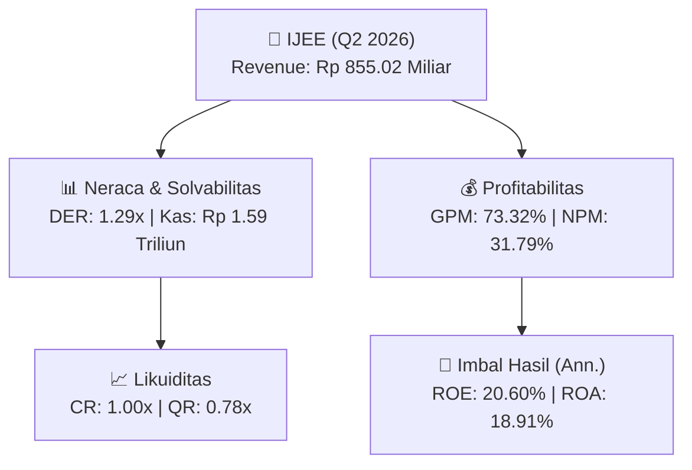
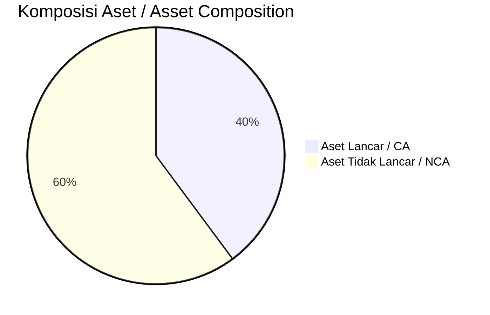
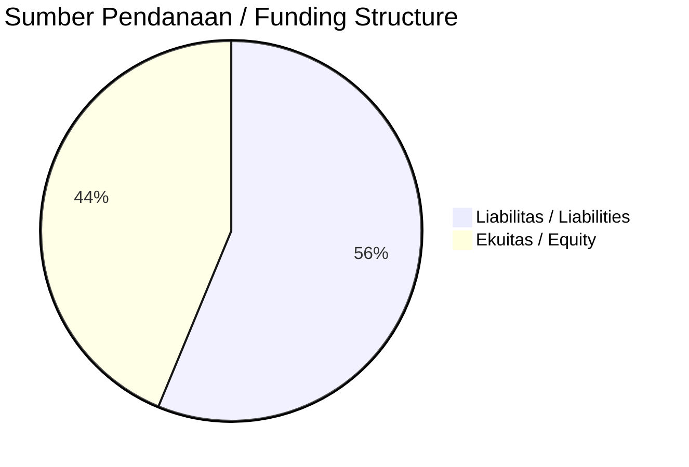

# 📈 Laporan Analisis Keuangan Mendalam: [[IJEE]] — Q2 2026

⬅️ [[knowledge-base/daily-digests/Daily_Digest_20261001|Kembali ke Daily Digest]] | 📅 **2026-10-01** | 🎛️ [[Dashboard|Ke Dashboard Utama]]

> [!IMPORTANT]
> Dokumen ini disusun oleh **Financial Summarizer Agent** untuk menganalisis kinerja keuangan, kesehatan neraca, profitabilitas, dan katalis sektor (Infrastruktur & Transportasi) **PT Integrasi Jaringan Ekosistem ([[IJEE]])** berdasarkan LK Q2 2026.

---

## 📌 1. Ikhtisar Kinerja Utama / Executive Performance Highlight
- **Emiten**: `[[IJEE]]` (PT Integrasi Jaringan Ekosistem)
- **Sektor Usaha / Industry Sector**: `Infrastruktur & Transportasi`
- **Periode Laporan / Reporting Period**: `Q2 2026`
- **Pendapatan Neto / Net Revenue**: `Rp 855.02 Miliar` (**+165.80% 🟢 YoY** dari Rp 321.67 Miliar)
- **Laba Bruto / Gross Profit**: `Rp 626.90 Miliar` (**+153.26% 🟢 YoY**)
- **Laba (Rugi) Bersih / Net Income**: `Rp 271.79 Miliar` (**+128.66% 🟢 YoY**)
- **Total Aset / Total Assets**: `Rp 3.56 Triliun` | **Total Ekuitas / Total Equity**: `Rp 2.78 Triliun`
- **EPS (Annualized)**: `0.39` | **BVPS**: `1.98`

---

## 📊 2. Laba Rugi Komparatif / Comparative Income Statement

| Pos Laba Rugi / Income Statement Item | Q2 2026 | Prior Period | YoY (%) |
| :--- | ---: | ---: | :---: |
| **Pendapatan Neto / Net Revenue** | `855.02B` | `321.67B` | **+165.80% 🟢** |
| **Beban Pokok / COGS** | `(228.12B)` | `(74.14B)` | +207.68% 🟢 |
| **Laba Bruto / Gross Profit** | `626.90B` | `247.53B` | **+153.26% 🟢** |
| **Beban Usaha / Operating Expenses** | `(79.87B)` | `(50.14B)` | +59.31% 🟢 |
| **Laba Operasional / EBIT** | `330.99B` | `134.44B` | +146.19% 🟢 |
| **Laba (Rugi) Bersih / Net Income** | **271.79B** | **118.86B** | **+128.66% 🟢** |

---

## 🏦 3. Neraca & Struktur Permodalan / Balance Sheet & Capital Structure

| Pos Neraca / Balance Sheet Item | Q2 2026 | Prior Year End | Δ YoY/YtD (%) | Catatan / Notes |
| :--- | ---: | ---: | :---: | :--- |
| **Aset Lancar / Current Assets** | `3.56T` | `2.19T` | +62.34% 🟢 | Kas: Rp 1.59 Triliun |
| **Aset Tidak Lancar / Non-Current Assets** | `5.37T` | `4.46T` | +20.34% 🟢 | Aset Tetap & Operasional |
| **TOTAL ASET / TOTAL ASSETS** | **3.56T** | **2.19T** | **+62.34% 🟢** | |
| **Liabilitas Jk. Pendek / Current Liabilities** | `3.57T` | `1.97T` | +81.23% 🟢 | |
| **Liabilitas Jk. Panjang / Non-Current Liabilities** | `2.58T` | `2.18T` | +18.39% 🟢 | |
| **TOTAL LIABILITAS / TOTAL LIABILITIES** | **3.57T** | **1.97T** | **+81.23% 🟢** | |
| **TOTAL EKUITAS / TOTAL EQUITY** | **2.78T** | **2.50T** | **+10.91% 🟢** | |

---

## 💸 4. Laporan Arus Kas / Cash Flow Statement

| Komponen Arus Kas / Cash Flow Component | Q2 2026 | Prior Period | Δ YoY (%) |
| :--- | ---: | ---: | :---: |
| **Arus Kas Operasi / CFO** | `685.77B` | `76.10B` | +801.14% 🟢 |
| **Arus Kas Investasi / CFI** | `-1.98T` | `-1.26T` | -57.82% 🔴 |
| **Arus Kas Pendanaan / CFF** | `1.56T` | `1.83T` | -14.85% 🔴 |
| **Kenaikan (Penurunan) Kas Bersih** | `266.28B` | `654.79B` | -59.33% 🔴 |
| Belanja Modal / Capex | `(1.04T)` | `(1.16T)` | -9.62% 🔴 |
| Pembayaran Dividen / Dividends Paid | `(-)` | `(-)` | - |
| **Free Cash Flow (CFO - Capex)** | **-358.79B** | **-1.08T** | **+66.77% 🟢** |

---

## 📈 Analisis Rasio Keuangan / Financial Ratio Analysis

| Kategori / Category | Metrik / Metric | Nilai / Value | Benchmark | Interpretasi / Interpretation |
| :--- | :--- | :---: | :---: | :--- |
| **🛡️ Likuiditas** | **Current Ratio** | `1.00x` | `> 1.0x` | Kemampuan bayar kewajiban jk. pendek |
| | **Quick Ratio** | `0.78x` | `> 0.8x` | Likuiditas tanpa persediaan |
| **📊 Profitabilitas** | **Gross Profit Margin (GPM)** | `73.32%` | - | Margin kotor operasional inti |
| | **Operating Profit Margin (OPM)** | `38.71%` | - | Efisiensi operasional |
| | **Net Profit Margin (NPM)** | `31.79%` | - | Konversi revenue ke laba bersih |
| **🎯 Imbal Hasil (Ann.)** | **Return on Equity (ROE)** | `20.60%` | - | Imbal hasil terhadap ekuitas |
| | **Return on Assets (ROA)** | `18.91%` | - | Produktivitas aset |
| **⚖️ Solvabilitas** | **Debt to Equity (DER)** | `1.29x` | `< 2.0x` | Leverage utang vs modal |
| | **Debt to Asset (DAR)** | `1.00x` | `< 0.7x` | Porsi aset didanai utang |

---

## 📐 Per Share Metrics

| Metrik / Metric | Nilai / Value | Keterangan / Notes |
| :--- | ---: | :--- |
| **EPS (Annualized)** | `Rp 0.39` | Laba per saham (dianualisasi) |
| **BVPS** | `Rp 1.98` | Nilai buku per saham |

---

## 🚀 Analisis Strategis & Karakteristik Sektor / Strategic Analysis: Infrastruktur & Transportasi

Pada periode Q2 2026, **PT Integrasi Jaringan Ekosistem ([[IJEE]])** membukukan total pendapatan sebesar **Rp 855.02 Miliar** (+165.80% 🟢 YoY). Laba kotor tercatat **Rp 626.90 Miliar** dengan GPM **73.32%**. Laba bersih sebesar **Rp 271.79 Miliar** (+128.66% 🟢 YoY). Total aset **Rp 3.56 Triliun**, ekuitas **Rp 2.78 Triliun**, DER **1.29x**.

### 🔍 Indikator Kunci Sektor / Sector Key Indicators (Infrastruktur & Transportasi)
- **Karakteristik Infrastruktur & Transportasi**: Kinerja didorong oleh pertumbuhan volume Lalu Lintas Harian Rata-rata (LHR) dan penyesuaian tarif berkala.
- **Struktur Leverage / Leverage Structure**: Pengelolaan liabilitas jangka panjang yang terukur seiring masa konsesi.
- **Recurring Revenue**: Pendapatan tol/sewa/transport bersifat recurring dan predictable.

> [!NOTE]
> _Data Public Expose / Investor Presentation belum tersedia untuk emiten ini._

---

## 📋 Catatan Kunci Laporan Keuangan / Key Notes to Financial Statements

### 🔍 Opini Auditor / Auditor Opinion
- **Jenis Opini / Opinion Type**: `Wajar Tanpa Modifikasian / Unqualified`
- **KAP / Audit Firm**: `KAP Kanaka Puradiredja, Suhartono`
- **Partner Audit**: `Christiadi Tjahnadi`
- **Tanggal Laporan / Report Date**: `2026-09-30`

### 📝 Perjanjian & Kontrak Signifikan / Key Contracts & Agreements
- Catatan 37 mengungkapkan Ikatan dan Perjanjian Penting Lainnya (Lanjutan), namun rincian tidak tersedia dalam teks yang diberikan.

### 🤝 Transaksi Pihak Berelasi / Related Party Transactions
- Uang muka kepada PT Solusi Sinergi Digital Tbk sebesar Rp600.127.675.892 pada 30 Juni 2026 dan nihil pada 31 Desember 2025.
- Uang muka kepada PT Jaringan Infra Andalan sebesar Rp304.230.500.000 pada 30 Juni 2026 dan nihil pada 31 Desember 2025.
- Total uang muka pihak berelasi sebesar Rp904.358.175.892 atau 10,13% dari total aset.
- Utang kepada PT Solusi Sinergi Digital Tbk sebesar Rp410.911.015.950 pada 30 Juni 2026 dan Rp644.394.917.819 pada 31 Desember 2025.

### ⚠️ Komitmen & Kontinjensi / Commitments & Contingencies
- Perusahaan memiliki kontrak dan komitmen jaminan keuangan yang diterbitkan, diukur sesuai kebijakan akuntansi spesifik (Catatan 3e).

---

## 💡 Catatan Strategis & Panduan Investor / Strategic Notes & Investor Guide

1. **Kesehatan Permodalan / Capital Health**: DER **1.29x**, CR **1.00x** — _perlu dipantau secara disiplin_.
2. **Katalis Pertumbuhan / Growth Catalysts**: Pantau realisasi pendapatan dan efisiensi operasional periode berikutnya.

---

## 🔗 Hubungan Note Terkait / Knowledge Graph Links
- [[knowledge-base/daily-digests/Daily_Digest_20261001|📄 Daily Digest 2026-10-01]]
- [[knowledge-base/trading-signals/Trading_Signals_20261001|🎯 Trading Signals]]
- [[Dashboard|🎛️ Kembali ke Dashboard Utama]]