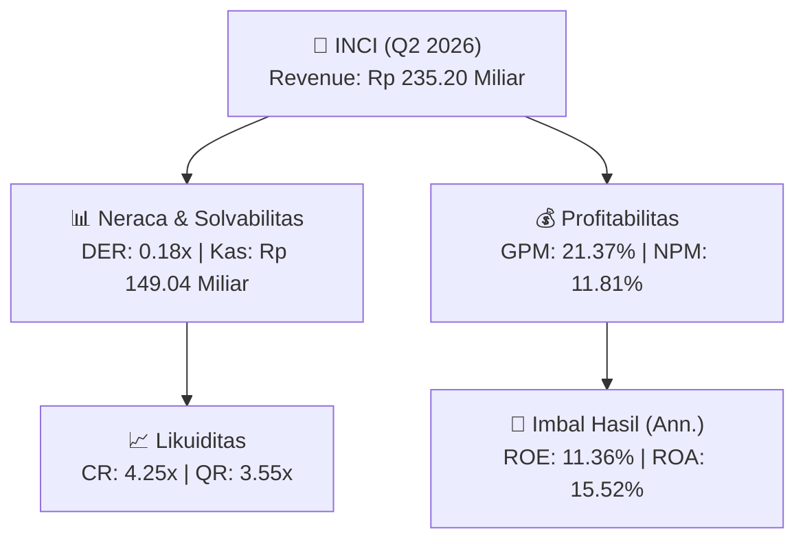
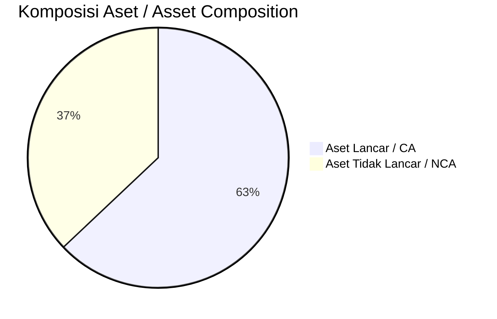
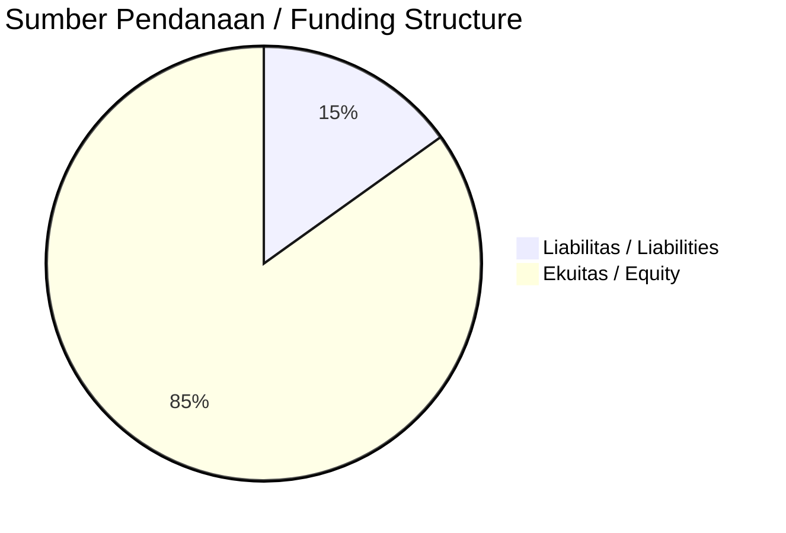

# 📈 Laporan Analisis Keuangan Mendalam: [[INCI]] — Q2 2026

⬅️ [[knowledge-base/daily-digests/Daily_Digest_20260901|Kembali ke Daily Digest]] | 📅 **2026-09-01** | 🎛️ [[Dashboard|Ke Dashboard Utama]]

> [!IMPORTANT]
> Dokumen ini disusun oleh **Financial Summarizer Agent** untuk menganalisis kinerja keuangan, kesehatan neraca, profitabilitas, dan katalis sektor (General) **Intanwijaya Internasional Tbk ([[INCI]])** berdasarkan LK Q2 2026.

---

## 📌 1. Ikhtisar Kinerja Utama / Executive Performance Highlight
- **Emiten**: `[[INCI]]` (Intanwijaya Internasional Tbk)
- **Sektor Usaha / Industry Sector**: `General`
- **Periode Laporan / Reporting Period**: `Q2 2026`
- **Pendapatan Neto / Net Revenue**: `Rp 235.20 Miliar` (**+39.07% 🟢 YoY** dari Rp 169.12 Miliar)
- **Laba Bruto / Gross Profit**: `Rp 50.27 Miliar` (**+50.32% 🟢 YoY**)
- **Laba (Rugi) Bersih / Net Income**: `Rp 27.78 Miliar` (**+225.22% 🟢 YoY**)
- **Total Aset / Total Assets**: `Rp 379.90 Miliar` | **Total Ekuitas / Total Equity**: `Rp 501.54 Miliar`
- **EPS (Annualized)**: `0.54` | **BVPS**: `4.83`

---

## 📊 2. Laba Rugi Komparatif / Comparative Income Statement

| Pos Laba Rugi / Income Statement Item | Q2 2026 | Prior Period | YoY (%) |
| :--- | ---: | ---: | :---: |
| **Pendapatan Neto / Net Revenue** | `235.20B` | `169.12B` | **+39.07% 🟢** |
| **Beban Pokok / COGS** | `(184.93B)` | `(135.68B)` | +36.30% 🟢 |
| **Laba Bruto / Gross Profit** | `50.27B` | `33.44B` | **+50.32% 🟢** |
| **Beban Usaha / Operating Expenses** | `(18.95B)` | `(15.42B)` | +22.88% 🟢 |
| **Laba Operasional / EBIT** | `32.56B` | `10.27B` | +216.94% 🟢 |
| **Laba (Rugi) Bersih / Net Income** | **27.78B** | **8.54B** | **+225.22% 🟢** |

---

## 🏦 3. Neraca & Struktur Permodalan / Balance Sheet & Capital Structure

| Pos Neraca / Balance Sheet Item | Q2 2026 | Prior Year End | Δ YoY/YtD (%) | Catatan / Notes |
| :--- | ---: | ---: | :---: | :--- |
| **Aset Lancar / Current Assets** | `379.90B` | `336.09B` | +13.03% 🟢 | Kas: Rp 149.04 Miliar |
| **Aset Tidak Lancar / Non-Current Assets** | `223.66B` | `223.03B` | +0.28% 🟢 | Aset Tetap & Operasional |
| **TOTAL ASET / TOTAL ASSETS** | **379.90B** | **336.09B** | **+13.03% 🟢** | |
| **Liabilitas Jk. Pendek / Current Liabilities** | `89.40B` | `71.48B` | +25.08% 🟢 | |
| **Liabilitas Jk. Panjang / Non-Current Liabilities** | `10.58B` | `9.19B` | +15.14% 🟢 | |
| **TOTAL LIABILITAS / TOTAL LIABILITIES** | **89.40B** | **71.48B** | **+25.08% 🟢** | |
| **TOTAL EKUITAS / TOTAL EQUITY** | **501.54B** | **476.43B** | **+5.27% 🟢** | |

---

## 💸 4. Laporan Arus Kas / Cash Flow Statement

| Komponen Arus Kas / Cash Flow Component | Q2 2026 | Prior Period | Δ YoY (%) |
| :--- | ---: | ---: | :---: |
| **Arus Kas Operasi / CFO** | `1.45B` | `-5.69B` | +125.53% 🟢 |
| **Arus Kas Investasi / CFI** | `-21.49B` | `12.85B` | -267.27% 🔴 |
| **Arus Kas Pendanaan / CFF** | `-4.33B` | `-1.34B` | -223.80% 🔴 |
| **Kenaikan (Penurunan) Kas Bersih** | `-24.37B` | `5.82B` | -518.54% 🔴 |
| Belanja Modal / Capex | `(1.62B)` | `(1.40B)` | +15.86% 🟢 |
| Pembayaran Dividen / Dividends Paid | `(4.12B)` | `(-)` | - |
| **Free Cash Flow (CFO - Capex)** | **-168.19M** | **-7.09B** | **+97.63% 🟢** |

---

## 📈 Analisis Rasio Keuangan / Financial Ratio Analysis

| Kategori / Category | Metrik / Metric | Nilai / Value | Benchmark | Interpretasi / Interpretation |
| :--- | :--- | :---: | :---: | :--- |
| **🛡️ Likuiditas** | **Current Ratio** | `4.25x` | `> 1.0x` | Kemampuan bayar kewajiban jk. pendek |
| | **Quick Ratio** | `3.55x` | `> 0.8x` | Likuiditas tanpa persediaan |
| **📊 Profitabilitas** | **Gross Profit Margin (GPM)** | `21.37%` | - | Margin kotor operasional inti |
| | **Operating Profit Margin (OPM)** | `13.84%` | - | Efisiensi operasional |
| | **Net Profit Margin (NPM)** | `11.81%` | - | Konversi revenue ke laba bersih |
| **🎯 Imbal Hasil (Ann.)** | **Return on Equity (ROE)** | `11.36%` | - | Imbal hasil terhadap ekuitas |
| | **Return on Assets (ROA)** | `15.52%` | - | Produktivitas aset |
| **⚖️ Solvabilitas** | **Debt to Equity (DER)** | `0.18x` | `< 2.0x` | Leverage utang vs modal |
| | **Debt to Asset (DAR)** | `0.24x` | `< 0.7x` | Porsi aset didanai utang |

---

## 📐 Per Share Metrics

| Metrik / Metric | Nilai / Value | Keterangan / Notes |
| :--- | ---: | :--- |
| **EPS (Annualized)** | `Rp 0.54` | Laba per saham (dianualisasi) |
| **BVPS** | `Rp 4.83` | Nilai buku per saham |

---

## 🚀 Analisis Strategis & Karakteristik Sektor / Strategic Analysis: General

Pada periode Q2 2026, **Intanwijaya Internasional Tbk ([[INCI]])** membukukan total pendapatan sebesar **Rp 235.20 Miliar** (+39.07% 🟢 YoY). Laba kotor tercatat **Rp 50.27 Miliar** dengan GPM **21.37%**. Laba bersih sebesar **Rp 27.78 Miliar** (+225.22% 🟢 YoY). Total aset **Rp 379.90 Miliar**, ekuitas **Rp 501.54 Miliar**, DER **0.18x**.

### 🔍 Indikator Kunci Sektor / Sector Key Indicators (General)
- **Karakteristik Industri (General)**: Kinerja mencerminkan dinamika penyerapan pasar, utilisasi kapasitas produksi, dan efisiensi biaya pokok.
- **Faktor Penggerak**: Pertumbuhan organik, efisiensi operasional, dan ekspansi pasar.

> [!NOTE]
> _Data Public Expose / Investor Presentation belum tersedia untuk emiten ini._

---

## 📋 Catatan Kunci Laporan Keuangan / Key Notes to Financial Statements

### 🔍 Opini Auditor / Auditor Opinion
- **Jenis Opini / Opinion Type**: `Reviu Terbatas / Limited Review`
- **KAP / Audit Firm**: `KAP Arman Eddy Ferdinand Dan Rekan`
- **Partner Audit**: `Eddy Pianto Simon`
- **Tanggal Laporan / Report Date**: `2026-08-27`
- **Kesimpulan**: _Kesimpulan Reviu Tanpa Modifikasian_

---

## 💡 Catatan Strategis & Panduan Investor / Strategic Notes & Investor Guide

1. **Kesehatan Permodalan / Capital Health**: DER **0.18x**, CR **4.25x** — _sehat dan aman_.
2. **Katalis Pertumbuhan / Growth Catalysts**: Pantau realisasi pendapatan dan efisiensi operasional periode berikutnya.

---

## 🔗 Hubungan Note Terkait / Knowledge Graph Links
- [[knowledge-base/daily-digests/Daily_Digest_20260901|📄 Daily Digest 2026-09-01]]
- [[knowledge-base/trading-signals/Trading_Signals_20260901|🎯 Trading Signals]]
- [[Dashboard|🎛️ Kembali ke Dashboard Utama]]