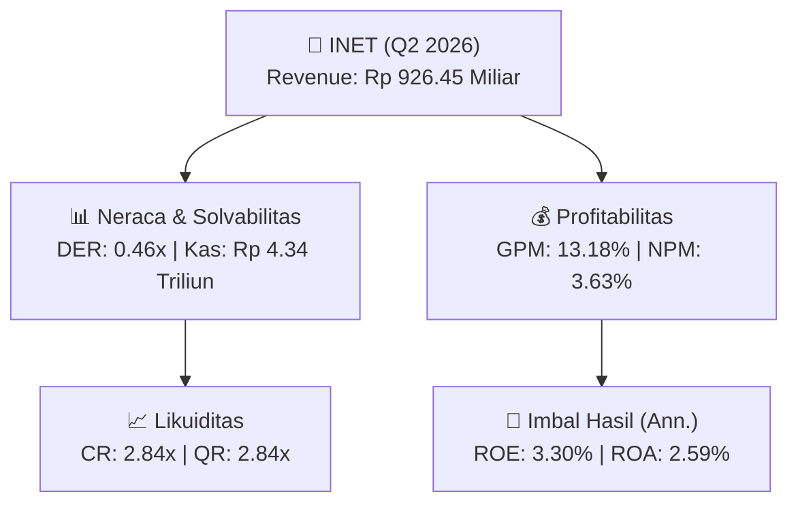
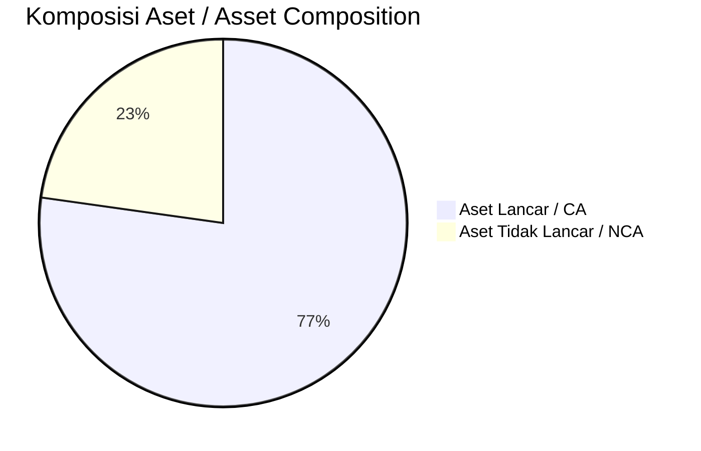
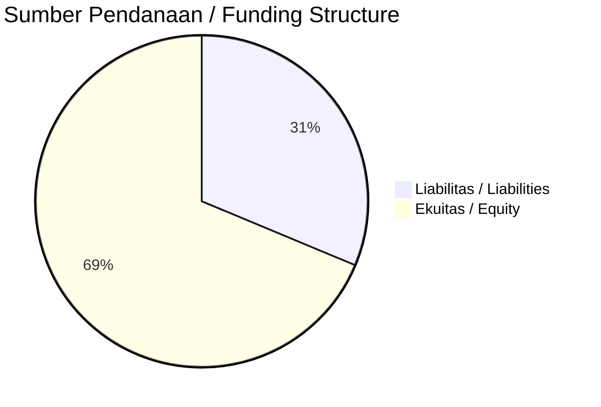

# 📈 Laporan Analisis Keuangan Mendalam: [[INET]] — Q2 2026

⬅️ [[knowledge-base/daily-digests/Daily_Digest_20260914|Kembali ke Daily Digest]] | 📅 **2026-09-14** | 🎛️ [[Dashboard|Ke Dashboard Utama]]

> [!IMPORTANT]
> Dokumen ini disusun oleh **Financial Summarizer Agent** untuk menganalisis kinerja keuangan, kesehatan neraca, profitabilitas, dan katalis sektor (Infrastruktur & Transportasi) **PT Sinergi Inti Andalan Prima Tbk. ([[INET]])** berdasarkan LK Q2 2026.

---

## 📌 1. Ikhtisar Kinerja Utama / Executive Performance Highlight
- **Emiten**: `[[INET]]` (PT Sinergi Inti Andalan Prima Tbk.)
- **Sektor Usaha / Industry Sector**: `Infrastruktur & Transportasi`
- **Periode Laporan / Reporting Period**: `Q2 2026`
- **Pendapatan Neto / Net Revenue**: `Rp 926.45 Miliar` (**+1958.68% 🟢 YoY** dari Rp 45.00 Miliar)
- **Laba Bruto / Gross Profit**: `Rp 122.11 Miliar` (**+627.53% 🟢 YoY**)
- **Laba (Rugi) Bersih / Net Income**: `Rp 33.67 Miliar` (**+340.02% 🟢 YoY**)
- **Total Aset / Total Assets**: `Rp 4.72 Triliun` | **Total Ekuitas / Total Equity**: `Rp 3.66 Triliun`
- **EPS (Annualized)**: `0.30` | **BVPS**: `16.34`

---

## 📊 2. Laba Rugi Komparatif / Comparative Income Statement

| Pos Laba Rugi / Income Statement Item | Q2 2026 | Prior Period | YoY (%) |
| :--- | ---: | ---: | :---: |
| **Pendapatan Neto / Net Revenue** | `926.45B` | `45.00B` | **+1958.68% 🟢** |
| **Beban Pokok / COGS** | `(804.35B)` | `(28.22B)` | +2750.41% 🟢 |
| **Laba Bruto / Gross Profit** | `122.11B` | `16.78B` | **+627.53% 🟢** |
| **Beban Usaha / Operating Expenses** | `(46.97B)` | `(6.42B)` | +631.69% 🟢 |
| **Laba Operasional / EBIT** | `40.14B` | `10.08B` | +298.14% 🟢 |
| **Laba (Rugi) Bersih / Net Income** | **33.67B** | **7.65B** | **+340.02% 🟢** |

---

## 🏦 3. Neraca & Struktur Permodalan / Balance Sheet & Capital Structure

| Pos Neraca / Balance Sheet Item | Q2 2026 | Prior Year End | Δ YoY/YtD (%) | Catatan / Notes |
| :--- | ---: | ---: | :---: | :--- |
| **Aset Lancar / Current Assets** | `4.72T` | `478.22B` | +887.03% 🟢 | Kas: Rp 4.34 Triliun |
| **Aset Tidak Lancar / Non-Current Assets** | `1.39T` | `282.15B` | +392.93% 🟢 | Aset Tetap & Operasional |
| **TOTAL ASET / TOTAL ASSETS** | **4.72T** | **478.22B** | **+887.03% 🟢** | |
| **Liabilitas Jk. Pendek / Current Liabilities** | `1.66T` | `322.53B` | +416.17% 🟢 | |
| **Liabilitas Jk. Panjang / Non-Current Liabilities** | `637.31B` | `8.63B` | +7282.73% 🟢 | |
| **TOTAL LIABILITAS / TOTAL LIABILITIES** | **1.66T** | **322.53B** | **+416.17% 🟢** | |
| **TOTAL EKUITAS / TOTAL EQUITY** | **3.66T** | **429.19B** | **+752.00% 🟢** | |

---

## 💸 4. Laporan Arus Kas / Cash Flow Statement

| Komponen Arus Kas / Cash Flow Component | Q2 2026 | Prior Period | Δ YoY (%) |
| :--- | ---: | ---: | :---: |
| **Arus Kas Operasi / CFO** | `20.45B` | `425.19M` | +4708.48% 🟢 |
| **Arus Kas Investasi / CFI** | `-848.97B` | `-34.66B` | -2349.68% 🔴 |
| **Arus Kas Pendanaan / CFF** | `4.76T` | `68.27B` | +6873.91% 🟢 |
| **Kenaikan (Penurunan) Kas Bersih** | `3.93T` | `34.04B` | +11453.33% 🟢 |
| Belanja Modal / Capex | `(240.95B)` | `(8.17B)` | +2849.14% 🟢 |
| Pembayaran Dividen / Dividends Paid | `(894.47M)` | `(-)` | - |
| **Free Cash Flow (CFO - Capex)** | **-220.50B** | **-7.74B** | **-2747.06% 🔴** |

---

## 📈 Analisis Rasio Keuangan / Financial Ratio Analysis

| Kategori / Category | Metrik / Metric | Nilai / Value | Benchmark | Interpretasi / Interpretation |
| :--- | :--- | :---: | :---: | :--- |
| **🛡️ Likuiditas** | **Current Ratio** | `2.84x` | `> 1.0x` | Kemampuan bayar kewajiban jk. pendek |
| | **Quick Ratio** | `2.84x` | `> 0.8x` | Likuiditas tanpa persediaan |
| **📊 Profitabilitas** | **Gross Profit Margin (GPM)** | `13.18%` | - | Margin kotor operasional inti |
| | **Operating Profit Margin (OPM)** | `4.33%` | - | Efisiensi operasional |
| | **Net Profit Margin (NPM)** | `3.63%` | - | Konversi revenue ke laba bersih |
| **🎯 Imbal Hasil (Ann.)** | **Return on Equity (ROE)** | `3.30%` | - | Imbal hasil terhadap ekuitas |
| | **Return on Assets (ROA)** | `2.59%` | - | Produktivitas aset |
| **⚖️ Solvabilitas** | **Debt to Equity (DER)** | `0.46x` | `< 2.0x` | Leverage utang vs modal |
| | **Debt to Asset (DAR)** | `0.35x` | `< 0.7x` | Porsi aset didanai utang |

---

## 📐 Per Share Metrics

| Metrik / Metric | Nilai / Value | Keterangan / Notes |
| :--- | ---: | :--- |
| **EPS (Annualized)** | `Rp 0.30` | Laba per saham (dianualisasi) |
| **BVPS** | `Rp 16.34` | Nilai buku per saham |

---

## 🚀 Analisis Strategis & Karakteristik Sektor / Strategic Analysis: Infrastruktur & Transportasi

Pada periode Q2 2026, **PT Sinergi Inti Andalan Prima Tbk. ([[INET]])** membukukan total pendapatan sebesar **Rp 926.45 Miliar** (+1958.68% 🟢 YoY). Laba kotor tercatat **Rp 122.11 Miliar** dengan GPM **13.18%**. Laba bersih sebesar **Rp 33.67 Miliar** (+340.02% 🟢 YoY). Total aset **Rp 4.72 Triliun**, ekuitas **Rp 3.66 Triliun**, DER **0.46x**.

### 🔍 Indikator Kunci Sektor / Sector Key Indicators (Infrastruktur & Transportasi)
- **Karakteristik Infrastruktur & Transportasi**: Kinerja didorong oleh pertumbuhan volume Lalu Lintas Harian Rata-rata (LHR) dan penyesuaian tarif berkala.
- **Struktur Leverage / Leverage Structure**: Pengelolaan liabilitas jangka panjang yang terukur seiring masa konsesi.
- **Recurring Revenue**: Pendapatan tol/sewa/transport bersifat recurring dan predictable.

> [!NOTE]
> _Data Public Expose / Investor Presentation belum tersedia untuk emiten ini._

---

## 📋 Catatan Kunci Laporan Keuangan / Key Notes to Financial Statements

### 🔍 Opini Auditor / Auditor Opinion
- **Jenis Opini / Opinion Type**: `Wajar Tanpa Modifikasian / Unqualified`
- **KAP / Audit Firm**: `KAP Suharli, Sugiharto  Rekan`
- **Partner Audit**: `Ridho Fathoni`
- **Tanggal Laporan / Report Date**: `2026-09-09`

### 📝 Perjanjian & Kontrak Signifikan / Key Contracts & Agreements
- Perjanjian Kredit No. 131/KK/BS0/06/2026 tanggal 19 Juni 2026 dengan PT Bank Saqu Indonesia, fasilitas Kredit Aksep Back-to-Back (BTB) maksimum Rp 250.000.000.000, jangka waktu 12 bulan, bunga 0,5% per tahun.
- Perpanjangan fasilitas kredit Pinjaman Rekening Koran (PRK) dan bank garansi dari PT Bank CIMB Niaga Tbk, berdasarkan Surat Pemberitahuan Kredit No. 01117/1/GEL/SPPK/2022 tanggal 25 Juni 2024.

### 🤝 Transaksi Pihak Berelasi / Related Party Transactions
- Fasilitas pinjaman dari PT Bank IBK Indonesia Tbk dijaminkan dengan deposito atas nama PT Abadi Kreasi Unggul Nusantara (pihak berelasi) senilai Rp 7.000.000.000.

---

## 💡 Catatan Strategis & Panduan Investor / Strategic Notes & Investor Guide

1. **Kesehatan Permodalan / Capital Health**: DER **0.46x**, CR **2.84x** — _sehat dan aman_.
2. **Katalis Pertumbuhan / Growth Catalysts**: Pantau realisasi pendapatan dan efisiensi operasional periode berikutnya.

---

## 🔗 Hubungan Note Terkait / Knowledge Graph Links
- [[knowledge-base/daily-digests/Daily_Digest_20260914|📄 Daily Digest 2026-09-14]]
- [[knowledge-base/trading-signals/Trading_Signals_20260914|🎯 Trading Signals]]
- [[Dashboard|🎛️ Kembali ke Dashboard Utama]]