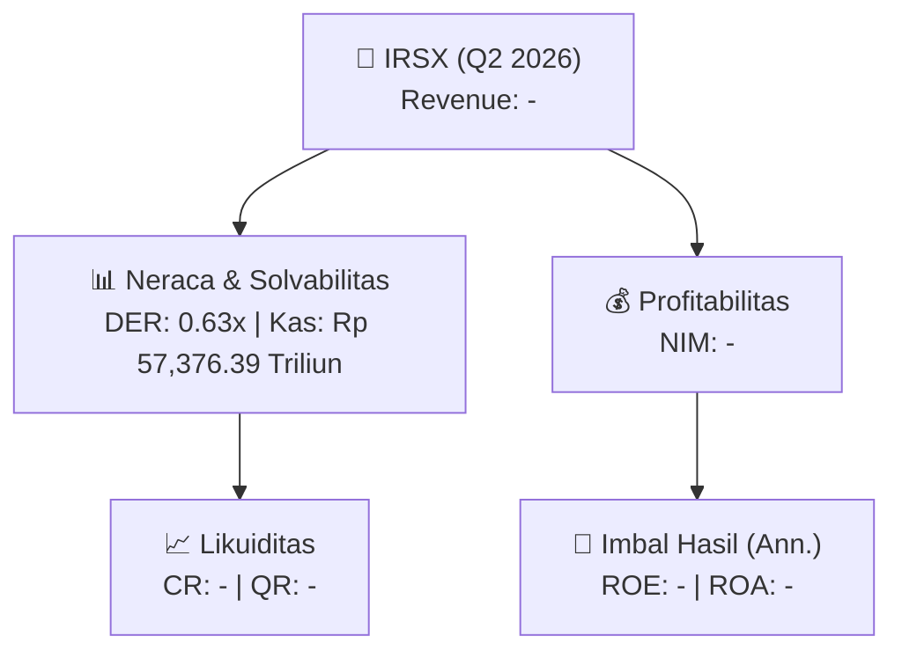
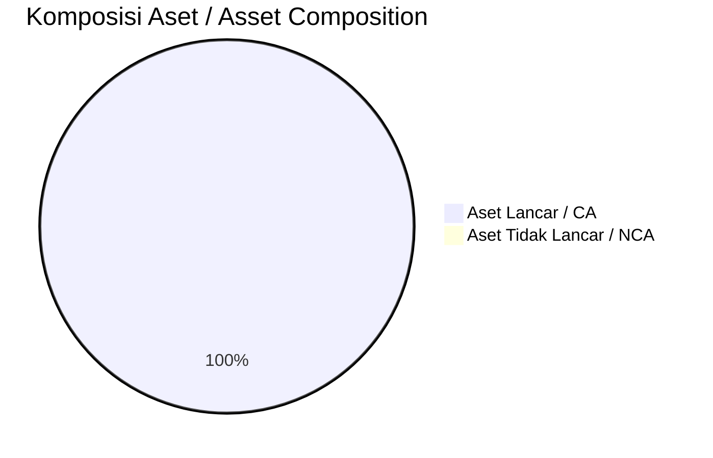
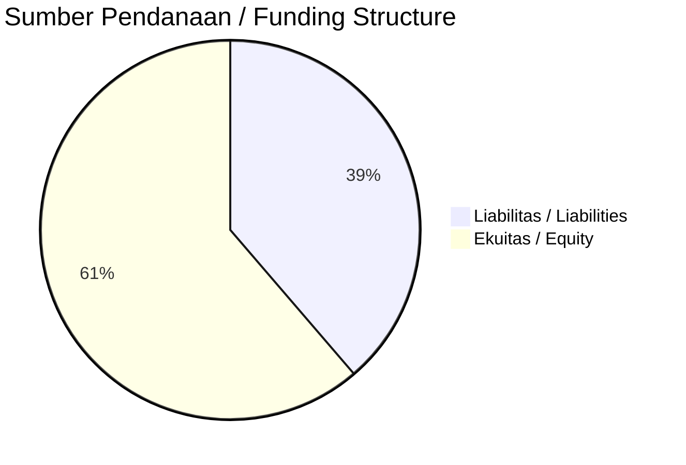

# 📈 Laporan Analisis Keuangan Mendalam: [[IRSX]] — Q2 2026

⬅️ [[knowledge-base/daily-digests/Daily_Digest_20260925|Kembali ke Daily Digest]] | 📅 **2026-09-25** | 🎛️ [[Dashboard|Ke Dashboard Utama]]

> [!IMPORTANT]
> Dokumen ini disusun oleh **Financial Summarizer Agent** untuk menganalisis kinerja keuangan, kesehatan neraca, profitabilitas, dan katalis sektor (Multifinance & Perbankan) **PT Folago Global Nusantara Tbk yang tidak memerlukan tanda tangan karena dihasilkan secara
elektronik. PT Folago Global Nusantara Tbk ([[IRSX]])** berdasarkan LK Q2 2026.

---

## 📌 1. Ikhtisar Kinerja Utama / Executive Performance Highlight
- **Emiten**: `[[IRSX]]` (PT Folago Global Nusantara Tbk yang tidak memerlukan tanda tangan karena dihasilkan secara
elektronik. PT Folago Global Nusantara Tbk)
- **Sektor Usaha / Industry Sector**: `Multifinance & Perbankan`
- **Periode Laporan / Reporting Period**: `Q2 2026`
- **Pendapatan Usaha / Total Revenue**: `-` (**- YoY** dari -)

- **Laba (Rugi) Bersih / Net Income**: `-` (**- YoY**)
- **Total Aset / Total Assets**: `Rp 439,206.86 Triliun` | **Total Ekuitas / Total Equity**: `Rp 317,279.14 Triliun`
- **EPS (Annualized)**: `-` | **BVPS**: `-`

---

## 📊 2. Laba Rugi Komparatif / Comparative Income Statement (Financial Sector)

| Pos Laba Rugi / Income Statement Item | Q2 2026 | Prior Period | YoY (%) |
| :--- | ---: | ---: | :---: |
| **Laba (Rugi) Bersih / Net Income** | **-** | **-** | **-** |

---

## 🏦 3. Neraca & Struktur Permodalan / Balance Sheet & Capital Structure

| Pos Neraca / Balance Sheet Item | Q2 2026 | Prior Year End | Δ YoY/YtD (%) | Catatan / Notes |
| :--- | ---: | ---: | :---: | :--- |
| **Aset Lancar / Current Assets** | `439,206.86T` | `311,554.25T` | +40.97% 🟢 | Kas: Rp 57,376.39 Triliun |
| **Aset Tidak Lancar / Non-Current Assets** | `-` | `-` | - | Aset Tetap & Operasional |
| **TOTAL ASET / TOTAL ASSETS** | **439,206.86T** | **311,554.25T** | **+40.97% 🟢** | |
| **Liabilitas Jk. Pendek / Current Liabilities** | `-` | `-` | - | |
| **Liabilitas Jk. Panjang / Non-Current Liabilities** | `-` | `-` | - | |
| **TOTAL LIABILITAS / TOTAL LIABILITIES** | **200,493.02T** | **44,871.77T** | **+346.81% 🟢** | |
| **TOTAL EKUITAS / TOTAL EQUITY** | **317,279.14T** | **315,356.53T** | **+0.61% 🟢** | |

---

## 💸 4. Laporan Arus Kas / Cash Flow Statement

| Komponen Arus Kas / Cash Flow Component | Q2 2026 | Prior Period | Δ YoY (%) |
| :--- | ---: | ---: | :---: |
| **Arus Kas Operasi / CFO** | `-` | `-` | - |
| **Arus Kas Investasi / CFI** | `-` | `-` | - |
| **Arus Kas Pendanaan / CFF** | `-` | `-` | - |
| **Kenaikan (Penurunan) Kas Bersih** | `-` | `-` | - |
| Belanja Modal / Capex | `(-)` | `(-)` | - |
| Pembayaran Dividen / Dividends Paid | `(-)` | `(-)` | - |
| **Free Cash Flow (CFO - Capex)** | **-** | **-** | **-** |

---

## 📈 Analisis Rasio Keuangan / Financial Ratio Analysis

| Kategori / Category | Metrik / Metric | Nilai / Value | Benchmark | Interpretasi / Interpretation |
| :--- | :--- | :---: | :---: | :--- |
| **🛡️ Likuiditas** | **Current Ratio** | `-` | `> 1.0x` | Kemampuan bayar kewajiban jk. pendek |
| | **Quick Ratio** | `-` | `> 0.8x` | Likuiditas tanpa persediaan |
| **🎯 Imbal Hasil (Ann.)** | **Return on Equity (ROE)** | `-` | - | Imbal hasil terhadap ekuitas |
| | **Return on Assets (ROA)** | `-` | - | Produktivitas aset |
| **⚖️ Solvabilitas** | **Debt to Equity (DER)** | `0.63x` | `< 2.0x` | Leverage utang vs modal |
| | **Debt to Asset (DAR)** | `0.46x` | `< 0.7x` | Porsi aset didanai utang |

---

## 📐 Per Share Metrics

| Metrik / Metric | Nilai / Value | Keterangan / Notes |
| :--- | ---: | :--- |
| **EPS (Annualized)** | `-` | Laba per saham (dianualisasi) |
| **BVPS** | `-` | Nilai buku per saham |

---

## 🚀 Analisis Strategis & Karakteristik Sektor / Strategic Analysis: Multifinance & Perbankan

Pada periode Q2 2026, **PT Folago Global Nusantara Tbk yang tidak memerlukan tanda tangan karena dihasilkan secara
elektronik. PT Folago Global Nusantara Tbk ([[IRSX]])** membukukan total pendapatan sebesar **-** (- YoY). Laba bersih sebesar **-** (- YoY). Total aset **Rp 439,206.86 Triliun**, ekuitas **Rp 317,279.14 Triliun**, DER **0.63x**.

### 🔍 Indikator Kunci Sektor / Sector Key Indicators (Multifinance & Perbankan)
- **Karakteristik Industri Finansial / Financial Industry**: Kinerja ditopang oleh spread pendapatan bunga (NIM), hasil investasi, dan pengelolaan Cost of Funds.
- **Kualitas Aset / Asset Quality**: Pengawasan rasio NPL/NPF dan kecukupan pencadangan (PPAP) untuk menjaga stabilitas margin usaha.
- **Solvabilitas / Solvency**: Rasio kecukupan modal (CAR/RBC) ketat sesuai regulasi OJK.

> [!NOTE]
> _Data Public Expose / Investor Presentation belum tersedia untuk emiten ini._

---

## 📋 Catatan Kunci Laporan Keuangan / Key Notes to Financial Statements

### 🔍 Opini Auditor / Auditor Opinion
- _Informasi opini auditor tidak tersedia._

### 📝 Perjanjian & Kontrak Signifikan / Key Contracts & Agreements
- Pada tanggal 2 Januari 2026, PT Folago Picture Indonesia (FPI) mengadakan perjanjian kerja sama produksi film dengan PT Hidayah Insan Mulia (HIM), pihak berelasi, sehubungan dengan film "Hafiz & Hafizah"; FPI memperoleh hak atas kekayaan intelektual (teks terpotong).
- Grup mencatat transaksi yang berasal dari perjanjian sewa sebagai bagian dari akun "Aset Hak-guna dan Liabilitas Sewa" (Catatan 14 dan 22).

### 🤝 Transaksi Pihak Berelasi / Related Party Transactions
- Utang pemegang saham kepada MTA memperoleh pendapat kewajaran dari penilai independen KJPP Syarif, Endang dan Rekan (Endang Sunardi) dengan laporan No. 00033/2.0113-03/BS/05/0340/1/VI/2026 tanggal 12 Juni 2026; transaksi perolehan pinjaman dari MTA dinilai Wajar.
- Pada tanggal 2 Januari 2026, FPI mengadakan perjanjian kerja sama produksi film dengan HIM, pihak berelasi, untuk film "Hafiz & Hafizah".
- Grup mencatat transaksi dari perjanjian sewa dengan pihak berelasi (PT Folago Karya Indonesia (FKI)) sebagai Aset Hak-guna dan Liabilitas Sewa (Catatan 14 dan 22).

### ⚠️ Komitmen & Kontinjensi / Commitments & Contingencies
- Perjanjian dan ikatan penting: Pada tanggal 2 Januari 2026, FPI mengadakan perjanjian kerja sama produksi film dengan HIM, pihak berelasi, sehubungan dengan film "Hafiz & Hafizah"; FPI memperoleh hak atas kekayaan intelektual (teks terpotong).

---

## 💡 Catatan Strategis & Panduan Investor / Strategic Notes & Investor Guide

1. **Kesehatan Permodalan / Capital Health**: DER **0.63x**, CR **-** — _perlu dipantau secara disiplin_.
2. **Katalis Pertumbuhan / Growth Catalysts**: Pantau realisasi pendapatan dan efisiensi operasional periode berikutnya.
3. **Kualitas Aset Finansial**: Pantau tren NIM (**-**) dan kualitas portofolio kredit/pembiayaan.

---

## 🔗 Hubungan Note Terkait / Knowledge Graph Links
- [[knowledge-base/daily-digests/Daily_Digest_20260925|📄 Daily Digest 2026-09-25]]
- [[knowledge-base/trading-signals/Trading_Signals_20260925|🎯 Trading Signals]]
- [[Dashboard|🎛️ Kembali ke Dashboard Utama]]

---
> [!WARNING] **Data Sumber: PDF (LLM-Extracted)**
> Laporan ini dibuat dari ekstraksi PDF via LLM karena tidak tersedia XBRL workbook (.xlsx) dari IDX.
> Angka-angka yang ditampilkan mungkin kurang presisi dibanding laporan berbasis XBRL.
> Verifikasi manual disarankan sebelum digunakan sebagai dasar keputusan investasi.
