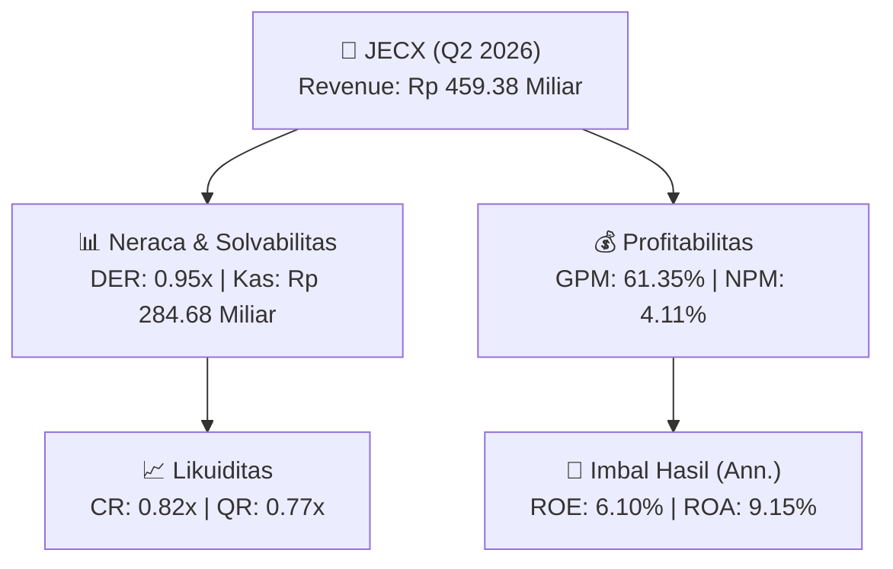
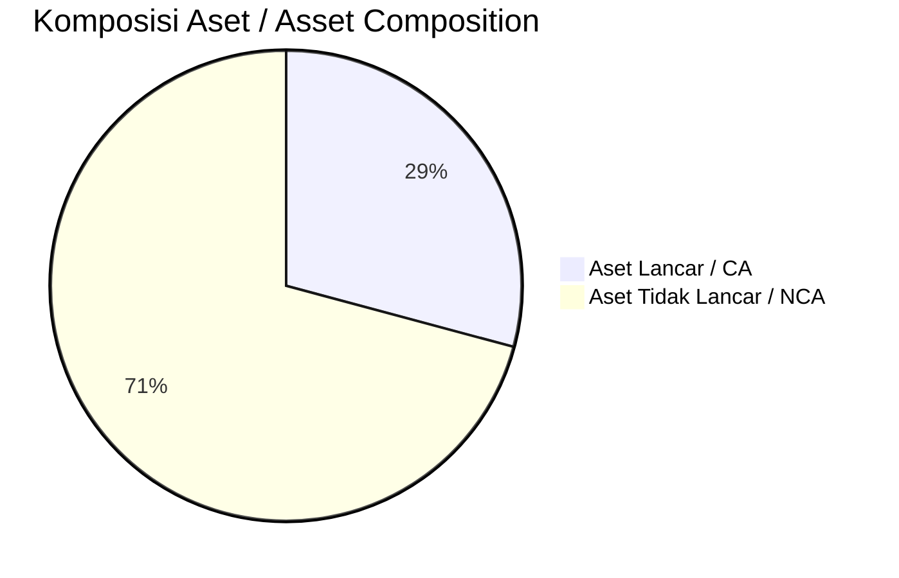
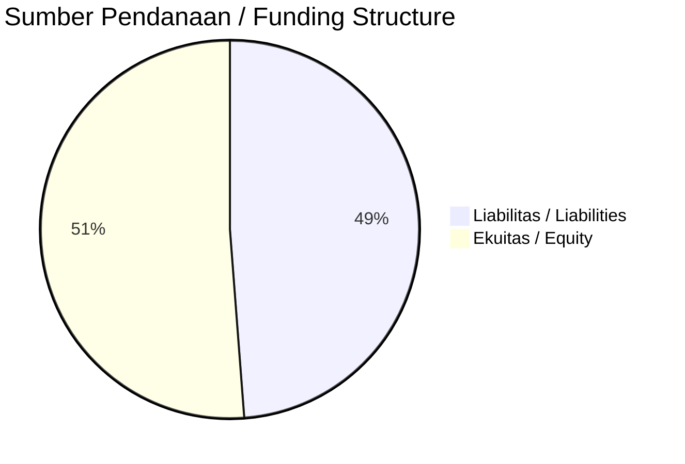

# 📈 Laporan Analisis Keuangan Mendalam: [[JECX]] — Q2 2026

⬅️ [[knowledge-base/daily-digests/Daily_Digest_20260901|Kembali ke Daily Digest]] | 📅 **2026-09-01** | 🎛️ [[Dashboard|Ke Dashboard Utama]]

> [!IMPORTANT]
> Dokumen ini disusun oleh **Financial Summarizer Agent** untuk menganalisis kinerja keuangan, kesehatan neraca, profitabilitas, dan katalis sektor (Kesehatan) **PT Nitrasanata Dharma Tbk ([[JECX]])** berdasarkan LK Q2 2026.

---

## 📌 1. Ikhtisar Kinerja Utama / Executive Performance Highlight
- **Emiten**: `[[JECX]]` (PT Nitrasanata Dharma Tbk)
- **Sektor Usaha / Industry Sector**: `Kesehatan`
- **Periode Laporan / Reporting Period**: `Q2 2026`
- **Pendapatan Neto / Net Revenue**: `Rp 459.38 Miliar` (**+3.41% 🟢 YoY** dari Rp 444.23 Miliar)
- **Laba Bruto / Gross Profit**: `Rp 281.84 Miliar` (**+1.74% 🟢 YoY**)
- **Laba (Rugi) Bersih / Net Income**: `Rp 18.87 Miliar` (**-37.77% 🔴 YoY**)
- **Total Aset / Total Assets**: `Rp 447.98 Miliar` | **Total Ekuitas / Total Equity**: `Rp 570.58 Miliar`
- **EPS (Annualized)**: `0.81` | **BVPS**: `12.18`

---

## 📊 2. Laba Rugi Komparatif / Comparative Income Statement

| Pos Laba Rugi / Income Statement Item | Q2 2026 | Prior Period | YoY (%) |
| :--- | ---: | ---: | :---: |
| **Pendapatan Neto / Net Revenue** | `459.38B` | `444.23B` | **+3.41% 🟢** |
| **Beban Pokok / COGS** | `(177.54B)` | `(167.22B)` | +6.18% 🟢 |
| **Laba Bruto / Gross Profit** | `281.84B` | `277.01B` | **+1.74% 🟢** |
| **Beban Usaha / Operating Expenses** | `(218.25B)` | `(205.93B)` | +5.99% 🟢 |
| **Laba Operasional / EBIT** | `34.56B` | `47.58B` | -27.36% 🔴 |
| **Laba (Rugi) Bersih / Net Income** | **18.87B** | **30.32B** | **-37.77% 🔴** |

---

## 🏦 3. Neraca & Struktur Permodalan / Balance Sheet & Capital Structure

| Pos Neraca / Balance Sheet Item | Q2 2026 | Prior Year End | Δ YoY/YtD (%) | Catatan / Notes |
| :--- | ---: | ---: | :---: | :--- |
| **Aset Lancar / Current Assets** | `447.98B` | `377.15B` | +18.78% 🟢 | Kas: Rp 284.68 Miliar |
| **Aset Tidak Lancar / Non-Current Assets** | `1.09T` | `1.07T` | +1.22% 🟢 | Aset Tetap & Operasional |
| **TOTAL ASET / TOTAL ASSETS** | **447.98B** | **377.15B** | **+18.78% 🟢** | |
| **Liabilitas Jk. Pendek / Current Liabilities** | `543.83B` | `547.40B` | -0.65% 🔴 | |
| **Liabilitas Jk. Panjang / Non-Current Liabilities** | `284.41B` | `92.93B` | +206.04% 🟢 | |
| **TOTAL LIABILITAS / TOTAL LIABILITIES** | **543.83B** | **547.40B** | **-0.65% 🔴** | |
| **TOTAL EKUITAS / TOTAL EQUITY** | **570.58B** | **666.64B** | **-14.41% 🔴** | |

---

## 💸 4. Laporan Arus Kas / Cash Flow Statement

| Komponen Arus Kas / Cash Flow Component | Q2 2026 | Prior Period | Δ YoY (%) |
| :--- | ---: | ---: | :---: |
| **Arus Kas Operasi / CFO** | `6.64B` | `89.70B` | -92.60% 🔴 |
| **Arus Kas Investasi / CFI** | `-54.51B` | `-69.62B` | +21.70% 🟢 |
| **Arus Kas Pendanaan / CFF** | `88.42B` | `-96.81B` | +191.33% 🟢 |
| **Kenaikan (Penurunan) Kas Bersih** | `40.55B` | `-76.73B` | +152.84% 🟢 |
| Belanja Modal / Capex | `(38.78B)` | `(62.81B)` | -38.26% 🔴 |
| Pembayaran Dividen / Dividends Paid | `(100.71B)` | `(58.21B)` | +73.02% 🟢 |
| **Free Cash Flow (CFO - Capex)** | **-32.14B** | **26.89B** | **-219.54% 🔴** |

---

## 📈 Analisis Rasio Keuangan / Financial Ratio Analysis

| Kategori / Category | Metrik / Metric | Nilai / Value | Benchmark | Interpretasi / Interpretation |
| :--- | :--- | :---: | :---: | :--- |
| **🛡️ Likuiditas** | **Current Ratio** | `0.82x` | `> 1.0x` | Kemampuan bayar kewajiban jk. pendek |
| | **Quick Ratio** | `0.77x` | `> 0.8x` | Likuiditas tanpa persediaan |
| **📊 Profitabilitas** | **Gross Profit Margin (GPM)** | `61.35%` | - | Margin kotor operasional inti |
| | **Operating Profit Margin (OPM)** | `7.52%` | - | Efisiensi operasional |
| | **Net Profit Margin (NPM)** | `4.11%` | - | Konversi revenue ke laba bersih |
| **🎯 Imbal Hasil (Ann.)** | **Return on Equity (ROE)** | `6.10%` | - | Imbal hasil terhadap ekuitas |
| | **Return on Assets (ROA)** | `9.15%` | - | Produktivitas aset |
| **⚖️ Solvabilitas** | **Debt to Equity (DER)** | `0.95x` | `< 2.0x` | Leverage utang vs modal |
| | **Debt to Asset (DAR)** | `1.21x` | `< 0.7x` | Porsi aset didanai utang |

---

## 📐 Per Share Metrics

| Metrik / Metric | Nilai / Value | Keterangan / Notes |
| :--- | ---: | :--- |
| **EPS (Annualized)** | `Rp 0.81` | Laba per saham (dianualisasi) |
| **BVPS** | `Rp 12.18` | Nilai buku per saham |

---

## 🚀 Analisis Strategis & Karakteristik Sektor / Strategic Analysis: Kesehatan

Pada periode Q2 2026, **PT Nitrasanata Dharma Tbk ([[JECX]])** membukukan total pendapatan sebesar **Rp 459.38 Miliar** (+3.41% 🟢 YoY). Laba kotor tercatat **Rp 281.84 Miliar** dengan GPM **61.35%**. Laba bersih sebesar **Rp 18.87 Miliar** (-37.77% 🔴 YoY). Total aset **Rp 447.98 Miliar**, ekuitas **Rp 570.58 Miliar**, DER **0.95x**.

### 🔍 Indikator Kunci Sektor / Sector Key Indicators (Kesehatan)
- **Karakteristik Layanan Kesehatan**: Margin kotor tebal dari layanan medis spesialis (GPM: **61.35%**).
- **Penggerak Pertumbuhan**: Volume kunjungan pasien, ekspansi cabang baru, dan akuisisi teknologi diagnostik.
- **Capex Intensif**: Investasi berkelanjutan pada peralatan medis dan fasilitas.

> [!NOTE]
> _Data Public Expose / Investor Presentation belum tersedia untuk emiten ini._

---

## 📋 Catatan Kunci Laporan Keuangan / Key Notes to Financial Statements

### 🔍 Opini Auditor / Auditor Opinion
- **Jenis Opini / Opinion Type**: `Reviu Terbatas / Limited Review`
- **KAP / Audit Firm**: `KAP Yonathan Dan Rekan`
- **Partner Audit**: `Jimmy Cakranegara`
- **Tanggal Laporan / Report Date**: `2026-08-28`

---

## 💡 Catatan Strategis & Panduan Investor / Strategic Notes & Investor Guide

1. **Kesehatan Permodalan / Capital Health**: DER **0.95x**, CR **0.82x** — _perlu dipantau secara disiplin_.
2. **Katalis Pertumbuhan / Growth Catalysts**: Pantau realisasi pendapatan dan efisiensi operasional periode berikutnya.

---

## 🔗 Hubungan Note Terkait / Knowledge Graph Links
- [[knowledge-base/daily-digests/Daily_Digest_20260901|📄 Daily Digest 2026-09-01]]
- [[knowledge-base/trading-signals/Trading_Signals_20260901|🎯 Trading Signals]]
- [[Dashboard|🎛️ Kembali ke Dashboard Utama]]