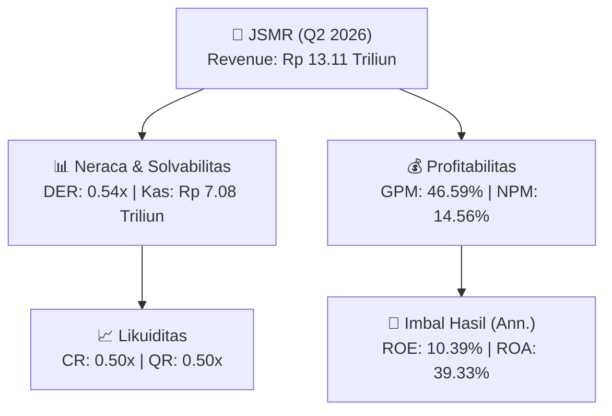
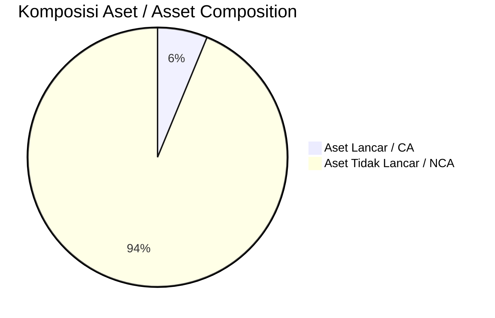
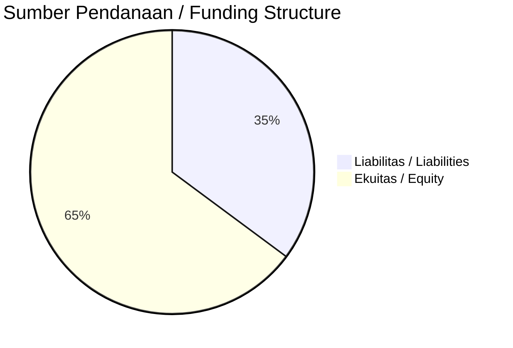

# 📈 Laporan Analisis Keuangan Mendalam: [[JSMR]] — Q2 2026

⬅️ [[knowledge-base/daily-digests/Daily_Digest_20260901|Kembali ke Daily Digest]] | 📅 **2026-09-01** | 🎛️ [[Dashboard|Ke Dashboard Utama]]

> [!IMPORTANT]
> Dokumen ini disusun oleh **Financial Summarizer Agent** untuk menganalisis kinerja keuangan, kesehatan neraca, profitabilitas, dan katalis sektor (Infrastruktur & Transportasi) **PT Jasa Marga Tbk ([[JSMR]])** berdasarkan LK Q2 2026.

---

## 📌 1. Ikhtisar Kinerja Utama / Executive Performance Highlight
- **Emiten**: `[[JSMR]]` (PT Jasa Marga Tbk)
- **Sektor Usaha / Industry Sector**: `Infrastruktur & Transportasi`
- **Periode Laporan / Reporting Period**: `Q2 2026`
- **Pendapatan Neto / Net Revenue**: `Rp 13.11 Triliun` (**-6.00% 🔴 YoY** dari Rp 13.95 Triliun)
- **Laba Bruto / Gross Profit**: `Rp 6.11 Triliun` (**+8.42% 🟢 YoY**)
- **Laba (Rugi) Bersih / Net Income**: `Rp 1.91 Triliun` (**+2.01% 🟢 YoY**)
- **Total Aset / Total Assets**: `Rp 10.15 Triliun` | **Total Ekuitas / Total Equity**: `Rp 37.13 Triliun`
- **EPS (Annualized)**: `1.05` | **BVPS**: `10.23`

---

## 📊 2. Laba Rugi Komparatif / Comparative Income Statement

| Pos Laba Rugi / Income Statement Item | Q2 2026 | Prior Period | YoY (%) |
| :--- | ---: | ---: | :---: |
| **Pendapatan Neto / Net Revenue** | `13.11T` | `13.95T` | **-6.00% 🔴** |
| **Beban Pokok / COGS** | `(7.00T)` | `(8.31T)` | -15.78% 🔴 |
| **Laba Bruto / Gross Profit** | `6.11T` | `5.63T` | **+8.42% 🟢** |
| **Beban Usaha / Operating Expenses** | `(1.13T)` | `(1.01T)` | +12.84% 🟢 |
| **Laba Operasional / EBIT** | `3.54T` | `3.20T` | +10.74% 🟢 |
| **Laba (Rugi) Bersih / Net Income** | **1.91T** | **1.87T** | **+2.01% 🟢** |

---

## 🏦 3. Neraca & Struktur Permodalan / Balance Sheet & Capital Structure

| Pos Neraca / Balance Sheet Item | Q2 2026 | Prior Year End | Δ YoY/YtD (%) | Catatan / Notes |
| :--- | ---: | ---: | :---: | :--- |
| **Aset Lancar / Current Assets** | `10.15T` | `9.27T` | +9.51% 🟢 | Kas: Rp 7.08 Triliun |
| **Aset Tidak Lancar / Non-Current Assets** | `153.06T` | `150.73T` | +1.55% 🟢 | Aset Tetap & Operasional |
| **TOTAL ASET / TOTAL ASSETS** | **10.15T** | **9.27T** | **+9.51% 🟢** | |
| **Liabilitas Jk. Pendek / Current Liabilities** | `20.13T` | `16.00T` | +25.84% 🟢 | |
| **Liabilitas Jk. Panjang / Non-Current Liabilities** | `79.85T` | `81.64T` | -2.18% 🔴 | |
| **TOTAL LIABILITAS / TOTAL LIABILITIES** | **20.13T** | **16.00T** | **+25.84% 🟢** | |
| **TOTAL EKUITAS / TOTAL EQUITY** | **37.13T** | **36.36T** | **+2.14% 🟢** | |

---

## 💸 4. Laporan Arus Kas / Cash Flow Statement

| Komponen Arus Kas / Cash Flow Component | Q2 2026 | Prior Period | Δ YoY (%) |
| :--- | ---: | ---: | :---: |
| **Arus Kas Operasi / CFO** | `3.13T` | `1.32T` | +136.84% 🟢 |
| **Arus Kas Investasi / CFI** | `-4.18T` | `-5.57T` | +25.06% 🟢 |
| **Arus Kas Pendanaan / CFF** | `1.38T` | `5.60T` | -75.42% 🔴 |
| **Kenaikan (Penurunan) Kas Bersih** | `330.96B` | `1.35T` | -75.48% 🔴 |
| Belanja Modal / Capex | `(13.13B)` | `(10.02B)` | +31.05% 🟢 |
| Pembayaran Dividen / Dividends Paid | `(1.51T)` | `(1.13T)` | +32.75% 🟢 |
| **Free Cash Flow (CFO - Capex)** | **3.12T** | **1.31T** | **+137.64% 🟢** |

---

## 📈 Analisis Rasio Keuangan / Financial Ratio Analysis

| Kategori / Category | Metrik / Metric | Nilai / Value | Benchmark | Interpretasi / Interpretation |
| :--- | :--- | :---: | :---: | :--- |
| **🛡️ Likuiditas** | **Current Ratio** | `0.50x` | `> 1.0x` | Kemampuan bayar kewajiban jk. pendek |
| | **Quick Ratio** | `0.50x` | `> 0.8x` | Likuiditas tanpa persediaan |
| **📊 Profitabilitas** | **Gross Profit Margin (GPM)** | `46.59%` | - | Margin kotor operasional inti |
| | **Operating Profit Margin (OPM)** | `27.00%` | - | Efisiensi operasional |
| | **Net Profit Margin (NPM)** | `14.56%` | - | Konversi revenue ke laba bersih |
| **🎯 Imbal Hasil (Ann.)** | **Return on Equity (ROE)** | `10.39%` | - | Imbal hasil terhadap ekuitas |
| | **Return on Assets (ROA)** | `39.33%` | - | Produktivitas aset |
| **⚖️ Solvabilitas** | **Debt to Equity (DER)** | `0.54x` | `< 2.0x` | Leverage utang vs modal |
| | **Debt to Asset (DAR)** | `1.98x` | `< 0.7x` | Porsi aset didanai utang |

---

## 📐 Per Share Metrics

| Metrik / Metric | Nilai / Value | Keterangan / Notes |
| :--- | ---: | :--- |
| **EPS (Annualized)** | `Rp 1.05` | Laba per saham (dianualisasi) |
| **BVPS** | `Rp 10.23` | Nilai buku per saham |

---

## 🚀 Analisis Strategis & Karakteristik Sektor / Strategic Analysis: Infrastruktur & Transportasi

Pada periode Q2 2026, **PT Jasa Marga Tbk ([[JSMR]])** membukukan total pendapatan sebesar **Rp 13.11 Triliun** (-6.00% 🔴 YoY). Laba kotor tercatat **Rp 6.11 Triliun** dengan GPM **46.59%**. Laba bersih sebesar **Rp 1.91 Triliun** (+2.01% 🟢 YoY). Total aset **Rp 10.15 Triliun**, ekuitas **Rp 37.13 Triliun**, DER **0.54x**.

### 🔍 Indikator Kunci Sektor / Sector Key Indicators (Infrastruktur & Transportasi)
- **Karakteristik Infrastruktur & Transportasi**: Kinerja didorong oleh pertumbuhan volume Lalu Lintas Harian Rata-rata (LHR) dan penyesuaian tarif berkala.
- **Struktur Leverage / Leverage Structure**: Pengelolaan liabilitas jangka panjang yang terukur seiring masa konsesi.
- **Recurring Revenue**: Pendapatan tol/sewa/transport bersifat recurring dan predictable.

> [!NOTE]
> _Data Public Expose / Investor Presentation belum tersedia untuk emiten ini._

---

## 📋 Catatan Kunci Laporan Keuangan / Key Notes to Financial Statements

### 🔍 Opini Auditor / Auditor Opinion
- **Jenis Opini / Opinion Type**: `Wajar Tanpa Modifikasian / Unqualified`
- **KAP / Audit Firm**: `KAP Amir Abadi Jusuf, Aryanto, Mawar  Rekan`
- **Partner Audit**: `Dedy Sukrisnadi`
- **Tanggal Laporan / Report Date**: `2026-08-28`

---

## 💡 Catatan Strategis & Panduan Investor / Strategic Notes & Investor Guide

1. **Kesehatan Permodalan / Capital Health**: DER **0.54x**, CR **0.50x** — _perlu dipantau secara disiplin_.
2. **Katalis Pertumbuhan / Growth Catalysts**: Pantau realisasi pendapatan dan efisiensi operasional periode berikutnya.

---

## 🔗 Hubungan Note Terkait / Knowledge Graph Links
- [[knowledge-base/daily-digests/Daily_Digest_20260901|📄 Daily Digest 2026-09-01]]
- [[knowledge-base/trading-signals/Trading_Signals_20260901|🎯 Trading Signals]]
- [[Dashboard|🎛️ Kembali ke Dashboard Utama]]