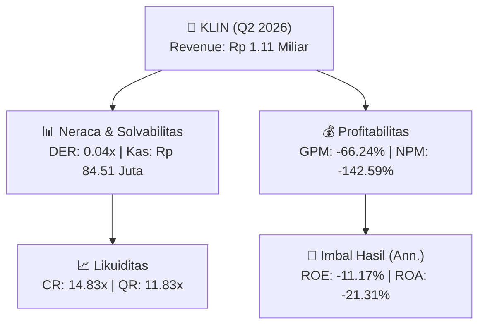
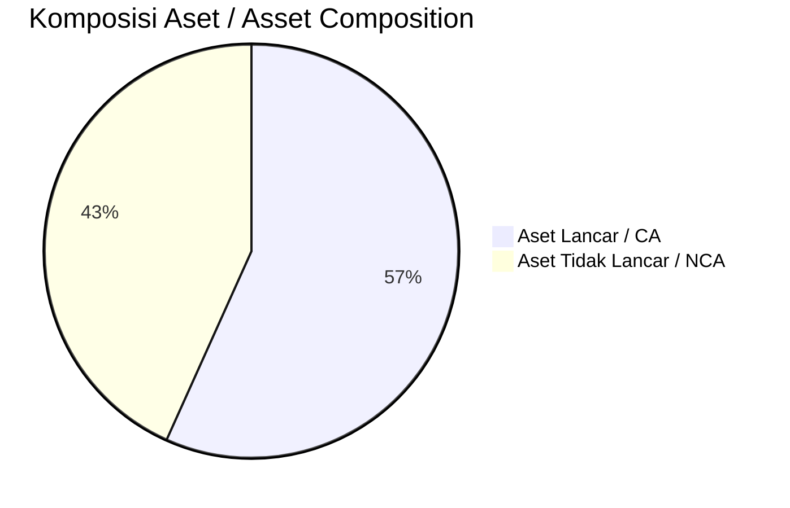
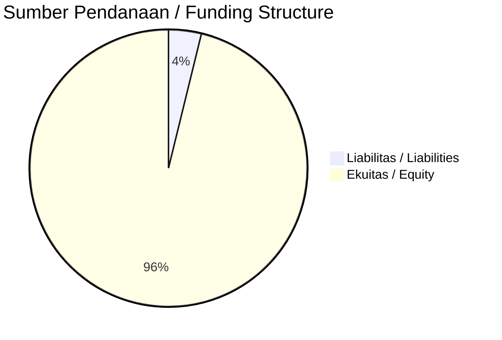

# 📈 Laporan Analisis Keuangan Mendalam: [[KLIN]] — Q2 2026

⬅️ [[knowledge-base/daily-digests/Daily_Digest_20261001|Kembali ke Daily Digest]] | 📅 **2026-10-01** | 🎛️ [[Dashboard|Ke Dashboard Utama]]

> [!IMPORTANT]
> Dokumen ini disusun oleh **Financial Summarizer Agent** untuk menganalisis kinerja keuangan, kesehatan neraca, profitabilitas, dan katalis sektor (Konsumer & Ritel) **PT Klinko Karya Imaji Tbk ([[KLIN]])** berdasarkan LK Q2 2026.

---

## 📌 1. Ikhtisar Kinerja Utama / Executive Performance Highlight
- **Emiten**: `[[KLIN]]` (PT Klinko Karya Imaji Tbk)
- **Sektor Usaha / Industry Sector**: `Konsumer & Ritel`
- **Periode Laporan / Reporting Period**: `Q2 2026`
- **Pendapatan Neto / Net Revenue**: `Rp 1.11 Miliar` (**-76.70% 🔴 YoY** dari Rp 4.75 Miliar)
- **Laba Bruto / Gross Profit**: `Rp -732.61 Juta` (**-283.35% 🔴 YoY**)
- **Laba (Rugi) Bersih / Net Income**: `Rp -1.58 Miliar` (**+30.78% 🟢 YoY**)
- **Total Aset / Total Assets**: `Rp 16.27 Miliar` | **Total Ekuitas / Total Equity**: `Rp 27.44 Miliar`
- **EPS (Annualized)**: `-0.24` | **BVPS**: `2.10`

---

## 📊 2. Laba Rugi Komparatif / Comparative Income Statement

| Pos Laba Rugi / Income Statement Item | Q2 2026 | Prior Period | YoY (%) |
| :--- | ---: | ---: | :---: |
| **Pendapatan Neto / Net Revenue** | `1.11B` | `4.75B` | **-76.70% 🔴** |
| **Beban Pokok / COGS** | `(1.84B)` | `(4.35B)` | -57.71% 🔴 |
| **Laba Bruto / Gross Profit** | `-732.61M` | `399.57M` | **-283.35% 🔴** |
| **Beban Usaha / Operating Expenses** | `(704.28M)` | `(1.35B)` | -47.64% 🔴 |
| **Laba Operasional / EBIT** | `-1.64B` | `-2.07B` | +20.85% 🟢 |
| **Laba (Rugi) Bersih / Net Income** | **-1.58B** | **-2.28B** | **+30.78% 🟢** |

---

## 🏦 3. Neraca & Struktur Permodalan / Balance Sheet & Capital Structure

| Pos Neraca / Balance Sheet Item | Q2 2026 | Prior Year End | Δ YoY/YtD (%) | Catatan / Notes |
| :--- | ---: | ---: | :---: | :--- |
| **Aset Lancar / Current Assets** | `16.27B` | `13.33B` | +22.01% 🟢 | Kas: Rp 84.51 Juta |
| **Aset Tidak Lancar / Non-Current Assets** | `12.41B` | `17.22B` | -27.92% 🔴 | Aset Tetap & Operasional |
| **TOTAL ASET / TOTAL ASSETS** | **16.27B** | **13.33B** | **+22.01% 🟢** | |
| **Liabilitas Jk. Pendek / Current Liabilities** | `1.10B` | `1.30B` | -15.78% 🔴 | |
| **Liabilitas Jk. Panjang / Non-Current Liabilities** | `138.97M` | `229.90M` | -39.55% 🔴 | |
| **TOTAL LIABILITAS / TOTAL LIABILITIES** | **1.10B** | **1.30B** | **-15.78% 🔴** | |
| **TOTAL EKUITAS / TOTAL EQUITY** | **27.44B** | **29.02B** | **-5.44% 🔴** | |

---

## 💸 4. Laporan Arus Kas / Cash Flow Statement

| Komponen Arus Kas / Cash Flow Component | Q2 2026 | Prior Period | Δ YoY (%) |
| :--- | ---: | ---: | :---: |
| **Arus Kas Operasi / CFO** | `93.52M` | `1.11B` | -91.61% 🔴 |
| **Arus Kas Investasi / CFI** | `0.00` | `229.90M` | -100.00% 🔴 |
| **Arus Kas Pendanaan / CFF** | `-58.87M` | `-1.34B` | +95.60% 🟢 |
| **Kenaikan (Penurunan) Kas Bersih** | `34.65M` | `5.67M` | +511.40% 🟢 |
| Belanja Modal / Capex | `(-)` | `(2.60M)` | - |
| Pembayaran Dividen / Dividends Paid | `(-)` | `(-)` | - |
| **Free Cash Flow (CFO - Capex)** | **-** | **1.11B** | **-** |

---

## 📈 Analisis Rasio Keuangan / Financial Ratio Analysis

| Kategori / Category | Metrik / Metric | Nilai / Value | Benchmark | Interpretasi / Interpretation |
| :--- | :--- | :---: | :---: | :--- |
| **🛡️ Likuiditas** | **Current Ratio** | `14.83x` | `> 1.0x` | Kemampuan bayar kewajiban jk. pendek |
| | **Quick Ratio** | `11.83x` | `> 0.8x` | Likuiditas tanpa persediaan |
| **📊 Profitabilitas** | **Gross Profit Margin (GPM)** | `-66.24%` | - | Margin kotor operasional inti |
| | **Operating Profit Margin (OPM)** | `-148.32%` | - | Efisiensi operasional |
| | **Net Profit Margin (NPM)** | `-142.59%` | - | Konversi revenue ke laba bersih |
| **🎯 Imbal Hasil (Ann.)** | **Return on Equity (ROE)** | `-11.17%` | - | Imbal hasil terhadap ekuitas |
| | **Return on Assets (ROA)** | `-21.31%` | - | Produktivitas aset |
| **⚖️ Solvabilitas** | **Debt to Equity (DER)** | `0.04x` | `< 2.0x` | Leverage utang vs modal |
| | **Debt to Asset (DAR)** | `0.07x` | `< 0.7x` | Porsi aset didanai utang |

---

## 📐 Per Share Metrics

| Metrik / Metric | Nilai / Value | Keterangan / Notes |
| :--- | ---: | :--- |
| **EPS (Annualized)** | `Rp -0.24` | Laba per saham (dianualisasi) |
| **BVPS** | `Rp 2.10` | Nilai buku per saham |

---

## 🚀 Analisis Strategis & Karakteristik Sektor / Strategic Analysis: Konsumer & Ritel

Pada periode Q2 2026, **PT Klinko Karya Imaji Tbk ([[KLIN]])** membukukan total pendapatan sebesar **Rp 1.11 Miliar** (-76.70% 🔴 YoY). Laba kotor tercatat **Rp -732.61 Juta** dengan GPM **-66.24%**. Laba bersih sebesar **Rp -1.58 Miliar** (+30.78% 🟢 YoY). Total aset **Rp 16.27 Miliar**, ekuitas **Rp 27.44 Miliar**, DER **0.04x**.

### 🔍 Indikator Kunci Sektor / Sector Key Indicators (Konsumer & Ritel)
- **Karakteristik Industri (Konsumer & Ritel)**: Kinerja mencerminkan dinamika penyerapan pasar, utilisasi kapasitas produksi, dan efisiensi biaya pokok.
- **Faktor Penggerak**: Pertumbuhan organik, efisiensi operasional, dan ekspansi pasar.

> [!NOTE]
> _Data Public Expose / Investor Presentation belum tersedia untuk emiten ini._

---

## 📋 Catatan Kunci Laporan Keuangan / Key Notes to Financial Statements

### 🔍 Opini Auditor / Auditor Opinion
- **Jenis Opini / Opinion Type**: `Wajar Tanpa Modifikasian / Unqualified`
- **KAP / Audit Firm**: `KAP Morhan Dan Rekan`
- **Partner Audit**: `Morhan Tirtonadi`
- **Tanggal Laporan / Report Date**: `2026-09-29`

### 📝 Perjanjian & Kontrak Signifikan / Key Contracts & Agreements
- Adendum Perjanjian Jual Beli tanggal 30 Maret 2026 antara Perusahaan dengan PT Panjimas Textile (pihak ketiga) terkait uang muka pembelian bahan baku; jika PT Panjimas Textile tidak dapat memenuhi permintaan barang sesuai spesifikasi dan kuantitas yang dibutuhkan Perusahaan untuk produksi, sisa uang muka akan dikembalikan selambat-lambatnya 30 hari setelah diterimanya surat permintaan pengembalian uang muka dari Perusahaan.

### 🤝 Transaksi Pihak Berelasi / Related Party Transactions
- Transaksi signifikan dengan pihak-pihak berelasi diungkapkan dalam Catatan 28 atas laporan keuangan interim.

---

## 💡 Catatan Strategis & Panduan Investor / Strategic Notes & Investor Guide

1. **Kesehatan Permodalan / Capital Health**: DER **0.04x**, CR **14.83x** — _sehat dan aman_.
2. **Katalis Pertumbuhan / Growth Catalysts**: Pantau realisasi pendapatan dan efisiensi operasional periode berikutnya.

---

## 🔗 Hubungan Note Terkait / Knowledge Graph Links
- [[knowledge-base/daily-digests/Daily_Digest_20261001|📄 Daily Digest 2026-10-01]]
- [[knowledge-base/trading-signals/Trading_Signals_20261001|🎯 Trading Signals]]
- [[Dashboard|🎛️ Kembali ke Dashboard Utama]]