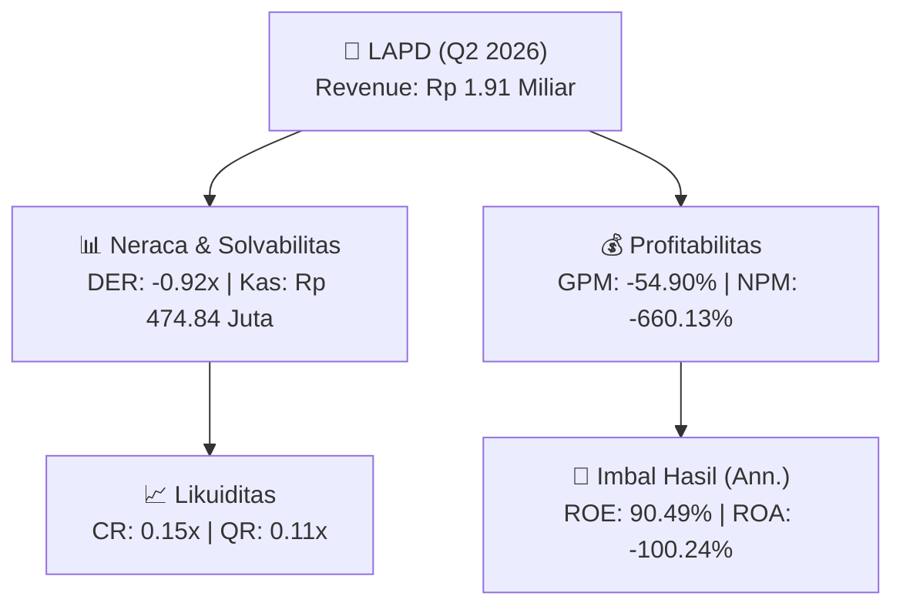
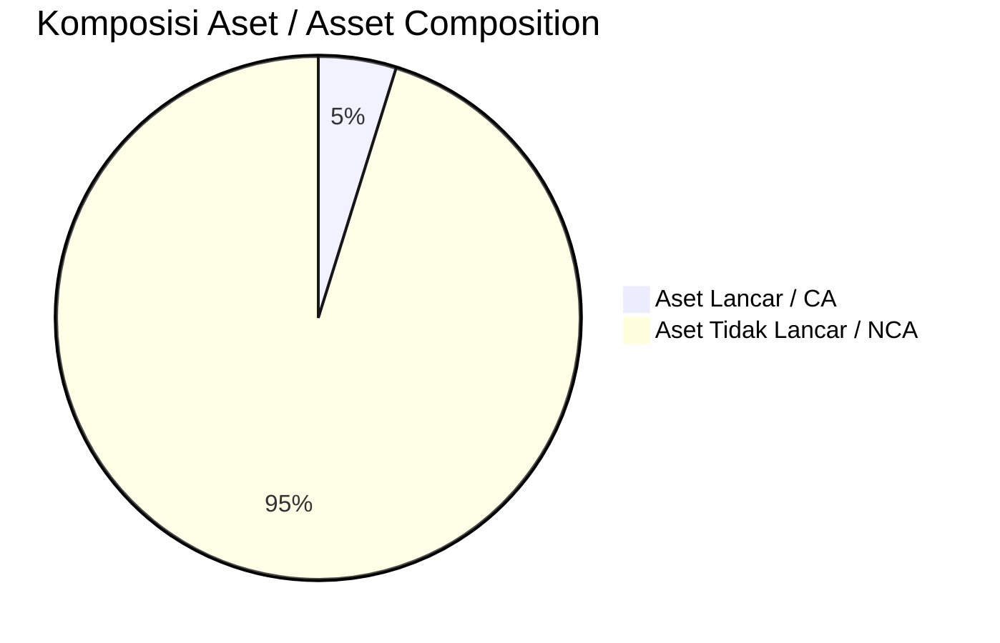
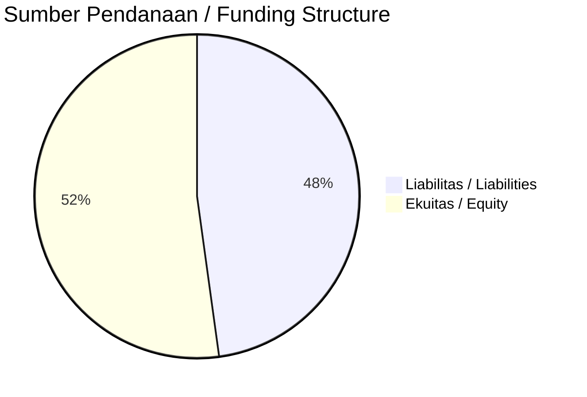

# 📈 Laporan Analisis Keuangan Mendalam: [[LAPD]] — Q2 2026

⬅️ [[knowledge-base/daily-digests/Daily_Digest_20261001|Kembali ke Daily Digest]] | 📅 **2026-10-01** | 🎛️ [[Dashboard|Ke Dashboard Utama]]

> [!IMPORTANT]
> Dokumen ini disusun oleh **Financial Summarizer Agent** untuk menganalisis kinerja keuangan, kesehatan neraca, profitabilitas, dan katalis sektor (Konsumer & Ritel) **Leyand International Tbk ([[LAPD]])** berdasarkan LK Q2 2026.

---

## 📌 1. Ikhtisar Kinerja Utama / Executive Performance Highlight
- **Emiten**: `[[LAPD]]` (Leyand International Tbk)
- **Sektor Usaha / Industry Sector**: `Konsumer & Ritel`
- **Periode Laporan / Reporting Period**: `Q2 2026`
- **Pendapatan Neto / Net Revenue**: `Rp 1.91 Miliar` (**-98.62% 🔴 YoY** dari Rp 138.51 Miliar)
- **Laba Bruto / Gross Profit**: `Rp -1.05 Miliar` (**-124.02% 🔴 YoY**)
- **Laba (Rugi) Bersih / Net Income**: `Rp -12.58 Miliar` (**-505.12% 🔴 YoY**)
- **Total Aset / Total Assets**: `Rp 4.78 Miliar` | **Total Ekuitas / Total Equity**: `Rp -34.06 Miliar`
- **EPS (Annualized)**: `-0.06` | **BVPS**: `-0.09`

---

## 📊 2. Laba Rugi Komparatif / Comparative Income Statement

| Pos Laba Rugi / Income Statement Item | Q2 2026 | Prior Period | YoY (%) |
| :--- | ---: | ---: | :---: |
| **Pendapatan Neto / Net Revenue** | `1.91B` | `138.51B` | **-98.62% 🔴** |
| **Beban Pokok / COGS** | `(2.95B)` | `(134.15B)` | -97.80% 🔴 |
| **Laba Bruto / Gross Profit** | `-1.05B` | `4.35B` | **-124.02% 🔴** |
| **Beban Usaha / Operating Expenses** | `(1.99B)` | `(5.93B)` | -66.50% 🔴 |
| **Laba Operasional / EBIT** | `-24.33B` | `-3.63B` | -569.95% 🔴 |
| **Laba (Rugi) Bersih / Net Income** | **-12.58B** | **-2.08B** | **-505.12% 🔴** |

---

## 🏦 3. Neraca & Struktur Permodalan / Balance Sheet & Capital Structure

| Pos Neraca / Balance Sheet Item | Q2 2026 | Prior Year End | Δ YoY/YtD (%) | Catatan / Notes |
| :--- | ---: | ---: | :---: | :--- |
| **Aset Lancar / Current Assets** | `4.78B` | `45.41B` | -89.48% 🔴 | Kas: Rp 474.84 Juta |
| **Aset Tidak Lancar / Non-Current Assets** | `94.70B` | `96.27B` | -1.63% 🔴 | Aset Tetap & Operasional |
| **TOTAL ASET / TOTAL ASSETS** | **4.78B** | **45.41B** | **-89.48% 🔴** | |
| **Liabilitas Jk. Pendek / Current Liabilities** | `31.23B` | `63.96B` | -51.18% 🔴 | |
| **Liabilitas Jk. Panjang / Non-Current Liabilities** | `70.89B` | `56.44B` | +25.61% 🟢 | |
| **TOTAL LIABILITAS / TOTAL LIABILITIES** | **31.23B** | **63.96B** | **-51.18% 🔴** | |
| **TOTAL EKUITAS / TOTAL EQUITY** | **-34.06B** | **-21.53B** | **-58.19% 🔴** | |

---

## 💸 4. Laporan Arus Kas / Cash Flow Statement

| Komponen Arus Kas / Cash Flow Component | Q2 2026 | Prior Period | Δ YoY (%) |
| :--- | ---: | ---: | :---: |
| **Arus Kas Operasi / CFO** | `-6.19B` | `-8.71B` | +28.94% 🟢 |
| **Arus Kas Investasi / CFI** | `7.07B` | `-8.71B` | +181.13% 🟢 |
| **Arus Kas Pendanaan / CFF** | `-657.93M` | `-5.02B` | +86.88% 🟢 |
| **Kenaikan (Penurunan) Kas Bersih** | `224.95M` | `-22.44B` | +101.00% 🟢 |
| Belanja Modal / Capex | `(0.00)` | `(11.77M)` | -100.00% 🔴 |
| Pembayaran Dividen / Dividends Paid | `(-)` | `(-)` | - |
| **Free Cash Flow (CFO - Capex)** | **-6.19B** | **-8.72B** | **+29.04% 🟢** |

---

## 📈 Analisis Rasio Keuangan / Financial Ratio Analysis

| Kategori / Category | Metrik / Metric | Nilai / Value | Benchmark | Interpretasi / Interpretation |
| :--- | :--- | :---: | :---: | :--- |
| **🛡️ Likuiditas** | **Current Ratio** | `0.15x` | `> 1.0x` | Kemampuan bayar kewajiban jk. pendek |
| | **Quick Ratio** | `0.11x` | `> 0.8x` | Likuiditas tanpa persediaan |
| **📊 Profitabilitas** | **Gross Profit Margin (GPM)** | `-54.90%` | - | Margin kotor operasional inti |
| | **Operating Profit Margin (OPM)** | `-1277.21%` | - | Efisiensi operasional |
| | **Net Profit Margin (NPM)** | `-660.13%` | - | Konversi revenue ke laba bersih |
| **🎯 Imbal Hasil (Ann.)** | **Return on Equity (ROE)** | `90.49%` | - | Imbal hasil terhadap ekuitas |
| | **Return on Assets (ROA)** | `-100.24%` | - | Produktivitas aset |
| **⚖️ Solvabilitas** | **Debt to Equity (DER)** | `-0.92x` | `< 2.0x` | Leverage utang vs modal |
| | **Debt to Asset (DAR)** | `6.54x` | `< 0.7x` | Porsi aset didanai utang |

---

## 📐 Per Share Metrics

| Metrik / Metric | Nilai / Value | Keterangan / Notes |
| :--- | ---: | :--- |
| **EPS (Annualized)** | `Rp -0.06` | Laba per saham (dianualisasi) |
| **BVPS** | `Rp -0.09` | Nilai buku per saham |

---

## 🚀 Analisis Strategis & Karakteristik Sektor / Strategic Analysis: Konsumer & Ritel

Pada periode Q2 2026, **Leyand International Tbk ([[LAPD]])** membukukan total pendapatan sebesar **Rp 1.91 Miliar** (-98.62% 🔴 YoY). Laba kotor tercatat **Rp -1.05 Miliar** dengan GPM **-54.90%**. Laba bersih sebesar **Rp -12.58 Miliar** (-505.12% 🔴 YoY). Total aset **Rp 4.78 Miliar**, ekuitas **Rp -34.06 Miliar**, DER **-0.92x**.

### 🔍 Indikator Kunci Sektor / Sector Key Indicators (Konsumer & Ritel)
- **Karakteristik Industri (Konsumer & Ritel)**: Kinerja mencerminkan dinamika penyerapan pasar, utilisasi kapasitas produksi, dan efisiensi biaya pokok.
- **Faktor Penggerak**: Pertumbuhan organik, efisiensi operasional, dan ekspansi pasar.

> [!NOTE]
> _Data Public Expose / Investor Presentation belum tersedia untuk emiten ini._

---

## 📋 Catatan Kunci Laporan Keuangan / Key Notes to Financial Statements

### 🔍 Opini Auditor / Auditor Opinion
- **Jenis Opini / Opinion Type**: `Wajar Tanpa Modifikasian / Unqualified`
- **KAP / Audit Firm**: `KAP Maurice Ganda Nainggolan dan Rekan`
- **Partner Audit**: `Ahalik`
- **Tanggal Laporan / Report Date**: `2026-09-09`

### 📝 Perjanjian & Kontrak Signifikan / Key Contracts & Agreements
- Perjanjian Utang Usaha kepada Pihak Ketiga dan Utang Lain-Lain kepada Pihak Berelasi; syarat dan ketentuan utama telah dibaca dan dipahami dalam audit.

### 🤝 Transaksi Pihak Berelasi / Related Party Transactions
- Utang Lain-Lain kepada Pihak Berelasi; konfirmasi kepada seluruh kreditur menyatakan saldo piutang mereka telah cocok dengan yang dicatatkan Perusahaan dan Entitas Anak per 30 Juni 2026.

---

## 💡 Catatan Strategis & Panduan Investor / Strategic Notes & Investor Guide

1. **Kesehatan Permodalan / Capital Health**: DER **-0.92x**, CR **0.15x** — _perlu dipantau secara disiplin_.
2. **Katalis Pertumbuhan / Growth Catalysts**: Pantau realisasi pendapatan dan efisiensi operasional periode berikutnya.

---

## 🔗 Hubungan Note Terkait / Knowledge Graph Links
- [[knowledge-base/daily-digests/Daily_Digest_20261001|📄 Daily Digest 2026-10-01]]
- [[knowledge-base/trading-signals/Trading_Signals_20261001|🎯 Trading Signals]]
- [[Dashboard|🎛️ Kembali ke Dashboard Utama]]