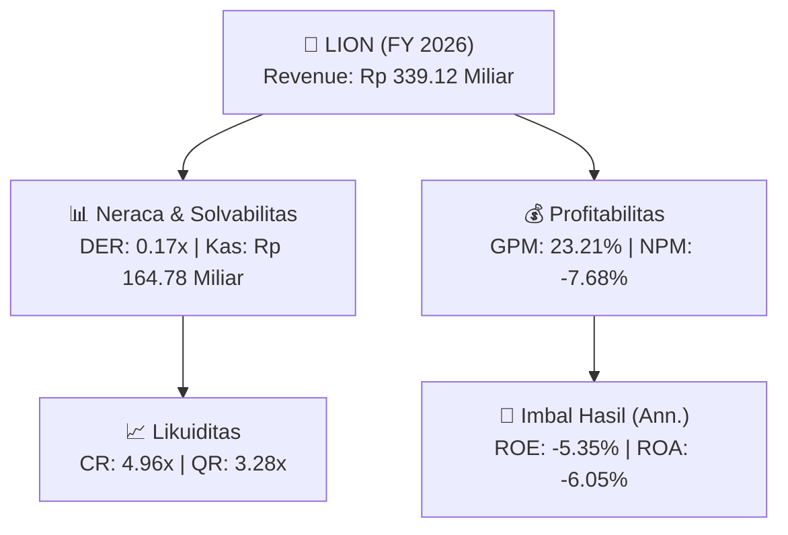
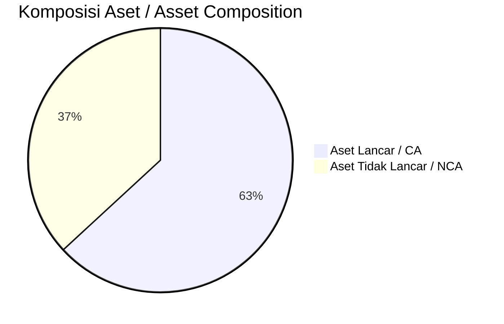
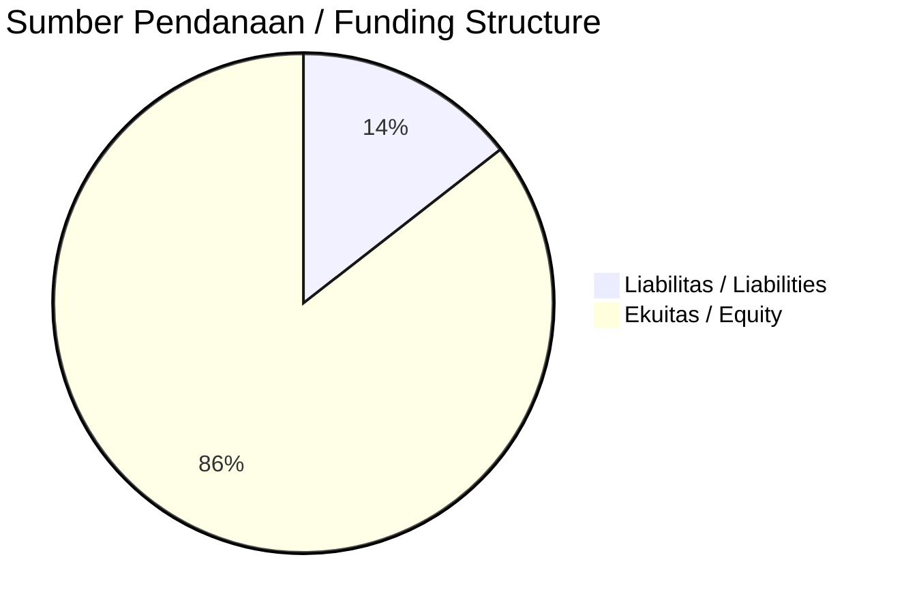

# 📈 Laporan Analisis Keuangan Tahunan Komprehensif: [[LION]] — FY 2026

⬅️ [[knowledge-base/daily-digests/Daily_Digest_20260914|Kembali ke Daily Digest]] | 📅 **2026-09-14** | 🎛️ [[Dashboard|Ke Dashboard Utama]]

> [!IMPORTANT]
> Dokumen ini disusun oleh **Financial Summarizer Agent** untuk menganalisis kinerja keuangan, kesehatan neraca, profitabilitas, dan katalis sektor (Manufaktur) **Lion Metal Works Tbk ([[LION]])** berdasarkan LK FY 2026.

---

## 📌 1. Ikhtisar Kinerja Utama / Executive Performance Highlight
- **Emiten**: `[[LION]]` (Lion Metal Works Tbk)
- **Sektor Usaha / Industry Sector**: `Manufaktur`
- **Periode Laporan / Reporting Period**: `FY 2026`
- **Pendapatan Neto / Net Revenue**: `Rp 339.12 Miliar` (**-20.29% 🔴 YoY** dari Rp 425.42 Miliar)
- **Laba Bruto / Gross Profit**: `Rp 78.71 Miliar` (**-36.41% 🔴 YoY**)
- **Laba (Rugi) Bersih / Net Income**: `Rp -26.04 Miliar` (**-346.46% 🔴 YoY**)
- **Total Aset / Total Assets**: `Rp 394.59 Miliar` | **Total Ekuitas / Total Equity**: `Rp 472.11 Miliar`
- **EPS (Annualized)**: `-0.50` | **BVPS**: `9.08`

---

## 📊 2. Laba Rugi Komparatif / Comparative Income Statement

| Pos Laba Rugi / Income Statement Item | FY 2026 | Prior Period | YoY (%) |
| :--- | ---: | ---: | :---: |
| **Pendapatan Neto / Net Revenue** | `339.12B` | `425.42B` | **-20.29% 🔴** |
| **Beban Pokok / COGS** | `(260.42B)` | `(301.65B)` | -13.67% 🔴 |
| **Laba Bruto / Gross Profit** | `78.71B` | `123.77B` | **-36.41% 🔴** |
| **Beban Usaha / Operating Expenses** | `(85.25B)` | `(80.46B)` | +5.95% 🟢 |
| **Laba Operasional / EBIT** | `-26.80B` | `18.84B` | -242.20% 🔴 |
| **Laba (Rugi) Bersih / Net Income** | **-26.04B** | **10.57B** | **-346.46% 🔴** |

---

## 🏦 3. Neraca & Struktur Permodalan / Balance Sheet & Capital Structure

| Pos Neraca / Balance Sheet Item | FY 2026 | Prior Year End | Δ YoY/YtD (%) | Catatan / Notes |
| :--- | ---: | ---: | :---: | :--- |
| **Aset Lancar / Current Assets** | `394.59B` | `466.48B` | -15.41% 🔴 | Kas: Rp 164.78 Miliar |
| **Aset Tidak Lancar / Non-Current Assets** | `230.26B` | `247.69B` | -7.04% 🔴 | Aset Tetap & Operasional |
| **TOTAL ASET / TOTAL ASSETS** | **394.59B** | **466.48B** | **-15.41% 🔴** | |
| **Liabilitas Jk. Pendek / Current Liabilities** | `79.56B` | `138.83B` | -42.70% 🔴 | |
| **Liabilitas Jk. Panjang / Non-Current Liabilities** | `73.18B` | `74.29B` | -1.49% 🔴 | |
| **TOTAL LIABILITAS / TOTAL LIABILITIES** | **79.56B** | **138.83B** | **-42.70% 🔴** | |
| **TOTAL EKUITAS / TOTAL EQUITY** | **472.11B** | **501.05B** | **-5.78% 🔴** | |

---

## 💸 4. Laporan Arus Kas / Cash Flow Statement

| Komponen Arus Kas / Cash Flow Component | FY 2026 | Prior Period | Δ YoY (%) |
| :--- | ---: | ---: | :---: |
| **Arus Kas Operasi / CFO** | `22.29B` | `92.43B` | -75.88% 🔴 |
| **Arus Kas Investasi / CFI** | `25.66B` | `10.66B` | +140.68% 🟢 |
| **Arus Kas Pendanaan / CFF** | `-27.72B` | `-23.65B` | -17.21% 🔴 |
| **Kenaikan (Penurunan) Kas Bersih** | `20.23B` | `79.44B` | -74.53% 🔴 |
| Belanja Modal / Capex | `(4.38B)` | `(8.04B)` | -45.50% 🔴 |
| Pembayaran Dividen / Dividends Paid | `(2.58B)` | `(2.56B)` | +1.12% 🟢 |
| **Free Cash Flow (CFO - Capex)** | **17.91B** | **84.39B** | **-78.78% 🔴** |

---

## 📈 Analisis Rasio Keuangan / Financial Ratio Analysis

| Kategori / Category | Metrik / Metric | Nilai / Value | Benchmark | Interpretasi / Interpretation |
| :--- | :--- | :---: | :---: | :--- |
| **🛡️ Likuiditas** | **Current Ratio** | `4.96x` | `> 1.0x` | Kemampuan bayar kewajiban jk. pendek |
| | **Quick Ratio** | `3.28x` | `> 0.8x` | Likuiditas tanpa persediaan |
| **📊 Profitabilitas** | **Gross Profit Margin (GPM)** | `23.21%` | - | Margin kotor operasional inti |
| | **Operating Profit Margin (OPM)** | `-7.90%` | - | Efisiensi operasional |
| | **Net Profit Margin (NPM)** | `-7.68%` | - | Konversi revenue ke laba bersih |
| **🎯 Imbal Hasil (Ann.)** | **Return on Equity (ROE)** | `-5.35%` | - | Imbal hasil terhadap ekuitas |
| | **Return on Assets (ROA)** | `-6.05%` | - | Produktivitas aset |
| **⚖️ Solvabilitas** | **Debt to Equity (DER)** | `0.17x` | `< 2.0x` | Leverage utang vs modal |
| | **Debt to Asset (DAR)** | `0.20x` | `< 0.7x` | Porsi aset didanai utang |

---

## 📐 Per Share Metrics

| Metrik / Metric | Nilai / Value | Keterangan / Notes |
| :--- | ---: | :--- |
| **EPS (Annualized)** | `Rp -0.50` | Laba per saham (dianualisasi) |
| **BVPS** | `Rp 9.08` | Nilai buku per saham |

---

## 🚀 Analisis Strategis & Karakteristik Sektor / Strategic Analysis: Manufaktur

Pada periode FY 2026, **Lion Metal Works Tbk ([[LION]])** membukukan total pendapatan sebesar **Rp 339.12 Miliar** (-20.29% 🔴 YoY). Laba kotor tercatat **Rp 78.71 Miliar** dengan GPM **23.21%**. Laba bersih sebesar **Rp -26.04 Miliar** (-346.46% 🔴 YoY). Total aset **Rp 394.59 Miliar**, ekuitas **Rp 472.11 Miliar**, DER **0.17x**.

### 🔍 Indikator Kunci Sektor / Sector Key Indicators (Manufaktur)
- **Karakteristik Industri (Manufaktur)**: Kinerja mencerminkan dinamika penyerapan pasar, utilisasi kapasitas produksi, dan efisiensi biaya pokok.
- **Faktor Penggerak**: Pertumbuhan organik, efisiensi operasional, dan ekspansi pasar.

> [!NOTE]
> _Data Public Expose / Investor Presentation belum tersedia untuk emiten ini._

---

## 📋 Catatan Kunci Laporan Keuangan / Key Notes to Financial Statements

### 🔍 Opini Auditor / Auditor Opinion
- **Jenis Opini / Opinion Type**: `Wajar Tanpa Modifikasian / Unqualified`
- **KAP / Audit Firm**: `KAP Teramihardja, Pradhono  Chandra`
- **Partner Audit**: `Heru Kusdandaru`
- **Tanggal Laporan / Report Date**: `2026-03-17`

### 📝 Perjanjian & Kontrak Signifikan / Key Contracts & Agreements
- Perjanjian Sewa Menyewa tanggal 27 Juli 2022 antara Grup dan PT Lionmesh P (berdasarkan akta Notaris No. 13)

### 🤝 Transaksi Pihak Berelasi / Related Party Transactions
- Penjualan barang kepada pihak berelasi (Catatan 28)

---

## 💡 Catatan Strategis & Panduan Investor / Strategic Notes & Investor Guide

1. **Kesehatan Permodalan / Capital Health**: DER **0.17x**, CR **4.96x** — _sehat dan aman_.
2. **Katalis Pertumbuhan / Growth Catalysts**: Pantau realisasi pendapatan dan efisiensi operasional periode berikutnya.

---

## 💰 Informasi Dividen / Dividend Information

| Metrik / Metric | Nilai / Value |
| :--- | ---: |
| **Total Dividen Dibayarkan / Dividends Paid** | `Rp 2.58 Miliar` |
| **Dividend Payout Ratio** | `9.9%` |
| **Laba Bersih (Basis)** | `Rp -26.04 Miliar` |

---

## 📊 Trend Multi-Tahun / Multi-Year Trend

> [!NOTE]
> _Tabel trend multi-tahun (3 tahun) akan tersedia setelah data historis FY sebelumnya diproses._

---
## 🔗 Hubungan Note Terkait / Knowledge Graph Links
- [[knowledge-base/daily-digests/Daily_Digest_20260914|📄 Daily Digest 2026-09-14]]
- [[knowledge-base/trading-signals/Trading_Signals_20260914|🎯 Trading Signals]]
- [[Dashboard|🎛️ Kembali ke Dashboard Utama]]