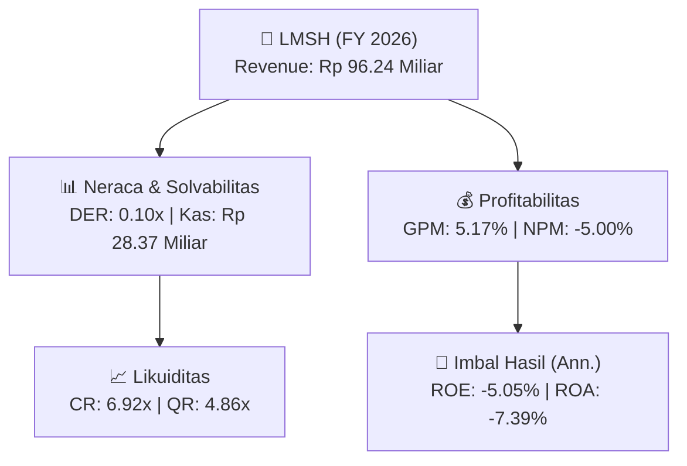
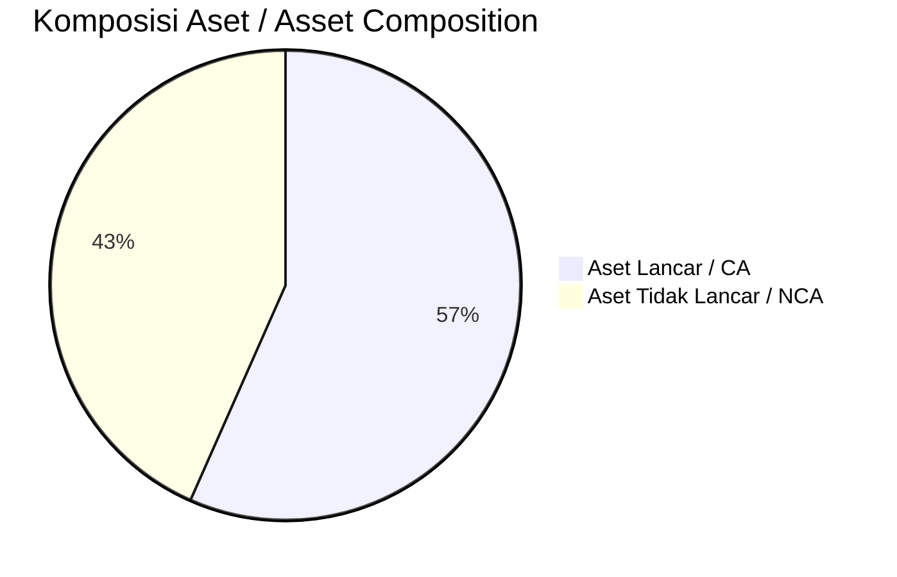
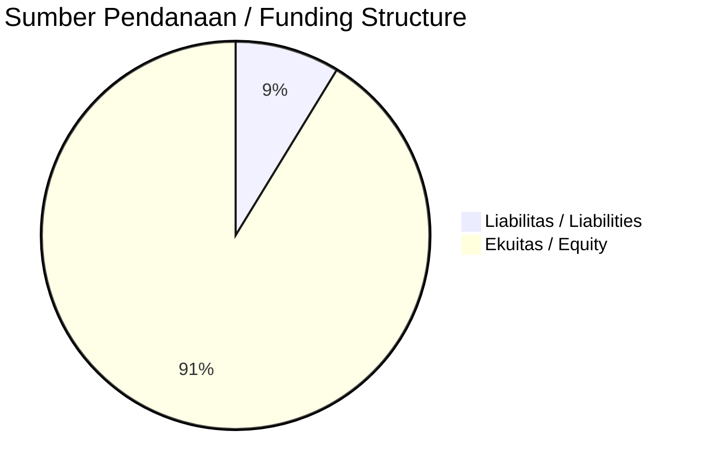

# 📈 Laporan Analisis Keuangan Tahunan Komprehensif: [[LMSH]] — FY 2026

⬅️ [[knowledge-base/daily-digests/Daily_Digest_20260914|Kembali ke Daily Digest]] | 📅 **2026-09-14** | 🎛️ [[Dashboard|Ke Dashboard Utama]]

> [!IMPORTANT]
> Dokumen ini disusun oleh **Financial Summarizer Agent** untuk menganalisis kinerja keuangan, kesehatan neraca, profitabilitas, dan katalis sektor (General) **Lionmesh Prima Tbk ([[LMSH]])** berdasarkan LK FY 2026.

---

## 📌 1. Ikhtisar Kinerja Utama / Executive Performance Highlight
- **Emiten**: `[[LMSH]]` (Lionmesh Prima Tbk)
- **Sektor Usaha / Industry Sector**: `General`
- **Periode Laporan / Reporting Period**: `FY 2026`
- **Pendapatan Neto / Net Revenue**: `Rp 96.24 Miliar` (**+5.04% 🟢 YoY** dari Rp 91.62 Miliar)
- **Laba Bruto / Gross Profit**: `Rp 4.98 Miliar` (**+985.85% 🟢 YoY**)
- **Laba (Rugi) Bersih / Net Income**: `Rp -4.81 Miliar` (**+35.59% 🟢 YoY**)
- **Total Aset / Total Assets**: `Rp 61.56 Miliar` | **Total Ekuitas / Total Equity**: `Rp 92.71 Miliar`
- **EPS (Annualized)**: `-0.50` | **BVPS**: `9.66`

---

## 📊 2. Laba Rugi Komparatif / Comparative Income Statement

| Pos Laba Rugi / Income Statement Item | FY 2026 | Prior Period | YoY (%) |
| :--- | ---: | ---: | :---: |
| **Pendapatan Neto / Net Revenue** | `96.24B` | `91.62B` | **+5.04% 🟢** |
| **Beban Pokok / COGS** | `(91.26B)` | `(91.16B)` | +0.11% 🟢 |
| **Laba Bruto / Gross Profit** | `4.98B` | `458.21M` | **+985.85% 🟢** |
| **Beban Usaha / Operating Expenses** | `(8.79B)` | `(8.32B)` | +5.59% 🟢 |
| **Laba Operasional / EBIT** | `-4.38B` | `-7.76B` | +43.54% 🟢 |
| **Laba (Rugi) Bersih / Net Income** | **-4.81B** | **-7.48B** | **+35.59% 🟢** |

---

## 🏦 3. Neraca & Struktur Permodalan / Balance Sheet & Capital Structure

| Pos Neraca / Balance Sheet Item | FY 2026 | Prior Year End | Δ YoY/YtD (%) | Catatan / Notes |
| :--- | ---: | ---: | :---: | :--- |
| **Aset Lancar / Current Assets** | `61.56B` | `68.79B` | -10.51% 🔴 | Kas: Rp 28.37 Miliar |
| **Aset Tidak Lancar / Non-Current Assets** | `47.14B` | `50.32B` | -6.31% 🔴 | Aset Tetap & Operasional |
| **TOTAL ASET / TOTAL ASSETS** | **61.56B** | **68.79B** | **-10.51% 🔴** | |
| **Liabilitas Jk. Pendek / Current Liabilities** | `8.89B` | `14.39B` | -38.20% 🔴 | |
| **Liabilitas Jk. Panjang / Non-Current Liabilities** | `7.10B` | `6.79B` | +4.62% 🟢 | |
| **TOTAL LIABILITAS / TOTAL LIABILITIES** | **8.89B** | **14.39B** | **-38.20% 🔴** | |
| **TOTAL EKUITAS / TOTAL EQUITY** | **92.71B** | **97.93B** | **-5.33% 🔴** | |

---

## 💸 4. Laporan Arus Kas / Cash Flow Statement

| Komponen Arus Kas / Cash Flow Component | FY 2026 | Prior Period | Δ YoY (%) |
| :--- | ---: | ---: | :---: |
| **Arus Kas Operasi / CFO** | `-9.95B` | `8.39B` | -218.60% 🔴 |
| **Arus Kas Investasi / CFI** | `765.71M` | `8.85B` | -91.35% 🔴 |
| **Arus Kas Pendanaan / CFF** | `0.00` | `0.00` | - |
| **Kenaikan (Penurunan) Kas Bersih** | `-9.18B` | `17.24B` | -153.27% 🔴 |
| Belanja Modal / Capex | `(379.46M)` | `(20.10M)` | +1788.22% 🟢 |
| Pembayaran Dividen / Dividends Paid | `(-)` | `(-)` | - |
| **Free Cash Flow (CFO - Capex)** | **-10.33B** | **8.37B** | **-223.41% 🔴** |

---

## 📈 Analisis Rasio Keuangan / Financial Ratio Analysis

| Kategori / Category | Metrik / Metric | Nilai / Value | Benchmark | Interpretasi / Interpretation |
| :--- | :--- | :---: | :---: | :--- |
| **🛡️ Likuiditas** | **Current Ratio** | `6.92x` | `> 1.0x` | Kemampuan bayar kewajiban jk. pendek |
| | **Quick Ratio** | `4.86x` | `> 0.8x` | Likuiditas tanpa persediaan |
| **📊 Profitabilitas** | **Gross Profit Margin (GPM)** | `5.17%` | - | Margin kotor operasional inti |
| | **Operating Profit Margin (OPM)** | `-4.55%` | - | Efisiensi operasional |
| | **Net Profit Margin (NPM)** | `-5.00%` | - | Konversi revenue ke laba bersih |
| **🎯 Imbal Hasil (Ann.)** | **Return on Equity (ROE)** | `-5.05%` | - | Imbal hasil terhadap ekuitas |
| | **Return on Assets (ROA)** | `-7.39%` | - | Produktivitas aset |
| **⚖️ Solvabilitas** | **Debt to Equity (DER)** | `0.10x` | `< 2.0x` | Leverage utang vs modal |
| | **Debt to Asset (DAR)** | `0.14x` | `< 0.7x` | Porsi aset didanai utang |

---

## 📐 Per Share Metrics

| Metrik / Metric | Nilai / Value | Keterangan / Notes |
| :--- | ---: | :--- |
| **EPS (Annualized)** | `Rp -0.50` | Laba per saham (dianualisasi) |
| **BVPS** | `Rp 9.66` | Nilai buku per saham |

---

## 🚀 Analisis Strategis & Karakteristik Sektor / Strategic Analysis: General

Pada periode FY 2026, **Lionmesh Prima Tbk ([[LMSH]])** membukukan total pendapatan sebesar **Rp 96.24 Miliar** (+5.04% 🟢 YoY). Laba kotor tercatat **Rp 4.98 Miliar** dengan GPM **5.17%**. Laba bersih sebesar **Rp -4.81 Miliar** (+35.59% 🟢 YoY). Total aset **Rp 61.56 Miliar**, ekuitas **Rp 92.71 Miliar**, DER **0.10x**.

### 🔍 Indikator Kunci Sektor / Sector Key Indicators (General)
- **Karakteristik Industri (General)**: Kinerja mencerminkan dinamika penyerapan pasar, utilisasi kapasitas produksi, dan efisiensi biaya pokok.
- **Faktor Penggerak**: Pertumbuhan organik, efisiensi operasional, dan ekspansi pasar.

> [!NOTE]
> _Data Public Expose / Investor Presentation belum tersedia untuk emiten ini._

---

## 📋 Catatan Kunci Laporan Keuangan / Key Notes to Financial Statements

### 🔍 Opini Auditor / Auditor Opinion
- **Jenis Opini / Opinion Type**: `Wajar Tanpa Modifikasian / Unqualified`
- **KAP / Audit Firm**: `KAP Teramihardja, Pradhono  Chandra`
- **Partner Audit**: `Heru Kusdandaru`
- **Tanggal Laporan / Report Date**: `2026-03-18`

### 🤝 Transaksi Pihak Berelasi / Related Party Transactions
- Penjualan kepada pihak berelasi (Catatan 21) sebesar Rp117.906.273 pada tahun 2025 dan Rp44.230.300 pada tahun 2024 untuk produk kawat.

---

## 💡 Catatan Strategis & Panduan Investor / Strategic Notes & Investor Guide

1. **Kesehatan Permodalan / Capital Health**: DER **0.10x**, CR **6.92x** — _sehat dan aman_.
2. **Katalis Pertumbuhan / Growth Catalysts**: Pantau realisasi pendapatan dan efisiensi operasional periode berikutnya.

---

## 📊 Trend Multi-Tahun / Multi-Year Trend

> [!NOTE]
> _Tabel trend multi-tahun (3 tahun) akan tersedia setelah data historis FY sebelumnya diproses._

---
## 🔗 Hubungan Note Terkait / Knowledge Graph Links
- [[knowledge-base/daily-digests/Daily_Digest_20260914|📄 Daily Digest 2026-09-14]]
- [[knowledge-base/trading-signals/Trading_Signals_20260914|🎯 Trading Signals]]
- [[Dashboard|🎛️ Kembali ke Dashboard Utama]]