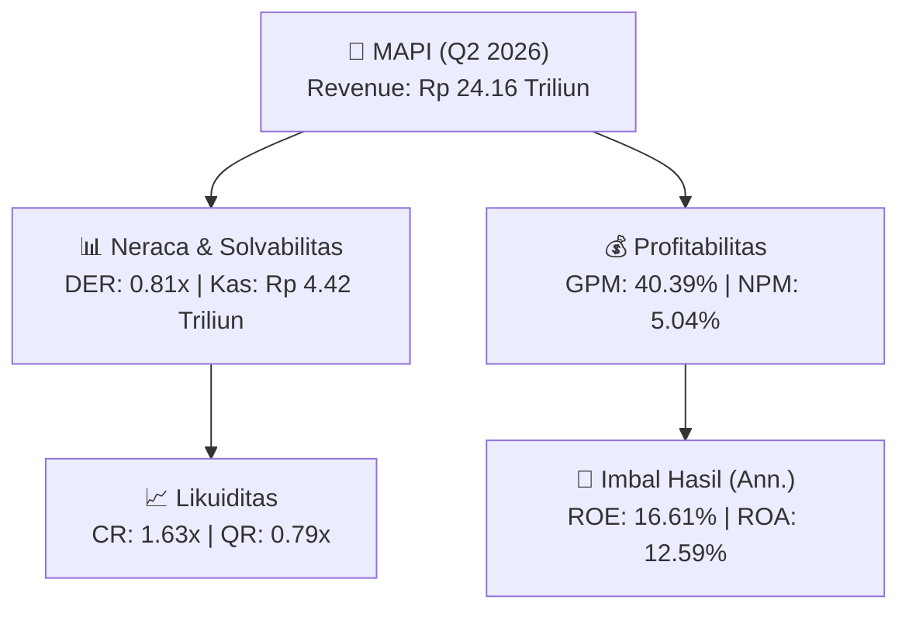
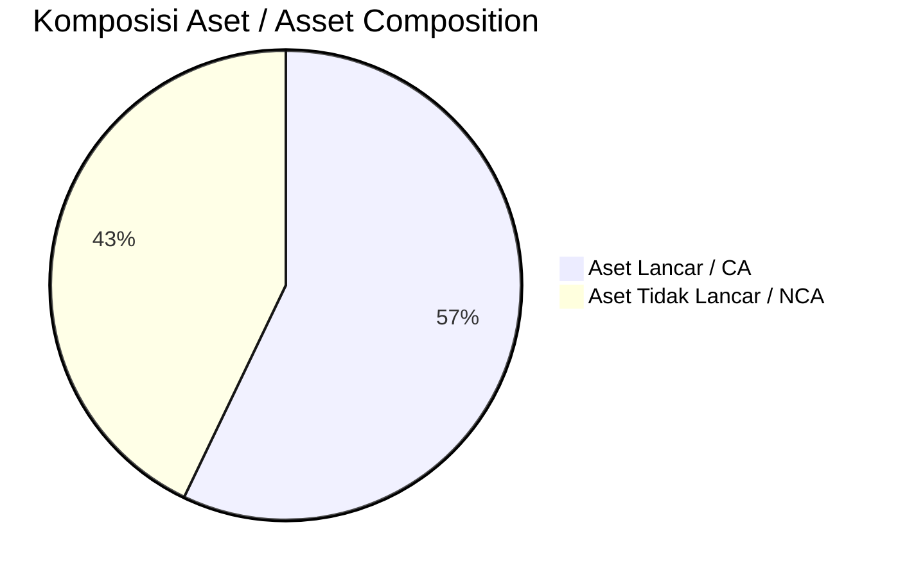
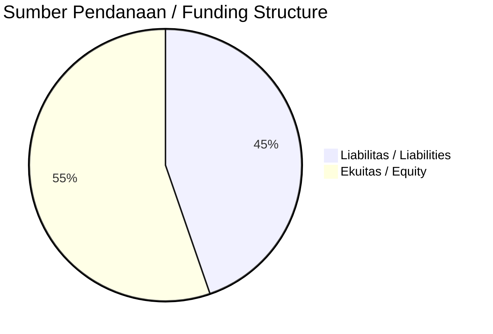

# 📈 Laporan Analisis Keuangan Mendalam: [[MAPI]] — Q2 2026

⬅️ [[knowledge-base/daily-digests/Daily_Digest_20260911|Kembali ke Daily Digest]] | 📅 **2026-09-11** | 🎛️ [[Dashboard|Ke Dashboard Utama]]

> [!IMPORTANT]
> Dokumen ini disusun oleh **Financial Summarizer Agent** untuk menganalisis kinerja keuangan, kesehatan neraca, profitabilitas, dan katalis sektor (Konsumer & Ritel) **PT Mitra Adiperkasa Tbk ([[MAPI]])** berdasarkan LK Q2 2026.

---

## 📌 1. Ikhtisar Kinerja Utama / Executive Performance Highlight
- **Emiten**: `[[MAPI]]` (PT Mitra Adiperkasa Tbk)
- **Sektor Usaha / Industry Sector**: `Konsumer & Ritel`
- **Periode Laporan / Reporting Period**: `Q2 2026`
- **Pendapatan Neto / Net Revenue**: `Rp 24.16 Triliun` (**+23.36% 🟢 YoY** dari Rp 19.58 Triliun)
- **Laba Bruto / Gross Profit**: `Rp 9.76 Triliun` (**+16.99% 🟢 YoY**)
- **Laba (Rugi) Bersih / Net Income**: `Rp 1.22 Triliun` (**+26.20% 🟢 YoY**)
- **Total Aset / Total Assets**: `Rp 20.24 Triliun` | **Total Ekuitas / Total Equity**: `Rp 15.32 Triliun`
- **EPS (Annualized)**: `2.93` | **BVPS**: `18.46`

---

## 📊 2. Laba Rugi Komparatif / Comparative Income Statement

| Pos Laba Rugi / Income Statement Item | Q2 2026 | Prior Period | YoY (%) |
| :--- | ---: | ---: | :---: |
| **Pendapatan Neto / Net Revenue** | `24.16T` | `19.58T` | **+23.36% 🟢** |
| **Beban Pokok / COGS** | `(14.40T)` | `(11.24T)` | +28.08% 🟢 |
| **Laba Bruto / Gross Profit** | `9.76T` | `8.34T` | **+16.99% 🟢** |
| **Beban Usaha / Operating Expenses** | `(1.10T)` | `(1.00T)` | +10.15% 🟢 |
| **Laba Operasional / EBIT** | `1.85T` | `1.47T` | +25.34% 🟢 |
| **Laba (Rugi) Bersih / Net Income** | **1.22T** | **964.18B** | **+26.20% 🟢** |

---

## 🏦 3. Neraca & Struktur Permodalan / Balance Sheet & Capital Structure

| Pos Neraca / Balance Sheet Item | Q2 2026 | Prior Year End | Δ YoY/YtD (%) | Catatan / Notes |
| :--- | ---: | ---: | :---: | :--- |
| **Aset Lancar / Current Assets** | `20.24T` | `18.43T` | +9.82% 🟢 | Kas: Rp 4.42 Triliun |
| **Aset Tidak Lancar / Non-Current Assets** | `15.19T` | `14.40T` | +5.52% 🟢 | Aset Tetap & Operasional |
| **TOTAL ASET / TOTAL ASSETS** | **20.24T** | **18.43T** | **+9.82% 🟢** | |
| **Liabilitas Jk. Pendek / Current Liabilities** | `12.38T` | `11.45T` | +8.11% 🟢 | |
| **Liabilitas Jk. Panjang / Non-Current Liabilities** | `4.31T` | `4.16T` | +3.55% 🟢 | |
| **TOTAL LIABILITAS / TOTAL LIABILITIES** | **12.38T** | **11.45T** | **+8.11% 🟢** | |
| **TOTAL EKUITAS / TOTAL EQUITY** | **15.32T** | **13.98T** | **+9.62% 🟢** | |

---

## 💸 4. Laporan Arus Kas / Cash Flow Statement

| Komponen Arus Kas / Cash Flow Component | Q2 2026 | Prior Period | Δ YoY (%) |
| :--- | ---: | ---: | :---: |
| **Arus Kas Operasi / CFO** | `1.44T` | `724.53B` | +99.42% 🟢 |
| **Arus Kas Investasi / CFI** | `-1.65T` | `-877.12B` | -88.65% 🔴 |
| **Arus Kas Pendanaan / CFF** | `-428.40B` | `-257.32B` | -66.48% 🔴 |
| **Kenaikan (Penurunan) Kas Bersih** | `-638.28B` | `-409.91B` | -55.71% 🔴 |
| Belanja Modal / Capex | `(1.07T)` | `(804.25B)` | +33.30% 🟢 |
| Pembayaran Dividen / Dividends Paid | `(-)` | `(-)` | - |
| **Free Cash Flow (CFO - Capex)** | **372.73B** | **-79.72B** | **+567.57% 🟢** |

---

## 📈 Analisis Rasio Keuangan / Financial Ratio Analysis

| Kategori / Category | Metrik / Metric | Nilai / Value | Benchmark | Interpretasi / Interpretation |
| :--- | :--- | :---: | :---: | :--- |
| **🛡️ Likuiditas** | **Current Ratio** | `1.63x` | `> 1.0x` | Kemampuan bayar kewajiban jk. pendek |
| | **Quick Ratio** | `0.79x` | `> 0.8x` | Likuiditas tanpa persediaan |
| **📊 Profitabilitas** | **Gross Profit Margin (GPM)** | `40.39%` | - | Margin kotor operasional inti |
| | **Operating Profit Margin (OPM)** | `7.64%` | - | Efisiensi operasional |
| | **Net Profit Margin (NPM)** | `5.04%` | - | Konversi revenue ke laba bersih |
| **🎯 Imbal Hasil (Ann.)** | **Return on Equity (ROE)** | `16.61%` | - | Imbal hasil terhadap ekuitas |
| | **Return on Assets (ROA)** | `12.59%` | - | Produktivitas aset |
| **⚖️ Solvabilitas** | **Debt to Equity (DER)** | `0.81x` | `< 2.0x` | Leverage utang vs modal |
| | **Debt to Asset (DAR)** | `0.61x` | `< 0.7x` | Porsi aset didanai utang |

---

## 📐 Per Share Metrics

| Metrik / Metric | Nilai / Value | Keterangan / Notes |
| :--- | ---: | :--- |
| **EPS (Annualized)** | `Rp 2.93` | Laba per saham (dianualisasi) |
| **BVPS** | `Rp 18.46` | Nilai buku per saham |

---

## 🚀 Analisis Strategis & Karakteristik Sektor / Strategic Analysis: Konsumer & Ritel

Pada periode Q2 2026, **PT Mitra Adiperkasa Tbk ([[MAPI]])** membukukan total pendapatan sebesar **Rp 24.16 Triliun** (+23.36% 🟢 YoY). Laba kotor tercatat **Rp 9.76 Triliun** dengan GPM **40.39%**. Laba bersih sebesar **Rp 1.22 Triliun** (+26.20% 🟢 YoY). Total aset **Rp 20.24 Triliun**, ekuitas **Rp 15.32 Triliun**, DER **0.81x**.

### 🔍 Indikator Kunci Sektor / Sector Key Indicators (Konsumer & Ritel)
- **Karakteristik Industri (Konsumer & Ritel)**: Kinerja mencerminkan dinamika penyerapan pasar, utilisasi kapasitas produksi, dan efisiensi biaya pokok.
- **Faktor Penggerak**: Pertumbuhan organik, efisiensi operasional, dan ekspansi pasar.

> [!NOTE]
> _Data Public Expose / Investor Presentation belum tersedia untuk emiten ini._

---

## 📋 Catatan Kunci Laporan Keuangan / Key Notes to Financial Statements

### 🔍 Opini Auditor / Auditor Opinion
- **Jenis Opini / Opinion Type**: `Wajar Tanpa Modifikasian / Unqualified`
- **KAP / Audit Firm**: ``

### 🤝 Transaksi Pihak Berelasi / Related Party Transactions
- Utang usaha pihak berelasi sebesar Rp 2.625 juta pada 30 Juni 2026 dan Rp 11.815 juta pada 31 Desember 2025
- Utang lain-lain pihak berelasi sebesar Rp 2.362 juta pada 30 Juni 2026 dan Rp 5.798 juta pada 31 Desember 2025

---

## 💡 Catatan Strategis & Panduan Investor / Strategic Notes & Investor Guide

1. **Kesehatan Permodalan / Capital Health**: DER **0.81x**, CR **1.63x** — _sehat dan aman_.
2. **Katalis Pertumbuhan / Growth Catalysts**: Pantau realisasi pendapatan dan efisiensi operasional periode berikutnya.

---

## 🔗 Hubungan Note Terkait / Knowledge Graph Links
- [[knowledge-base/daily-digests/Daily_Digest_20260911|📄 Daily Digest 2026-09-11]]
- [[knowledge-base/trading-signals/Trading_Signals_20260911|🎯 Trading Signals]]
- [[Dashboard|🎛️ Kembali ke Dashboard Utama]]