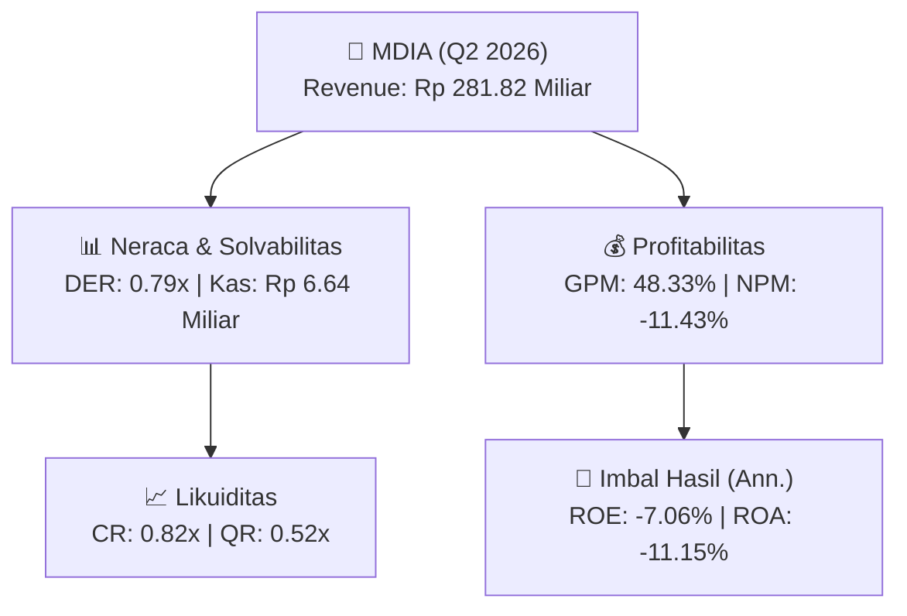
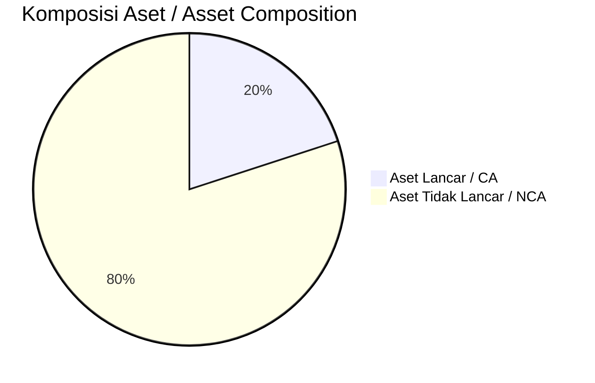
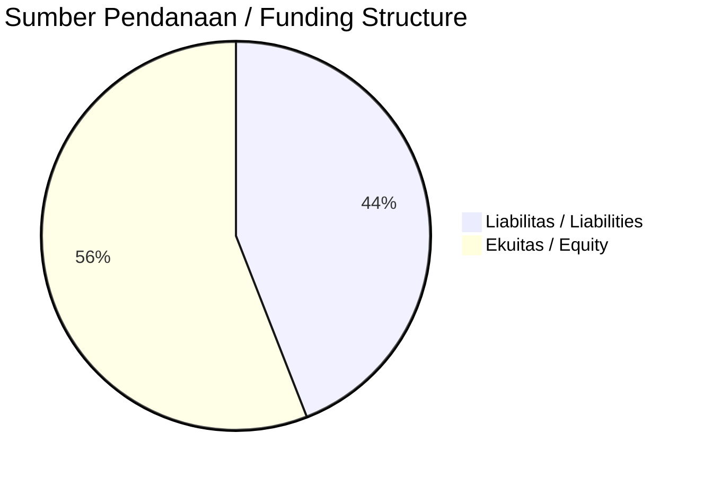

# 📈 Laporan Analisis Keuangan Mendalam: [[MDIA]] — Q2 2026

⬅️ [[knowledge-base/daily-digests/Daily_Digest_20260930|Kembali ke Daily Digest]] | 📅 **2026-09-30** | 🎛️ [[Dashboard|Ke Dashboard Utama]]

> [!IMPORTANT]
> Dokumen ini disusun oleh **Financial Summarizer Agent** untuk menganalisis kinerja keuangan, kesehatan neraca, profitabilitas, dan katalis sektor (Konsumer & Ritel) **PT Intermedia Capital Tbk. ([[MDIA]])** berdasarkan LK Q2 2026.

---

## 📌 1. Ikhtisar Kinerja Utama / Executive Performance Highlight
- **Emiten**: `[[MDIA]]` (PT Intermedia Capital Tbk.)
- **Sektor Usaha / Industry Sector**: `Konsumer & Ritel`
- **Periode Laporan / Reporting Period**: `Q2 2026`
- **Pendapatan Neto / Net Revenue**: `Rp 281.82 Miliar` (**-8.55% 🔴 YoY** dari Rp 308.17 Miliar)
- **Laba Bruto / Gross Profit**: `Rp 136.22 Miliar` (**-20.88% 🔴 YoY**)
- **Laba (Rugi) Bersih / Net Income**: `Rp -32.22 Miliar` (**-183.80% 🔴 YoY**)
- **Total Aset / Total Assets**: `Rp 580.10 Miliar` | **Total Ekuitas / Total Equity**: `Rp 898.87 Miliar`
- **EPS (Annualized)**: `-0.16` | **BVPS**: `2.29`

---

## 📊 2. Laba Rugi Komparatif / Comparative Income Statement

| Pos Laba Rugi / Income Statement Item | Q2 2026 | Prior Period | YoY (%) |
| :--- | ---: | ---: | :---: |
| **Pendapatan Neto / Net Revenue** | `281.82B` | `308.17B` | **-8.55% 🔴** |
| **Beban Pokok / COGS** | `(145.60B)` | `(136.00B)` | +7.06% 🟢 |
| **Laba Bruto / Gross Profit** | `136.22B` | `172.17B` | **-20.88% 🔴** |
| **Beban Usaha / Operating Expenses** | `(100.02B)` | `(111.34B)` | -10.17% 🔴 |
| **Laba Operasional / EBIT** | `-35.73B` | `-11.44B` | -212.22% 🔴 |
| **Laba (Rugi) Bersih / Net Income** | **-32.22B** | **-11.35B** | **-183.80% 🔴** |

---

## 🏦 3. Neraca & Struktur Permodalan / Balance Sheet & Capital Structure

| Pos Neraca / Balance Sheet Item | Q2 2026 | Prior Year End | Δ YoY/YtD (%) | Catatan / Notes |
| :--- | ---: | ---: | :---: | :--- |
| **Aset Lancar / Current Assets** | `580.10B` | `575.30B` | +0.83% 🟢 | Kas: Rp 6.64 Miliar |
| **Aset Tidak Lancar / Non-Current Assets** | `2.32T` | `2.76T` | -15.95% 🔴 | Aset Tetap & Operasional |
| **TOTAL ASET / TOTAL ASSETS** | **580.10B** | **575.30B** | **+0.83% 🟢** | |
| **Liabilitas Jk. Pendek / Current Liabilities** | `708.16B` | `813.60B` | -12.96% 🔴 | |
| **Liabilitas Jk. Panjang / Non-Current Liabilities** | `1.28T` | `1.58T` | -19.16% 🔴 | |
| **TOTAL LIABILITAS / TOTAL LIABILITIES** | **708.16B** | **813.60B** | **-12.96% 🔴** | |
| **TOTAL EKUITAS / TOTAL EQUITY** | **898.87B** | **926.44B** | **-2.98% 🔴** | |

---

## 💸 4. Laporan Arus Kas / Cash Flow Statement

| Komponen Arus Kas / Cash Flow Component | Q2 2026 | Prior Period | Δ YoY (%) |
| :--- | ---: | ---: | :---: |
| **Arus Kas Operasi / CFO** | `22.59B` | `35.46B` | -36.28% 🔴 |
| **Arus Kas Investasi / CFI** | `5.58B` | `-1.52B` | +467.31% 🟢 |
| **Arus Kas Pendanaan / CFF** | `-27.59B` | `-32.82B` | +15.93% 🟢 |
| **Kenaikan (Penurunan) Kas Bersih** | `586.49M` | `1.12B` | -47.69% 🔴 |
| Belanja Modal / Capex | `(-)` | `(-)` | - |
| Pembayaran Dividen / Dividends Paid | `(-)` | `(-)` | - |
| **Free Cash Flow (CFO - Capex)** | **-** | **-** | **-** |

---

## 📈 Analisis Rasio Keuangan / Financial Ratio Analysis

| Kategori / Category | Metrik / Metric | Nilai / Value | Benchmark | Interpretasi / Interpretation |
| :--- | :--- | :---: | :---: | :--- |
| **🛡️ Likuiditas** | **Current Ratio** | `0.82x` | `> 1.0x` | Kemampuan bayar kewajiban jk. pendek |
| | **Quick Ratio** | `0.52x` | `> 0.8x` | Likuiditas tanpa persediaan |
| **📊 Profitabilitas** | **Gross Profit Margin (GPM)** | `48.33%` | - | Margin kotor operasional inti |
| | **Operating Profit Margin (OPM)** | `-12.68%` | - | Efisiensi operasional |
| | **Net Profit Margin (NPM)** | `-11.43%` | - | Konversi revenue ke laba bersih |
| **🎯 Imbal Hasil (Ann.)** | **Return on Equity (ROE)** | `-7.06%` | - | Imbal hasil terhadap ekuitas |
| | **Return on Assets (ROA)** | `-11.15%` | - | Produktivitas aset |
| **⚖️ Solvabilitas** | **Debt to Equity (DER)** | `0.79x` | `< 2.0x` | Leverage utang vs modal |
| | **Debt to Asset (DAR)** | `1.22x` | `< 0.7x` | Porsi aset didanai utang |

---

## 📐 Per Share Metrics

| Metrik / Metric | Nilai / Value | Keterangan / Notes |
| :--- | ---: | :--- |
| **EPS (Annualized)** | `Rp -0.16` | Laba per saham (dianualisasi) |
| **BVPS** | `Rp 2.29` | Nilai buku per saham |

---

## 🚀 Analisis Strategis & Karakteristik Sektor / Strategic Analysis: Konsumer & Ritel

Pada periode Q2 2026, **PT Intermedia Capital Tbk. ([[MDIA]])** membukukan total pendapatan sebesar **Rp 281.82 Miliar** (-8.55% 🔴 YoY). Laba kotor tercatat **Rp 136.22 Miliar** dengan GPM **48.33%**. Laba bersih sebesar **Rp -32.22 Miliar** (-183.80% 🔴 YoY). Total aset **Rp 580.10 Miliar**, ekuitas **Rp 898.87 Miliar**, DER **0.79x**.

### 🔍 Indikator Kunci Sektor / Sector Key Indicators (Konsumer & Ritel)
- **Karakteristik Industri (Konsumer & Ritel)**: Kinerja mencerminkan dinamika penyerapan pasar, utilisasi kapasitas produksi, dan efisiensi biaya pokok.
- **Faktor Penggerak**: Pertumbuhan organik, efisiensi operasional, dan ekspansi pasar.

> [!NOTE]
> _Data Public Expose / Investor Presentation belum tersedia untuk emiten ini._

---

## 📋 Catatan Kunci Laporan Keuangan / Key Notes to Financial Statements

### 🔍 Opini Auditor / Auditor Opinion
- _Informasi opini auditor tidak tersedia._

### 📝 Perjanjian & Kontrak Signifikan / Key Contracts & Agreements
- Pada 13 Mei 2024, CAT dan PT Telkom Satelit Indonesia (Telkomsat) menandatangani perjanjian sewa transponder. Perjanjian diperpanjang beberapa kali, terakhir untuk periode sewa 1 Juli 2026 sampai 30 Juni 2027 (Catatan 36).

---

## 💡 Catatan Strategis & Panduan Investor / Strategic Notes & Investor Guide

1. **Kesehatan Permodalan / Capital Health**: DER **0.79x**, CR **0.82x** — _perlu dipantau secara disiplin_.
2. **Katalis Pertumbuhan / Growth Catalysts**: Pantau realisasi pendapatan dan efisiensi operasional periode berikutnya.

---

## 🔗 Hubungan Note Terkait / Knowledge Graph Links
- [[knowledge-base/daily-digests/Daily_Digest_20260930|📄 Daily Digest 2026-09-30]]
- [[knowledge-base/trading-signals/Trading_Signals_20260930|🎯 Trading Signals]]
- [[Dashboard|🎛️ Kembali ke Dashboard Utama]]