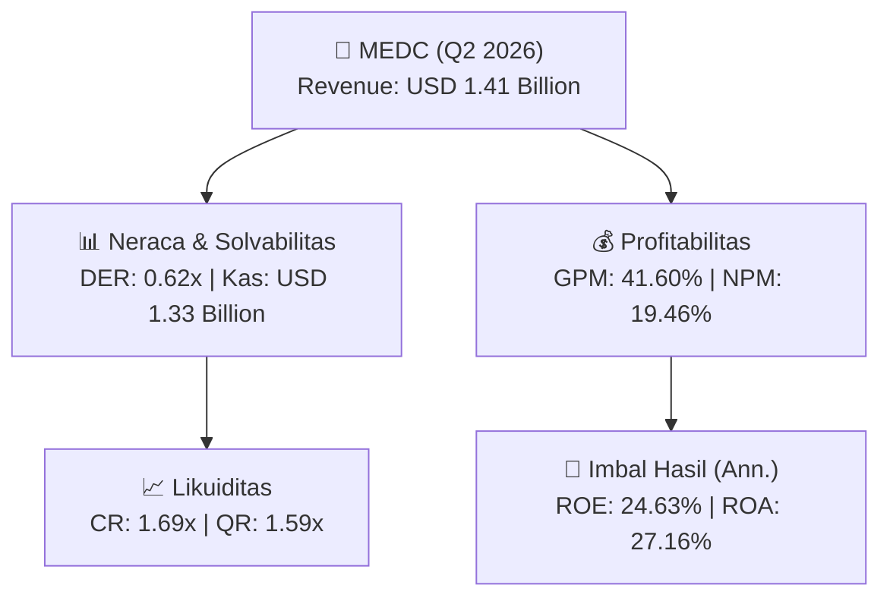
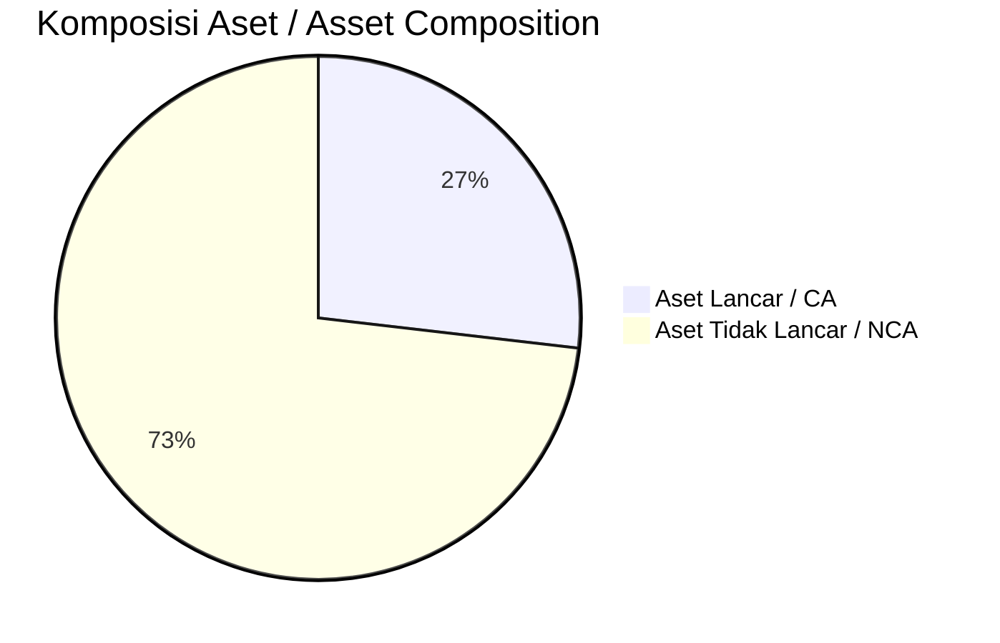
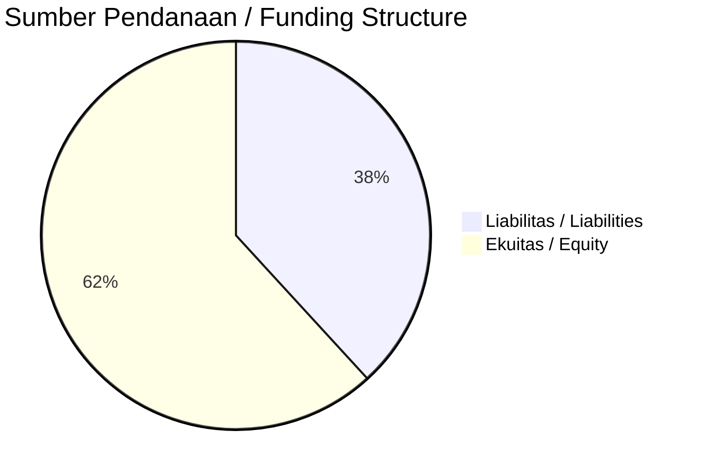

# 📈 Laporan Analisis Keuangan Mendalam: [[MEDC]] — Q2 2026

⬅️ [[knowledge-base/daily-digests/Daily_Digest_20260922|Kembali ke Daily Digest]] | 📅 **2026-09-22** | 🎛️ [[Dashboard|Ke Dashboard Utama]]

> [!IMPORTANT]
> Dokumen ini disusun oleh **Financial Summarizer Agent** untuk menganalisis kinerja keuangan, kesehatan neraca, profitabilitas, dan katalis sektor (Energi & Utilitas) **PT Medco Energi Internasional Tbk ([[MEDC]])** berdasarkan LK Q2 2026.

---

## 📌 1. Ikhtisar Kinerja Utama / Executive Performance Highlight
- **Emiten**: `[[MEDC]]` (PT Medco Energi Internasional Tbk)
- **Sektor Usaha / Industry Sector**: `Energi & Utilitas`
- **Periode Laporan / Reporting Period**: `Q2 2026`
- **Pendapatan Neto / Net Revenue**: `USD 1.41 Billion` (**+23.35% 🟢 YoY** dari USD 1.15 Billion)
- **Laba Bruto / Gross Profit**: `USD 588.49 Million` (**+30.17% 🟢 YoY**)
- **Laba (Rugi) Bersih / Net Income**: `USD 275.32 Million` (**+796.60% 🟢 YoY**)
- **Total Aset / Total Assets**: `USD 2.43 Billion` | **Total Ekuitas / Total Equity**: `USD 2.32 Billion`
- **EPS (Annualized)**: `4.52` | **BVPS**: `19.03`

---

## 📊 2. Laba Rugi Komparatif / Comparative Income Statement

| Pos Laba Rugi / Income Statement Item | Q2 2026 | Prior Period | YoY (%) |
| :--- | ---: | ---: | :---: |
| **Pendapatan Neto / Net Revenue** | `1.41B` | `1.15B` | **+23.35% 🟢** |
| **Beban Pokok / COGS** | `(826.25M)` | `(694.81M)` | +18.92% 🟢 |
| **Laba Bruto / Gross Profit** | `588.49M` | `452.11M` | **+30.17% 🟢** |
| **Beban Usaha / Operating Expenses** | `(120.03M)` | `(98.57M)` | +21.78% 🟢 |
| **Laba Operasional / EBIT** | `477.39M` | `189.85M` | +151.46% 🟢 |
| **Laba (Rugi) Bersih / Net Income** | **275.32M** | **30.71M** | **+796.60% 🟢** |

---

## 🏦 3. Neraca & Struktur Permodalan / Balance Sheet & Capital Structure

| Pos Neraca / Balance Sheet Item | Q2 2026 | Prior Year End | Δ YoY/YtD (%) | Catatan / Notes |
| :--- | ---: | ---: | :---: | :--- |
| **Aset Lancar / Current Assets** | `2.43B` | `1.63B` | +48.75% 🟢 | Kas: USD 1.33 Billion |
| **Aset Tidak Lancar / Non-Current Assets** | `6.61B` | `6.73B` | -1.84% 🔴 | Aset Tetap & Operasional |
| **TOTAL ASET / TOTAL ASSETS** | **2.43B** | **1.63B** | **+48.75% 🟢** | |
| **Liabilitas Jk. Pendek / Current Liabilities** | `1.43B` | `1.39B` | +3.38% 🟢 | |
| **Liabilitas Jk. Panjang / Non-Current Liabilities** | `5.07B` | `4.62B` | +9.86% 🟢 | |
| **TOTAL LIABILITAS / TOTAL LIABILITIES** | **1.43B** | **1.39B** | **+3.38% 🟢** | |
| **TOTAL EKUITAS / TOTAL EQUITY** | **2.32B** | **2.15B** | **+7.64% 🟢** | |

---

## 💸 4. Laporan Arus Kas / Cash Flow Statement

| Komponen Arus Kas / Cash Flow Component | Q2 2026 | Prior Period | Δ YoY (%) |
| :--- | ---: | ---: | :---: |
| **Arus Kas Operasi / CFO** | `514.72M` | `351.16M` | +46.58% 🟢 |
| **Arus Kas Investasi / CFI** | `-135.42M` | `-35.76M` | -278.67% 🔴 |
| **Arus Kas Pendanaan / CFF** | `381.58M` | `-128.40M` | +397.19% 🟢 |
| **Kenaikan (Penurunan) Kas Bersih** | `760.88M` | `187.00M` | +306.89% 🟢 |
| Belanja Modal / Capex | `(3.21M)` | `(7.11M)` | -54.85% 🔴 |
| Pembayaran Dividen / Dividends Paid | `(-)` | `(41.22M)` | - |
| **Free Cash Flow (CFO - Capex)** | **511.51M** | **344.05M** | **+48.67% 🟢** |

---

## 📈 Analisis Rasio Keuangan / Financial Ratio Analysis

| Kategori / Category | Metrik / Metric | Nilai / Value | Benchmark | Interpretasi / Interpretation |
| :--- | :--- | :---: | :---: | :--- |
| **🛡️ Likuiditas** | **Current Ratio** | `1.69x` | `> 1.0x` | Kemampuan bayar kewajiban jk. pendek |
| | **Quick Ratio** | `1.59x` | `> 0.8x` | Likuiditas tanpa persediaan |
| **📊 Profitabilitas** | **Gross Profit Margin (GPM)** | `41.60%` | - | Margin kotor operasional inti |
| | **Operating Profit Margin (OPM)** | `33.74%` | - | Efisiensi operasional |
| | **Net Profit Margin (NPM)** | `19.46%` | - | Konversi revenue ke laba bersih |
| **🎯 Imbal Hasil (Ann.)** | **Return on Equity (ROE)** | `24.63%` | - | Imbal hasil terhadap ekuitas |
| | **Return on Assets (ROA)** | `27.16%` | - | Produktivitas aset |
| **⚖️ Solvabilitas** | **Debt to Equity (DER)** | `0.62x` | `< 2.0x` | Leverage utang vs modal |
| | **Debt to Asset (DAR)** | `0.59x` | `< 0.7x` | Porsi aset didanai utang |

---

## 📐 Per Share Metrics

| Metrik / Metric | Nilai / Value | Keterangan / Notes |
| :--- | ---: | :--- |
| **EPS (Annualized)** | `USD 4.52` | Laba per saham (dianualisasi) |
| **BVPS** | `USD 19.03` | Nilai buku per saham |

---

## 🚀 Analisis Strategis & Karakteristik Sektor / Strategic Analysis: Energi & Utilitas

Pada periode Q2 2026, **PT Medco Energi Internasional Tbk ([[MEDC]])** membukukan total pendapatan sebesar **USD 1.41 Billion** (+23.35% 🟢 YoY). Laba kotor tercatat **USD 588.49 Million** dengan GPM **41.60%**. Laba bersih sebesar **USD 275.32 Million** (+796.60% 🟢 YoY). Total aset **USD 2.43 Billion**, ekuitas **USD 2.32 Billion**, DER **0.62x**.

### 🔍 Indikator Kunci Sektor / Sector Key Indicators (Energi & Utilitas)
- **Karakteristik Industri Tambang & Komoditas / Mining & Commodity**: Kinerja dipengaruhi oleh Average Selling Price (ASP), volume produksi/pengapalan, dan efisiensi Cash Cost per ton.
- **Profil Arus Kas / Cash Flow Profile**: Arus kas operasional yang solid menopang dividen berkala dan ekspansi hilirisasi / transisi energi.
- **Regulasi & ESG**: Kewajiban reklamasi, royalti pemerintah, dan komitmen keberlanjutan.

> [!NOTE]
> _Data Public Expose / Investor Presentation belum tersedia untuk emiten ini._

---

## 📋 Catatan Kunci Laporan Keuangan / Key Notes to Financial Statements

### 🔍 Opini Auditor / Auditor Opinion
- **Jenis Opini / Opinion Type**: `Wajar Tanpa Modifikasian / Unqualified`
- **KAP / Audit Firm**: `KAP Purwanto Susanti dan Surja`
- **Partner Audit**: `Indrajuwana Komala Widjaja`
- **Tanggal Laporan / Report Date**: `2026-09-21`

---

## 💡 Catatan Strategis & Panduan Investor / Strategic Notes & Investor Guide

1. **Kesehatan Permodalan / Capital Health**: DER **0.62x**, CR **1.69x** — _sehat dan aman_.
2. **Katalis Pertumbuhan / Growth Catalysts**: Pantau realisasi pendapatan dan efisiensi operasional periode berikutnya.

---

## 🔗 Hubungan Note Terkait / Knowledge Graph Links
- [[knowledge-base/daily-digests/Daily_Digest_20260922|📄 Daily Digest 2026-09-22]]
- [[knowledge-base/trading-signals/Trading_Signals_20260922|🎯 Trading Signals]]
- [[Dashboard|🎛️ Kembali ke Dashboard Utama]]