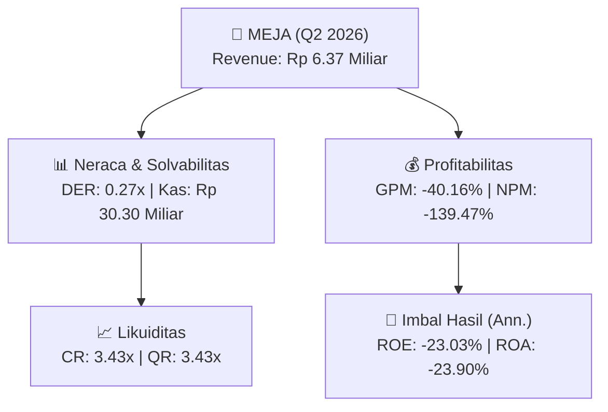
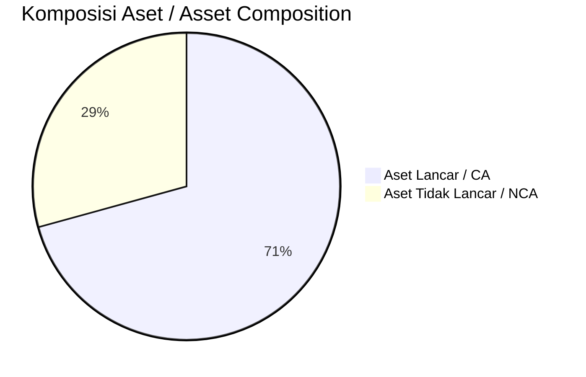
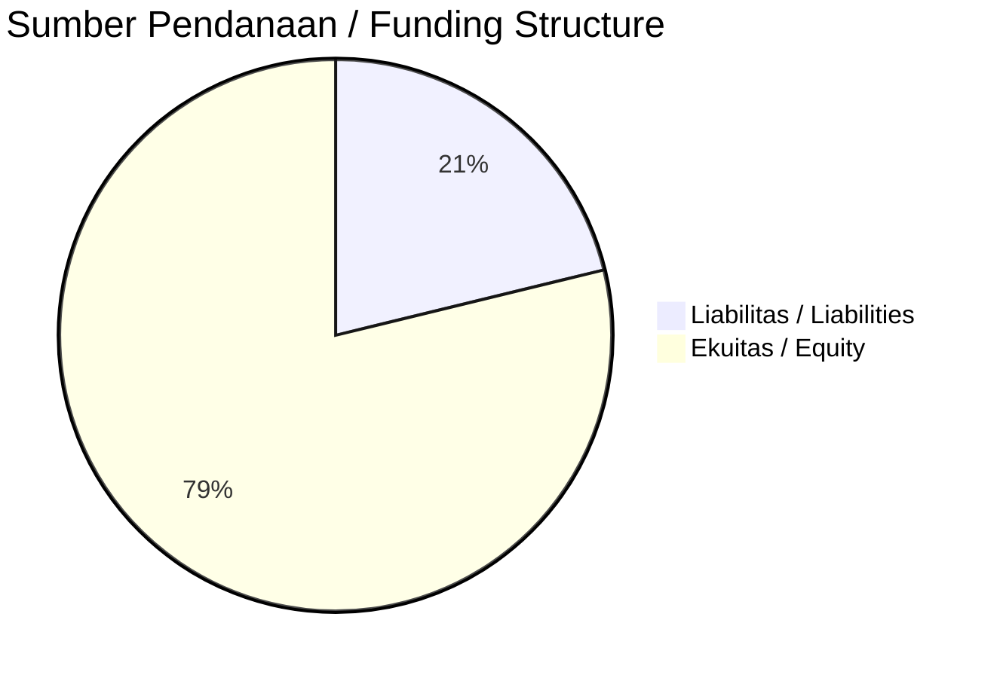

# 📈 Laporan Analisis Keuangan Mendalam: [[MEJA]] — Q2 2026

⬅️ [[knowledge-base/daily-digests/Daily_Digest_20260909|Kembali ke Daily Digest]] | 📅 **2026-09-09** | 🎛️ [[Dashboard|Ke Dashboard Utama]]

> [!IMPORTANT]
> Dokumen ini disusun oleh **Financial Summarizer Agent** untuk menganalisis kinerja keuangan, kesehatan neraca, profitabilitas, dan katalis sektor (Konsumer & Ritel) **PT Harta Djaya Karya Tbk ([[MEJA]])** berdasarkan LK Q2 2026.

---

## 📌 1. Ikhtisar Kinerja Utama / Executive Performance Highlight
- **Emiten**: `[[MEJA]]` (PT Harta Djaya Karya Tbk)
- **Sektor Usaha / Industry Sector**: `Konsumer & Ritel`
- **Periode Laporan / Reporting Period**: `Q2 2026`
- **Pendapatan Neto / Net Revenue**: `Rp 6.37 Miliar` (**-79.50% 🔴 YoY** dari Rp 31.07 Miliar)
- **Laba Bruto / Gross Profit**: `Rp -2.56 Miliar` (**-132.84% 🔴 YoY**)
- **Laba (Rugi) Bersih / Net Income**: `Rp -8.88 Miliar` (**-998.54% 🔴 YoY**)
- **Total Aset / Total Assets**: `Rp 83.56 Miliar` | **Total Ekuitas / Total Equity**: `Rp 90.73 Miliar`
- **EPS (Annualized)**: `-0.34` | **BVPS**: `1.74`

---

## 📊 2. Laba Rugi Komparatif / Comparative Income Statement

| Pos Laba Rugi / Income Statement Item | Q2 2026 | Prior Period | YoY (%) |
| :--- | ---: | ---: | :---: |
| **Pendapatan Neto / Net Revenue** | `6.37B` | `31.07B` | **-79.50% 🔴** |
| **Beban Pokok / COGS** | `(8.93B)` | `(23.28B)` | -61.65% 🔴 |
| **Laba Bruto / Gross Profit** | `-2.56B` | `7.79B` | **-132.84% 🔴** |
| **Beban Usaha / Operating Expenses** | `(4.41B)` | `(4.97B)` | -11.22% 🔴 |
| **Laba Operasional / EBIT** | `-8.79B` | `1.65B` | -634.23% 🔴 |
| **Laba (Rugi) Bersih / Net Income** | **-8.88B** | **988.78M** | **-998.54% 🔴** |

---

## 🏦 3. Neraca & Struktur Permodalan / Balance Sheet & Capital Structure

| Pos Neraca / Balance Sheet Item | Q2 2026 | Prior Year End | Δ YoY/YtD (%) | Catatan / Notes |
| :--- | ---: | ---: | :---: | :--- |
| **Aset Lancar / Current Assets** | `83.56B` | `65.15B` | +28.26% 🟢 | Kas: Rp 30.30 Miliar |
| **Aset Tidak Lancar / Non-Current Assets** | `34.59B` | `23.56B` | +46.82% 🟢 | Aset Tetap & Operasional |
| **TOTAL ASET / TOTAL ASSETS** | **83.56B** | **65.15B** | **+28.26% 🟢** | |
| **Liabilitas Jk. Pendek / Current Liabilities** | `24.38B` | `24.15B` | +0.95% 🟢 | |
| **Liabilitas Jk. Panjang / Non-Current Liabilities** | `3.04B` | `974.74M` | +212.08% 🟢 | |
| **TOTAL LIABILITAS / TOTAL LIABILITIES** | **24.38B** | **24.15B** | **+0.95% 🟢** | |
| **TOTAL EKUITAS / TOTAL EQUITY** | **90.73B** | **63.59B** | **+42.69% 🟢** | |

---

## 💸 4. Laporan Arus Kas / Cash Flow Statement

| Komponen Arus Kas / Cash Flow Component | Q2 2026 | Prior Period | Δ YoY (%) |
| :--- | ---: | ---: | :---: |
| **Arus Kas Operasi / CFO** | `-27.09B` | `14.49B` | -286.91% 🔴 |
| **Arus Kas Investasi / CFI** | `-11.48B` | `-10.97B` | -4.66% 🔴 |
| **Arus Kas Pendanaan / CFF** | `38.52B` | `-2.08B` | +1953.68% 🟢 |
| **Kenaikan (Penurunan) Kas Bersih** | `-49.17M` | `1.44B` | -103.41% 🔴 |
| Belanja Modal / Capex | `(-)` | `(-)` | - |
| Pembayaran Dividen / Dividends Paid | `(-)` | `(-)` | - |
| **Free Cash Flow (CFO - Capex)** | **-** | **-** | **-** |

---

## 📈 Analisis Rasio Keuangan / Financial Ratio Analysis

| Kategori / Category | Metrik / Metric | Nilai / Value | Benchmark | Interpretasi / Interpretation |
| :--- | :--- | :---: | :---: | :--- |
| **🛡️ Likuiditas** | **Current Ratio** | `3.43x` | `> 1.0x` | Kemampuan bayar kewajiban jk. pendek |
| | **Quick Ratio** | `3.43x` | `> 0.8x` | Likuiditas tanpa persediaan |
| **📊 Profitabilitas** | **Gross Profit Margin (GPM)** | `-40.16%` | - | Margin kotor operasional inti |
| | **Operating Profit Margin (OPM)** | `-138.02%` | - | Efisiensi operasional |
| | **Net Profit Margin (NPM)** | `-139.47%` | - | Konversi revenue ke laba bersih |
| **🎯 Imbal Hasil (Ann.)** | **Return on Equity (ROE)** | `-23.03%` | - | Imbal hasil terhadap ekuitas |
| | **Return on Assets (ROA)** | `-23.90%` | - | Produktivitas aset |
| **⚖️ Solvabilitas** | **Debt to Equity (DER)** | `0.27x` | `< 2.0x` | Leverage utang vs modal |
| | **Debt to Asset (DAR)** | `0.29x` | `< 0.7x` | Porsi aset didanai utang |

---

## 📐 Per Share Metrics

| Metrik / Metric | Nilai / Value | Keterangan / Notes |
| :--- | ---: | :--- |
| **EPS (Annualized)** | `Rp -0.34` | Laba per saham (dianualisasi) |
| **BVPS** | `Rp 1.74` | Nilai buku per saham |

---

## 🚀 Analisis Strategis & Karakteristik Sektor / Strategic Analysis: Konsumer & Ritel

Pada periode Q2 2026, **PT Harta Djaya Karya Tbk ([[MEJA]])** membukukan total pendapatan sebesar **Rp 6.37 Miliar** (-79.50% 🔴 YoY). Laba kotor tercatat **Rp -2.56 Miliar** dengan GPM **-40.16%**. Laba bersih sebesar **Rp -8.88 Miliar** (-998.54% 🔴 YoY). Total aset **Rp 83.56 Miliar**, ekuitas **Rp 90.73 Miliar**, DER **0.27x**.

### 🔍 Indikator Kunci Sektor / Sector Key Indicators (Konsumer & Ritel)
- **Karakteristik Industri (Konsumer & Ritel)**: Kinerja mencerminkan dinamika penyerapan pasar, utilisasi kapasitas produksi, dan efisiensi biaya pokok.
- **Faktor Penggerak**: Pertumbuhan organik, efisiensi operasional, dan ekspansi pasar.

> [!NOTE]
> _Data Public Expose / Investor Presentation belum tersedia untuk emiten ini._

---

## 📋 Catatan Kunci Laporan Keuangan / Key Notes to Financial Statements

### 🔍 Opini Auditor / Auditor Opinion
- **Jenis Opini / Opinion Type**: `Wajar Tanpa Modifikasian / Unqualified`
- **KAP / Audit Firm**: `KAP Robert, Rudi, Yansen  Rekan`
- **Partner Audit**: `Robert Ricker`
- **Tanggal Laporan / Report Date**: `2026-09-07`
- **Kesimpulan**: _-_

### 🤝 Transaksi Pihak Berelasi / Related Party Transactions
- Pendapatan dari pihak berelasi: PT Rukun Raharja Tbk, PT Nusantara Bina Artha, Ibu Leotine Ierma Agustina S, PT Matrixindo Multi Kreasi, PT Nusantara Compnet Integrator

---

## 💡 Catatan Strategis & Panduan Investor / Strategic Notes & Investor Guide

1. **Kesehatan Permodalan / Capital Health**: DER **0.27x**, CR **3.43x** — _sehat dan aman_.
2. **Katalis Pertumbuhan / Growth Catalysts**: Pantau realisasi pendapatan dan efisiensi operasional periode berikutnya.

---

## 🔗 Hubungan Note Terkait / Knowledge Graph Links
- [[knowledge-base/daily-digests/Daily_Digest_20260909|📄 Daily Digest 2026-09-09]]
- [[knowledge-base/trading-signals/Trading_Signals_20260909|🎯 Trading Signals]]
- [[Dashboard|🎛️ Kembali ke Dashboard Utama]]