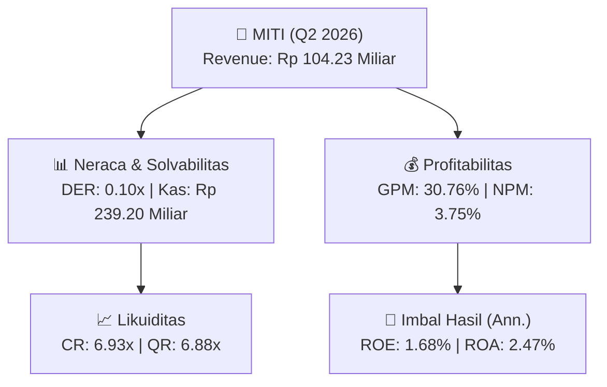
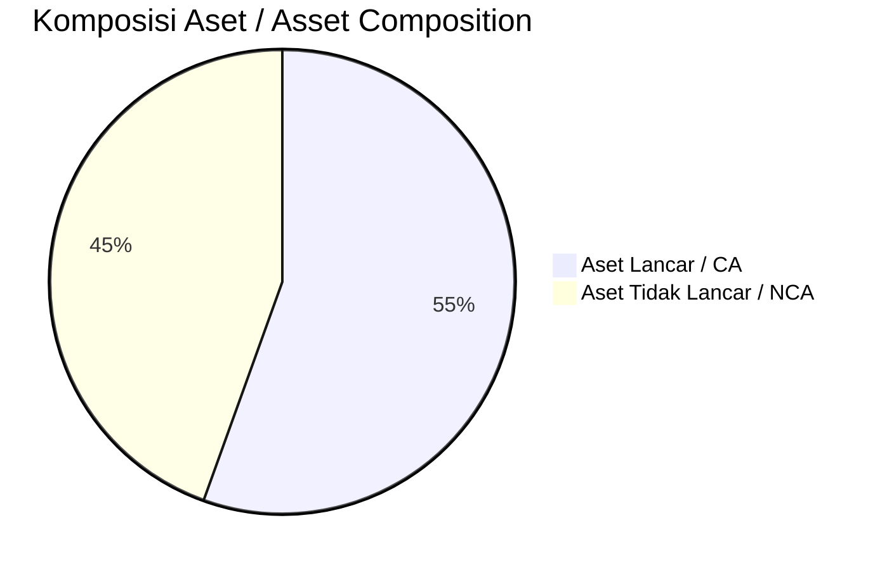
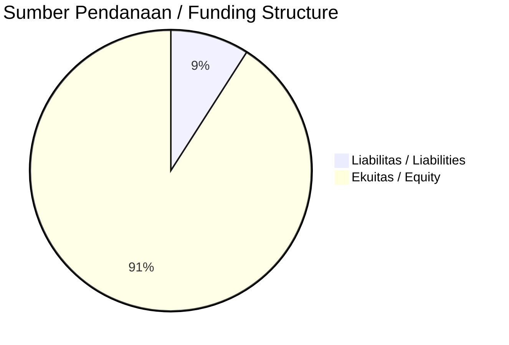

# 📈 Laporan Analisis Keuangan Mendalam: [[MITI]] — Q2 2026

⬅️ [[knowledge-base/daily-digests/Daily_Digest_20260901|Kembali ke Daily Digest]] | 📅 **2026-09-01** | 🎛️ [[Dashboard|Ke Dashboard Utama]]

> [!IMPORTANT]
> Dokumen ini disusun oleh **Financial Summarizer Agent** untuk menganalisis kinerja keuangan, kesehatan neraca, profitabilitas, dan katalis sektor (Infrastruktur & Transportasi) **Mitra Investindo Tbk ([[MITI]])** berdasarkan LK Q2 2026.

---

## 📌 1. Ikhtisar Kinerja Utama / Executive Performance Highlight
- **Emiten**: `[[MITI]]` (Mitra Investindo Tbk)
- **Sektor Usaha / Industry Sector**: `Infrastruktur & Transportasi`
- **Periode Laporan / Reporting Period**: `Q2 2026`
- **Pendapatan Neto / Net Revenue**: `Rp 104.23 Miliar` (**-13.14% 🔴 YoY** dari Rp 120.00 Miliar)
- **Laba Bruto / Gross Profit**: `Rp 32.06 Miliar` (**-2.20% 🔴 YoY**)
- **Laba (Rugi) Bersih / Net Income**: `Rp 3.91 Miliar` (**-22.57% 🔴 YoY**)
- **Total Aset / Total Assets**: `Rp 324.23 Miliar` | **Total Ekuitas / Total Equity**: `Rp 468.98 Miliar`
- **EPS (Annualized)**: `0.03` | **BVPS**: `1.94`

---

## 📊 2. Laba Rugi Komparatif / Comparative Income Statement

| Pos Laba Rugi / Income Statement Item | Q2 2026 | Prior Period | YoY (%) |
| :--- | ---: | ---: | :---: |
| **Pendapatan Neto / Net Revenue** | `104.23B` | `120.00B` | **-13.14% 🔴** |
| **Beban Pokok / COGS** | `(72.17B)` | `(87.22B)` | -17.25% 🔴 |
| **Laba Bruto / Gross Profit** | `32.06B` | `32.78B` | **-2.20% 🔴** |
| **Beban Usaha / Operating Expenses** | `(26.55B)` | `(24.47B)` | +8.51% 🟢 |
| **Laba Operasional / EBIT** | `7.89B` | `11.27B` | -29.97% 🔴 |
| **Laba (Rugi) Bersih / Net Income** | **3.91B** | **5.05B** | **-22.57% 🔴** |

---

## 🏦 3. Neraca & Struktur Permodalan / Balance Sheet & Capital Structure

| Pos Neraca / Balance Sheet Item | Q2 2026 | Prior Year End | Δ YoY/YtD (%) | Catatan / Notes |
| :--- | ---: | ---: | :---: | :--- |
| **Aset Lancar / Current Assets** | `324.23B` | `309.43B` | +4.78% 🟢 | Kas: Rp 239.20 Miliar |
| **Aset Tidak Lancar / Non-Current Assets** | `259.99B` | `261.37B` | -0.53% 🔴 | Aset Tetap & Operasional |
| **TOTAL ASET / TOTAL ASSETS** | **324.23B** | **309.43B** | **+4.78% 🟢** | |
| **Liabilitas Jk. Pendek / Current Liabilities** | `46.79B` | `44.73B` | +4.61% 🟢 | |
| **Liabilitas Jk. Panjang / Non-Current Liabilities** | `20.11B` | `13.07B` | +53.84% 🟢 | |
| **TOTAL LIABILITAS / TOTAL LIABILITIES** | **46.79B** | **44.73B** | **+4.61% 🟢** | |
| **TOTAL EKUITAS / TOTAL EQUITY** | **468.98B** | **465.06B** | **+0.84% 🟢** | |

---

## 💸 4. Laporan Arus Kas / Cash Flow Statement

| Komponen Arus Kas / Cash Flow Component | Q2 2026 | Prior Period | Δ YoY (%) |
| :--- | ---: | ---: | :---: |
| **Arus Kas Operasi / CFO** | `-10.43B` | `7.89B` | -232.22% 🔴 |
| **Arus Kas Investasi / CFI** | `-6.17B` | `2.48B` | -348.81% 🔴 |
| **Arus Kas Pendanaan / CFF** | `16.96B` | `11.09B` | +52.91% 🟢 |
| **Kenaikan (Penurunan) Kas Bersih** | `351.89M` | `21.46B` | -98.36% 🔴 |
| Belanja Modal / Capex | `(1.39B)` | `(380.27M)` | +264.41% 🟢 |
| Pembayaran Dividen / Dividends Paid | `(-)` | `(800.00M)` | - |
| **Free Cash Flow (CFO - Capex)** | **-11.82B** | **7.51B** | **-257.36% 🔴** |

---

## 📈 Analisis Rasio Keuangan / Financial Ratio Analysis

| Kategori / Category | Metrik / Metric | Nilai / Value | Benchmark | Interpretasi / Interpretation |
| :--- | :--- | :---: | :---: | :--- |
| **🛡️ Likuiditas** | **Current Ratio** | `6.93x` | `> 1.0x` | Kemampuan bayar kewajiban jk. pendek |
| | **Quick Ratio** | `6.88x` | `> 0.8x` | Likuiditas tanpa persediaan |
| **📊 Profitabilitas** | **Gross Profit Margin (GPM)** | `30.76%` | - | Margin kotor operasional inti |
| | **Operating Profit Margin (OPM)** | `7.57%` | - | Efisiensi operasional |
| | **Net Profit Margin (NPM)** | `3.75%` | - | Konversi revenue ke laba bersih |
| **🎯 Imbal Hasil (Ann.)** | **Return on Equity (ROE)** | `1.68%` | - | Imbal hasil terhadap ekuitas |
| | **Return on Assets (ROA)** | `2.47%` | - | Produktivitas aset |
| **⚖️ Solvabilitas** | **Debt to Equity (DER)** | `0.10x` | `< 2.0x` | Leverage utang vs modal |
| | **Debt to Asset (DAR)** | `0.14x` | `< 0.7x` | Porsi aset didanai utang |

---

## 📐 Per Share Metrics

| Metrik / Metric | Nilai / Value | Keterangan / Notes |
| :--- | ---: | :--- |
| **EPS (Annualized)** | `Rp 0.03` | Laba per saham (dianualisasi) |
| **BVPS** | `Rp 1.94` | Nilai buku per saham |

---

## 🚀 Analisis Strategis & Karakteristik Sektor / Strategic Analysis: Infrastruktur & Transportasi

Pada periode Q2 2026, **Mitra Investindo Tbk ([[MITI]])** membukukan total pendapatan sebesar **Rp 104.23 Miliar** (-13.14% 🔴 YoY). Laba kotor tercatat **Rp 32.06 Miliar** dengan GPM **30.76%**. Laba bersih sebesar **Rp 3.91 Miliar** (-22.57% 🔴 YoY). Total aset **Rp 324.23 Miliar**, ekuitas **Rp 468.98 Miliar**, DER **0.10x**.

### 🔍 Indikator Kunci Sektor / Sector Key Indicators (Infrastruktur & Transportasi)
- **Karakteristik Infrastruktur & Transportasi**: Kinerja didorong oleh pertumbuhan volume Lalu Lintas Harian Rata-rata (LHR) dan penyesuaian tarif berkala.
- **Struktur Leverage / Leverage Structure**: Pengelolaan liabilitas jangka panjang yang terukur seiring masa konsesi.
- **Recurring Revenue**: Pendapatan tol/sewa/transport bersifat recurring dan predictable.

> [!NOTE]
> _Data Public Expose / Investor Presentation belum tersedia untuk emiten ini._

---

## 📋 Catatan Kunci Laporan Keuangan / Key Notes to Financial Statements

### 🔍 Opini Auditor / Auditor Opinion
- **Jenis Opini / Opinion Type**: `Reviu Terbatas / Limited Review`
- **KAP / Audit Firm**: `KAP Paul Hadiwinata, Hidajat, Arsono, Retno, Palilingan  Rekan`
- **Partner Audit**: `Indra Yagi Oktoriansyah`
- **Tanggal Laporan / Report Date**: `2026-08-28`
- **Kesimpulan**: _Berdasarkan reviu kami, tidak terdapat hal yang menjadi perhatian kami, yang menyebabkan kami yakin bahwa laporan keuangan konsolidasian interim terlampir tidak menyajikan secara wajar, dalam semua hal yang material, posisi keuangan konsolidasian PT Mitra Investindo Tbk dan entitas anak tanggal 30 J..._

### ⚠️ Komitmen & Kontinjensi / Commitments & Contingencies
- Berdasarkan Putusan Pengadilan Niaga pada Pengadilan Negeri Jakarta Pusat No. 159/Pdt.Sus-PKPU/2019/PN.Niaga.Jkt.Pst tanggal 3 Oktober 2019, PT Indelberg Oil Indonesia dinyatakan pailit dan sedang dalam proses likuidasi.

---

## 💡 Catatan Strategis & Panduan Investor / Strategic Notes & Investor Guide

1. **Kesehatan Permodalan / Capital Health**: DER **0.10x**, CR **6.93x** — _sehat dan aman_.
2. **Katalis Pertumbuhan / Growth Catalysts**: Pantau realisasi pendapatan dan efisiensi operasional periode berikutnya.

---

## 🔗 Hubungan Note Terkait / Knowledge Graph Links
- [[knowledge-base/daily-digests/Daily_Digest_20260901|📄 Daily Digest 2026-09-01]]
- [[knowledge-base/trading-signals/Trading_Signals_20260901|🎯 Trading Signals]]
- [[Dashboard|🎛️ Kembali ke Dashboard Utama]]