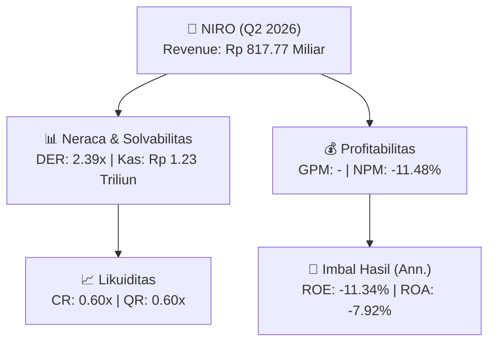
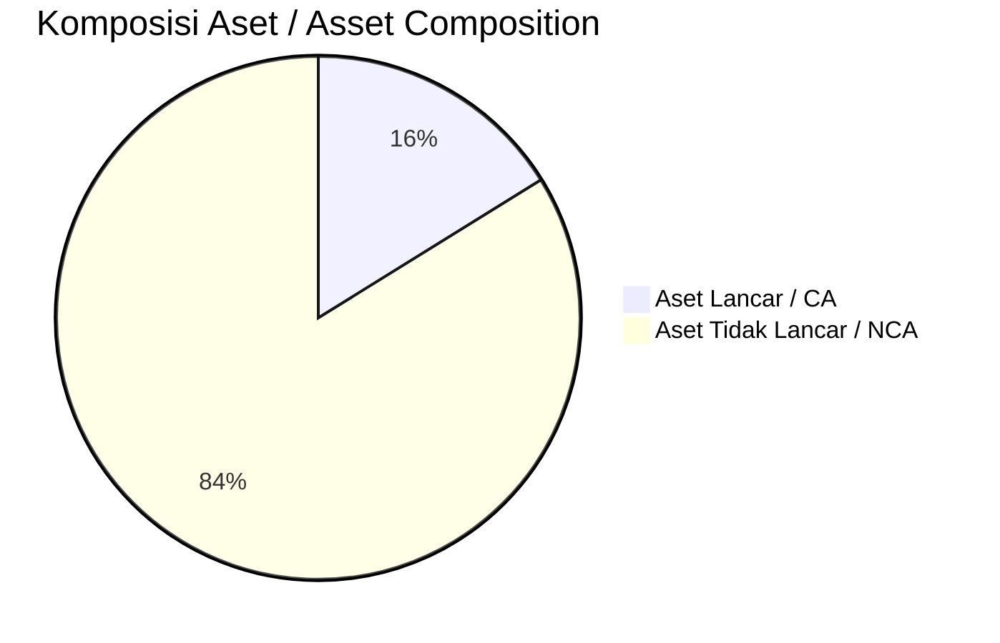
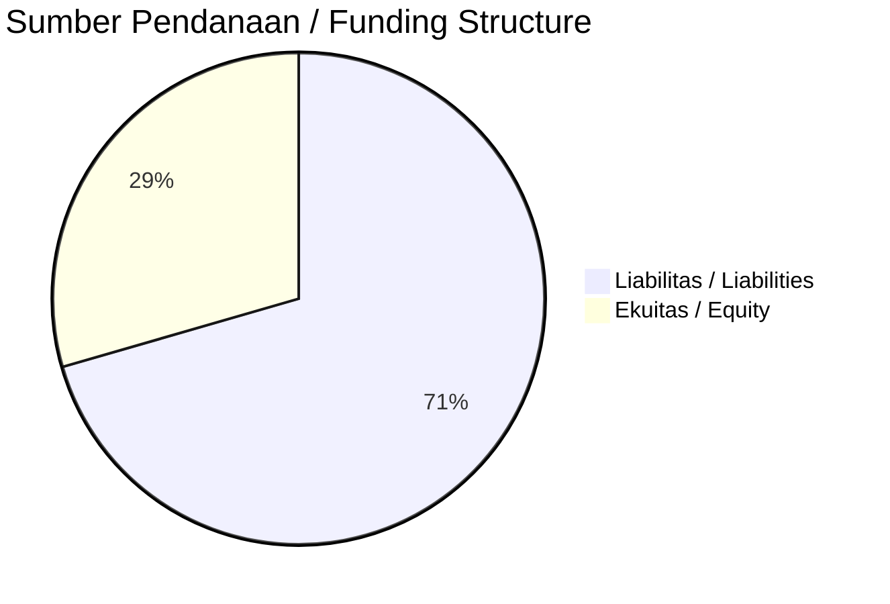

# 📈 Laporan Analisis Keuangan Mendalam: [[NIRO]] — Q2 2026

⬅️ [[knowledge-base/daily-digests/Daily_Digest_20260929|Kembali ke Daily Digest]] | 📅 **2026-09-29** | 🎛️ [[Dashboard|Ke Dashboard Utama]]

> [!IMPORTANT]
> Dokumen ini disusun oleh **Financial Summarizer Agent** untuk menganalisis kinerja keuangan, kesehatan neraca, profitabilitas, dan katalis sektor (Properti & Konstruksi) **City Retail Developments Tbk ([[NIRO]])** berdasarkan LK Q2 2026.

---

## 📌 1. Ikhtisar Kinerja Utama / Executive Performance Highlight
- **Emiten**: `[[NIRO]]` (City Retail Developments Tbk)
- **Sektor Usaha / Industry Sector**: `Properti & Konstruksi`
- **Periode Laporan / Reporting Period**: `Q2 2026`
- **Pendapatan Neto / Net Revenue**: `Rp 817.77 Miliar` (**+12.39% 🟢 YoY** dari Rp 727.61 Miliar)

- **Laba (Rugi) Bersih / Net Income**: `Rp -93.86 Miliar` (**-36.70% 🔴 YoY**)
- **Total Aset / Total Assets**: `Rp 2.32 Triliun` | **Total Ekuitas / Total Equity**: `Rp 1.61 Triliun`
- **EPS (Annualized)**: `-0.08` | **BVPS**: `0.72`

---

## 📊 2. Laba Rugi Komparatif / Comparative Income Statement

| Pos Laba Rugi / Income Statement Item | Q2 2026 | Prior Period | YoY (%) |
| :--- | ---: | ---: | :---: |
| **Pendapatan Neto / Net Revenue** | `817.77B` | `727.61B` | **+12.39% 🟢** |
| **Beban Pokok / COGS** | `(-)` | `(-)` | - |
| **Laba Bruto / Gross Profit** | `-` | `-` | **-** |
| **Beban Usaha / Operating Expenses** | `(-)` | `(-)` | - |
| **Laba Operasional / EBIT** | `-146.63B` | `-120.48B` | -21.70% 🔴 |
| **Laba (Rugi) Bersih / Net Income** | **-93.86B** | **-68.66B** | **-36.70% 🔴** |

---

## 🏦 3. Neraca & Struktur Permodalan / Balance Sheet & Capital Structure

| Pos Neraca / Balance Sheet Item | Q2 2026 | Prior Year End | Δ YoY/YtD (%) | Catatan / Notes |
| :--- | ---: | ---: | :---: | :--- |
| **Aset Lancar / Current Assets** | `2.32T` | `2.43T` | -4.50% 🔴 | Kas: Rp 1.23 Triliun |
| **Aset Tidak Lancar / Non-Current Assets** | `12.02T` | `11.96T` | +0.49% 🟢 | Aset Tetap & Operasional |
| **TOTAL ASET / TOTAL ASSETS** | **2.32T** | **2.43T** | **-4.50% 🔴** | |
| **Liabilitas Jk. Pendek / Current Liabilities** | `3.84T` | `2.36T` | +62.44% 🟢 | |
| **Liabilitas Jk. Panjang / Non-Current Liabilities** | `5.96T` | `7.23T` | -17.56% 🔴 | |
| **TOTAL LIABILITAS / TOTAL LIABILITIES** | **3.84T** | **2.36T** | **+62.44% 🟢** | |
| **TOTAL EKUITAS / TOTAL EQUITY** | **1.61T** | **1.70T** | **-5.80% 🔴** | |

---

## 💸 4. Laporan Arus Kas / Cash Flow Statement

| Komponen Arus Kas / Cash Flow Component | Q2 2026 | Prior Period | Δ YoY (%) |
| :--- | ---: | ---: | :---: |
| **Arus Kas Operasi / CFO** | `47.62B` | `-12.55B` | +479.43% 🟢 |
| **Arus Kas Investasi / CFI** | `417.04B` | `-250.82B` | +266.27% 🟢 |
| **Arus Kas Pendanaan / CFF** | `67.48B` | `95.51B` | -29.35% 🔴 |
| **Kenaikan (Penurunan) Kas Bersih** | `532.14B` | `-167.86B` | +417.01% 🟢 |
| Belanja Modal / Capex | `(3.74B)` | `(3.87B)` | -3.36% 🔴 |
| Pembayaran Dividen / Dividends Paid | `(-)` | `(-)` | - |
| **Free Cash Flow (CFO - Capex)** | **43.88B** | **-16.42B** | **+367.20% 🟢** |

---

## 📈 Analisis Rasio Keuangan / Financial Ratio Analysis

| Kategori / Category | Metrik / Metric | Nilai / Value | Benchmark | Interpretasi / Interpretation |
| :--- | :--- | :---: | :---: | :--- |
| **🛡️ Likuiditas** | **Current Ratio** | `0.60x` | `> 1.0x` | Kemampuan bayar kewajiban jk. pendek |
| | **Quick Ratio** | `0.60x` | `> 0.8x` | Likuiditas tanpa persediaan |
| **📊 Profitabilitas** | **Gross Profit Margin (GPM)** | `-` | - | Margin kotor operasional inti |
| | **Operating Profit Margin (OPM)** | `-17.93%` | - | Efisiensi operasional |
| | **Net Profit Margin (NPM)** | `-11.48%` | - | Konversi revenue ke laba bersih |
| **🎯 Imbal Hasil (Ann.)** | **Return on Equity (ROE)** | `-11.34%` | - | Imbal hasil terhadap ekuitas |
| | **Return on Assets (ROA)** | `-7.92%` | - | Produktivitas aset |
| **⚖️ Solvabilitas** | **Debt to Equity (DER)** | `2.39x` | `< 2.0x` | Leverage utang vs modal |
| | **Debt to Asset (DAR)** | `1.66x` | `< 0.7x` | Porsi aset didanai utang |

---

## 📐 Per Share Metrics

| Metrik / Metric | Nilai / Value | Keterangan / Notes |
| :--- | ---: | :--- |
| **EPS (Annualized)** | `Rp -0.08` | Laba per saham (dianualisasi) |
| **BVPS** | `Rp 0.72` | Nilai buku per saham |

---

## 🚀 Analisis Strategis & Karakteristik Sektor / Strategic Analysis: Properti & Konstruksi

Pada periode Q2 2026, **City Retail Developments Tbk ([[NIRO]])** membukukan total pendapatan sebesar **Rp 817.77 Miliar** (+12.39% 🟢 YoY). Laba kotor tercatat **-** dengan GPM **-**. Laba bersih sebesar **Rp -93.86 Miliar** (-36.70% 🔴 YoY). Total aset **Rp 2.32 Triliun**, ekuitas **Rp 1.61 Triliun**, DER **2.39x**.

### 🔍 Indikator Kunci Sektor / Sector Key Indicators (Properti & Konstruksi)
- **Karakteristik Konstruksi & Properti**: Pertumbuhan bertumpu pada perolehan kontrak baru (Order Book) dan percepatan progres fisik proyek.
- **Modal Kerja**: Restrukturisasi liabilitas dan pengelolaan arus kas proyek.
- **Katalis**: Presales/marketing sales, groundbreaking proyek baru, dan penyerahan unit.

> [!NOTE]
> _Data Public Expose / Investor Presentation belum tersedia untuk emiten ini._

---

## 📋 Catatan Kunci Laporan Keuangan / Key Notes to Financial Statements

### 🔍 Opini Auditor / Auditor Opinion
- **Jenis Opini / Opinion Type**: `Wajar Tanpa Modifikasian / Unqualified`
- **KAP / Audit Firm**: `KAP Purwanto Susanti dan Surja`
- **Partner Audit**: `Edward Dharmadi`
- **Tanggal Laporan / Report Date**: `2026-09-21`

---

## 💡 Catatan Strategis & Panduan Investor / Strategic Notes & Investor Guide

1. **Kesehatan Permodalan / Capital Health**: DER **2.39x**, CR **0.60x** — _perlu dipantau secara disiplin_.
2. **Katalis Pertumbuhan / Growth Catalysts**: Pantau realisasi pendapatan dan efisiensi operasional periode berikutnya.

---

## 🔗 Hubungan Note Terkait / Knowledge Graph Links
- [[knowledge-base/daily-digests/Daily_Digest_20260929|📄 Daily Digest 2026-09-29]]
- [[knowledge-base/trading-signals/Trading_Signals_20260929|🎯 Trading Signals]]
- [[Dashboard|🎛️ Kembali ke Dashboard Utama]]