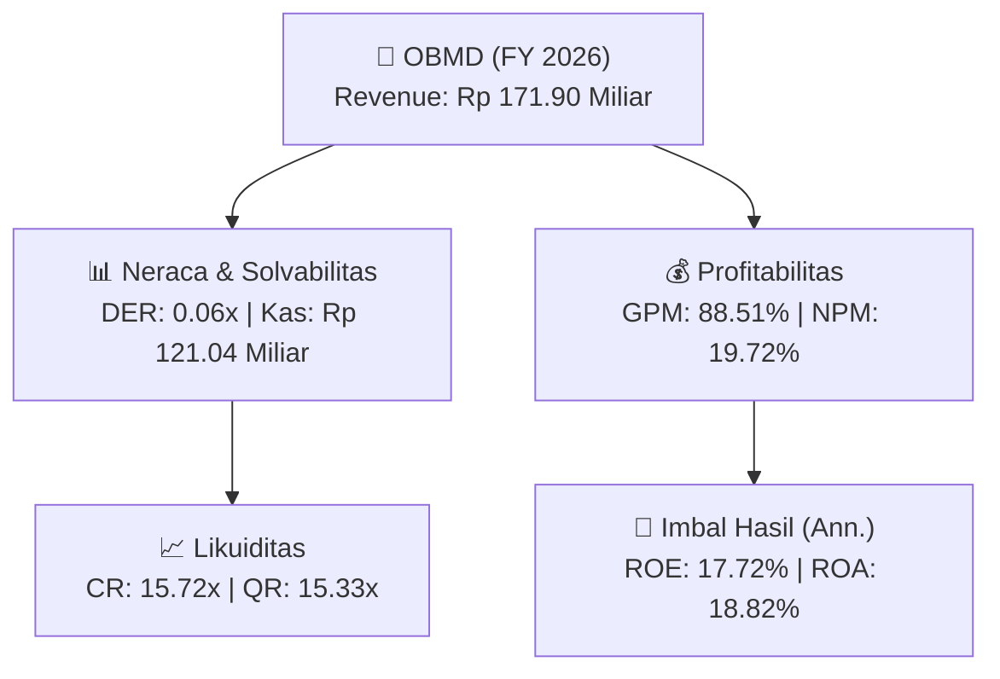
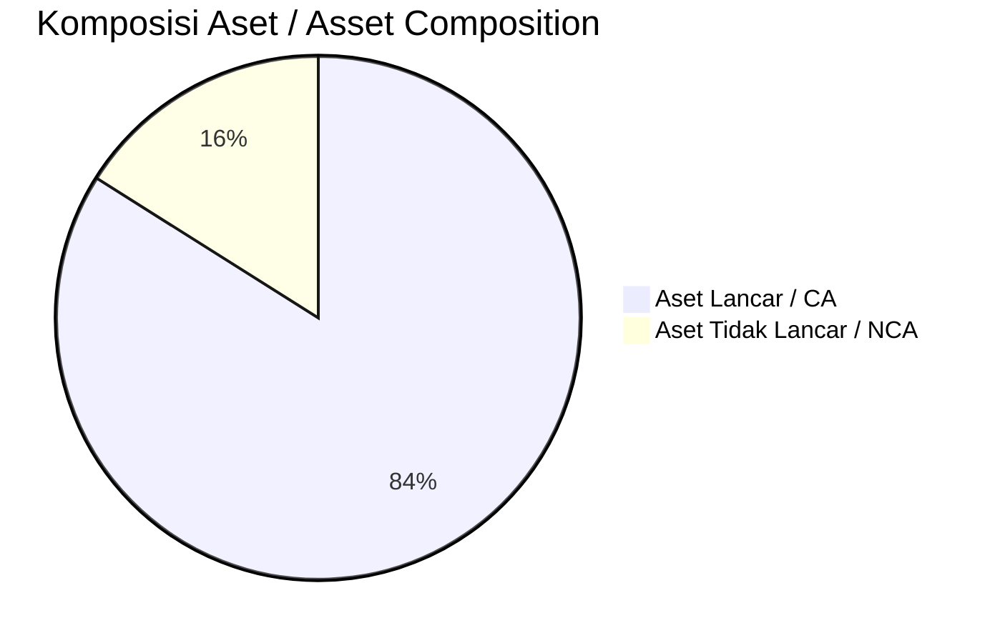
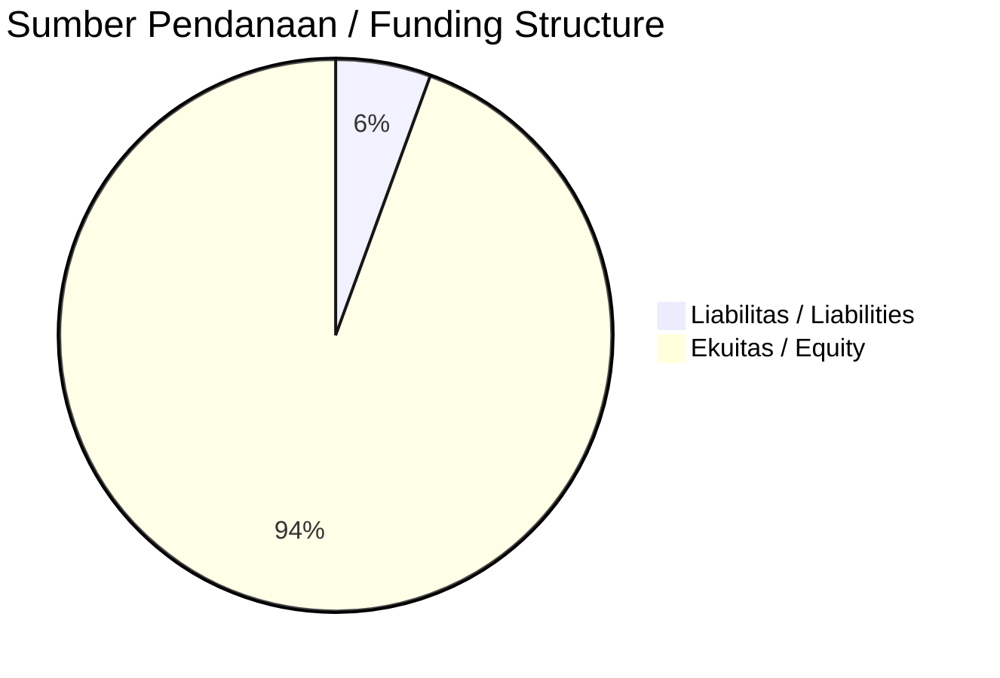

# 📈 Laporan Analisis Keuangan Tahunan Komprehensif: [[OBMD]] — FY 2026

⬅️ [[knowledge-base/daily-digests/Daily_Digest_20260922|Kembali ke Daily Digest]] | 📅 **2026-09-22** | 🎛️ [[Dashboard|Ke Dashboard Utama]]

> [!IMPORTANT]
> Dokumen ini disusun oleh **Financial Summarizer Agent** untuk menganalisis kinerja keuangan, kesehatan neraca, profitabilitas, dan katalis sektor (General) **PT OBM Drilchem Tbk ([[OBMD]])** berdasarkan LK FY 2026.

---

## 📌 1. Ikhtisar Kinerja Utama / Executive Performance Highlight
- **Emiten**: `[[OBMD]]` (PT OBM Drilchem Tbk)
- **Sektor Usaha / Industry Sector**: `General`
- **Periode Laporan / Reporting Period**: `FY 2026`
- **Pendapatan Neto / Net Revenue**: `Rp 171.90 Miliar` (**+1.33% 🟢 YoY** dari Rp 169.64 Miliar)
- **Laba Bruto / Gross Profit**: `Rp 152.15 Miliar` (**+6.16% 🟢 YoY**)
- **Laba (Rugi) Bersih / Net Income**: `Rp 33.90 Miliar` (**-12.26% 🔴 YoY**)
- **Total Aset / Total Assets**: `Rp 192.00 Miliar` | **Total Ekuitas / Total Equity**: `Rp 208.54 Miliar`
- **EPS (Annualized)**: `0.84` | **BVPS**: `5.17`

---

## 📊 2. Laba Rugi Komparatif / Comparative Income Statement

| Pos Laba Rugi / Income Statement Item | FY 2026 | Prior Period | YoY (%) |
| :--- | ---: | ---: | :---: |
| **Pendapatan Neto / Net Revenue** | `171.90B` | `169.64B` | **+1.33% 🟢** |
| **Beban Pokok / COGS** | `(19.75B)` | `(26.32B)` | -24.95% 🔴 |
| **Laba Bruto / Gross Profit** | `152.15B` | `143.32B` | **+6.16% 🟢** |
| **Beban Usaha / Operating Expenses** | `(85.27B)` | `(67.70B)` | +25.96% 🟢 |
| **Laba Operasional / EBIT** | `44.68B` | `51.27B` | -12.87% 🔴 |
| **Laba (Rugi) Bersih / Net Income** | **33.90B** | **38.64B** | **-12.26% 🔴** |

---

## 🏦 3. Neraca & Struktur Permodalan / Balance Sheet & Capital Structure

| Pos Neraca / Balance Sheet Item | FY 2026 | Prior Year End | Δ YoY/YtD (%) | Catatan / Notes |
| :--- | ---: | ---: | :---: | :--- |
| **Aset Lancar / Current Assets** | `192.00B` | `168.17B` | +14.17% 🟢 | Kas: Rp 121.04 Miliar |
| **Aset Tidak Lancar / Non-Current Assets** | `36.73B` | `36.69B` | +0.11% 🟢 | Aset Tetap & Operasional |
| **TOTAL ASET / TOTAL ASSETS** | **192.00B** | **168.17B** | **+14.17% 🟢** | |
| **Liabilitas Jk. Pendek / Current Liabilities** | `12.21B` | `15.22B` | -19.78% 🔴 | |
| **Liabilitas Jk. Panjang / Non-Current Liabilities** | `7.98B` | `15.56B` | -48.70% 🔴 | |
| **TOTAL LIABILITAS / TOTAL LIABILITIES** | **12.21B** | **15.22B** | **-19.78% 🔴** | |
| **TOTAL EKUITAS / TOTAL EQUITY** | **208.54B** | **174.08B** | **+19.79% 🟢** | |

---

## 💸 4. Laporan Arus Kas / Cash Flow Statement

| Komponen Arus Kas / Cash Flow Component | FY 2026 | Prior Period | Δ YoY (%) |
| :--- | ---: | ---: | :---: |
| **Arus Kas Operasi / CFO** | `24.01B` | `28.04B` | -14.39% 🔴 |
| **Arus Kas Investasi / CFI** | `-1.44B` | `-2.93B` | +50.79% 🟢 |
| **Arus Kas Pendanaan / CFF** | `-6.00B` | `1.80B` | -433.90% 🔴 |
| **Kenaikan (Penurunan) Kas Bersih** | `16.57B` | `26.91B` | -38.43% 🔴 |
| Belanja Modal / Capex | `(1.44B)` | `(2.93B)` | -50.79% 🔴 |
| Pembayaran Dividen / Dividends Paid | `(-)` | `(-)` | - |
| **Free Cash Flow (CFO - Capex)** | **22.57B** | **25.11B** | **-10.14% 🔴** |

---

## 📈 Analisis Rasio Keuangan / Financial Ratio Analysis

| Kategori / Category | Metrik / Metric | Nilai / Value | Benchmark | Interpretasi / Interpretation |
| :--- | :--- | :---: | :---: | :--- |
| **🛡️ Likuiditas** | **Current Ratio** | `15.72x` | `> 1.0x` | Kemampuan bayar kewajiban jk. pendek |
| | **Quick Ratio** | `15.33x` | `> 0.8x` | Likuiditas tanpa persediaan |
| **📊 Profitabilitas** | **Gross Profit Margin (GPM)** | `88.51%` | - | Margin kotor operasional inti |
| | **Operating Profit Margin (OPM)** | `25.99%` | - | Efisiensi operasional |
| | **Net Profit Margin (NPM)** | `19.72%` | - | Konversi revenue ke laba bersih |
| **🎯 Imbal Hasil (Ann.)** | **Return on Equity (ROE)** | `17.72%` | - | Imbal hasil terhadap ekuitas |
| | **Return on Assets (ROA)** | `18.82%` | - | Produktivitas aset |
| **⚖️ Solvabilitas** | **Debt to Equity (DER)** | `0.06x` | `< 2.0x` | Leverage utang vs modal |
| | **Debt to Asset (DAR)** | `0.06x` | `< 0.7x` | Porsi aset didanai utang |

---

## 📐 Per Share Metrics

| Metrik / Metric | Nilai / Value | Keterangan / Notes |
| :--- | ---: | :--- |
| **EPS (Annualized)** | `Rp 0.84` | Laba per saham (dianualisasi) |
| **BVPS** | `Rp 5.17` | Nilai buku per saham |

---

## 🚀 Analisis Strategis & Karakteristik Sektor / Strategic Analysis: General

Pada periode FY 2026, **PT OBM Drilchem Tbk ([[OBMD]])** membukukan total pendapatan sebesar **Rp 171.90 Miliar** (+1.33% 🟢 YoY). Laba kotor tercatat **Rp 152.15 Miliar** dengan GPM **88.51%**. Laba bersih sebesar **Rp 33.90 Miliar** (-12.26% 🔴 YoY). Total aset **Rp 192.00 Miliar**, ekuitas **Rp 208.54 Miliar**, DER **0.06x**.

### 🔍 Indikator Kunci Sektor / Sector Key Indicators (General)
- **Karakteristik Industri (General)**: Kinerja mencerminkan dinamika penyerapan pasar, utilisasi kapasitas produksi, dan efisiensi biaya pokok.
- **Faktor Penggerak**: Pertumbuhan organik, efisiensi operasional, dan ekspansi pasar.

> [!NOTE]
> _Data Public Expose / Investor Presentation belum tersedia untuk emiten ini._

---

## 📋 Catatan Kunci Laporan Keuangan / Key Notes to Financial Statements

### 🔍 Opini Auditor / Auditor Opinion
- **Jenis Opini / Opinion Type**: `Wajar Tanpa Modifikasian / Unqualified`
- **KAP / Audit Firm**: `KAP Moch. Zainuddin, Sukmadi  Rekan`
- **Partner Audit**: `Moch. Zainuddin`
- **Tanggal Laporan / Report Date**: `2026-03-30`

---

## 💡 Catatan Strategis & Panduan Investor / Strategic Notes & Investor Guide

1. **Kesehatan Permodalan / Capital Health**: DER **0.06x**, CR **15.72x** — _sehat dan aman_.
2. **Katalis Pertumbuhan / Growth Catalysts**: Pantau realisasi pendapatan dan efisiensi operasional periode berikutnya.

---

## 📊 Trend Multi-Tahun / Multi-Year Trend

> [!NOTE]
> _Tabel trend multi-tahun (3 tahun) akan tersedia setelah data historis FY sebelumnya diproses._

---
## 🔗 Hubungan Note Terkait / Knowledge Graph Links
- [[knowledge-base/daily-digests/Daily_Digest_20260922|📄 Daily Digest 2026-09-22]]
- [[knowledge-base/trading-signals/Trading_Signals_20260922|🎯 Trading Signals]]
- [[Dashboard|🎛️ Kembali ke Dashboard Utama]]