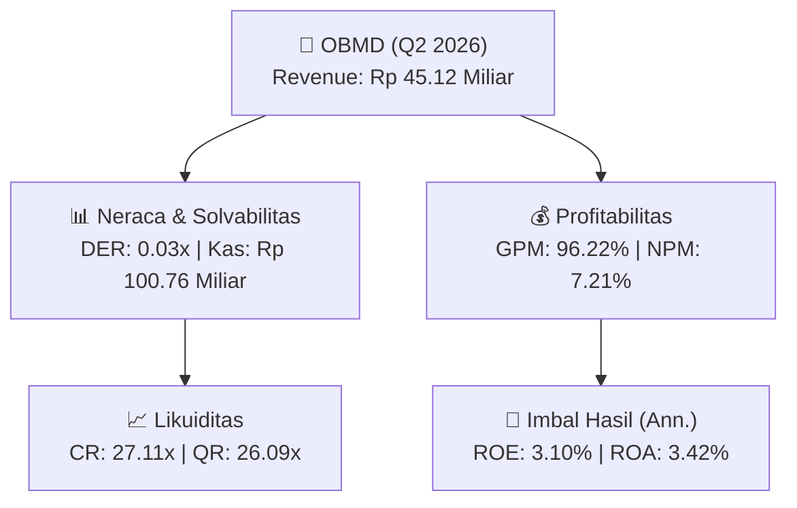
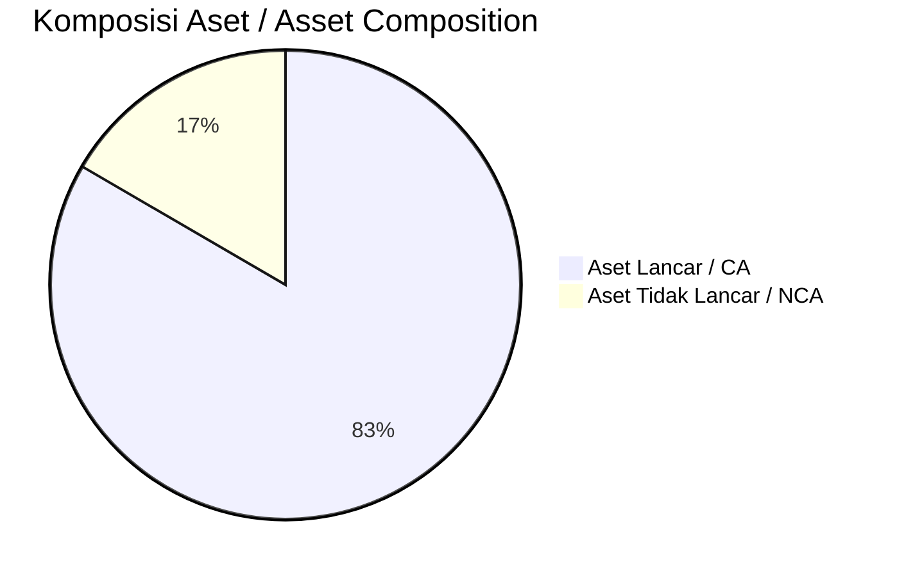
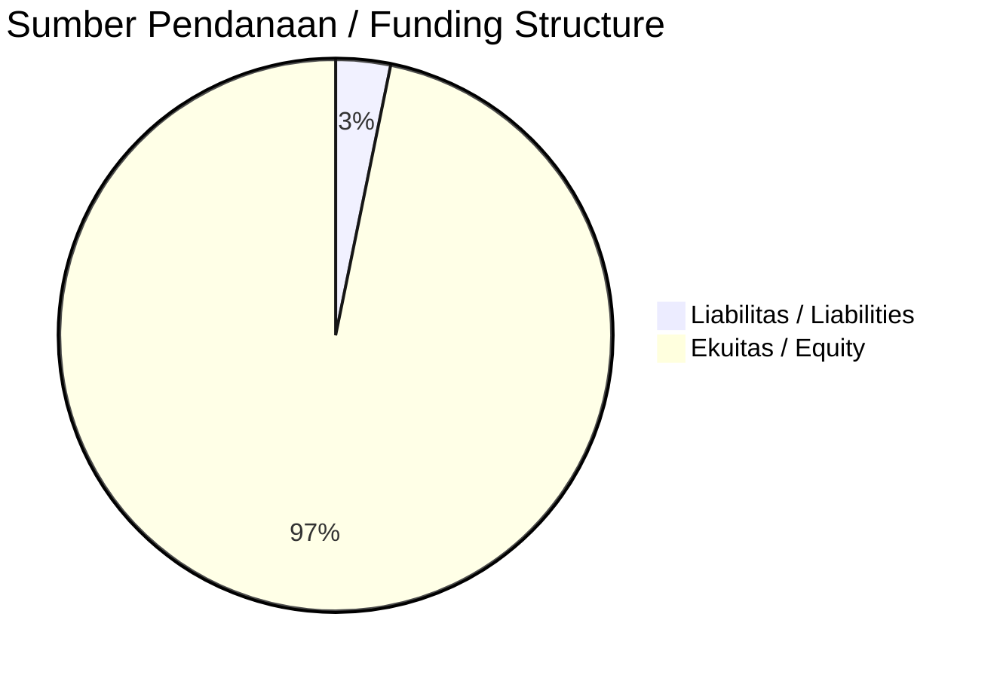

# 📈 Laporan Analisis Keuangan Mendalam: [[OBMD]] — Q2 2026

⬅️ [[knowledge-base/daily-digests/Daily_Digest_20260922|Kembali ke Daily Digest]] | 📅 **2026-09-22** | 🎛️ [[Dashboard|Ke Dashboard Utama]]

> [!IMPORTANT]
> Dokumen ini disusun oleh **Financial Summarizer Agent** untuk menganalisis kinerja keuangan, kesehatan neraca, profitabilitas, dan katalis sektor (General) **PT OBM Drilchem Tbk ([[OBMD]])** berdasarkan LK Q2 2026.

---

## 📌 1. Ikhtisar Kinerja Utama / Executive Performance Highlight
- **Emiten**: `[[OBMD]]` (PT OBM Drilchem Tbk)
- **Sektor Usaha / Industry Sector**: `General`
- **Periode Laporan / Reporting Period**: `Q2 2026`
- **Pendapatan Neto / Net Revenue**: `Rp 45.12 Miliar` (**-45.93% 🔴 YoY** dari Rp 83.44 Miliar)
- **Laba Bruto / Gross Profit**: `Rp 43.41 Miliar` (**-44.99% 🔴 YoY**)
- **Laba (Rugi) Bersih / Net Income**: `Rp 3.26 Miliar` (**-84.76% 🔴 YoY**)
- **Total Aset / Total Assets**: `Rp 189.02 Miliar` | **Total Ekuitas / Total Equity**: `Rp 211.79 Miliar`
- **EPS (Annualized)**: `0.16` | **BVPS**: `5.26`

---

## 📊 2. Laba Rugi Komparatif / Comparative Income Statement

| Pos Laba Rugi / Income Statement Item | Q2 2026 | Prior Period | YoY (%) |
| :--- | ---: | ---: | :---: |
| **Pendapatan Neto / Net Revenue** | `45.12B` | `83.44B` | **-45.93% 🔴** |
| **Beban Pokok / COGS** | `(1.71B)` | `(4.51B)` | -62.21% 🔴 |
| **Laba Bruto / Gross Profit** | `43.41B` | `78.92B` | **-44.99% 🔴** |
| **Beban Usaha / Operating Expenses** | `(42.96B)` | `(41.44B)` | +3.67% 🟢 |
| **Laba Operasional / EBIT** | `4.66B` | `27.28B` | -82.91% 🔴 |
| **Laba (Rugi) Bersih / Net Income** | **3.26B** | **21.36B** | **-84.76% 🔴** |

---

## 🏦 3. Neraca & Struktur Permodalan / Balance Sheet & Capital Structure

| Pos Neraca / Balance Sheet Item | Q2 2026 | Prior Year End | Δ YoY/YtD (%) | Catatan / Notes |
| :--- | ---: | ---: | :---: | :--- |
| **Aset Lancar / Current Assets** | `189.02B` | `192.00B` | -1.55% 🔴 | Kas: Rp 100.76 Miliar |
| **Aset Tidak Lancar / Non-Current Assets** | `37.54B` | `36.73B` | +2.21% 🟢 | Aset Tetap & Operasional |
| **TOTAL ASET / TOTAL ASSETS** | **189.02B** | **192.00B** | **-1.55% 🔴** | |
| **Liabilitas Jk. Pendek / Current Liabilities** | `6.97B` | `12.21B` | -42.89% 🔴 | |
| **Liabilitas Jk. Panjang / Non-Current Liabilities** | `7.80B` | `7.98B` | -2.26% 🔴 | |
| **TOTAL LIABILITAS / TOTAL LIABILITIES** | **6.97B** | **12.21B** | **-42.89% 🔴** | |
| **TOTAL EKUITAS / TOTAL EQUITY** | **211.79B** | **208.54B** | **+1.56% 🟢** | |

---

## 💸 4. Laporan Arus Kas / Cash Flow Statement

| Komponen Arus Kas / Cash Flow Component | Q2 2026 | Prior Period | Δ YoY (%) |
| :--- | ---: | ---: | :---: |
| **Arus Kas Operasi / CFO** | `-19.35B` | `26.06B` | -174.25% 🔴 |
| **Arus Kas Investasi / CFI** | `-928.49M` | `-861.54M` | -7.77% 🔴 |
| **Arus Kas Pendanaan / CFF** | `-` | `-` | - |
| **Kenaikan (Penurunan) Kas Bersih** | `-20.28B` | `25.20B` | -180.47% 🔴 |
| Belanja Modal / Capex | `(928.49M)` | `(861.54M)` | +7.77% 🟢 |
| Pembayaran Dividen / Dividends Paid | `(-)` | `(-)` | - |
| **Free Cash Flow (CFO - Capex)** | **-20.28B** | **25.20B** | **-180.47% 🔴** |

---

## 📈 Analisis Rasio Keuangan / Financial Ratio Analysis

| Kategori / Category | Metrik / Metric | Nilai / Value | Benchmark | Interpretasi / Interpretation |
| :--- | :--- | :---: | :---: | :--- |
| **🛡️ Likuiditas** | **Current Ratio** | `27.11x` | `> 1.0x` | Kemampuan bayar kewajiban jk. pendek |
| | **Quick Ratio** | `26.09x` | `> 0.8x` | Likuiditas tanpa persediaan |
| **📊 Profitabilitas** | **Gross Profit Margin (GPM)** | `96.22%` | - | Margin kotor operasional inti |
| | **Operating Profit Margin (OPM)** | `10.33%` | - | Efisiensi operasional |
| | **Net Profit Margin (NPM)** | `7.21%` | - | Konversi revenue ke laba bersih |
| **🎯 Imbal Hasil (Ann.)** | **Return on Equity (ROE)** | `3.10%` | - | Imbal hasil terhadap ekuitas |
| | **Return on Assets (ROA)** | `3.42%` | - | Produktivitas aset |
| **⚖️ Solvabilitas** | **Debt to Equity (DER)** | `0.03x` | `< 2.0x` | Leverage utang vs modal |
| | **Debt to Asset (DAR)** | `0.04x` | `< 0.7x` | Porsi aset didanai utang |

---

## 📐 Per Share Metrics

| Metrik / Metric | Nilai / Value | Keterangan / Notes |
| :--- | ---: | :--- |
| **EPS (Annualized)** | `Rp 0.16` | Laba per saham (dianualisasi) |
| **BVPS** | `Rp 5.26` | Nilai buku per saham |

---

## 🚀 Analisis Strategis & Karakteristik Sektor / Strategic Analysis: General

Pada periode Q2 2026, **PT OBM Drilchem Tbk ([[OBMD]])** membukukan total pendapatan sebesar **Rp 45.12 Miliar** (-45.93% 🔴 YoY). Laba kotor tercatat **Rp 43.41 Miliar** dengan GPM **96.22%**. Laba bersih sebesar **Rp 3.26 Miliar** (-84.76% 🔴 YoY). Total aset **Rp 189.02 Miliar**, ekuitas **Rp 211.79 Miliar**, DER **0.03x**.

### 🔍 Indikator Kunci Sektor / Sector Key Indicators (General)
- **Karakteristik Industri (General)**: Kinerja mencerminkan dinamika penyerapan pasar, utilisasi kapasitas produksi, dan efisiensi biaya pokok.
- **Faktor Penggerak**: Pertumbuhan organik, efisiensi operasional, dan ekspansi pasar.

> [!NOTE]
> _Data Public Expose / Investor Presentation belum tersedia untuk emiten ini._

---

## 📋 Catatan Kunci Laporan Keuangan / Key Notes to Financial Statements

### 🔍 Opini Auditor / Auditor Opinion
- **Jenis Opini / Opinion Type**: `Tidak Wajar / Adverse`
- **KAP / Audit Firm**: `KAP Moch. Zainuddin, Sukmadi  Rekan`
- **Partner Audit**: `Moch. Zainuddin`
- **Tanggal Laporan / Report Date**: `2026-08-28`

### 📝 Perjanjian & Kontrak Signifikan / Key Contracts & Agreements
- Perusahaan memanfaatkan fasilitas kredit investasi dari PT Bank Central Asia Tbk sebesar Rp2.500.000.000 dengan suku bunga 6,12% per tahun, jangka waktu 84 bulan, mulai 16 Agustus 2023 sampai 16 Agustus 2030, dengan jaminan berupa gudang di Bizhub Trading Complex 52 Block B.

### 🤝 Transaksi Pihak Berelasi / Related Party Transactions
- Utang lain-lain jangka pendek kepada pihak berelasi berupa imbalan kerja Direksi.
- Utang lain-lain jangka panjang kepada pihak berelasi berupa pemegang saham dan imbalan kerja.

---

## 💡 Catatan Strategis & Panduan Investor / Strategic Notes & Investor Guide

1. **Kesehatan Permodalan / Capital Health**: DER **0.03x**, CR **27.11x** — _sehat dan aman_.
2. **Katalis Pertumbuhan / Growth Catalysts**: Pantau realisasi pendapatan dan efisiensi operasional periode berikutnya.

---

## 🔗 Hubungan Note Terkait / Knowledge Graph Links
- [[knowledge-base/daily-digests/Daily_Digest_20260922|📄 Daily Digest 2026-09-22]]
- [[knowledge-base/trading-signals/Trading_Signals_20260922|🎯 Trading Signals]]
- [[Dashboard|🎛️ Kembali ke Dashboard Utama]]