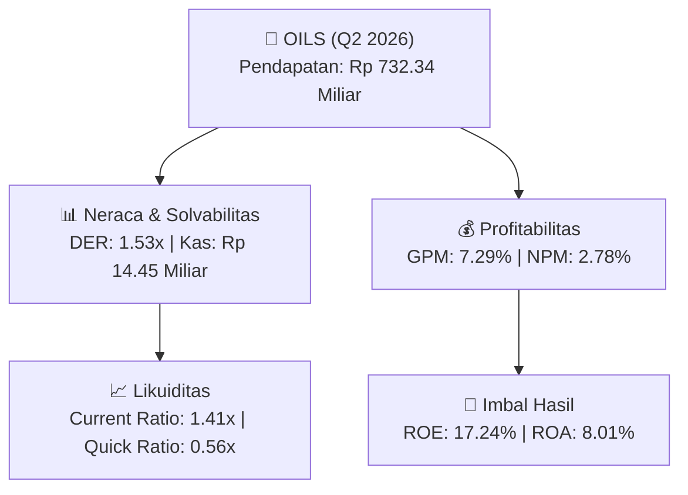

# 📈 Laporan Analisis Keuangan Mendalam: [[OILS]] - Q2 2026

⬅️ [[knowledge-base/daily-digests/Daily_Digest_20260831|Kembali ke Daily Digest]] | 📅 **2026-08-31** | 🎛️ [[Dashboard|Ke Dashboard Utama]]

> [!IMPORTANT]
> Dokumen ini disusun secara khusus oleh **Financial Summarizer Agent** untuk menganalisis kinerja keuangan, **kesehatan neraca**, profitabilitas, dan **katalis sektor (Konsumer & Ritel)** **PT Indo Oil Perkasa Tbk ([[OILS]])** berdasarkan Laporan Keuangan Q2 2026.

---

## 📌 1. Ikhtisar Kinerja Utama (Executive Performance Highlight)
- **Emiten**: `[[OILS]]` (PT Indo Oil Perkasa Tbk)
- **Sektor Usaha**: `Konsumer & Ritel`
- **Periode Laporan**: `Q2 2026`
- **Pendapatan Neto (Revenue)**: `Rp 732.34 Miliar` (**+56.32% 🟢 YoY** dari Rp 468.49 Miliar)
- **Laba Bruto (Gross Profit)**: `Rp 53.42 Miliar` (**+182.48% 🟢 YoY**)
- **Laba (Rugi) Bersih**: `Rp 20.33 Miliar` (**+547.79% 🟢 YoY**)
- **Total Aset**: `Rp 253.98 Miliar` | **Total Ekuitas**: `Rp 117.93 Miliar`

---

## 📊 2. Matriks Laba Rugi Komparatif (Income Statement)

| Pos Laba Rugi Utama (Dalam Miliar Rp) | Periode Berjalan (Q2 2026) | Periode Komparatif Lalu | Pertumbuhan YoY (%) |
| :--- | :---: | :---: | :---: |
| **Pendapatan / Penjualan Neto** | `732.34` | `468.49` | **+56.32% 🟢** |
| **Beban Pokok Pendapatan (COGS)** | `(678.92)` | `(449.58)` | +51.01% 🟢 |
| **Laba Bruto (Gross Profit)** | `53.42` | `18.91` | **+182.48% 🟢** |
| **Beban Usaha / Operasional** | `(23.30)` | `(12.31)` | +89.34% 🟢 |
| **Laba Operasional (EBIT)** | `26.68` | `3.97` | +572.17% 🟢 |
| **Laba (Rugi) Bersih Periode Berjalan** | **20.33** | **3.14** | **+547.79% 🟢** |

---

## 🏦 3. Matriks Neraca & Struktur Permodalan (Balance Sheet)

| Pos Neraca Utama (Dalam Miliar Rp) | Q2 2026 | Posisi Akhir Tahun Lalu | Perubahan YoY / YtD (%) | Catatan Analis |
| :--- | :---: | :---: | :---: | :--- |
| **Aset Lancar** | `253.98` | `191.31` | +32.76% 🟢 | Kas: Rp 14.45 Miliar |
| **Aset Tidak Lancar** | `65.99` | `68.07` | -3.06% 🔴 | Aset Tetap & Operasional |
| **TOTAL ASET** | **253.98** | **191.31** | **+32.76% 🟢** | Basis Skala Usaha |
| **Liabilitas Jangka Pendek** | `180.61` | `145.29` | +24.31% 🟢 | Utang Usaha & Kewajiban Pendek |
| **Liabilitas Jangka Panjang** | `16.08` | `15.75` | +2.08% 🟢 | Kewajiban Jangka Panjang |
| **TOTAL LIABILITAS** | **180.61** | **145.29** | **+24.31% 🟢** | Struktur Utang Terkendali |
| **TOTAL EKUITAS** | **117.93** | **98.34** | **+19.92% 🟢** | Modal Bersih Pemegang Saham |

---

## 📈 4. Analisis Rasio Keuangan Utama (Financial Ratios)

| Kategori Rasio | Metrik Rasio | Nilai Rasio | Benchmark & Status | Interpretasi Analis |
| :--- | :--- | :---: | :---: | :--- |
| **🛡️ Likuiditas** | **Current Ratio** | `1.41x` | `> 1.0x` | Kemampuan melunasi kewajiban jangka pendek |
| | **Quick Ratio** | `0.56x` | `> 0.8x` | Likuiditas kas & piutang tanpa persediaan |
| **📊 Profitabilitas** | **Gross Profit Margin (GPM)** | `7.29%` | - | Margin kotor dari operasional inti |
| | **Net Profit Margin (NPM)** | `2.78%` | - | Efisiensi konversi omset ke laba bersih |
| | **Return on Equity (ROE)** | `17.24%` | - | Tingkat imbal hasil terhadap ekuitas |
| | **Return on Assets (ROA)** | `8.01%` | - | Produktivitas aset menghasilkan laba |
| **⚖️ Solvabilitas** | **Debt to Equity Ratio (DER)** | `1.53x` | `< 2.0x` | Struktur leverage utang terhadap modal |
| | **Debt to Asset Ratio (DAR)** | `0.71x` | `< 0.7x` | Porsi pendanaan aset dari kewajiban |

---

## 🚀 5. Analisis Strategis & Karakteristik Sektor: Konsumer & Ritel

Pada periode Q2 2026, **PT Indo Oil Perkasa Tbk ([[OILS]])** membukukan total pendapatan/penjualan sebesar **Rp 732.34 Miliar** (+56.32% 🟢 YoY). Laba kotor tercatat sebesar **Rp 53.42 Miliar** dengan Gross Profit Margin (GPM) sebesar **7.29%** dan laba bersih tahun berjalan sebesar **Rp 20.33 Miliar** (+547.79% 🟢 YoY).

Dari sisi neraca, perseroan memiliki total aset sebesar **Rp 253.98 Miliar** dengan ekuitas bersih **Rp 117.93 Miliar**. Rasio solvabilitas DER berada di level **1.53x**, menunjukkan struktur permodalan yang terkelola dengan rasio likuiditas Current Ratio sebesar **1.41x**.

### 🔍 Indikator Kunci Sektor (Konsumer & Ritel):
- **Karakteristik Industri (Konsumer & Ritel)**: Kinerja mencerminkan dinamika penyerapan pasar, utilisasi kapasitas produksi, dan efisiensi biaya pokok produksi/layanan.

---

## 💡 6. Catatan Strategis & Panduan Investor
1. **Kesehatan Permodalan**: Rasio DER tercatat **1.53x** dengan likuiditas Current Ratio **1.41x** (perlu dipantau secara disiplin).
2. **Katalis Pertumbuhan**: Pantau realisasi pendapatan semester berikutnya serta efisiensi beban usaha operasional.

---

## 🔗 Hubungan Note Terkait (Knowledge Graph)
- [[knowledge-base/daily-digests/Daily_Digest_20260831|📄 Daily Digest 2026-08-31]]
- [[knowledge-base/trading-signals/Trading_Signals_20260831|🎯 Trading Signals]]
- [[Dashboard|🎛️ Kembali ke Dashboard Utama]]
