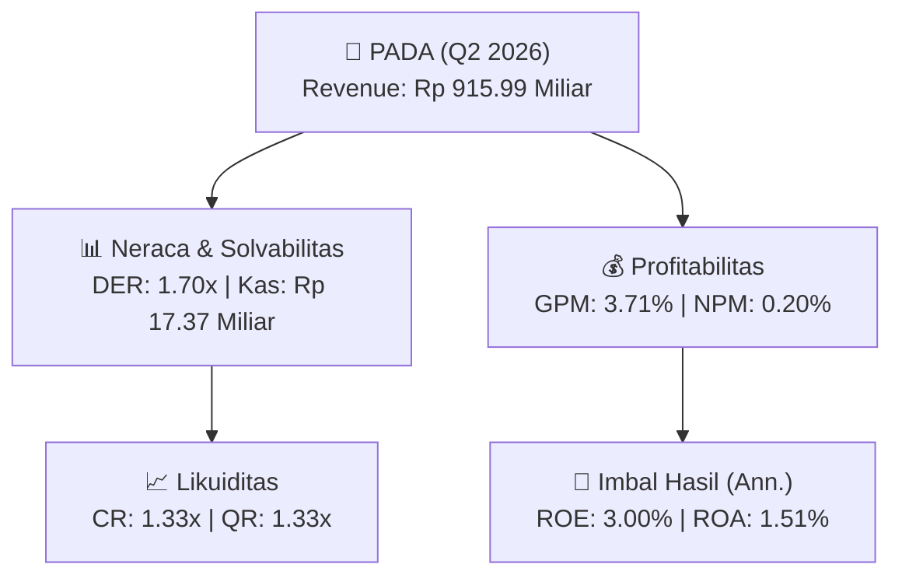
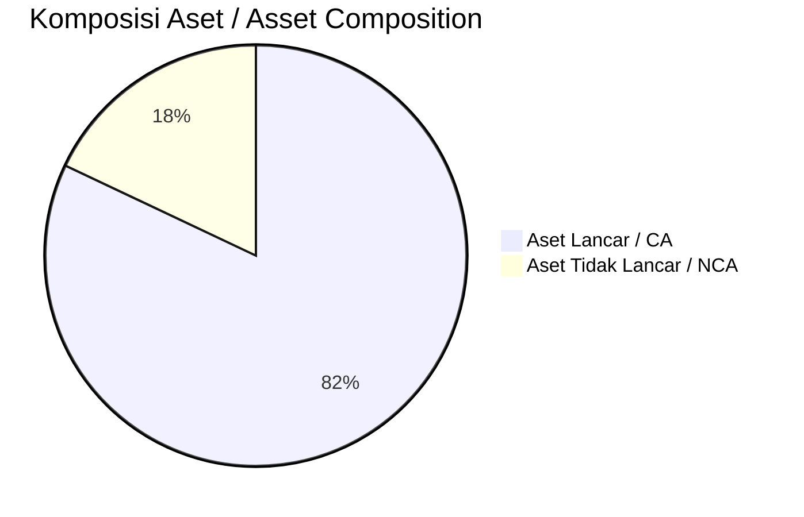
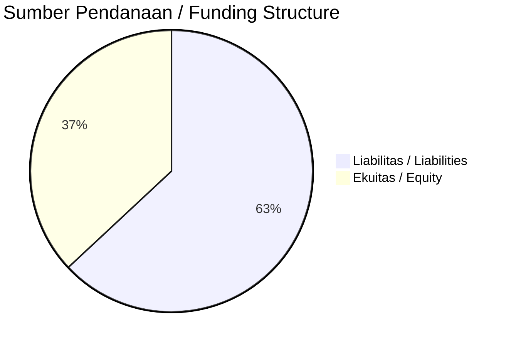

# 📈 Laporan Analisis Keuangan Mendalam: [[PADA]] — Q2 2026

⬅️ [[knowledge-base/daily-digests/Daily_Digest_20260930|Kembali ke Daily Digest]] | 📅 **2026-09-30** | 🎛️ [[Dashboard|Ke Dashboard Utama]]

> [!IMPORTANT]
> Dokumen ini disusun oleh **Financial Summarizer Agent** untuk menganalisis kinerja keuangan, kesehatan neraca, profitabilitas, dan katalis sektor (Manufaktur) **PT Personel Alih Daya Tbk ([[PADA]])** berdasarkan LK Q2 2026.

---

## 📌 1. Ikhtisar Kinerja Utama / Executive Performance Highlight
- **Emiten**: `[[PADA]]` (PT Personel Alih Daya Tbk)
- **Sektor Usaha / Industry Sector**: `Manufaktur`
- **Periode Laporan / Reporting Period**: `Q2 2026`
- **Pendapatan Neto / Net Revenue**: `Rp 915.99 Miliar` (**+81.61% 🟢 YoY** dari Rp 504.36 Miliar)
- **Laba Bruto / Gross Profit**: `Rp 34.01 Miliar` (**+81.24% 🟢 YoY**)
- **Laba (Rugi) Bersih / Net Income**: `Rp 1.81 Miliar` (**+1239.43% 🟢 YoY**)
- **Total Aset / Total Assets**: `Rp 276.08 Miliar` | **Total Ekuitas / Total Equity**: `Rp 121.82 Miliar`
- **EPS (Annualized)**: `0.06` | **BVPS**: `1.93`

---

## 📊 2. Laba Rugi Komparatif / Comparative Income Statement

| Pos Laba Rugi / Income Statement Item | Q2 2026 | Prior Period | YoY (%) |
| :--- | ---: | ---: | :---: |
| **Pendapatan Neto / Net Revenue** | `915.99B` | `504.36B` | **+81.61% 🟢** |
| **Beban Pokok / COGS** | `(881.98B)` | `(485.60B)` | +81.63% 🟢 |
| **Laba Bruto / Gross Profit** | `34.01B` | `18.77B` | **+81.24% 🟢** |
| **Beban Usaha / Operating Expenses** | `(18.95B)` | `(12.61B)` | +50.30% 🟢 |
| **Laba Operasional / EBIT** | `3.19B` | `577.38M` | +452.75% 🟢 |
| **Laba (Rugi) Bersih / Net Income** | **1.81B** | **135.21M** | **+1239.43% 🟢** |

---

## 🏦 3. Neraca & Struktur Permodalan / Balance Sheet & Capital Structure

| Pos Neraca / Balance Sheet Item | Q2 2026 | Prior Year End | Δ YoY/YtD (%) | Catatan / Notes |
| :--- | ---: | ---: | :---: | :--- |
| **Aset Lancar / Current Assets** | `276.08B` | `205.08B` | +34.62% 🟢 | Kas: Rp 17.37 Miliar |
| **Aset Tidak Lancar / Non-Current Assets** | `60.53B` | `60.85B` | -0.52% 🔴 | Aset Tetap & Operasional |
| **TOTAL ASET / TOTAL ASSETS** | **276.08B** | **205.08B** | **+34.62% 🟢** | |
| **Liabilitas Jk. Pendek / Current Liabilities** | `207.54B` | `139.14B` | +49.16% 🟢 | |
| **Liabilitas Jk. Panjang / Non-Current Liabilities** | `7.25B` | `6.95B` | +4.31% 🟢 | |
| **TOTAL LIABILITAS / TOTAL LIABILITIES** | **207.54B** | **139.14B** | **+49.16% 🟢** | |
| **TOTAL EKUITAS / TOTAL EQUITY** | **121.82B** | **119.84B** | **+1.65% 🟢** | |

---

## 💸 4. Laporan Arus Kas / Cash Flow Statement

| Komponen Arus Kas / Cash Flow Component | Q2 2026 | Prior Period | Δ YoY (%) |
| :--- | ---: | ---: | :---: |
| **Arus Kas Operasi / CFO** | `-64.45B` | `-17.13B` | -276.29% 🔴 |
| **Arus Kas Investasi / CFI** | `-2.66B` | `-1.87B` | -42.24% 🔴 |
| **Arus Kas Pendanaan / CFF** | `77.12B` | `20.59B` | +274.49% 🟢 |
| **Kenaikan (Penurunan) Kas Bersih** | `10.01B` | `1.59B` | +527.57% 🟢 |
| Belanja Modal / Capex | `(1.27B)` | `(1.56B)` | -18.69% 🔴 |
| Pembayaran Dividen / Dividends Paid | `(-)` | `(0.00)` | - |
| **Free Cash Flow (CFO - Capex)** | **-65.72B** | **-18.69B** | **-251.63% 🔴** |

---

## 📈 Analisis Rasio Keuangan / Financial Ratio Analysis

| Kategori / Category | Metrik / Metric | Nilai / Value | Benchmark | Interpretasi / Interpretation |
| :--- | :--- | :---: | :---: | :--- |
| **🛡️ Likuiditas** | **Current Ratio** | `1.33x` | `> 1.0x` | Kemampuan bayar kewajiban jk. pendek |
| | **Quick Ratio** | `1.33x` | `> 0.8x` | Likuiditas tanpa persediaan |
| **📊 Profitabilitas** | **Gross Profit Margin (GPM)** | `3.71%` | - | Margin kotor operasional inti |
| | **Operating Profit Margin (OPM)** | `0.35%` | - | Efisiensi operasional |
| | **Net Profit Margin (NPM)** | `0.20%` | - | Konversi revenue ke laba bersih |
| **🎯 Imbal Hasil (Ann.)** | **Return on Equity (ROE)** | `3.00%` | - | Imbal hasil terhadap ekuitas |
| | **Return on Assets (ROA)** | `1.51%` | - | Produktivitas aset |
| **⚖️ Solvabilitas** | **Debt to Equity (DER)** | `1.70x` | `< 2.0x` | Leverage utang vs modal |
| | **Debt to Asset (DAR)** | `0.75x` | `< 0.7x` | Porsi aset didanai utang |

---

## 📐 Per Share Metrics

| Metrik / Metric | Nilai / Value | Keterangan / Notes |
| :--- | ---: | :--- |
| **EPS (Annualized)** | `Rp 0.06` | Laba per saham (dianualisasi) |
| **BVPS** | `Rp 1.93` | Nilai buku per saham |

---

## 🚀 Analisis Strategis & Karakteristik Sektor / Strategic Analysis: Manufaktur

Pada periode Q2 2026, **PT Personel Alih Daya Tbk ([[PADA]])** membukukan total pendapatan sebesar **Rp 915.99 Miliar** (+81.61% 🟢 YoY). Laba kotor tercatat **Rp 34.01 Miliar** dengan GPM **3.71%**. Laba bersih sebesar **Rp 1.81 Miliar** (+1239.43% 🟢 YoY). Total aset **Rp 276.08 Miliar**, ekuitas **Rp 121.82 Miliar**, DER **1.70x**.

### 🔍 Indikator Kunci Sektor / Sector Key Indicators (Manufaktur)
- **Karakteristik Industri (Manufaktur)**: Kinerja mencerminkan dinamika penyerapan pasar, utilisasi kapasitas produksi, dan efisiensi biaya pokok.
- **Faktor Penggerak**: Pertumbuhan organik, efisiensi operasional, dan ekspansi pasar.

> [!NOTE]
> _Data Public Expose / Investor Presentation belum tersedia untuk emiten ini._

---

## 📋 Catatan Kunci Laporan Keuangan / Key Notes to Financial Statements

### 🔍 Opini Auditor / Auditor Opinion
- **Jenis Opini / Opinion Type**: `Wajar Tanpa Modifikasian / Unqualified`
- **KAP / Audit Firm**: `KAP Suharli, Sugiharto  Rekan`
- **Partner Audit**: `Ridho Fathoni`
- **Tanggal Laporan / Report Date**: `2026-09-28`

### 📝 Perjanjian & Kontrak Signifikan / Key Contracts & Agreements
- Berdasarkan Akta Notaris No. 66 tanggal 22 April 2026 dari Sindian Osaputra, S.H., M.Kn., Perusahaan menandatangani perjanjian pinjaman dengan PT Bank Hibank Indonesia.

### 🤝 Transaksi Pihak Berelasi / Related Party Transactions
- Utang usaha pihak berelasi sebesar Rp712.246.298 pada 30 Juni 2026 (31 Desember 2025: Rp651.783.187).
- Utang lain-lain pihak berelasi sebesar Rp22.375.000.000 pada 30 Juni 2026 (31 Desember 2025: Rp39.975.000.000).
- Piutang usaha kepada entitas sepengendali PT Aplikanusa Lintas Artha sebesar Rp2.512.575.100 pada 30 Juni 2026 (31 Desember 2025: Rp1.581.376.405).
- Piutang usaha kepada pemegang saham PT Sinergi Inti Andalan Prima Tbk sebesar Rp851.532.616 pada 30 Juni 2026 (31 Desember 2025: nihil).
- Piutang usaha kepada Koperasi Pegawai PT Indosat Tbk (jumlah tidak tercantum lengkap dalam teks yang tersedia).

---

## 💡 Catatan Strategis & Panduan Investor / Strategic Notes & Investor Guide

1. **Kesehatan Permodalan / Capital Health**: DER **1.70x**, CR **1.33x** — _perlu dipantau secara disiplin_.
2. **Katalis Pertumbuhan / Growth Catalysts**: Pantau realisasi pendapatan dan efisiensi operasional periode berikutnya.

---

## 🔗 Hubungan Note Terkait / Knowledge Graph Links
- [[knowledge-base/daily-digests/Daily_Digest_20260930|📄 Daily Digest 2026-09-30]]
- [[knowledge-base/trading-signals/Trading_Signals_20260930|🎯 Trading Signals]]
- [[Dashboard|🎛️ Kembali ke Dashboard Utama]]