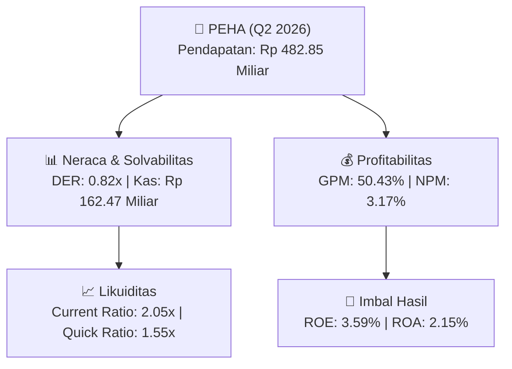

# 📈 Laporan Analisis Keuangan Mendalam: [[PEHA]] - Q2 2026

⬅️ [[knowledge-base/daily-digests/Daily_Digest_20260831|Kembali ke Daily Digest]] | 📅 **2026-08-31** | 🎛️ [[Dashboard|Ke Dashboard Utama]]

> [!IMPORTANT]
> Dokumen ini disusun secara khusus oleh **Financial Summarizer Agent** untuk menganalisis kinerja keuangan, **kesehatan neraca**, profitabilitas, dan **katalis sektor (Kesehatan)** **PT Phapros Tbk ([[PEHA]])** berdasarkan Laporan Keuangan Q2 2026.

---

## 📌 1. Ikhtisar Kinerja Utama (Executive Performance Highlight)
- **Emiten**: `[[PEHA]]` (PT Phapros Tbk)
- **Sektor Usaha**: `Kesehatan`
- **Periode Laporan**: `Q2 2026`
- **Pendapatan Neto (Revenue)**: `Rp 482.85 Miliar` (**+5.37% 🟢 YoY** dari Rp 458.23 Miliar)
- **Laba Bruto (Gross Profit)**: `Rp 243.49 Miliar` (**+10.80% 🟢 YoY**)
- **Laba (Rugi) Bersih**: `Rp 15.29 Miliar` (**+541.56% 🟢 YoY**)
- **Total Aset**: `Rp 712.31 Miliar` | **Total Ekuitas**: `Rp 425.61 Miliar`

---

## 📊 2. Matriks Laba Rugi Komparatif (Income Statement)

| Pos Laba Rugi Utama (Dalam Miliar Rp) | Periode Berjalan (Q2 2026) | Periode Komparatif Lalu | Pertumbuhan YoY (%) |
| :--- | :---: | :---: | :---: |
| **Pendapatan / Penjualan Neto** | `482.85` | `458.23` | **+5.37% 🟢** |
| **Beban Pokok Pendapatan (COGS)** | `(239.36)` | `(238.46)` | +0.38% 🟢 |
| **Laba Bruto (Gross Profit)** | `243.49` | `219.77` | **+10.80% 🟢** |
| **Beban Usaha / Operasional** | `(59.57)` | `(56.13)` | +6.13% 🟢 |
| **Laba Operasional (EBIT)** | `21.95` | `10.67` | +105.72% 🟢 |
| **Laba (Rugi) Bersih Periode Berjalan** | **15.29** | **2.38** | **+541.56% 🟢** |

---

## 🏦 3. Matriks Neraca & Struktur Permodalan (Balance Sheet)

| Pos Neraca Utama (Dalam Miliar Rp) | Q2 2026 | Posisi Akhir Tahun Lalu | Perubahan YoY / YtD (%) | Catatan Analis |
| :--- | :---: | :---: | :---: | :--- |
| **Aset Lancar** | `712.31` | `642.03` | +10.95% 🟢 | Kas: Rp 162.47 Miliar |
| **Aset Tidak Lancar** | `739.50` | `745.14` | -0.76% 🔴 | Aset Tetap & Operasional |
| **TOTAL ASET** | **712.31** | **642.03** | **+10.95% 🟢** | Basis Skala Usaha |
| **Liabilitas Jangka Pendek** | `347.50` | `280.77` | +23.76% 🟢 | Utang Usaha & Kewajiban Pendek |
| **Liabilitas Jangka Panjang** | `666.07` | `678.93` | -1.89% 🔴 | Kewajiban Jangka Panjang |
| **TOTAL LIABILITAS** | **347.50** | **280.77** | **+23.76% 🟢** | Struktur Utang Terkendali |
| **TOTAL EKUITAS** | **425.61** | **414.52** | **+2.67% 🟢** | Modal Bersih Pemegang Saham |

---

## 📈 4. Analisis Rasio Keuangan Utama (Financial Ratios)

| Kategori Rasio | Metrik Rasio | Nilai Rasio | Benchmark & Status | Interpretasi Analis |
| :--- | :--- | :---: | :---: | :--- |
| **🛡️ Likuiditas** | **Current Ratio** | `2.05x` | `> 1.0x` | Kemampuan melunasi kewajiban jangka pendek |
| | **Quick Ratio** | `1.55x` | `> 0.8x` | Likuiditas kas & piutang tanpa persediaan |
| **📊 Profitabilitas** | **Gross Profit Margin (GPM)** | `50.43%` | - | Margin kotor dari operasional inti |
| | **Net Profit Margin (NPM)** | `3.17%` | - | Efisiensi konversi omset ke laba bersih |
| | **Return on Equity (ROE)** | `3.59%` | - | Tingkat imbal hasil terhadap ekuitas |
| | **Return on Assets (ROA)** | `2.15%` | - | Produktivitas aset menghasilkan laba |
| **⚖️ Solvabilitas** | **Debt to Equity Ratio (DER)** | `0.82x` | `< 2.0x` | Struktur leverage utang terhadap modal |
| | **Debt to Asset Ratio (DAR)** | `0.49x` | `< 0.7x` | Porsi pendanaan aset dari kewajiban |

---

## 🚀 5. Analisis Strategis & Karakteristik Sektor: Kesehatan

Pada periode Q2 2026, **PT Phapros Tbk ([[PEHA]])** membukukan total pendapatan/penjualan sebesar **Rp 482.85 Miliar** (+5.37% 🟢 YoY). Laba kotor tercatat sebesar **Rp 243.49 Miliar** dengan Gross Profit Margin (GPM) sebesar **50.43%** dan laba bersih tahun berjalan sebesar **Rp 15.29 Miliar** (+541.56% 🟢 YoY).

Dari sisi neraca, perseroan memiliki total aset sebesar **Rp 712.31 Miliar** dengan ekuitas bersih **Rp 425.61 Miliar**. Rasio solvabilitas DER berada di level **0.82x**, menunjukkan struktur permodalan yang terkelola dengan rasio likuiditas Current Ratio sebesar **2.05x**.

### 🔍 Indikator Kunci Sektor (Kesehatan):
- **Karakteristik Industri Layanan Kesehatan & Klinik Spesialis**: Jaringan Rumah Sakit Spesialis Mata & Eye Care memiliki margin kotor yang sangat tebal (GPM tercatat **50.43%**), didorong oleh layanan tindakan medis spesialis (misal: LASIK, Operasi Katarak, Vitreoretina) serta farmasi.
- **Penggerak Pertumbuhan**: Peningkatan volume kunjungan pasien rawat jalan/inap serta ekspansi klinik cabang baru di kota-kota metropolitan.
- **Postur Permodalan**: Belanja modal (Capex) dialokasikan untuk pengadaan teknologi diagnostik medis mutakhir dan penambahan fasilitas bedah.

---

## 💡 6. Catatan Strategis & Panduan Investor
1. **Kesehatan Permodalan**: Rasio DER tercatat **0.82x** dengan likuiditas Current Ratio **2.05x** (sehat dan aman).
2. **Katalis Pertumbuhan**: Pantau realisasi pendapatan semester berikutnya serta efisiensi beban usaha operasional.

---

## 🔗 Hubungan Note Terkait (Knowledge Graph)
- [[knowledge-base/daily-digests/Daily_Digest_20260831|📄 Daily Digest 2026-08-31]]
- [[knowledge-base/trading-signals/Trading_Signals_20260831|🎯 Trading Signals]]
- [[Dashboard|🎛️ Kembali ke Dashboard Utama]]
