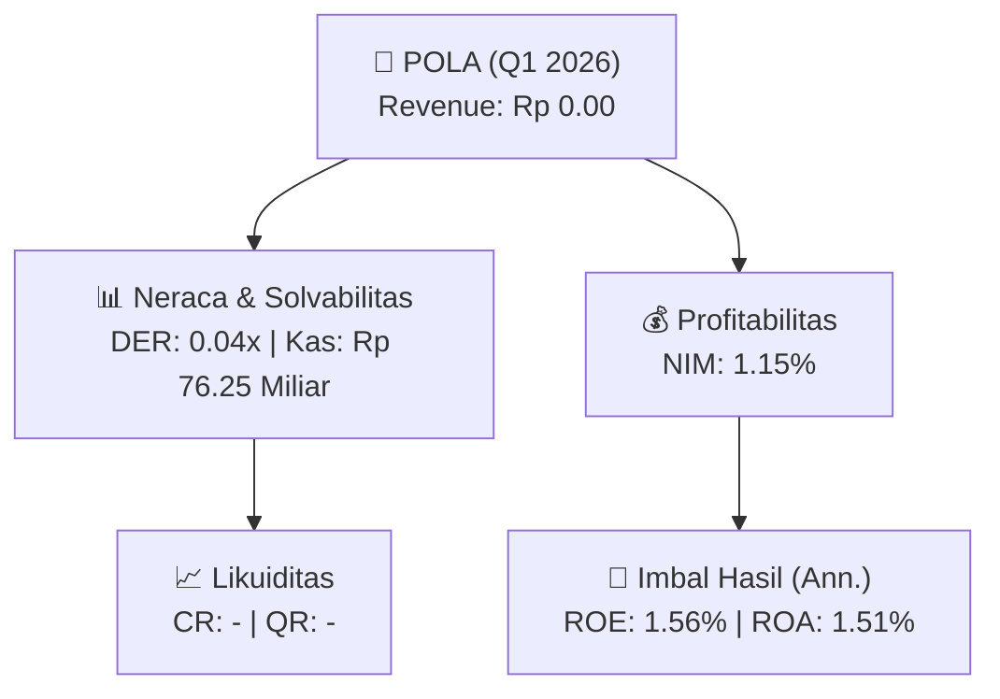

# 📈 Laporan Keuangan Interim: [[POLA]] — Q1 2026

📅 **2026-09-25** | 🎛️ [[Dashboard|Ke Dashboard Utama]]

> [!NOTE]
> Laporan interim ringkas **PT Pool Advista Finance Tbk. ([[POLA]])** — Sektor: Multifinance & Perbankan.

---

## 📌 1. Ikhtisar Kinerja Utama / Executive Performance Highlight
- **Emiten**: `[[POLA]]` (PT Pool Advista Finance Tbk.)
- **Sektor Usaha / Industry Sector**: `Multifinance & Perbankan`
- **Periode Laporan / Reporting Period**: `Q1 2026`
- **Pendapatan Usaha / Total Revenue**: `Rp 0.00` (**- YoY** dari Rp 0.00)
- **Pendapatan Bunga / Interest Income**: `Rp 666.09 Juta`
- **Laba (Rugi) Bersih / Net Income**: `Rp 864.29 Juta` (**-57.50% 🔴 YoY**)
- **Total Aset / Total Assets**: `Rp 230.38 Miliar` | **Total Ekuitas / Total Equity**: `Rp 222.56 Miliar`
- **EPS (Annualized)**: `0.01` | **BVPS**: `0.66`

---

## 📊 2. Laba Rugi Komparatif / Comparative Income Statement (Financial Sector)

| Pos Laba Rugi / Income Statement Item | Q1 2026 | Prior Period | YoY (%) |
| :--- | ---: | ---: | :---: |
| **Pendapatan Bunga / Interest Income** | `666.09M` | `173.04M` | +284.94% 🟢 |
| **Beban Bunga / Interest Expense** | `(1.84M)` | `(1.57M)` | +17.55% 🟢 |
| **Jumlah Pendapatan Usaha / Total Revenue** | `0.00` | `0.00` | - |
| **Pencadangan / Provision (PPAP)** | `(-2.48B)` | `(880.30M)` | -381.34% 🔴 |
| **Beban Operasional / Operating Expenses** | `(940.21M)` | `(1.03B)` | -9.09% 🔴 |
| **Laba Sebelum Pajak / Profit Before Tax** | `1.40B` | `1.14B` | +22.20% 🟢 |
| **Laba (Rugi) Bersih / Net Income** | **864.29M** | **2.03B** | **-57.50% 🔴** |

---

## 🏦 3. Neraca & Struktur Permodalan / Balance Sheet & Capital Structure

| Pos Neraca / Balance Sheet Item | Q1 2026 | Prior Year End | Δ YoY/YtD (%) | Catatan / Notes |
| :--- | ---: | ---: | :---: | :--- |
| **Aset Lancar / Current Assets** | `-` | `-` | - | Kas: Rp 76.25 Miliar |
| **Aset Tidak Lancar / Non-Current Assets** | `-` | `-` | - | Aset Tetap & Operasional |
| **TOTAL ASET / TOTAL ASSETS** | **230.38B** | **228.88B** | **+0.65% 🟢** | |
| **Liabilitas Jk. Pendek / Current Liabilities** | `-` | `-` | - | |
| **Liabilitas Jk. Panjang / Non-Current Liabilities** | `-` | `-` | - | |
| **TOTAL LIABILITAS / TOTAL LIABILITIES** | **7.81B** | **7.18B** | **+8.73% 🟢** | |
| **TOTAL EKUITAS / TOTAL EQUITY** | **222.56B** | **221.70B** | **+0.39% 🟢** | |

---

## 📈 Analisis Rasio Keuangan / Financial Ratio Analysis

| Kategori / Category | Metrik / Metric | Nilai / Value | Benchmark | Interpretasi / Interpretation |
| :--- | :--- | :---: | :---: | :--- |
| **🛡️ Likuiditas** | **Current Ratio** | `-` | `> 1.0x` | Kemampuan bayar kewajiban jk. pendek |
| | **Quick Ratio** | `-` | `> 0.8x` | Likuiditas tanpa persediaan |
| **📊 Profitabilitas** | **Net Interest Margin (NIM)** | `1.15%` | `> 3.0%` | Spread pendapatan bunga bersih |
| **🎯 Imbal Hasil (Ann.)** | **Return on Equity (ROE)** | `1.56%` | - | Imbal hasil terhadap ekuitas |
| | **Return on Assets (ROA)** | `1.51%` | - | Produktivitas aset |
| **⚖️ Solvabilitas** | **Debt to Equity (DER)** | `0.04x` | `< 2.0x` | Leverage utang vs modal |
| | **Debt to Asset (DAR)** | `0.03x` | `< 0.7x` | Porsi aset didanai utang |

---

## 🔗 Hubungan Note Terkait / Knowledge Graph Links
- [[knowledge-base/daily-digests/Daily_Digest_20260925|📄 Daily Digest 2026-09-25]]
- [[knowledge-base/trading-signals/Trading_Signals_20260925|🎯 Trading Signals]]
- [[Dashboard|🎛️ Kembali ke Dashboard Utama]]