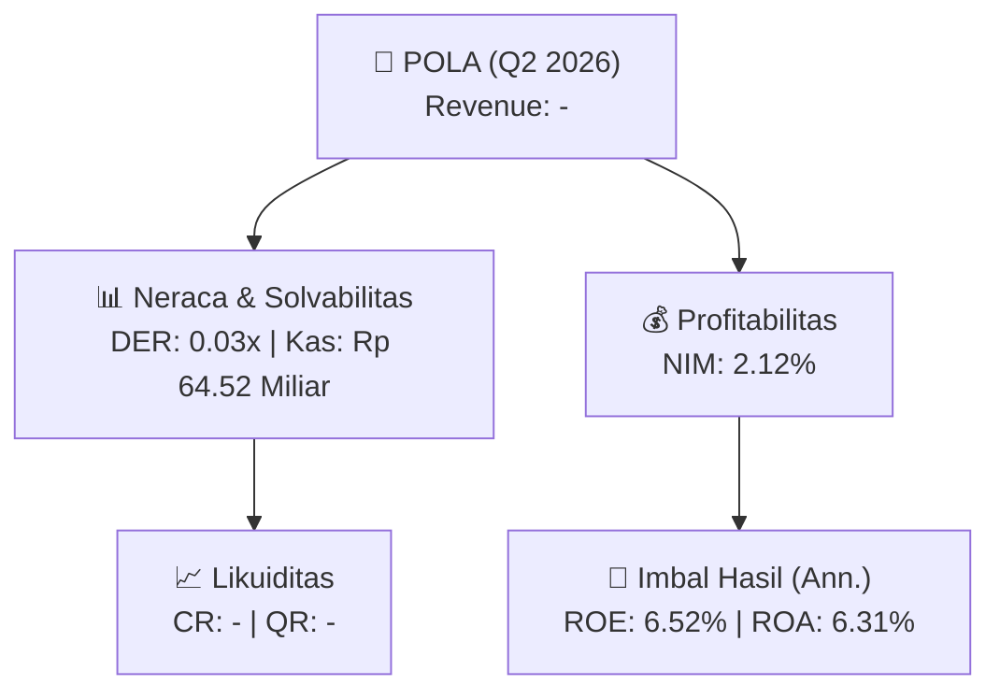
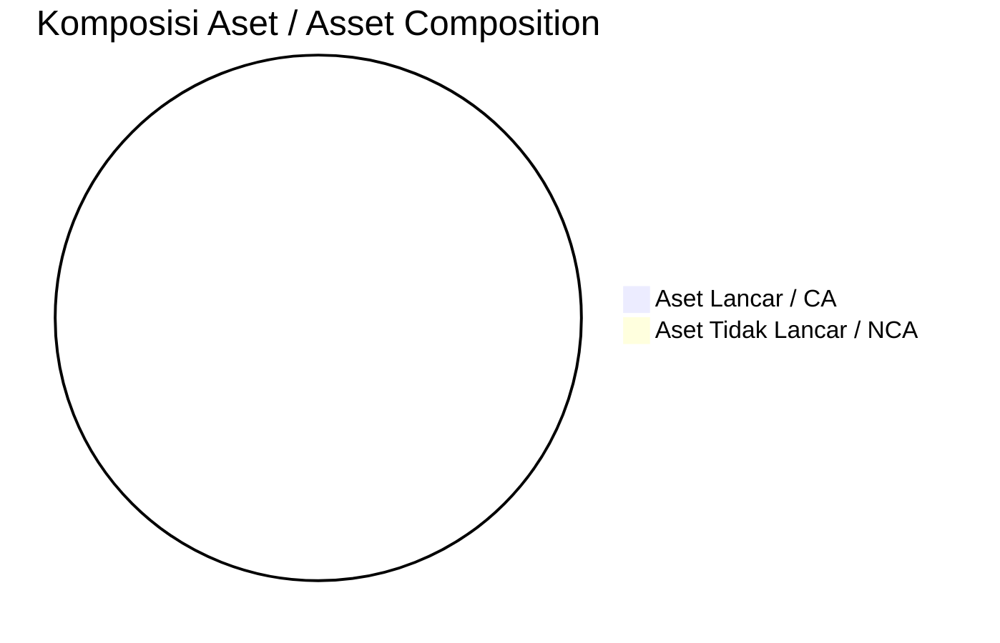
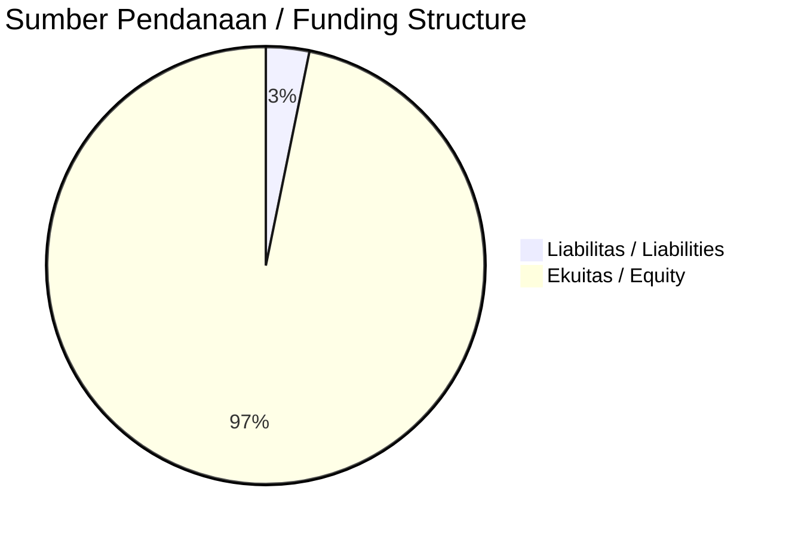

# 📈 Laporan Analisis Keuangan Mendalam: [[POLA]] — Q2 2026

⬅️ [[knowledge-base/daily-digests/Daily_Digest_20260902|Kembali ke Daily Digest]] | 📅 **2026-09-02** | 🎛️ [[Dashboard|Ke Dashboard Utama]]

> [!IMPORTANT]
> Dokumen ini disusun oleh **Financial Summarizer Agent** untuk menganalisis kinerja keuangan, kesehatan neraca, profitabilitas, dan katalis sektor (Multifinance & Perbankan) **PT Pool Advista Finance Tbk. ([[POLA]])** berdasarkan LK Q2 2026.

---

## 📌 1. Ikhtisar Kinerja Utama / Executive Performance Highlight
- **Emiten**: `[[POLA]]` (PT Pool Advista Finance Tbk.)
- **Sektor Usaha / Industry Sector**: `Multifinance & Perbankan`
- **Periode Laporan / Reporting Period**: `Q2 2026`
- **Pendapatan Usaha / Total Revenue**: `-` (**- YoY** dari -)
- **Pendapatan Bunga / Interest Income**: `Rp 2.47 Miliar`
- **Laba (Rugi) Bersih / Net Income**: `Rp 7.23 Miliar` (**+175.37% 🟢 YoY**)
- **Total Aset / Total Assets**: `Rp 232.73 Miliar` | **Total Ekuitas / Total Equity**: `Rp 225.24 Miliar`
- **EPS (Annualized)**: `0.04` | **BVPS**: `0.67`

---

## 📊 2. Laba Rugi Komparatif / Comparative Income Statement (Financial Sector)

| Pos Laba Rugi / Income Statement Item | Q2 2026 | Prior Period | YoY (%) |
| :--- | ---: | ---: | :---: |
| **Pendapatan Bunga / Interest Income** | `2.47B` | `322.73M` | +666.49% 🟢 |
| **Beban Bunga / Interest Expense** | `(6.87M)` | `(157.12M)` | -95.63% 🔴 |
| **Pencadangan / Provision (PPAP)** | `(-644.72M)` | `(10.88B)` | -105.93% 🔴 |
| **Beban Operasional / Operating Expenses** | `(3.43B)` | `(3.54B)` | -3.07% 🔴 |
| **Laba Sebelum Pajak / Profit Before Tax** | `8.01B` | `-12.26B` | +165.32% 🟢 |
| **Laba (Rugi) Bersih / Net Income** | **7.23B** | **-9.59B** | **+175.37% 🟢** |

---

## 🏦 3. Neraca & Struktur Permodalan / Balance Sheet & Capital Structure

| Pos Neraca / Balance Sheet Item | Q2 2026 | Prior Year End | Δ YoY/YtD (%) | Catatan / Notes |
| :--- | ---: | ---: | :---: | :--- |
| **Aset Lancar / Current Assets** | `-` | `-` | - | Kas: Rp 64.52 Miliar |
| **Aset Tidak Lancar / Non-Current Assets** | `-` | `-` | - | Aset Tetap & Operasional |
| **TOTAL ASET / TOTAL ASSETS** | **232.73B** | **225.03B** | **+3.42% 🟢** | |
| **Liabilitas Jk. Pendek / Current Liabilities** | `-` | `-` | - | |
| **Liabilitas Jk. Panjang / Non-Current Liabilities** | `-` | `-` | - | |
| **TOTAL LIABILITAS / TOTAL LIABILITIES** | **7.49B** | **7.02B** | **+6.78% 🟢** | |
| **TOTAL EKUITAS / TOTAL EQUITY** | **225.24B** | **218.01B** | **+3.31% 🟢** | |

---

## 💸 4. Laporan Arus Kas / Cash Flow Statement

| Komponen Arus Kas / Cash Flow Component | Q2 2026 | Prior Period | Δ YoY (%) |
| :--- | ---: | ---: | :---: |
| **Arus Kas Operasi / CFO** | `44.70B` | `19.68B` | +127.12% 🟢 |
| **Arus Kas Investasi / CFI** | `-22.11M` | `-11.95M` | -85.11% 🔴 |
| **Arus Kas Pendanaan / CFF** | `-1.37B` | `-16.77B` | +91.82% 🟢 |
| **Kenaikan (Penurunan) Kas Bersih** | `43.31B` | `2.91B` | +1390.68% 🟢 |
| Belanja Modal / Capex | `(22.11M)` | `(11.95M)` | +85.11% 🟢 |
| Pembayaran Dividen / Dividends Paid | `(-)` | `(-)` | - |
| **Free Cash Flow (CFO - Capex)** | **44.68B** | **19.67B** | **+127.14% 🟢** |

---

## 📈 Analisis Rasio Keuangan / Financial Ratio Analysis

| Kategori / Category | Metrik / Metric | Nilai / Value | Benchmark | Interpretasi / Interpretation |
| :--- | :--- | :---: | :---: | :--- |
| **🛡️ Likuiditas** | **Current Ratio** | `-` | `> 1.0x` | Kemampuan bayar kewajiban jk. pendek |
| | **Quick Ratio** | `-` | `> 0.8x` | Likuiditas tanpa persediaan |
| **📊 Profitabilitas** | **Net Interest Margin (NIM)** | `2.12%` | `> 3.0%` | Spread pendapatan bunga bersih |
| **🎯 Imbal Hasil (Ann.)** | **Return on Equity (ROE)** | `6.52%` | - | Imbal hasil terhadap ekuitas |
| | **Return on Assets (ROA)** | `6.31%` | - | Produktivitas aset |
| **⚖️ Solvabilitas** | **Debt to Equity (DER)** | `0.03x` | `< 2.0x` | Leverage utang vs modal |
| | **Debt to Asset (DAR)** | `0.03x` | `< 0.7x` | Porsi aset didanai utang |

---

## 📐 Per Share Metrics

| Metrik / Metric | Nilai / Value | Keterangan / Notes |
| :--- | ---: | :--- |
| **EPS (Annualized)** | `Rp 0.04` | Laba per saham (dianualisasi) |
| **BVPS** | `Rp 0.67` | Nilai buku per saham |

---

## 🚀 Analisis Strategis & Karakteristik Sektor / Strategic Analysis: Multifinance & Perbankan

Pada periode Q2 2026, **PT Pool Advista Finance Tbk. ([[POLA]])** membukukan total pendapatan sebesar **-** (- YoY). Laba bersih sebesar **Rp 7.23 Miliar** (+175.37% 🟢 YoY). Total aset **Rp 232.73 Miliar**, ekuitas **Rp 225.24 Miliar**, DER **0.03x**.

### 🔍 Indikator Kunci Sektor / Sector Key Indicators (Multifinance & Perbankan)
- **Karakteristik Industri Finansial / Financial Industry**: Kinerja ditopang oleh spread pendapatan bunga (NIM), hasil investasi, dan pengelolaan Cost of Funds.
- **Kualitas Aset / Asset Quality**: Pengawasan rasio NPL/NPF dan kecukupan pencadangan (PPAP) untuk menjaga stabilitas margin usaha.
- **Solvabilitas / Solvency**: Rasio kecukupan modal (CAR/RBC) ketat sesuai regulasi OJK.

> [!NOTE]
> _Data Public Expose / Investor Presentation belum tersedia untuk emiten ini._

---

## 📋 Catatan Kunci Laporan Keuangan / Key Notes to Financial Statements

### 🔍 Opini Auditor / Auditor Opinion
- _Informasi opini auditor tidak tersedia._

---

## 💡 Catatan Strategis & Panduan Investor / Strategic Notes & Investor Guide

1. **Kesehatan Permodalan / Capital Health**: DER **0.03x**, CR **-** — _perlu dipantau secara disiplin_.
2. **Katalis Pertumbuhan / Growth Catalysts**: Pantau realisasi pendapatan dan efisiensi operasional periode berikutnya.
3. **Kualitas Aset Finansial**: Pantau tren NIM (**2.12%**) dan kualitas portofolio kredit/pembiayaan.

---

## 🔗 Hubungan Note Terkait / Knowledge Graph Links
- [[knowledge-base/daily-digests/Daily_Digest_20260902|📄 Daily Digest 2026-09-02]]
- [[knowledge-base/trading-signals/Trading_Signals_20260902|🎯 Trading Signals]]
- [[Dashboard|🎛️ Kembali ke Dashboard Utama]]