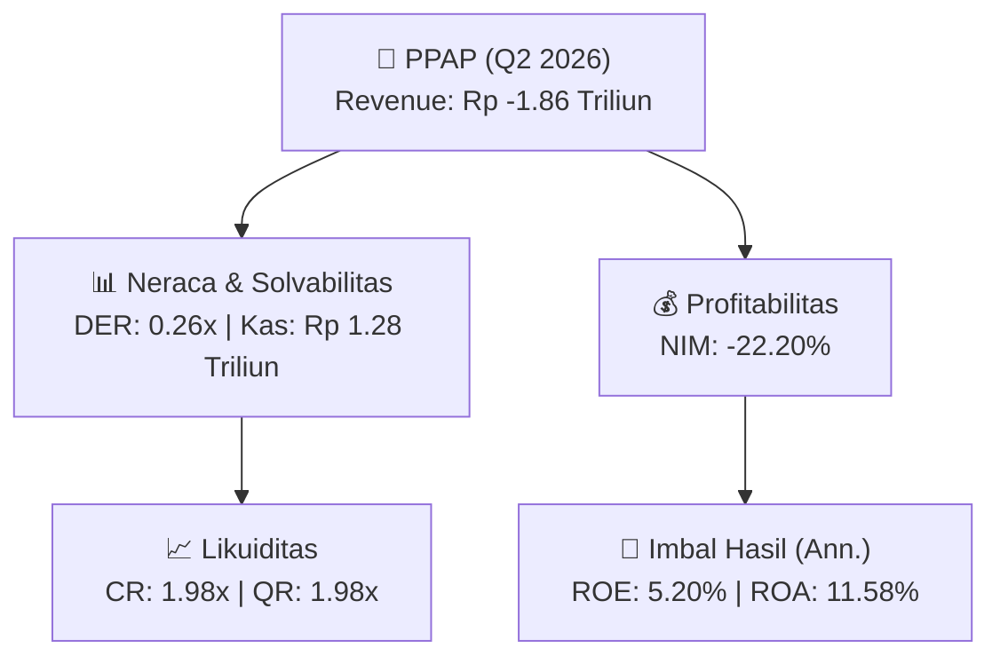
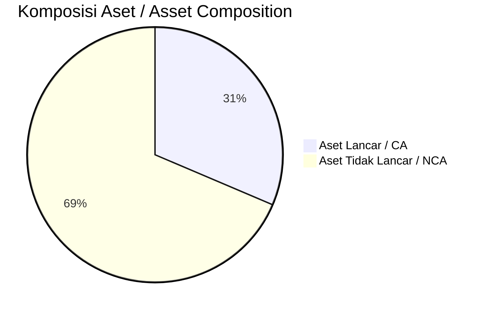
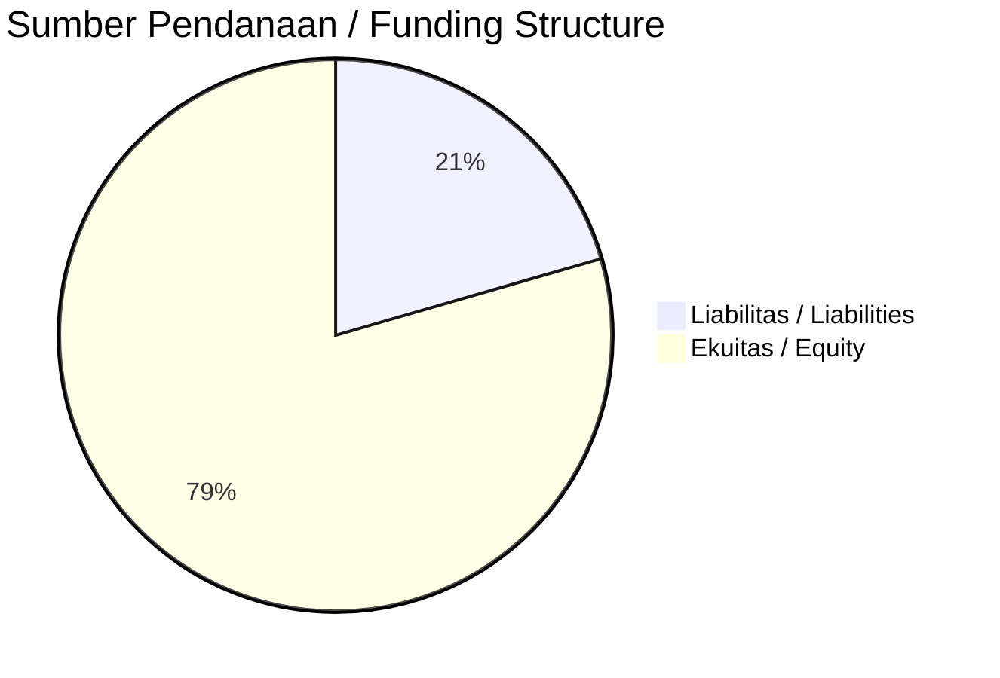

# 📈 Laporan Analisis Keuangan Mendalam: [[PPAP]] — Q2 2026

⬅️ [[knowledge-base/daily-digests/Daily_Digest_20261001|Kembali ke Daily Digest]] | 📅 **2026-10-01** | 🎛️ [[Dashboard|Ke Dashboard Utama]]

> [!IMPORTANT]
> Dokumen ini disusun oleh **Financial Summarizer Agent** untuk menganalisis kinerja keuangan, kesehatan neraca, profitabilitas, dan katalis sektor (Multifinance & Perbankan) **PT Perusahaan Pengelola Aset ([[PPAP]])** berdasarkan LK Q2 2026.

---

## 📌 1. Ikhtisar Kinerja Utama / Executive Performance Highlight
- **Emiten**: `[[PPAP]]` (PT Perusahaan Pengelola Aset)
- **Sektor Usaha / Industry Sector**: `Multifinance & Perbankan`
- **Periode Laporan / Reporting Period**: `Q2 2026`
- **Pendapatan Usaha / Total Revenue**: `Rp -1.86 Triliun` (**-57.18% 🔴 YoY** dari Rp -1.19 Triliun)

- **Laba (Rugi) Bersih / Net Income**: `Rp 219.50 Miliar` (**-12.88% 🔴 YoY**)
- **Total Aset / Total Assets**: `Rp 3.90 Triliun` | **Total Ekuitas / Total Equity**: `Rp 7.62 Triliun`
- **EPS (Annualized)**: `0.08` | **BVPS**: `1.34`

---

## 📊 2. Laba Rugi Komparatif / Comparative Income Statement (Financial Sector)

| Pos Laba Rugi / Income Statement Item | Q2 2026 | Prior Period | YoY (%) |
| :--- | ---: | ---: | :---: |
| **Pendapatan Bunga / Interest Income** | `0.00` | `0.00` | - |
| **Beban Bunga / Interest Expense** | `(432.97B)` | `(480.94B)` | -9.97% 🔴 |
| **Jumlah Pendapatan Usaha / Total Revenue** | `-1.86T` | `-1.19T` | -57.18% 🔴 |
| **Beban Operasional / Operating Expenses** | `(270.92B)` | `(155.66B)` | +74.05% 🟢 |
| **Laba Sebelum Pajak / Profit Before Tax** | `219.35B` | `250.64B` | -12.48% 🔴 |
| **Laba (Rugi) Bersih / Net Income** | **219.50B** | **251.95B** | **-12.88% 🔴** |

---

## 🏦 3. Neraca & Struktur Permodalan / Balance Sheet & Capital Structure

| Pos Neraca / Balance Sheet Item | Q2 2026 | Prior Year End | Δ YoY/YtD (%) | Catatan / Notes |
| :--- | ---: | ---: | :---: | :--- |
| **Aset Lancar / Current Assets** | `3.90T` | `3.68T` | +6.05% 🟢 | Kas: Rp 1.28 Triliun |
| **Aset Tidak Lancar / Non-Current Assets** | `8.52T` | `10.49T` | -18.81% 🔴 | Aset Tetap & Operasional |
| **TOTAL ASET / TOTAL ASSETS** | **3.90T** | **3.68T** | **+6.05% 🟢** | |
| **Liabilitas Jk. Pendek / Current Liabilities** | `1.97T` | `2.04T` | -3.59% 🔴 | |
| **Liabilitas Jk. Panjang / Non-Current Liabilities** | `2.82T` | `2.86T` | -1.16% 🔴 | |
| **TOTAL LIABILITAS / TOTAL LIABILITIES** | **1.97T** | **2.04T** | **-3.59% 🔴** | |
| **TOTAL EKUITAS / TOTAL EQUITY** | **7.62T** | **9.27T** | **-17.74% 🔴** | |

---

## 💸 4. Laporan Arus Kas / Cash Flow Statement

| Komponen Arus Kas / Cash Flow Component | Q2 2026 | Prior Period | Δ YoY (%) |
| :--- | ---: | ---: | :---: |
| **Arus Kas Operasi / CFO** | `340.54B` | `-67.50B` | +604.48% 🟢 |
| **Arus Kas Investasi / CFI** | `274.48B` | `160.50B` | +71.01% 🟢 |
| **Arus Kas Pendanaan / CFF** | `-187.61B` | `361.84B` | -151.85% 🔴 |
| **Kenaikan (Penurunan) Kas Bersih** | `427.41B` | `454.84B` | -6.03% 🔴 |
| Belanja Modal / Capex | `(65.00M)` | `(0.00)` | - |
| Pembayaran Dividen / Dividends Paid | `(0.00)` | `(0.00)` | - |
| **Free Cash Flow (CFO - Capex)** | **340.48B** | **-67.50B** | **+604.38% 🟢** |

---

## 📈 Analisis Rasio Keuangan / Financial Ratio Analysis

| Kategori / Category | Metrik / Metric | Nilai / Value | Benchmark | Interpretasi / Interpretation |
| :--- | :--- | :---: | :---: | :--- |
| **🛡️ Likuiditas** | **Current Ratio** | `1.98x` | `> 1.0x` | Kemampuan bayar kewajiban jk. pendek |
| | **Quick Ratio** | `1.98x` | `> 0.8x` | Likuiditas tanpa persediaan |
| **📊 Profitabilitas** | **Net Interest Margin (NIM)** | `-22.20%` | `> 3.0%` | Spread pendapatan bunga bersih |
| | **BOPO / Cost-to-Income Ratio** | `14.54%` | `< 80%` | Efisiensi biaya operasional |
| **🎯 Imbal Hasil (Ann.)** | **Return on Equity (ROE)** | `5.20%` | - | Imbal hasil terhadap ekuitas |
| | **Return on Assets (ROA)** | `11.58%` | - | Produktivitas aset |
| **⚖️ Solvabilitas** | **Debt to Equity (DER)** | `0.26x` | `< 2.0x` | Leverage utang vs modal |
| | **Debt to Asset (DAR)** | `0.51x` | `< 0.7x` | Porsi aset didanai utang |

---

## 📐 Per Share Metrics

| Metrik / Metric | Nilai / Value | Keterangan / Notes |
| :--- | ---: | :--- |
| **EPS (Annualized)** | `Rp 0.08` | Laba per saham (dianualisasi) |
| **BVPS** | `Rp 1.34` | Nilai buku per saham |

---

## 🚀 Analisis Strategis & Karakteristik Sektor / Strategic Analysis: Multifinance & Perbankan

Pada periode Q2 2026, **PT Perusahaan Pengelola Aset ([[PPAP]])** membukukan total pendapatan sebesar **Rp -1.86 Triliun** (-57.18% 🔴 YoY). Laba bersih sebesar **Rp 219.50 Miliar** (-12.88% 🔴 YoY). Total aset **Rp 3.90 Triliun**, ekuitas **Rp 7.62 Triliun**, DER **0.26x**.

### 🔍 Indikator Kunci Sektor / Sector Key Indicators (Multifinance & Perbankan)
- **Karakteristik Industri Finansial / Financial Industry**: Kinerja ditopang oleh spread pendapatan bunga (NIM), hasil investasi, dan pengelolaan Cost of Funds.
- **Kualitas Aset / Asset Quality**: Pengawasan rasio NPL/NPF dan kecukupan pencadangan (PPAP) untuk menjaga stabilitas margin usaha.
- **Solvabilitas / Solvency**: Rasio kecukupan modal (CAR/RBC) ketat sesuai regulasi OJK.

> [!NOTE]
> _Data Public Expose / Investor Presentation belum tersedia untuk emiten ini._

---

## 📋 Catatan Kunci Laporan Keuangan / Key Notes to Financial Statements

### 🔍 Opini Auditor / Auditor Opinion
- **Jenis Opini / Opinion Type**: `Wajar Tanpa Modifikasian / Unqualified`
- **KAP / Audit Firm**: `KAP Amir Abadi Jusuf, Aryanto, Mawar  Rekan`
- **Partner Audit**: `Benny Andria`
- **Tanggal Laporan / Report Date**: `2026-09-28`
- **Kesimpulan**: _wajar, dalan semua hal yang material_

### 📝 Perjanjian & Kontrak Signifikan / Key Contracts & Agreements
- Pada tanggal 16 Desember 2019, Perusahaan menerima Fasilitas Kredit Modal Kerja Transaksional dari Bank Mandiri sesuai Perjanjian Kredit No. CRO.KP/547/KMK/2019 sebagaimana diperbarui dengan Addendum VIII tanggal 27 Februari 2026. Nilai pinjaman maksimum sebesar Rp211.222 dengan tingkat suku bunga 6,15%-6,31% per tahun.

---

## 💡 Catatan Strategis & Panduan Investor / Strategic Notes & Investor Guide

1. **Kesehatan Permodalan / Capital Health**: DER **0.26x**, CR **1.98x** — _sehat dan aman_.
2. **Katalis Pertumbuhan / Growth Catalysts**: Pantau realisasi pendapatan dan efisiensi operasional periode berikutnya.
3. **Kualitas Aset Finansial**: Pantau tren NIM (**-22.20%**) dan kualitas portofolio kredit/pembiayaan.

---

## 🔗 Hubungan Note Terkait / Knowledge Graph Links
- [[knowledge-base/daily-digests/Daily_Digest_20261001|📄 Daily Digest 2026-10-01]]
- [[knowledge-base/trading-signals/Trading_Signals_20261001|🎯 Trading Signals]]
- [[Dashboard|🎛️ Kembali ke Dashboard Utama]]