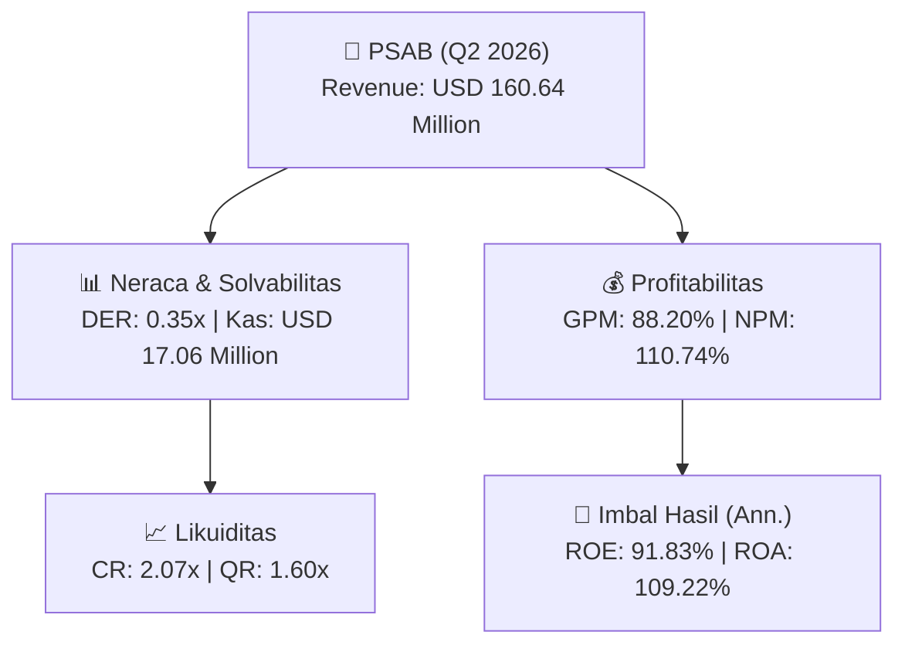
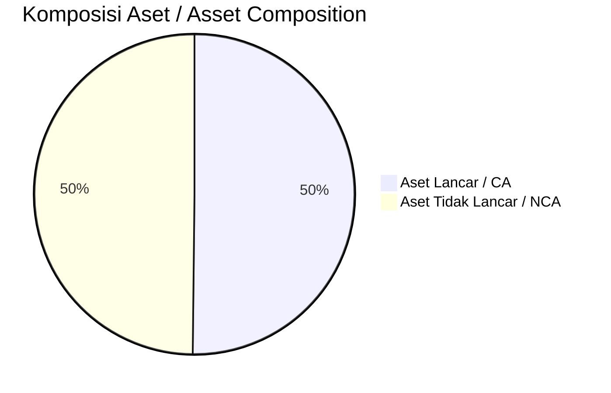
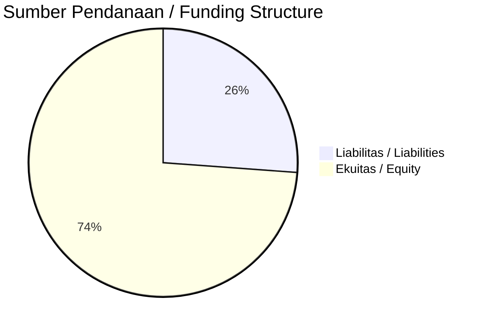

# 📈 Laporan Analisis Keuangan Mendalam: [[PSAB]] — Q2 2026

⬅️ [[knowledge-base/daily-digests/Daily_Digest_20260901|Kembali ke Daily Digest]] | 📅 **2026-09-01** | 🎛️ [[Dashboard|Ke Dashboard Utama]]

> [!IMPORTANT]
> Dokumen ini disusun oleh **Financial Summarizer Agent** untuk menganalisis kinerja keuangan, kesehatan neraca, profitabilitas, dan katalis sektor (General) **J RESOURCES ASIA PASIFIK Tbk ([[PSAB]])** berdasarkan LK Q2 2026.

---

## 📌 1. Ikhtisar Kinerja Utama / Executive Performance Highlight
- **Emiten**: `[[PSAB]]` (J RESOURCES ASIA PASIFIK Tbk)
- **Sektor Usaha / Industry Sector**: `General`
- **Periode Laporan / Reporting Period**: `Q2 2026`
- **Pendapatan Neto / Net Revenue**: `USD 160.64 Million` (**+14.50% 🟢 YoY** dari USD 140.30 Million)
- **Laba Bruto / Gross Profit**: `USD 141.69 Million` (**+61.03% 🟢 YoY**)
- **Laba (Rugi) Bersih / Net Income**: `USD 177.89 Million` (**+803.15% 🟢 YoY**)
- **Total Aset / Total Assets**: `USD 319.48 Million` | **Total Ekuitas / Total Equity**: `USD 435.50 Million`
- **EPS (Annualized)**: `6.05` | **BVPS**: `7.40`

---

## 📊 2. Laba Rugi Komparatif / Comparative Income Statement

| Pos Laba Rugi / Income Statement Item | Q2 2026 | Prior Period | YoY (%) |
| :--- | ---: | ---: | :---: |
| **Pendapatan Neto / Net Revenue** | `160.64M` | `140.30M` | **+14.50% 🟢** |
| **Beban Pokok / COGS** | `(18.95M)` | `(52.31M)` | -63.78% 🔴 |
| **Laba Bruto / Gross Profit** | `141.69M` | `87.99M` | **+61.03% 🟢** |
| **Beban Usaha / Operating Expenses** | `(46.43M)` | `(29.53M)` | +57.21% 🟢 |
| **Laba Operasional / EBIT** | `190.25M` | `37.79M` | +403.42% 🟢 |
| **Laba (Rugi) Bersih / Net Income** | **177.89M** | **19.70M** | **+803.15% 🟢** |

---

## 🏦 3. Neraca & Struktur Permodalan / Balance Sheet & Capital Structure

| Pos Neraca / Balance Sheet Item | Q2 2026 | Prior Year End | Δ YoY/YtD (%) | Catatan / Notes |
| :--- | ---: | ---: | :---: | :--- |
| **Aset Lancar / Current Assets** | `319.48M` | `332.01M` | -3.77% 🔴 | Kas: USD 17.06 Million |
| **Aset Tidak Lancar / Non-Current Assets** | `317.38M` | `489.56M` | -35.17% 🔴 | Aset Tetap & Operasional |
| **TOTAL ASET / TOTAL ASSETS** | **319.48M** | **332.01M** | **-3.77% 🔴** | |
| **Liabilitas Jk. Pendek / Current Liabilities** | `154.30M` | `182.19M` | -15.31% 🔴 | |
| **Liabilitas Jk. Panjang / Non-Current Liabilities** | `47.06M` | `184.85M` | -74.54% 🔴 | |
| **TOTAL LIABILITAS / TOTAL LIABILITIES** | **154.30M** | **182.19M** | **-15.31% 🔴** | |
| **TOTAL EKUITAS / TOTAL EQUITY** | **435.50M** | **339.35M** | **+28.33% 🟢** | |

---

## 💸 4. Laporan Arus Kas / Cash Flow Statement

| Komponen Arus Kas / Cash Flow Component | Q2 2026 | Prior Period | Δ YoY (%) |
| :--- | ---: | ---: | :---: |
| **Arus Kas Operasi / CFO** | `47.35M` | `58.81M` | -19.48% 🔴 |
| **Arus Kas Investasi / CFI** | `295.88M` | `-14.41M` | +2152.74% 🟢 |
| **Arus Kas Pendanaan / CFF** | `-352.28M` | `-33.25M` | -959.41% 🔴 |
| **Kenaikan (Penurunan) Kas Bersih** | `-9.05M` | `11.14M` | -181.23% 🔴 |
| Belanja Modal / Capex | `(29.44M)` | `(7.77M)` | +279.16% 🟢 |
| Pembayaran Dividen / Dividends Paid | `(155.53M)` | `(-)` | - |
| **Free Cash Flow (CFO - Capex)** | **17.91M** | **51.04M** | **-64.92% 🔴** |

---

## 📈 Analisis Rasio Keuangan / Financial Ratio Analysis

| Kategori / Category | Metrik / Metric | Nilai / Value | Benchmark | Interpretasi / Interpretation |
| :--- | :--- | :---: | :---: | :--- |
| **🛡️ Likuiditas** | **Current Ratio** | `2.07x` | `> 1.0x` | Kemampuan bayar kewajiban jk. pendek |
| | **Quick Ratio** | `1.60x` | `> 0.8x` | Likuiditas tanpa persediaan |
| **📊 Profitabilitas** | **Gross Profit Margin (GPM)** | `88.20%` | - | Margin kotor operasional inti |
| | **Operating Profit Margin (OPM)** | `118.44%` | - | Efisiensi operasional |
| | **Net Profit Margin (NPM)** | `110.74%` | - | Konversi revenue ke laba bersih |
| **🎯 Imbal Hasil (Ann.)** | **Return on Equity (ROE)** | `91.83%` | - | Imbal hasil terhadap ekuitas |
| | **Return on Assets (ROA)** | `109.22%` | - | Produktivitas aset |
| **⚖️ Solvabilitas** | **Debt to Equity (DER)** | `0.35x` | `< 2.0x` | Leverage utang vs modal |
| | **Debt to Asset (DAR)** | `0.48x` | `< 0.7x` | Porsi aset didanai utang |

---

## 📐 Per Share Metrics

| Metrik / Metric | Nilai / Value | Keterangan / Notes |
| :--- | ---: | :--- |
| **EPS (Annualized)** | `USD 6.05` | Laba per saham (dianualisasi) |
| **BVPS** | `USD 7.40` | Nilai buku per saham |

---

## 🚀 Analisis Strategis & Karakteristik Sektor / Strategic Analysis: General

Pada periode Q2 2026, **J RESOURCES ASIA PASIFIK Tbk ([[PSAB]])** membukukan total pendapatan sebesar **USD 160.64 Million** (+14.50% 🟢 YoY). Laba kotor tercatat **USD 141.69 Million** dengan GPM **88.20%**. Laba bersih sebesar **USD 177.89 Million** (+803.15% 🟢 YoY). Total aset **USD 319.48 Million**, ekuitas **USD 435.50 Million**, DER **0.35x**.

### 🔍 Indikator Kunci Sektor / Sector Key Indicators (General)
- **Karakteristik Industri (General)**: Kinerja mencerminkan dinamika penyerapan pasar, utilisasi kapasitas produksi, dan efisiensi biaya pokok.
- **Faktor Penggerak**: Pertumbuhan organik, efisiensi operasional, dan ekspansi pasar.

> [!NOTE]
> _Data Public Expose / Investor Presentation belum tersedia untuk emiten ini._

---

## 📋 Catatan Kunci Laporan Keuangan / Key Notes to Financial Statements

### 🔍 Opini Auditor / Auditor Opinion
- **Jenis Opini / Opinion Type**: `Reviu Terbatas / Limited Review`
- **KAP / Audit Firm**: `KAP Mirawati Sensi Idris`
- **Partner Audit**: `Leo Susanto`
- **Tanggal Laporan / Report Date**: `2026-07-01`

---

## 💡 Catatan Strategis & Panduan Investor / Strategic Notes & Investor Guide

1. **Kesehatan Permodalan / Capital Health**: DER **0.35x**, CR **2.07x** — _sehat dan aman_.
2. **Katalis Pertumbuhan / Growth Catalysts**: Pantau realisasi pendapatan dan efisiensi operasional periode berikutnya.

---

## 🔗 Hubungan Note Terkait / Knowledge Graph Links
- [[knowledge-base/daily-digests/Daily_Digest_20260901|📄 Daily Digest 2026-09-01]]
- [[knowledge-base/trading-signals/Trading_Signals_20260901|🎯 Trading Signals]]
- [[Dashboard|🎛️ Kembali ke Dashboard Utama]]