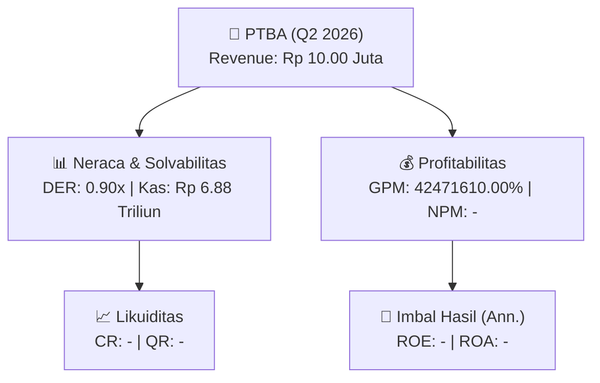
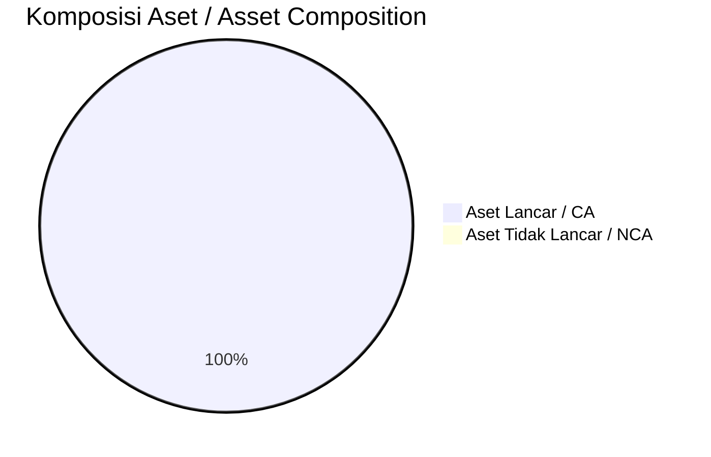
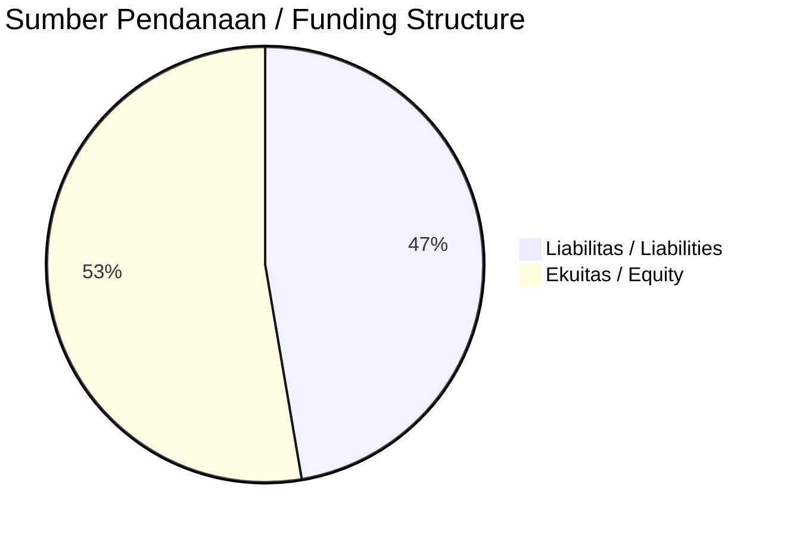

# 📈 Laporan Analisis Keuangan Mendalam: [[PTBA]] — Q2 2026

⬅️ [[knowledge-base/daily-digests/Daily_Digest_20260925|Kembali ke Daily Digest]] | 📅 **2026-09-25** | 🎛️ [[Dashboard|Ke Dashboard Utama]]

> [!IMPORTANT]
> Dokumen ini disusun oleh **Financial Summarizer Agent** untuk menganalisis kinerja keuangan, kesehatan neraca, profitabilitas, dan katalis sektor (Pertambangan) **Nama Emiten ([[PTBA]])** berdasarkan LK Q2 2026.

---

## 📌 1. Ikhtisar Kinerja Utama / Executive Performance Highlight
- **Emiten**: `[[PTBA]]` (Nama Emiten)
- **Sektor Usaha / Industry Sector**: `Pertambangan`
- **Periode Laporan / Reporting Period**: `Q2 2026`
- **Pendapatan Neto / Net Revenue**: `Rp 10.00 Juta` (**- YoY** dari -)
- **Laba Bruto / Gross Profit**: `Rp 4.25 Triliun` (**+89.02% 🟢 YoY**)
- **Laba (Rugi) Bersih / Net Income**: `-` (**- YoY**)
- **Total Aset / Total Assets**: `Rp 16.53 Triliun` | **Total Ekuitas / Total Equity**: `Rp 25.34 Triliun`
- **EPS (Annualized)**: `-` | **BVPS**: `-`

---

## 📊 2. Laba Rugi Komparatif / Comparative Income Statement

| Pos Laba Rugi / Income Statement Item | Q2 2026 | Prior Period | YoY (%) |
| :--- | ---: | ---: | :---: |
| **Pendapatan Neto / Net Revenue** | `10.00M` | `-` | **-** |
| **Beban Pokok / COGS** | `(17.78T)` | `(18.21T)` | -2.33% 🔴 |
| **Laba Bruto / Gross Profit** | `4.25T` | `2.25T` | **+89.02% 🟢** |
| **Beban Usaha / Operating Expenses** | `(-)` | `(-)` | - |
| **Laba Operasional / EBIT** | `-` | `-` | - |
| **Laba (Rugi) Bersih / Net Income** | **-** | **-** | **-** |

---

## 🏦 3. Neraca & Struktur Permodalan / Balance Sheet & Capital Structure

| Pos Neraca / Balance Sheet Item | Q2 2026 | Prior Year End | Δ YoY/YtD (%) | Catatan / Notes |
| :--- | ---: | ---: | :---: | :--- |
| **Aset Lancar / Current Assets** | `16.53T` | `14.24T` | +16.07% 🟢 | Kas: Rp 6.88 Triliun |
| **Aset Tidak Lancar / Non-Current Assets** | `-` | `-` | - | Aset Tetap & Operasional |
| **TOTAL ASET / TOTAL ASSETS** | **16.53T** | **14.24T** | **+16.07% 🟢** | |
| **Liabilitas Jk. Pendek / Current Liabilities** | `-` | `-` | - | |
| **Liabilitas Jk. Panjang / Non-Current Liabilities** | `-` | `-` | - | |
| **TOTAL LIABILITAS / TOTAL LIABILITIES** | **22.76T** | **21.30T** | **+6.87% 🟢** | |
| **TOTAL EKUITAS / TOTAL EQUITY** | **25.34T** | **22.62T** | **+12.03% 🟢** | |

---

## 💸 4. Laporan Arus Kas / Cash Flow Statement

| Komponen Arus Kas / Cash Flow Component | Q2 2026 | Prior Period | Δ YoY (%) |
| :--- | ---: | ---: | :---: |
| **Arus Kas Operasi / CFO** | `-` | `-` | - |
| **Arus Kas Investasi / CFI** | `-` | `-` | - |
| **Arus Kas Pendanaan / CFF** | `-` | `-` | - |
| **Kenaikan (Penurunan) Kas Bersih** | `-` | `-` | - |
| Belanja Modal / Capex | `(-)` | `(-)` | - |
| Pembayaran Dividen / Dividends Paid | `(-)` | `(-)` | - |
| **Free Cash Flow (CFO - Capex)** | **-** | **-** | **-** |

---

## 📈 Analisis Rasio Keuangan / Financial Ratio Analysis

| Kategori / Category | Metrik / Metric | Nilai / Value | Benchmark | Interpretasi / Interpretation |
| :--- | :--- | :---: | :---: | :--- |
| **🛡️ Likuiditas** | **Current Ratio** | `-` | `> 1.0x` | Kemampuan bayar kewajiban jk. pendek |
| | **Quick Ratio** | `-` | `> 0.8x` | Likuiditas tanpa persediaan |
| **📊 Profitabilitas** | **Gross Profit Margin (GPM)** | `42471610.00%` | - | Margin kotor operasional inti |
| | **Operating Profit Margin (OPM)** | `-` | - | Efisiensi operasional |
| | **Net Profit Margin (NPM)** | `-` | - | Konversi revenue ke laba bersih |
| **🎯 Imbal Hasil (Ann.)** | **Return on Equity (ROE)** | `-` | - | Imbal hasil terhadap ekuitas |
| | **Return on Assets (ROA)** | `-` | - | Produktivitas aset |
| **⚖️ Solvabilitas** | **Debt to Equity (DER)** | `0.90x` | `< 2.0x` | Leverage utang vs modal |
| | **Debt to Asset (DAR)** | `1.38x` | `< 0.7x` | Porsi aset didanai utang |

---

## 📐 Per Share Metrics

| Metrik / Metric | Nilai / Value | Keterangan / Notes |
| :--- | ---: | :--- |
| **EPS (Annualized)** | `-` | Laba per saham (dianualisasi) |
| **BVPS** | `-` | Nilai buku per saham |

---

## 🚀 Analisis Strategis & Karakteristik Sektor / Strategic Analysis: Pertambangan

Pada periode Q2 2026, **Nama Emiten ([[PTBA]])** membukukan total pendapatan sebesar **Rp 10.00 Juta** (- YoY). Laba kotor tercatat **Rp 4.25 Triliun** dengan GPM **42471610.00%**. Laba bersih sebesar **-** (- YoY). Total aset **Rp 16.53 Triliun**, ekuitas **Rp 25.34 Triliun**, DER **0.90x**.

### 🔍 Indikator Kunci Sektor / Sector Key Indicators (Pertambangan)
- **Karakteristik Industri Tambang & Komoditas / Mining & Commodity**: Kinerja dipengaruhi oleh Average Selling Price (ASP), volume produksi/pengapalan, dan efisiensi Cash Cost per ton.
- **Profil Arus Kas / Cash Flow Profile**: Arus kas operasional yang solid menopang dividen berkala dan ekspansi hilirisasi / transisi energi.
- **Regulasi & ESG**: Kewajiban reklamasi, royalti pemerintah, dan komitmen keberlanjutan.

### 📋 Data Operasional dari Public Expose / Operational Data from Public Expose
> Sumber: `PTBA_Public_Expose_20260910.md`

- ****Jumlah Peserta Public Expose****: `210 orang (terdaftar dalam daftar hadir)`
- ****Jumlah Media yang Hadir****: `60 perwakilan dari berbagai media massa`
- ****Tanggal Pelaksanaan****: `Tidak tercantum dalam dokumen`
- ****Lokasi Pelaksanaan****: `Tidak tercantum dalam dokumen (diasumsikan virtual/online berdasarkan format daftar hadir)`

---

## 📋 Catatan Kunci Laporan Keuangan / Key Notes to Financial Statements

### 🔍 Opini Auditor / Auditor Opinion
- _Informasi opini auditor tidak tersedia._

### 📝 Perjanjian & Kontrak Signifikan / Key Contracts & Agreements
- PLTS di Krakatau Industrial Estate, kapasitas 303 kWp, COD Juni 2025, partner PT Timah Industri.
- Solar Panel Power Plant di Airport Control Centre Bandara Soekarno Hatta, kapasitas 241 kWp, partner Injourney Airports.
- PLTS Semen Baturaja, kapasitas 23 kWp, partner Semen Baturaja, EPC Contractor – PLTS Semen Baturaja.
- PLTS Bali Mandara Toll Road, kapasitas 400 kWp, partner Jasa Maga.
- PLTS Perumahan Duren Tiga Bukit Asam, kapasitas 61 kWp, partner Bukit Multi Properti.

### ⏩ Peristiwa Setelah Tanggal Pelaporan / Subsequent Events
- COD PLTS di Krakatau Industrial Estate dijadwalkan Juni 2025.

### 🤝 Transaksi Pihak Berelasi / Related Party Transactions
- Proyek pengembangan dilakukan melalui anak usaha PTBA, yaitu PT Bukit Energi Service Terpadu (BEST).
- Kemitraan proyek dengan PT BEST pada PLTS Jakarta Industrial Estate Pulo Gadung dan Toll Road.

---

## 💡 Catatan Strategis & Panduan Investor / Strategic Notes & Investor Guide

1. **Kesehatan Permodalan / Capital Health**: DER **0.90x**, CR **-** — _perlu dipantau secara disiplin_.
2. **Katalis Pertumbuhan / Growth Catalysts**: Pantau realisasi pendapatan dan efisiensi operasional periode berikutnya.

---

## 🔗 Hubungan Note Terkait / Knowledge Graph Links
- [[knowledge-base/daily-digests/Daily_Digest_20260925|📄 Daily Digest 2026-09-25]]
- [[knowledge-base/trading-signals/Trading_Signals_20260925|🎯 Trading Signals]]
- [[Dashboard|🎛️ Kembali ke Dashboard Utama]]

---
> [!WARNING] **Data Sumber: PDF (LLM-Extracted)**
> Laporan ini dibuat dari ekstraksi PDF via LLM karena tidak tersedia XBRL workbook (.xlsx) dari IDX.
> Angka-angka yang ditampilkan mungkin kurang presisi dibanding laporan berbasis XBRL.
> Verifikasi manual disarankan sebelum digunakan sebagai dasar keputusan investasi.
