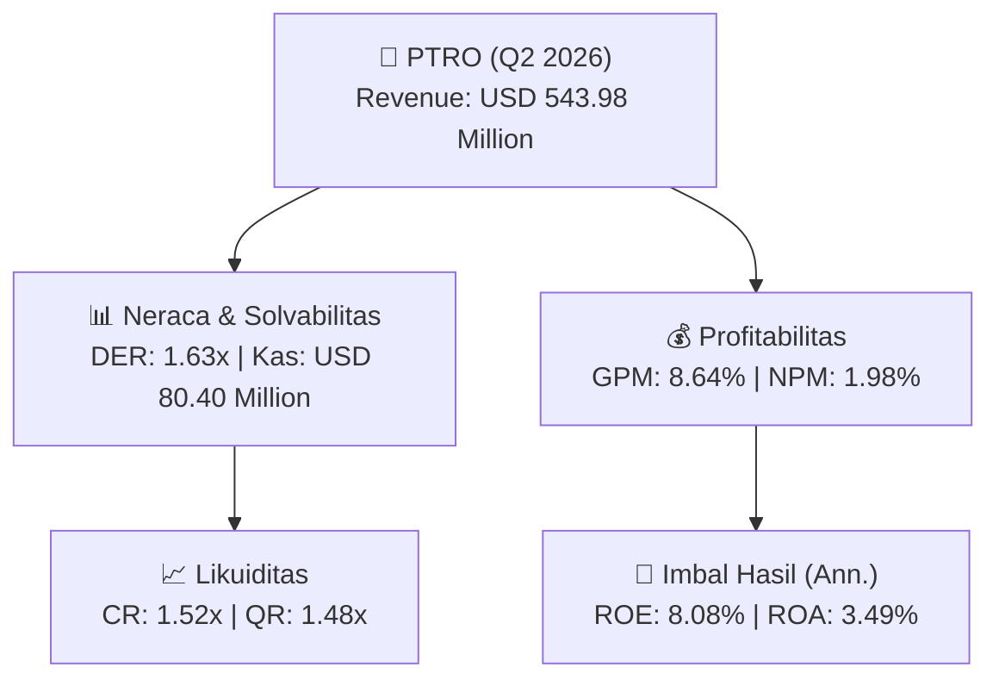
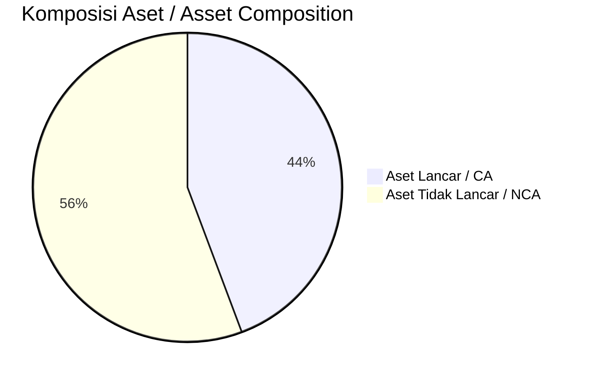
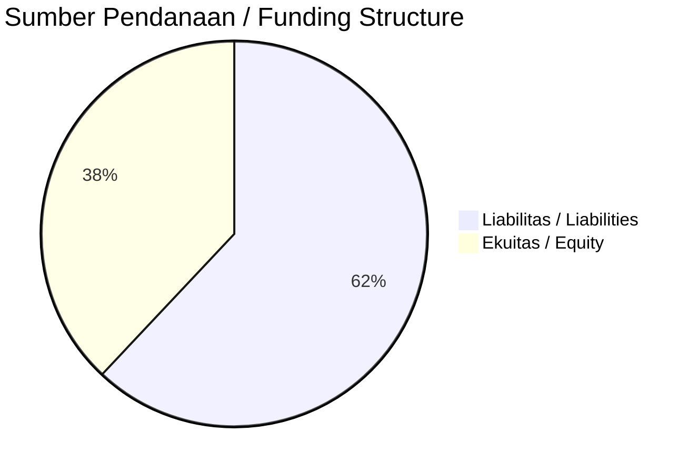

# 📈 Laporan Analisis Keuangan Mendalam: [[PTRO]] — Q2 2026

⬅️ [[knowledge-base/daily-digests/Daily_Digest_20260922|Kembali ke Daily Digest]] | 📅 **2026-09-22** | 🎛️ [[Dashboard|Ke Dashboard Utama]]

> [!IMPORTANT]
> Dokumen ini disusun oleh **Financial Summarizer Agent** untuk menganalisis kinerja keuangan, kesehatan neraca, profitabilitas, dan katalis sektor (Energi & Utilitas) **Petrosea Tbk ([[PTRO]])** berdasarkan LK Q2 2026.

---

## 📌 1. Ikhtisar Kinerja Utama / Executive Performance Highlight
- **Emiten**: `[[PTRO]]` (Petrosea Tbk)
- **Sektor Usaha / Industry Sector**: `Energi & Utilitas`
- **Periode Laporan / Reporting Period**: `Q2 2026`
- **Pendapatan Neto / Net Revenue**: `USD 543.98 Million` (**+59.56% 🟢 YoY** dari USD 340.94 Million)
- **Laba Bruto / Gross Profit**: `USD 47.02 Million` (**-2.63% 🔴 YoY**)
- **Laba (Rugi) Bersih / Net Income**: `USD 10.79 Million` (**+902.51% 🟢 YoY**)
- **Total Aset / Total Assets**: `USD 676.55 Million` | **Total Ekuitas / Total Equity**: `USD 271.78 Million`
- **EPS (Annualized)**: `0.65` | **BVPS**: `8.13`

---

## 📊 2. Laba Rugi Komparatif / Comparative Income Statement

| Pos Laba Rugi / Income Statement Item | Q2 2026 | Prior Period | YoY (%) |
| :--- | ---: | ---: | :---: |
| **Pendapatan Neto / Net Revenue** | `543.98M` | `340.94M` | **+59.56% 🟢** |
| **Beban Pokok / COGS** | `(496.96M)` | `(292.64M)` | +69.82% 🟢 |
| **Laba Bruto / Gross Profit** | `47.02M` | `48.30M` | **-2.63% 🔴** |
| **Beban Usaha / Operating Expenses** | `(20.07M)` | `(15.41M)` | +30.25% 🟢 |
| **Laba Operasional / EBIT** | `4.27M` | `7.85M` | -45.58% 🔴 |
| **Laba (Rugi) Bersih / Net Income** | **10.79M** | **1.08M** | **+902.51% 🟢** |

---

## 🏦 3. Neraca & Struktur Permodalan / Balance Sheet & Capital Structure

| Pos Neraca / Balance Sheet Item | Q2 2026 | Prior Year End | Δ YoY/YtD (%) | Catatan / Notes |
| :--- | ---: | ---: | :---: | :--- |
| **Aset Lancar / Current Assets** | `676.55M` | `558.88M` | +21.06% 🟢 | Kas: USD 80.40 Million |
| **Aset Tidak Lancar / Non-Current Assets** | `851.30M` | `1.02B` | -16.87% 🔴 | Aset Tetap & Operasional |
| **TOTAL ASET / TOTAL ASSETS** | **676.55M** | **558.88M** | **+21.06% 🟢** | |
| **Liabilitas Jk. Pendek / Current Liabilities** | `443.85M` | `438.47M` | +1.23% 🟢 | |
| **Liabilitas Jk. Panjang / Non-Current Liabilities** | `762.73M` | `836.96M` | -8.87% 🔴 | |
| **TOTAL LIABILITAS / TOTAL LIABILITIES** | **443.85M** | **438.47M** | **+1.23% 🟢** | |
| **TOTAL EKUITAS / TOTAL EQUITY** | **271.78M** | **262.52M** | **+3.53% 🟢** | |

---

## 💸 4. Laporan Arus Kas / Cash Flow Statement

| Komponen Arus Kas / Cash Flow Component | Q2 2026 | Prior Period | Δ YoY (%) |
| :--- | ---: | ---: | :---: |
| **Arus Kas Operasi / CFO** | `27.08M` | `-57.65M` | +146.98% 🟢 |
| **Arus Kas Investasi / CFI** | `-59.02M` | `-212.08M` | +72.17% 🟢 |
| **Arus Kas Pendanaan / CFF** | `38.15M` | `220.00M` | -82.66% 🔴 |
| **Kenaikan (Penurunan) Kas Bersih** | `6.21M` | `-49.73M` | +112.48% 🟢 |
| Belanja Modal / Capex | `(43.09M)` | `(200.26M)` | -78.49% 🔴 |
| Pembayaran Dividen / Dividends Paid | `(2.04M)` | `(10.20M)` | -79.94% 🔴 |
| **Free Cash Flow (CFO - Capex)** | **-16.00M** | **-257.91M** | **+93.79% 🟢** |

---

## 📈 Analisis Rasio Keuangan / Financial Ratio Analysis

| Kategori / Category | Metrik / Metric | Nilai / Value | Benchmark | Interpretasi / Interpretation |
| :--- | :--- | :---: | :---: | :--- |
| **🛡️ Likuiditas** | **Current Ratio** | `1.52x` | `> 1.0x` | Kemampuan bayar kewajiban jk. pendek |
| | **Quick Ratio** | `1.48x` | `> 0.8x` | Likuiditas tanpa persediaan |
| **📊 Profitabilitas** | **Gross Profit Margin (GPM)** | `8.64%` | - | Margin kotor operasional inti |
| | **Operating Profit Margin (OPM)** | `0.78%` | - | Efisiensi operasional |
| | **Net Profit Margin (NPM)** | `1.98%` | - | Konversi revenue ke laba bersih |
| **🎯 Imbal Hasil (Ann.)** | **Return on Equity (ROE)** | `8.08%` | - | Imbal hasil terhadap ekuitas |
| | **Return on Assets (ROA)** | `3.49%` | - | Produktivitas aset |
| **⚖️ Solvabilitas** | **Debt to Equity (DER)** | `1.63x` | `< 2.0x` | Leverage utang vs modal |
| | **Debt to Asset (DAR)** | `0.66x` | `< 0.7x` | Porsi aset didanai utang |

---

## 📐 Per Share Metrics

| Metrik / Metric | Nilai / Value | Keterangan / Notes |
| :--- | ---: | :--- |
| **EPS (Annualized)** | `USD 0.65` | Laba per saham (dianualisasi) |
| **BVPS** | `USD 8.13` | Nilai buku per saham |

---

## 🚀 Analisis Strategis & Karakteristik Sektor / Strategic Analysis: Energi & Utilitas

Pada periode Q2 2026, **Petrosea Tbk ([[PTRO]])** membukukan total pendapatan sebesar **USD 543.98 Million** (+59.56% 🟢 YoY). Laba kotor tercatat **USD 47.02 Million** dengan GPM **8.64%**. Laba bersih sebesar **USD 10.79 Million** (+902.51% 🟢 YoY). Total aset **USD 676.55 Million**, ekuitas **USD 271.78 Million**, DER **1.63x**.

### 🔍 Indikator Kunci Sektor / Sector Key Indicators (Energi & Utilitas)
- **Karakteristik Industri Tambang & Komoditas / Mining & Commodity**: Kinerja dipengaruhi oleh Average Selling Price (ASP), volume produksi/pengapalan, dan efisiensi Cash Cost per ton.
- **Profil Arus Kas / Cash Flow Profile**: Arus kas operasional yang solid menopang dividen berkala dan ekspansi hilirisasi / transisi energi.
- **Regulasi & ESG**: Kewajiban reklamasi, royalti pemerintah, dan komitmen keberlanjutan.

> [!NOTE]
> _Data Public Expose / Investor Presentation belum tersedia untuk emiten ini._

---

## 📋 Catatan Kunci Laporan Keuangan / Key Notes to Financial Statements

### 🔍 Opini Auditor / Auditor Opinion
- **Jenis Opini / Opinion Type**: `Wajar Tanpa Modifikasian / Unqualified`
- **KAP / Audit Firm**: `KAP Liana Ramon Xenia  Rekan`
- **Partner Audit**: `Kasman`
- **Tanggal Laporan / Report Date**: `2026-09-16`

---

## 💡 Catatan Strategis & Panduan Investor / Strategic Notes & Investor Guide

1. **Kesehatan Permodalan / Capital Health**: DER **1.63x**, CR **1.52x** — _perlu dipantau secara disiplin_.
2. **Katalis Pertumbuhan / Growth Catalysts**: Pantau realisasi pendapatan dan efisiensi operasional periode berikutnya.

---

## 🔗 Hubungan Note Terkait / Knowledge Graph Links
- [[knowledge-base/daily-digests/Daily_Digest_20260922|📄 Daily Digest 2026-09-22]]
- [[knowledge-base/trading-signals/Trading_Signals_20260922|🎯 Trading Signals]]
- [[Dashboard|🎛️ Kembali ke Dashboard Utama]]