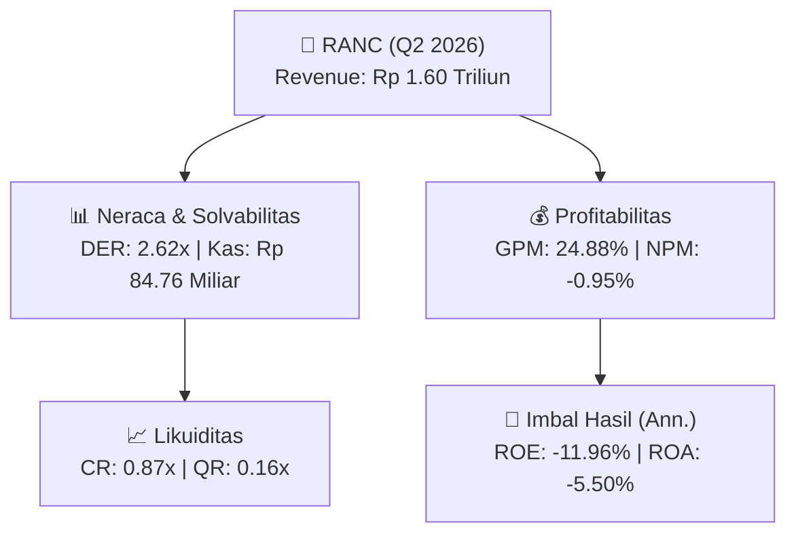
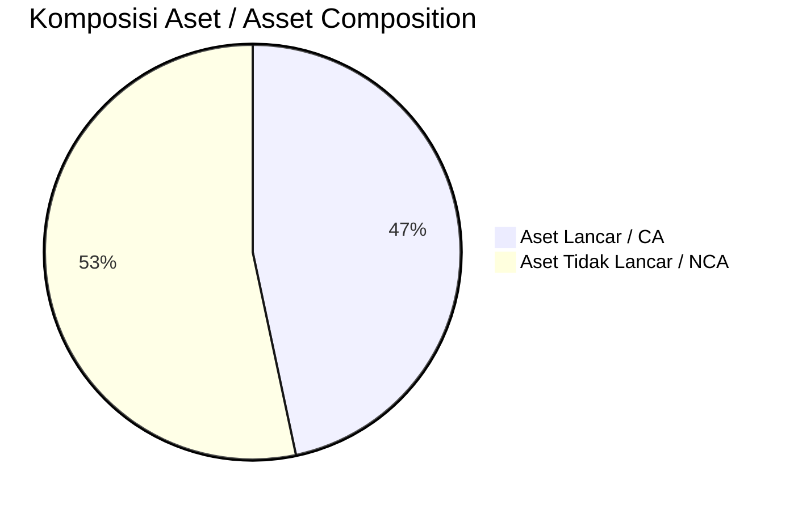
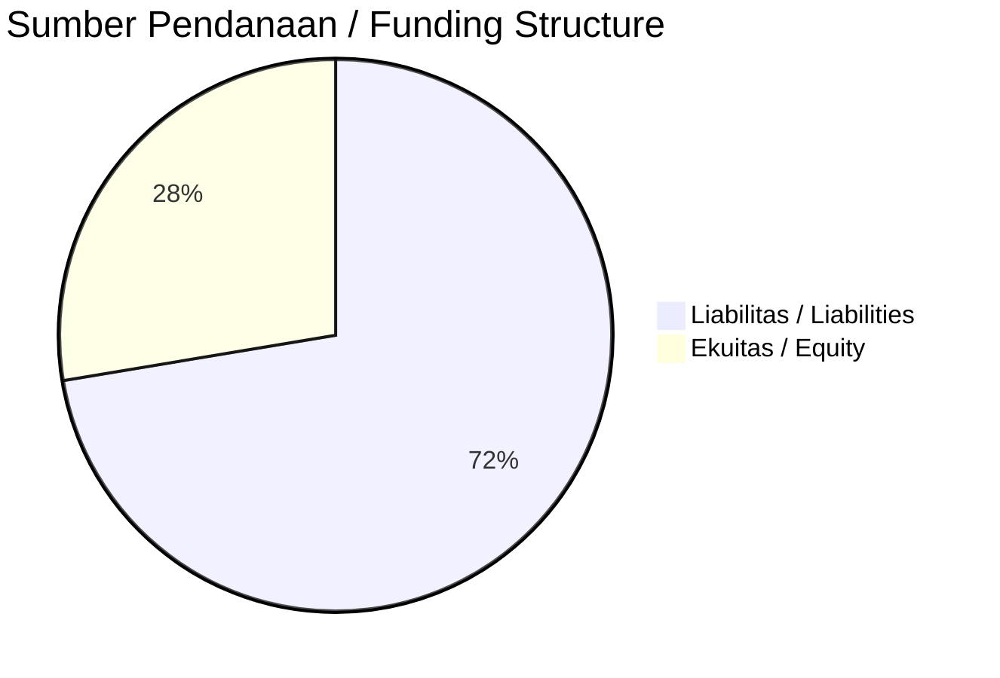

# 📈 Laporan Analisis Keuangan Mendalam: [[RANC]] — Q2 2026

⬅️ [[knowledge-base/daily-digests/Daily_Digest_20260928|Kembali ke Daily Digest]] | 📅 **2026-09-28** | 🎛️ [[Dashboard|Ke Dashboard Utama]]

> [!IMPORTANT]
> Dokumen ini disusun oleh **Financial Summarizer Agent** untuk menganalisis kinerja keuangan, kesehatan neraca, profitabilitas, dan katalis sektor (Konsumer & Ritel) **Supra Boga Lestari Tbk ([[RANC]])** berdasarkan LK Q2 2026.

---

## 📌 1. Ikhtisar Kinerja Utama / Executive Performance Highlight
- **Emiten**: `[[RANC]]` (Supra Boga Lestari Tbk)
- **Sektor Usaha / Industry Sector**: `Konsumer & Ritel`
- **Periode Laporan / Reporting Period**: `Q2 2026`
- **Pendapatan Neto / Net Revenue**: `Rp 1.60 Triliun` (**+10.47% 🟢 YoY** dari Rp 1.45 Triliun)
- **Laba Bruto / Gross Profit**: `Rp 398.95 Miliar` (**+12.31% 🟢 YoY**)
- **Laba (Rugi) Bersih / Net Income**: `Rp -15.29 Miliar` (**+57.41% 🟢 YoY**)
- **Total Aset / Total Assets**: `Rp 565.48 Miliar` | **Total Ekuitas / Total Equity**: `Rp 248.06 Miliar`
- **EPS (Annualized)**: `-0.20` | **BVPS**: `1.59`

---

## 📊 2. Laba Rugi Komparatif / Comparative Income Statement

| Pos Laba Rugi / Income Statement Item | Q2 2026 | Prior Period | YoY (%) |
| :--- | ---: | ---: | :---: |
| **Pendapatan Neto / Net Revenue** | `1.60T` | `1.45T` | **+10.47% 🟢** |
| **Beban Pokok / COGS** | `(1.20T)` | `(1.10T)` | +9.87% 🟢 |
| **Laba Bruto / Gross Profit** | `398.95B` | `355.21B` | **+12.31% 🟢** |
| **Beban Usaha / Operating Expenses** | `(130.03B)` | `(124.99B)` | +4.03% 🟢 |
| **Laba Operasional / EBIT** | `-14.58B` | `-36.56B` | +60.12% 🟢 |
| **Laba (Rugi) Bersih / Net Income** | **-15.29B** | **-35.89B** | **+57.41% 🟢** |

---

## 🏦 3. Neraca & Struktur Permodalan / Balance Sheet & Capital Structure

| Pos Neraca / Balance Sheet Item | Q2 2026 | Prior Year End | Δ YoY/YtD (%) | Catatan / Notes |
| :--- | ---: | ---: | :---: | :--- |
| **Aset Lancar / Current Assets** | `565.48B` | `547.23B` | +3.34% 🟢 | Kas: Rp 84.76 Miliar |
| **Aset Tidak Lancar / Non-Current Assets** | `646.58B` | `629.55B` | +2.71% 🟢 | Aset Tetap & Operasional |
| **TOTAL ASET / TOTAL ASSETS** | **565.48B** | **547.23B** | **+3.34% 🟢** | |
| **Liabilitas Jk. Pendek / Current Liabilities** | `650.46B` | `620.06B` | +4.90% 🟢 | |
| **Liabilitas Jk. Panjang / Non-Current Liabilities** | `311.84B` | `291.42B` | +7.01% 🟢 | |
| **TOTAL LIABILITAS / TOTAL LIABILITIES** | **650.46B** | **620.06B** | **+4.90% 🟢** | |
| **TOTAL EKUITAS / TOTAL EQUITY** | **248.06B** | **263.35B** | **-5.80% 🔴** | |

---

## 💸 4. Laporan Arus Kas / Cash Flow Statement

| Komponen Arus Kas / Cash Flow Component | Q2 2026 | Prior Period | Δ YoY (%) |
| :--- | ---: | ---: | :---: |
| **Arus Kas Operasi / CFO** | `103.61B` | `28.14B` | +268.16% 🟢 |
| **Arus Kas Investasi / CFI** | `-62.86B` | `-10.24B` | -513.78% 🔴 |
| **Arus Kas Pendanaan / CFF** | `-33.55B` | `-39.15B` | +14.33% 🟢 |
| **Kenaikan (Penurunan) Kas Bersih** | `7.20B` | `-21.25B` | +133.88% 🟢 |
| Belanja Modal / Capex | `(5.10B)` | `(1.04B)` | +387.74% 🟢 |
| Pembayaran Dividen / Dividends Paid | `(-)` | `(-)` | - |
| **Free Cash Flow (CFO - Capex)** | **98.51B** | **27.10B** | **+263.55% 🟢** |

---

## 📈 Analisis Rasio Keuangan / Financial Ratio Analysis

| Kategori / Category | Metrik / Metric | Nilai / Value | Benchmark | Interpretasi / Interpretation |
| :--- | :--- | :---: | :---: | :--- |
| **🛡️ Likuiditas** | **Current Ratio** | `0.87x` | `> 1.0x` | Kemampuan bayar kewajiban jk. pendek |
| | **Quick Ratio** | `0.16x` | `> 0.8x` | Likuiditas tanpa persediaan |
| **📊 Profitabilitas** | **Gross Profit Margin (GPM)** | `24.88%` | - | Margin kotor operasional inti |
| | **Operating Profit Margin (OPM)** | `-0.91%` | - | Efisiensi operasional |
| | **Net Profit Margin (NPM)** | `-0.95%` | - | Konversi revenue ke laba bersih |
| **🎯 Imbal Hasil (Ann.)** | **Return on Equity (ROE)** | `-11.96%` | - | Imbal hasil terhadap ekuitas |
| | **Return on Assets (ROA)** | `-5.50%` | - | Produktivitas aset |
| **⚖️ Solvabilitas** | **Debt to Equity (DER)** | `2.62x` | `< 2.0x` | Leverage utang vs modal |
| | **Debt to Asset (DAR)** | `1.15x` | `< 0.7x` | Porsi aset didanai utang |

---

## 📐 Per Share Metrics

| Metrik / Metric | Nilai / Value | Keterangan / Notes |
| :--- | ---: | :--- |
| **EPS (Annualized)** | `Rp -0.20` | Laba per saham (dianualisasi) |
| **BVPS** | `Rp 1.59` | Nilai buku per saham |

---

## 🚀 Analisis Strategis & Karakteristik Sektor / Strategic Analysis: Konsumer & Ritel

Pada periode Q2 2026, **Supra Boga Lestari Tbk ([[RANC]])** membukukan total pendapatan sebesar **Rp 1.60 Triliun** (+10.47% 🟢 YoY). Laba kotor tercatat **Rp 398.95 Miliar** dengan GPM **24.88%**. Laba bersih sebesar **Rp -15.29 Miliar** (+57.41% 🟢 YoY). Total aset **Rp 565.48 Miliar**, ekuitas **Rp 248.06 Miliar**, DER **2.62x**.

### 🔍 Indikator Kunci Sektor / Sector Key Indicators (Konsumer & Ritel)
- **Karakteristik Industri (Konsumer & Ritel)**: Kinerja mencerminkan dinamika penyerapan pasar, utilisasi kapasitas produksi, dan efisiensi biaya pokok.
- **Faktor Penggerak**: Pertumbuhan organik, efisiensi operasional, dan ekspansi pasar.

> [!NOTE]
> _Data Public Expose / Investor Presentation belum tersedia untuk emiten ini._

---

## 📋 Catatan Kunci Laporan Keuangan / Key Notes to Financial Statements

### 🔍 Opini Auditor / Auditor Opinion
- **Jenis Opini / Opinion Type**: `Wajar Tanpa Modifikasian / Unqualified`
- **KAP / Audit Firm**: `KAP Purwanto Susanti dan Surja`
- **Partner Audit**: `Daniel Amdhani Judistira`
- **Tanggal Laporan / Report Date**: `2026-09-23`

### 🤝 Transaksi Pihak Berelasi / Related Party Transactions
- Piutang usaha pihak berelasi: 4,494,831 pada 30 Juni 2026 dan 8,242,907 pada 31 Desember 2025
- Utang usaha pihak berelasi: 5,648,605 pada 30 Juni 2026 dan 5,340,049 pada 31 Desember 2025
- Terdapat akun uang muka pelanggan jangka pendek pihak berelasi dan uang muka pelanggan jangka panjang pihak berelasi, namun tidak disertai nilai dalam teks yang diberikan

---

## 💡 Catatan Strategis & Panduan Investor / Strategic Notes & Investor Guide

1. **Kesehatan Permodalan / Capital Health**: DER **2.62x**, CR **0.87x** — _perlu dipantau secara disiplin_.
2. **Katalis Pertumbuhan / Growth Catalysts**: Pantau realisasi pendapatan dan efisiensi operasional periode berikutnya.

---

## 🔗 Hubungan Note Terkait / Knowledge Graph Links
- [[knowledge-base/daily-digests/Daily_Digest_20260928|📄 Daily Digest 2026-09-28]]
- [[knowledge-base/trading-signals/Trading_Signals_20260928|🎯 Trading Signals]]
- [[Dashboard|🎛️ Kembali ke Dashboard Utama]]