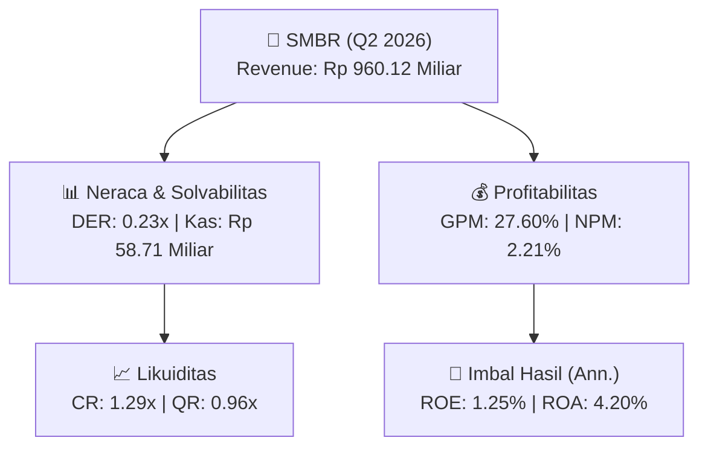
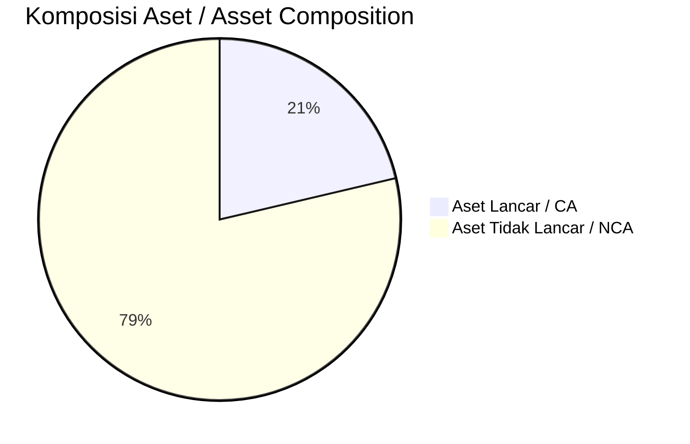
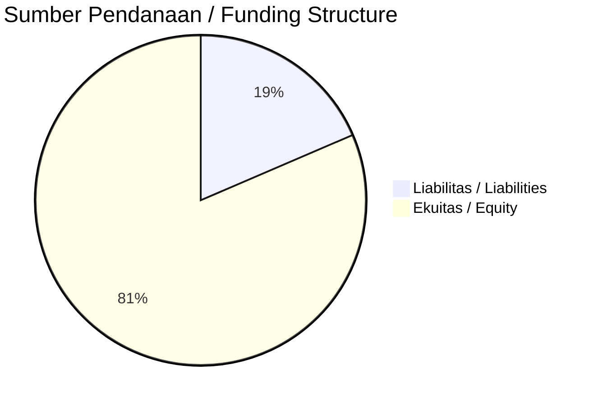

# 📈 Laporan Analisis Keuangan Mendalam: [[SMBR]] — Q2 2026

⬅️ [[knowledge-base/daily-digests/Daily_Digest_20260901|Kembali ke Daily Digest]] | 📅 **2026-09-01** | 🎛️ [[Dashboard|Ke Dashboard Utama]]

> [!IMPORTANT]
> Dokumen ini disusun oleh **Financial Summarizer Agent** untuk menganalisis kinerja keuangan, kesehatan neraca, profitabilitas, dan katalis sektor (General) **PT Semen Baturaja (Persero) Tbk ([[SMBR]])** berdasarkan LK Q2 2026.

---

## 📌 1. Ikhtisar Kinerja Utama / Executive Performance Highlight
- **Emiten**: `[[SMBR]]` (PT Semen Baturaja (Persero) Tbk)
- **Sektor Usaha / Industry Sector**: `General`
- **Periode Laporan / Reporting Period**: `Q2 2026`
- **Pendapatan Neto / Net Revenue**: `Rp 960.12 Miliar` (**-12.21% 🔴 YoY** dari Rp 1.09 Triliun)
- **Laba Bruto / Gross Profit**: `Rp 265.01 Miliar` (**-18.09% 🔴 YoY**)
- **Laba (Rugi) Bersih / Net Income**: `Rp 21.21 Miliar` (**-72.43% 🔴 YoY**)
- **Total Aset / Total Assets**: `Rp 998.15 Miliar` | **Total Ekuitas / Total Equity**: `Rp 3.40 Triliun`
- **EPS (Annualized)**: `0.04` | **BVPS**: `3.42`

---

## 📊 2. Laba Rugi Komparatif / Comparative Income Statement

| Pos Laba Rugi / Income Statement Item | Q2 2026 | Prior Period | YoY (%) |
| :--- | ---: | ---: | :---: |
| **Pendapatan Neto / Net Revenue** | `960.12B` | `1.09T` | **-12.21% 🔴** |
| **Beban Pokok / COGS** | `(695.11B)` | `(770.09B)` | -9.74% 🔴 |
| **Laba Bruto / Gross Profit** | `265.01B` | `323.52B` | **-18.09% 🔴** |
| **Beban Usaha / Operating Expenses** | `(98.84B)` | `(97.30B)` | +1.58% 🟢 |
| **Laba Operasional / EBIT** | `38.53B` | `101.08B` | -61.88% 🔴 |
| **Laba (Rugi) Bersih / Net Income** | **21.21B** | **76.93B** | **-72.43% 🔴** |

---

## 🏦 3. Neraca & Struktur Permodalan / Balance Sheet & Capital Structure

| Pos Neraca / Balance Sheet Item | Q2 2026 | Prior Year End | Δ YoY/YtD (%) | Catatan / Notes |
| :--- | ---: | ---: | :---: | :--- |
| **Aset Lancar / Current Assets** | `998.15B` | `1.02T` | -2.27% 🔴 | Kas: Rp 58.71 Miliar |
| **Aset Tidak Lancar / Non-Current Assets** | `3.68T` | `3.75T` | -1.85% 🔴 | Aset Tetap & Operasional |
| **TOTAL ASET / TOTAL ASSETS** | **998.15B** | **1.02T** | **-2.27% 🔴** | |
| **Liabilitas Jk. Pendek / Current Liabilities** | `773.63B` | `746.03B` | +3.70% 🟢 | |
| **Liabilitas Jk. Panjang / Non-Current Liabilities** | `505.81B` | `613.90B` | -17.61% 🔴 | |
| **TOTAL LIABILITAS / TOTAL LIABILITIES** | **773.63B** | **746.03B** | **+3.70% 🟢** | |
| **TOTAL EKUITAS / TOTAL EQUITY** | **3.40T** | **3.41T** | **-0.35% 🔴** | |

---

## 💸 4. Laporan Arus Kas / Cash Flow Statement

| Komponen Arus Kas / Cash Flow Component | Q2 2026 | Prior Period | Δ YoY (%) |
| :--- | ---: | ---: | :---: |
| **Arus Kas Operasi / CFO** | `179.74B` | `136.51B` | +31.66% 🟢 |
| **Arus Kas Investasi / CFI** | `-28.18B` | `-16.01B` | -76.05% 🔴 |
| **Arus Kas Pendanaan / CFF** | `-153.76B` | `-137.19B` | -12.08% 🔴 |
| **Kenaikan (Penurunan) Kas Bersih** | `-2.21B` | `-16.69B` | +86.79% 🟢 |
| Belanja Modal / Capex | `(21.87B)` | `(14.59B)` | +49.89% 🟢 |
| Pembayaran Dividen / Dividends Paid | `(34.38B)` | `(25.85B)` | +33.01% 🟢 |
| **Free Cash Flow (CFO - Capex)** | **157.86B** | **121.92B** | **+29.48% 🟢** |

---

## 📈 Analisis Rasio Keuangan / Financial Ratio Analysis

| Kategori / Category | Metrik / Metric | Nilai / Value | Benchmark | Interpretasi / Interpretation |
| :--- | :--- | :---: | :---: | :--- |
| **🛡️ Likuiditas** | **Current Ratio** | `1.29x` | `> 1.0x` | Kemampuan bayar kewajiban jk. pendek |
| | **Quick Ratio** | `0.96x` | `> 0.8x` | Likuiditas tanpa persediaan |
| **📊 Profitabilitas** | **Gross Profit Margin (GPM)** | `27.60%` | - | Margin kotor operasional inti |
| | **Operating Profit Margin (OPM)** | `4.01%` | - | Efisiensi operasional |
| | **Net Profit Margin (NPM)** | `2.21%` | - | Konversi revenue ke laba bersih |
| **🎯 Imbal Hasil (Ann.)** | **Return on Equity (ROE)** | `1.25%` | - | Imbal hasil terhadap ekuitas |
| | **Return on Assets (ROA)** | `4.20%` | - | Produktivitas aset |
| **⚖️ Solvabilitas** | **Debt to Equity (DER)** | `0.23x` | `< 2.0x` | Leverage utang vs modal |
| | **Debt to Asset (DAR)** | `0.78x` | `< 0.7x` | Porsi aset didanai utang |

---

## 📐 Per Share Metrics

| Metrik / Metric | Nilai / Value | Keterangan / Notes |
| :--- | ---: | :--- |
| **EPS (Annualized)** | `Rp 0.04` | Laba per saham (dianualisasi) |
| **BVPS** | `Rp 3.42` | Nilai buku per saham |

---

## 🚀 Analisis Strategis & Karakteristik Sektor / Strategic Analysis: General

Pada periode Q2 2026, **PT Semen Baturaja (Persero) Tbk ([[SMBR]])** membukukan total pendapatan sebesar **Rp 960.12 Miliar** (-12.21% 🔴 YoY). Laba kotor tercatat **Rp 265.01 Miliar** dengan GPM **27.60%**. Laba bersih sebesar **Rp 21.21 Miliar** (-72.43% 🔴 YoY). Total aset **Rp 998.15 Miliar**, ekuitas **Rp 3.40 Triliun**, DER **0.23x**.

### 🔍 Indikator Kunci Sektor / Sector Key Indicators (General)
- **Karakteristik Industri (General)**: Kinerja mencerminkan dinamika penyerapan pasar, utilisasi kapasitas produksi, dan efisiensi biaya pokok.
- **Faktor Penggerak**: Pertumbuhan organik, efisiensi operasional, dan ekspansi pasar.

> [!NOTE]
> _Data Public Expose / Investor Presentation belum tersedia untuk emiten ini._

---

## 📋 Catatan Kunci Laporan Keuangan / Key Notes to Financial Statements

### 🔍 Opini Auditor / Auditor Opinion
- **Jenis Opini / Opinion Type**: `Reviu Terbatas / Limited Review`
- **KAP / Audit Firm**: `KAP Liana Ramon Xenia  Rekan`
- **Partner Audit**: `Yusuf Ismail Abdul Karim`
- **Tanggal Laporan / Report Date**: `2026-08-28`

---

## 💡 Catatan Strategis & Panduan Investor / Strategic Notes & Investor Guide

1. **Kesehatan Permodalan / Capital Health**: DER **0.23x**, CR **1.29x** — _sehat dan aman_.
2. **Katalis Pertumbuhan / Growth Catalysts**: Pantau realisasi pendapatan dan efisiensi operasional periode berikutnya.

---

## 🔗 Hubungan Note Terkait / Knowledge Graph Links
- [[knowledge-base/daily-digests/Daily_Digest_20260901|📄 Daily Digest 2026-09-01]]
- [[knowledge-base/trading-signals/Trading_Signals_20260901|🎯 Trading Signals]]
- [[Dashboard|🎛️ Kembali ke Dashboard Utama]]