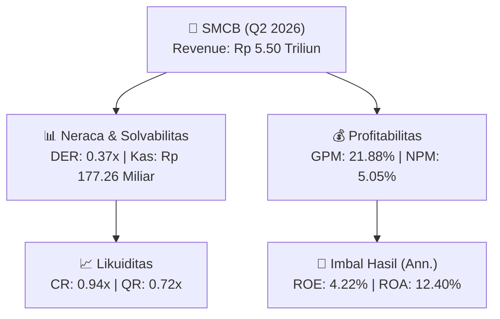
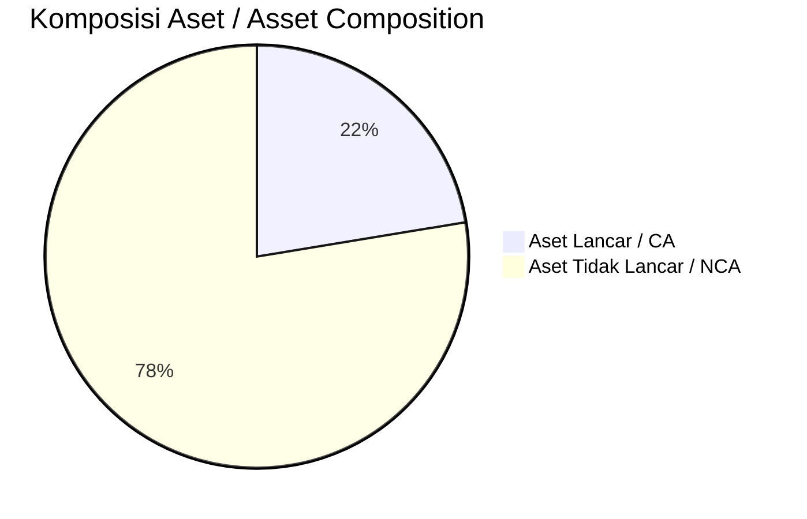
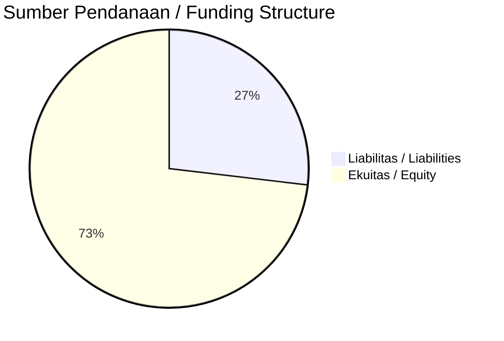

# 📈 Laporan Analisis Keuangan Mendalam: [[SMCB]] — Q2 2026

⬅️ [[knowledge-base/daily-digests/Daily_Digest_20260901|Kembali ke Daily Digest]] | 📅 **2026-09-01** | 🎛️ [[Dashboard|Ke Dashboard Utama]]

> [!IMPORTANT]
> Dokumen ini disusun oleh **Financial Summarizer Agent** untuk menganalisis kinerja keuangan, kesehatan neraca, profitabilitas, dan katalis sektor (General) **PT Solusi Bangun Indonesia Tbk ([[SMCB]])** berdasarkan LK Q2 2026.

---

## 📌 1. Ikhtisar Kinerja Utama / Executive Performance Highlight
- **Emiten**: `[[SMCB]]` (PT Solusi Bangun Indonesia Tbk)
- **Sektor Usaha / Industry Sector**: `General`
- **Periode Laporan / Reporting Period**: `Q2 2026`
- **Pendapatan Neto / Net Revenue**: `Rp 5.50 Triliun` (**+10.63% 🟢 YoY** dari Rp 4.97 Triliun)
- **Laba Bruto / Gross Profit**: `Rp 1.20 Triliun` (**+15.88% 🟢 YoY**)
- **Laba (Rugi) Bersih / Net Income**: `Rp 278.01 Miliar` (**+4.31% 🟢 YoY**)
- **Total Aset / Total Assets**: `Rp 4.57 Triliun` | **Total Ekuitas / Total Equity**: `Rp 13.17 Triliun`
- **EPS (Annualized)**: `0.12` | **BVPS**: `2.92`

---

## 📊 2. Laba Rugi Komparatif / Comparative Income Statement

| Pos Laba Rugi / Income Statement Item | Q2 2026 | Prior Period | YoY (%) |
| :--- | ---: | ---: | :---: |
| **Pendapatan Neto / Net Revenue** | `5.50T` | `4.97T` | **+10.63% 🟢** |
| **Beban Pokok / COGS** | `(4.30T)` | `(3.93T)` | +9.24% 🟢 |
| **Laba Bruto / Gross Profit** | `1.20T` | `1.04T` | **+15.88% 🟢** |
| **Beban Usaha / Operating Expenses** | `(145.42B)` | `(143.84B)` | +1.10% 🟢 |
| **Laba Operasional / EBIT** | `389.28B` | `359.29B` | +8.35% 🟢 |
| **Laba (Rugi) Bersih / Net Income** | **278.01B** | **266.53B** | **+4.31% 🟢** |

---

## 🏦 3. Neraca & Struktur Permodalan / Balance Sheet & Capital Structure

| Pos Neraca / Balance Sheet Item | Q2 2026 | Prior Year End | Δ YoY/YtD (%) | Catatan / Notes |
| :--- | ---: | ---: | :---: | :--- |
| **Aset Lancar / Current Assets** | `4.57T` | `4.40T` | +4.06% 🟢 | Kas: Rp 177.26 Miliar |
| **Aset Tidak Lancar / Non-Current Assets** | `15.85T` | `15.98T` | -0.86% 🔴 | Aset Tetap & Operasional |
| **TOTAL ASET / TOTAL ASSETS** | **4.57T** | **4.40T** | **+4.06% 🟢** | |
| **Liabilitas Jk. Pendek / Current Liabilities** | `4.84T` | `4.38T` | +10.64% 🟢 | |
| **Liabilitas Jk. Panjang / Non-Current Liabilities** | `2.41T` | `2.80T` | -13.91% 🔴 | |
| **TOTAL LIABILITAS / TOTAL LIABILITIES** | **4.84T** | **4.38T** | **+10.64% 🟢** | |
| **TOTAL EKUITAS / TOTAL EQUITY** | **13.17T** | **13.20T** | **-0.27% 🔴** | |

---

## 💸 4. Laporan Arus Kas / Cash Flow Statement

| Komponen Arus Kas / Cash Flow Component | Q2 2026 | Prior Period | Δ YoY (%) |
| :--- | ---: | ---: | :---: |
| **Arus Kas Operasi / CFO** | `1.05T` | `332.41B` | +214.77% 🟢 |
| **Arus Kas Investasi / CFI** | `-198.43B` | `-128.37B` | -54.58% 🔴 |
| **Arus Kas Pendanaan / CFF** | `-885.92B` | `-148.02B` | -498.53% 🔴 |
| **Kenaikan (Penurunan) Kas Bersih** | `-38.05B` | `56.02B` | -167.91% 🔴 |
| Belanja Modal / Capex | `(191.79B)` | `(124.13B)` | +54.51% 🟢 |
| Pembayaran Dividen / Dividends Paid | `(328.64B)` | `(-)` | - |
| **Free Cash Flow (CFO - Capex)** | **854.52B** | **208.28B** | **+310.28% 🟢** |

---

## 📈 Analisis Rasio Keuangan / Financial Ratio Analysis

| Kategori / Category | Metrik / Metric | Nilai / Value | Benchmark | Interpretasi / Interpretation |
| :--- | :--- | :---: | :---: | :--- |
| **🛡️ Likuiditas** | **Current Ratio** | `0.94x` | `> 1.0x` | Kemampuan bayar kewajiban jk. pendek |
| | **Quick Ratio** | `0.72x` | `> 0.8x` | Likuiditas tanpa persediaan |
| **📊 Profitabilitas** | **Gross Profit Margin (GPM)** | `21.88%` | - | Margin kotor operasional inti |
| | **Operating Profit Margin (OPM)** | `7.07%` | - | Efisiensi operasional |
| | **Net Profit Margin (NPM)** | `5.05%` | - | Konversi revenue ke laba bersih |
| **🎯 Imbal Hasil (Ann.)** | **Return on Equity (ROE)** | `4.22%` | - | Imbal hasil terhadap ekuitas |
| | **Return on Assets (ROA)** | `12.40%` | - | Produktivitas aset |
| **⚖️ Solvabilitas** | **Debt to Equity (DER)** | `0.37x` | `< 2.0x` | Leverage utang vs modal |
| | **Debt to Asset (DAR)** | `1.06x` | `< 0.7x` | Porsi aset didanai utang |

---

## 📐 Per Share Metrics

| Metrik / Metric | Nilai / Value | Keterangan / Notes |
| :--- | ---: | :--- |
| **EPS (Annualized)** | `Rp 0.12` | Laba per saham (dianualisasi) |
| **BVPS** | `Rp 2.92` | Nilai buku per saham |

---

## 🚀 Analisis Strategis & Karakteristik Sektor / Strategic Analysis: General

Pada periode Q2 2026, **PT Solusi Bangun Indonesia Tbk ([[SMCB]])** membukukan total pendapatan sebesar **Rp 5.50 Triliun** (+10.63% 🟢 YoY). Laba kotor tercatat **Rp 1.20 Triliun** dengan GPM **21.88%**. Laba bersih sebesar **Rp 278.01 Miliar** (+4.31% 🟢 YoY). Total aset **Rp 4.57 Triliun**, ekuitas **Rp 13.17 Triliun**, DER **0.37x**.

### 🔍 Indikator Kunci Sektor / Sector Key Indicators (General)
- **Karakteristik Industri (General)**: Kinerja mencerminkan dinamika penyerapan pasar, utilisasi kapasitas produksi, dan efisiensi biaya pokok.
- **Faktor Penggerak**: Pertumbuhan organik, efisiensi operasional, dan ekspansi pasar.

> [!NOTE]
> _Data Public Expose / Investor Presentation belum tersedia untuk emiten ini._

---

## 📋 Catatan Kunci Laporan Keuangan / Key Notes to Financial Statements

### 🔍 Opini Auditor / Auditor Opinion
- **Jenis Opini / Opinion Type**: `Reviu Terbatas / Limited Review`
- **KAP / Audit Firm**: `KAP Liana Ramon Xenia  Rekan`
- **Partner Audit**: `Yusuf Ismail Abdul Karim`
- **Tanggal Laporan / Report Date**: `2026-08-28`

### 📝 Perjanjian & Kontrak Signifikan / Key Contracts & Agreements
- Perusahaan, SBB, SBA dan PLP memperoleh fasilitas Short-Term Loan dari SCB Cabang Jakarta dengan nilai maksimum Rp400.000 juta dan Fasilitas Import Invoice Financing dan Bonds & Guarantees maksimum AS$20.000.000, berlaku sampai Mei 2026 dan otomatis diperpanjang 12 bulan.

### ⚠️ Komitmen & Kontinjensi / Commitments & Contingencies
- Berdasarkan Perjanjian Jual Beli Saham (SPPA) antara SIIB dan Holderfin B.V. tanggal 12 November 2018, Holderfin memberikan garansi dan kompensasi kepada SIIB untuk hal terkait perpajakan Grup sebelum akuisisi; Holderfin akan mengganti SIIB 80,64% dari jumlah kerugian perpajakan dan biaya konsultan perpajakan serta biaya wajar lainnya.

---

## 💡 Catatan Strategis & Panduan Investor / Strategic Notes & Investor Guide

1. **Kesehatan Permodalan / Capital Health**: DER **0.37x**, CR **0.94x** — _perlu dipantau secara disiplin_.
2. **Katalis Pertumbuhan / Growth Catalysts**: Pantau realisasi pendapatan dan efisiensi operasional periode berikutnya.

---

## 🔗 Hubungan Note Terkait / Knowledge Graph Links
- [[knowledge-base/daily-digests/Daily_Digest_20260901|📄 Daily Digest 2026-09-01]]
- [[knowledge-base/trading-signals/Trading_Signals_20260901|🎯 Trading Signals]]
- [[Dashboard|🎛️ Kembali ke Dashboard Utama]]