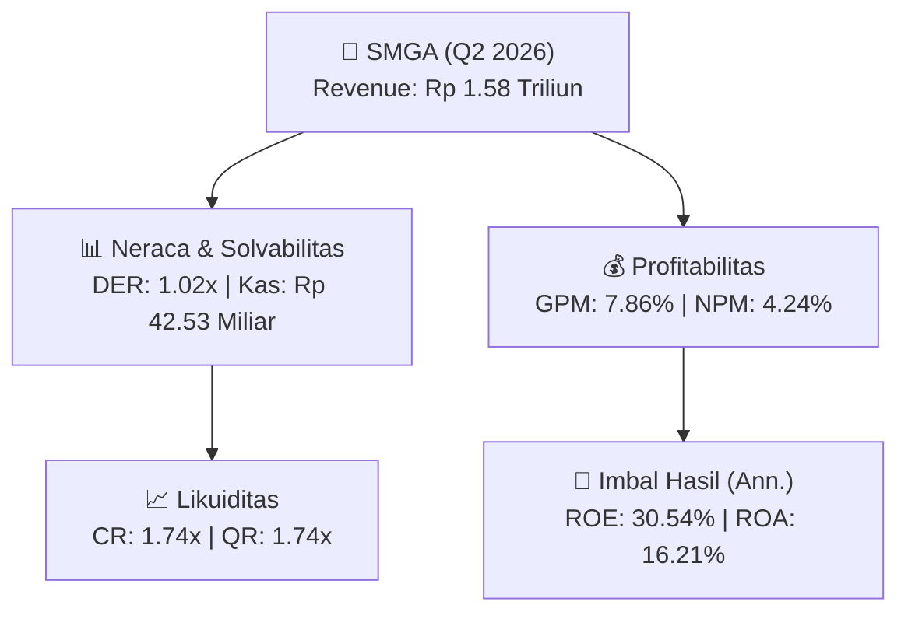
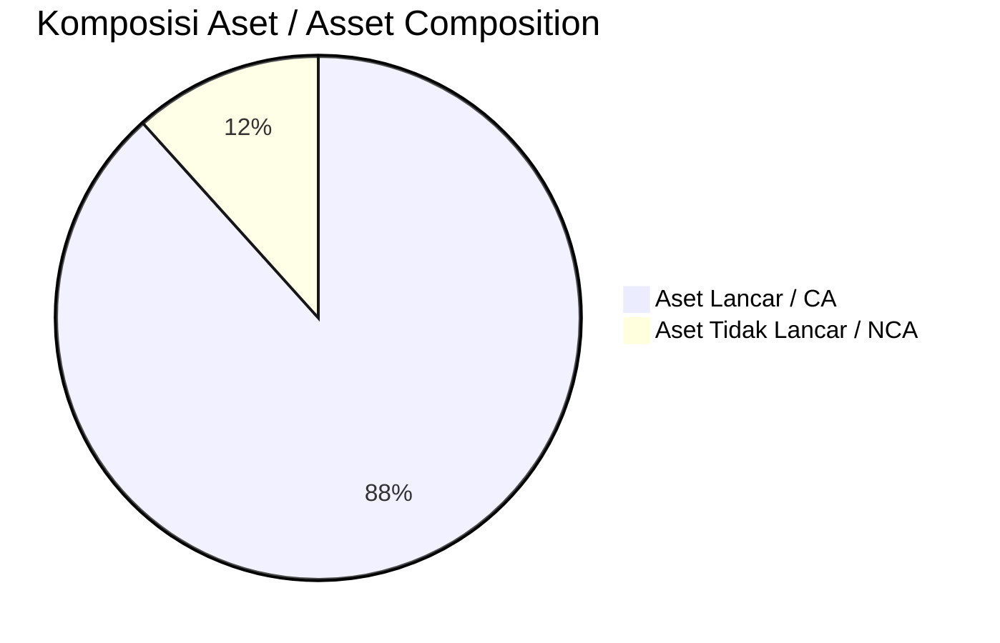
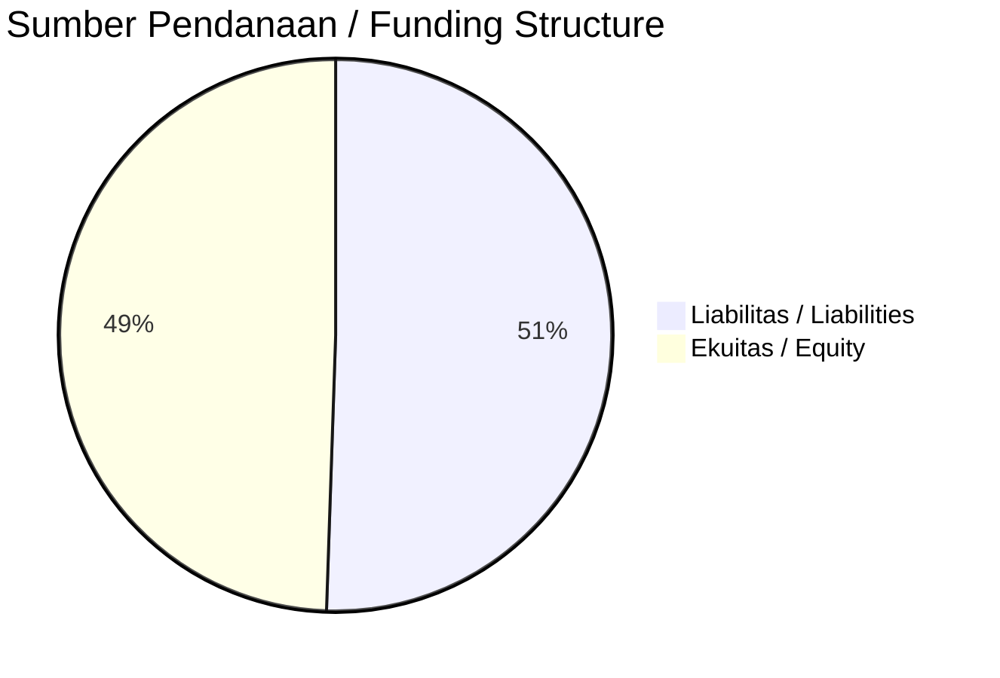

# 📈 Laporan Analisis Keuangan Mendalam: [[SMGA]] — Q2 2026

⬅️ [[knowledge-base/daily-digests/Daily_Digest_20261001|Kembali ke Daily Digest]] | 📅 **2026-10-01** | 🎛️ [[Dashboard|Ke Dashboard Utama]]

> [!IMPORTANT]
> Dokumen ini disusun oleh **Financial Summarizer Agent** untuk menganalisis kinerja keuangan, kesehatan neraca, profitabilitas, dan katalis sektor (General) **PT Sumber Mineral Global Abadi Tbk ([[SMGA]])** berdasarkan LK Q2 2026.

---

## 📌 1. Ikhtisar Kinerja Utama / Executive Performance Highlight
- **Emiten**: `[[SMGA]]` (PT Sumber Mineral Global Abadi Tbk)
- **Sektor Usaha / Industry Sector**: `General`
- **Periode Laporan / Reporting Period**: `Q2 2026`
- **Pendapatan Neto / Net Revenue**: `Rp 1.58 Triliun` (**+73.33% 🟢 YoY** dari Rp 913.05 Miliar)
- **Laba Bruto / Gross Profit**: `Rp 124.44 Miliar` (**+104.54% 🟢 YoY**)
- **Laba (Rugi) Bersih / Net Income**: `Rp 67.08 Miliar` (**+93.00% 🟢 YoY**)
- **Total Aset / Total Assets**: `Rp 841.47 Miliar` | **Total Ekuitas / Total Equity**: `Rp 472.88 Miliar`
- **EPS (Annualized)**: `0.77` | **BVPS**: `2.70`

---

## 📊 2. Laba Rugi Komparatif / Comparative Income Statement

| Pos Laba Rugi / Income Statement Item | Q2 2026 | Prior Period | YoY (%) |
| :--- | ---: | ---: | :---: |
| **Pendapatan Neto / Net Revenue** | `1.58T` | `913.05B` | **+73.33% 🟢** |
| **Beban Pokok / COGS** | `(1.46T)` | `(852.21B)` | +71.10% 🟢 |
| **Laba Bruto / Gross Profit** | `124.44B` | `60.84B` | **+104.54% 🟢** |
| **Beban Usaha / Operating Expenses** | `(34.50B)` | `(22.55B)` | +52.98% 🟢 |
| **Laba Operasional / EBIT** | `89.67B` | `42.69B` | +110.02% 🟢 |
| **Laba (Rugi) Bersih / Net Income** | **67.08B** | **34.76B** | **+93.00% 🟢** |

---

## 🏦 3. Neraca & Struktur Permodalan / Balance Sheet & Capital Structure

| Pos Neraca / Balance Sheet Item | Q2 2026 | Prior Year End | Δ YoY/YtD (%) | Catatan / Notes |
| :--- | ---: | ---: | :---: | :--- |
| **Aset Lancar / Current Assets** | `841.47B` | `813.43B` | +3.45% 🟢 | Kas: Rp 42.53 Miliar |
| **Aset Tidak Lancar / Non-Current Assets** | `110.68B` | `121.52B` | -8.93% 🔴 | Aset Tetap & Operasional |
| **TOTAL ASET / TOTAL ASSETS** | **841.47B** | **813.43B** | **+3.45% 🟢** | |
| **Liabilitas Jk. Pendek / Current Liabilities** | `482.97B` | `527.83B` | -8.50% 🔴 | |
| **Liabilitas Jk. Panjang / Non-Current Liabilities** | `10.16B` | `17.05B` | -40.44% 🔴 | |
| **TOTAL LIABILITAS / TOTAL LIABILITIES** | **482.97B** | **527.83B** | **-8.50% 🔴** | |
| **TOTAL EKUITAS / TOTAL EQUITY** | **472.88B** | **405.68B** | **+16.56% 🟢** | |

---

## 💸 4. Laporan Arus Kas / Cash Flow Statement

| Komponen Arus Kas / Cash Flow Component | Q2 2026 | Prior Period | Δ YoY (%) |
| :--- | ---: | ---: | :---: |
| **Arus Kas Operasi / CFO** | `19.67B` | `-4.62B` | +525.86% 🟢 |
| **Arus Kas Investasi / CFI** | `-1.07B` | `-5.32B` | +79.94% 🟢 |
| **Arus Kas Pendanaan / CFF** | `6.45B` | `15.51B` | -58.43% 🔴 |
| **Kenaikan (Penurunan) Kas Bersih** | `25.05B` | `5.57B` | +349.45% 🟢 |
| Belanja Modal / Capex | `(1.07B)` | `(5.32B)` | -79.94% 🔴 |
| Pembayaran Dividen / Dividends Paid | `(-)` | `(-)` | - |
| **Free Cash Flow (CFO - Capex)** | **18.60B** | **-9.94B** | **+287.22% 🟢** |

---

## 📈 Analisis Rasio Keuangan / Financial Ratio Analysis

| Kategori / Category | Metrik / Metric | Nilai / Value | Benchmark | Interpretasi / Interpretation |
| :--- | :--- | :---: | :---: | :--- |
| **🛡️ Likuiditas** | **Current Ratio** | `1.74x` | `> 1.0x` | Kemampuan bayar kewajiban jk. pendek |
| | **Quick Ratio** | `1.74x` | `> 0.8x` | Likuiditas tanpa persediaan |
| **📊 Profitabilitas** | **Gross Profit Margin (GPM)** | `7.86%` | - | Margin kotor operasional inti |
| | **Operating Profit Margin (OPM)** | `5.67%` | - | Efisiensi operasional |
| | **Net Profit Margin (NPM)** | `4.24%` | - | Konversi revenue ke laba bersih |
| **🎯 Imbal Hasil (Ann.)** | **Return on Equity (ROE)** | `30.54%` | - | Imbal hasil terhadap ekuitas |
| | **Return on Assets (ROA)** | `16.21%` | - | Produktivitas aset |
| **⚖️ Solvabilitas** | **Debt to Equity (DER)** | `1.02x` | `< 2.0x` | Leverage utang vs modal |
| | **Debt to Asset (DAR)** | `0.57x` | `< 0.7x` | Porsi aset didanai utang |

---

## 📐 Per Share Metrics

| Metrik / Metric | Nilai / Value | Keterangan / Notes |
| :--- | ---: | :--- |
| **EPS (Annualized)** | `Rp 0.77` | Laba per saham (dianualisasi) |
| **BVPS** | `Rp 2.70` | Nilai buku per saham |

---

## 🚀 Analisis Strategis & Karakteristik Sektor / Strategic Analysis: General

Pada periode Q2 2026, **PT Sumber Mineral Global Abadi Tbk ([[SMGA]])** membukukan total pendapatan sebesar **Rp 1.58 Triliun** (+73.33% 🟢 YoY). Laba kotor tercatat **Rp 124.44 Miliar** dengan GPM **7.86%**. Laba bersih sebesar **Rp 67.08 Miliar** (+93.00% 🟢 YoY). Total aset **Rp 841.47 Miliar**, ekuitas **Rp 472.88 Miliar**, DER **1.02x**.

### 🔍 Indikator Kunci Sektor / Sector Key Indicators (General)
- **Karakteristik Industri (General)**: Kinerja mencerminkan dinamika penyerapan pasar, utilisasi kapasitas produksi, dan efisiensi biaya pokok.
- **Faktor Penggerak**: Pertumbuhan organik, efisiensi operasional, dan ekspansi pasar.

> [!NOTE]
> _Data Public Expose / Investor Presentation belum tersedia untuk emiten ini._

---

## 📋 Catatan Kunci Laporan Keuangan / Key Notes to Financial Statements

### 🔍 Opini Auditor / Auditor Opinion
- **Jenis Opini / Opinion Type**: `Wajar Tanpa Modifikasian / Unqualified`
- **KAP / Audit Firm**: `KAP Morhan Dan Rekan`
- **Partner Audit**: `Morhan Tirtonadi`
- **Tanggal Laporan / Report Date**: `2026-09-28`

---

## 💡 Catatan Strategis & Panduan Investor / Strategic Notes & Investor Guide

1. **Kesehatan Permodalan / Capital Health**: DER **1.02x**, CR **1.74x** — _sehat dan aman_.
2. **Katalis Pertumbuhan / Growth Catalysts**: Pantau realisasi pendapatan dan efisiensi operasional periode berikutnya.

---

## 🔗 Hubungan Note Terkait / Knowledge Graph Links
- [[knowledge-base/daily-digests/Daily_Digest_20261001|📄 Daily Digest 2026-10-01]]
- [[knowledge-base/trading-signals/Trading_Signals_20261001|🎯 Trading Signals]]
- [[Dashboard|🎛️ Kembali ke Dashboard Utama]]