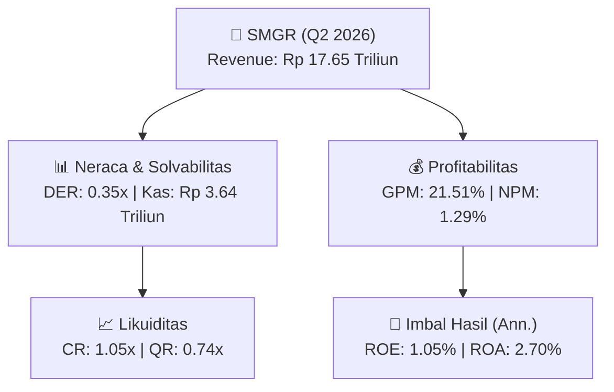
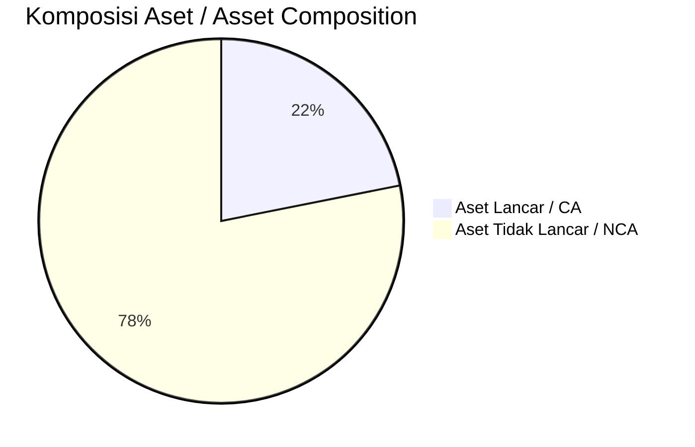
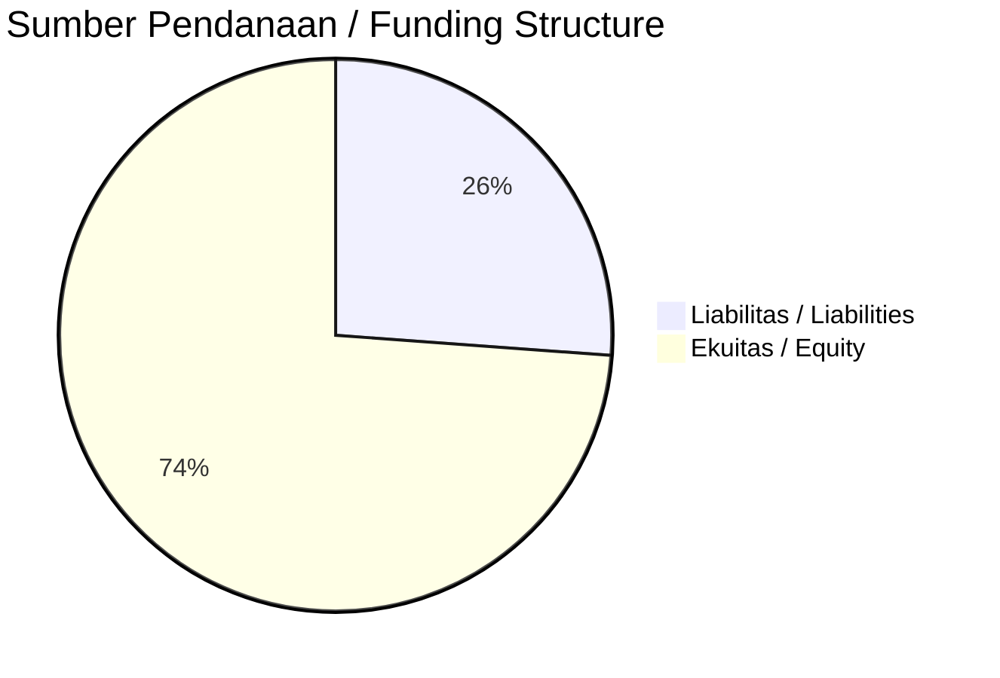

# 📈 Laporan Analisis Keuangan Mendalam: [[SMGR]] — Q2 2026

⬅️ [[knowledge-base/daily-digests/Daily_Digest_20260901|Kembali ke Daily Digest]] | 📅 **2026-09-01** | 🎛️ [[Dashboard|Ke Dashboard Utama]]

> [!IMPORTANT]
> Dokumen ini disusun oleh **Financial Summarizer Agent** untuk menganalisis kinerja keuangan, kesehatan neraca, profitabilitas, dan katalis sektor (General) **Semen Indonesia (Persero) Tbk ([[SMGR]])** berdasarkan LK Q2 2026.

---

## 📌 1. Ikhtisar Kinerja Utama / Executive Performance Highlight
- **Emiten**: `[[SMGR]]` (Semen Indonesia (Persero) Tbk)
- **Sektor Usaha / Industry Sector**: `General`
- **Periode Laporan / Reporting Period**: `Q2 2026`
- **Pendapatan Neto / Net Revenue**: `Rp 17.65 Triliun` (**+13.07% 🟢 YoY** dari Rp 15.61 Triliun)
- **Laba Bruto / Gross Profit**: `Rp 3.80 Triliun` (**+21.07% 🟢 YoY**)
- **Laba (Rugi) Bersih / Net Income**: `Rp 228.26 Miliar` (**+470.95% 🟢 YoY**)
- **Total Aset / Total Assets**: `Rp 16.32 Triliun` | **Total Ekuitas / Total Equity**: `Rp 43.68 Triliun`
- **EPS (Annualized)**: `0.68` | **BVPS**: `64.70`

---

## 📊 2. Laba Rugi Komparatif / Comparative Income Statement

| Pos Laba Rugi / Income Statement Item | Q2 2026 | Prior Period | YoY (%) |
| :--- | ---: | ---: | :---: |
| **Pendapatan Neto / Net Revenue** | `17.65T` | `15.61T` | **+13.07% 🟢** |
| **Beban Pokok / COGS** | `(13.85T)` | `(12.47T)` | +11.06% 🟢 |
| **Laba Bruto / Gross Profit** | `3.80T` | `3.14T` | **+21.07% 🟢** |
| **Beban Usaha / Operating Expenses** | `(1.65T)` | `(1.44T)` | +14.30% 🟢 |
| **Laba Operasional / EBIT** | `392.39B` | `155.28B` | +152.70% 🟢 |
| **Laba (Rugi) Bersih / Net Income** | **228.26B** | **39.98B** | **+470.95% 🟢** |

---

## 🏦 3. Neraca & Struktur Permodalan / Balance Sheet & Capital Structure

| Pos Neraca / Balance Sheet Item | Q2 2026 | Prior Year End | Δ YoY/YtD (%) | Catatan / Notes |
| :--- | ---: | ---: | :---: | :--- |
| **Aset Lancar / Current Assets** | `16.32T` | `17.43T` | -6.36% 🔴 | Kas: Rp 3.64 Triliun |
| **Aset Tidak Lancar / Non-Current Assets** | `58.30T` | `59.14T` | -1.42% 🔴 | Aset Tetap & Operasional |
| **TOTAL ASET / TOTAL ASSETS** | **16.32T** | **17.43T** | **-6.36% 🔴** | |
| **Liabilitas Jk. Pendek / Current Liabilities** | `15.48T` | `15.84T` | -2.25% 🔴 | |
| **Liabilitas Jk. Panjang / Non-Current Liabilities** | `11.26T` | `13.01T` | -13.46% 🔴 | |
| **TOTAL LIABILITAS / TOTAL LIABILITIES** | **15.48T** | **15.84T** | **-2.25% 🔴** | |
| **TOTAL EKUITAS / TOTAL EQUITY** | **43.68T** | **43.46T** | **+0.50% 🟢** | |

---

## 💸 4. Laporan Arus Kas / Cash Flow Statement

| Komponen Arus Kas / Cash Flow Component | Q2 2026 | Prior Period | Δ YoY (%) |
| :--- | ---: | ---: | :---: |
| **Arus Kas Operasi / CFO** | `2.17T` | `1.17T` | +84.92% 🟢 |
| **Arus Kas Investasi / CFI** | `-527.03B` | `-310.69B` | -69.63% 🔴 |
| **Arus Kas Pendanaan / CFF** | `-2.68T` | `-478.33B` | -459.99% 🔴 |
| **Kenaikan (Penurunan) Kas Bersih** | `-1.03T` | `384.91B` | -368.86% 🔴 |
| Belanja Modal / Capex | `(533.37B)` | `(327.67B)` | +62.78% 🟢 |
| Pembayaran Dividen / Dividends Paid | `(190.85B)` | `(648.75B)` | -70.58% 🔴 |
| **Free Cash Flow (CFO - Capex)** | **1.64T** | **846.26B** | **+93.49% 🟢** |

---

## 📈 Analisis Rasio Keuangan / Financial Ratio Analysis

| Kategori / Category | Metrik / Metric | Nilai / Value | Benchmark | Interpretasi / Interpretation |
| :--- | :--- | :---: | :---: | :--- |
| **🛡️ Likuiditas** | **Current Ratio** | `1.05x` | `> 1.0x` | Kemampuan bayar kewajiban jk. pendek |
| | **Quick Ratio** | `0.74x` | `> 0.8x` | Likuiditas tanpa persediaan |
| **📊 Profitabilitas** | **Gross Profit Margin (GPM)** | `21.51%` | - | Margin kotor operasional inti |
| | **Operating Profit Margin (OPM)** | `2.22%` | - | Efisiensi operasional |
| | **Net Profit Margin (NPM)** | `1.29%` | - | Konversi revenue ke laba bersih |
| **🎯 Imbal Hasil (Ann.)** | **Return on Equity (ROE)** | `1.05%` | - | Imbal hasil terhadap ekuitas |
| | **Return on Assets (ROA)** | `2.70%` | - | Produktivitas aset |
| **⚖️ Solvabilitas** | **Debt to Equity (DER)** | `0.35x` | `< 2.0x` | Leverage utang vs modal |
| | **Debt to Asset (DAR)** | `0.95x` | `< 0.7x` | Porsi aset didanai utang |

---

## 📐 Per Share Metrics

| Metrik / Metric | Nilai / Value | Keterangan / Notes |
| :--- | ---: | :--- |
| **EPS (Annualized)** | `Rp 0.68` | Laba per saham (dianualisasi) |
| **BVPS** | `Rp 64.70` | Nilai buku per saham |

---

## 🚀 Analisis Strategis & Karakteristik Sektor / Strategic Analysis: General

Pada periode Q2 2026, **Semen Indonesia (Persero) Tbk ([[SMGR]])** membukukan total pendapatan sebesar **Rp 17.65 Triliun** (+13.07% 🟢 YoY). Laba kotor tercatat **Rp 3.80 Triliun** dengan GPM **21.51%**. Laba bersih sebesar **Rp 228.26 Miliar** (+470.95% 🟢 YoY). Total aset **Rp 16.32 Triliun**, ekuitas **Rp 43.68 Triliun**, DER **0.35x**.

### 🔍 Indikator Kunci Sektor / Sector Key Indicators (General)
- **Karakteristik Industri (General)**: Kinerja mencerminkan dinamika penyerapan pasar, utilisasi kapasitas produksi, dan efisiensi biaya pokok.
- **Faktor Penggerak**: Pertumbuhan organik, efisiensi operasional, dan ekspansi pasar.

> [!NOTE]
> _Data Public Expose / Investor Presentation belum tersedia untuk emiten ini._

---

## 📋 Catatan Kunci Laporan Keuangan / Key Notes to Financial Statements

### 🔍 Opini Auditor / Auditor Opinion
- **Jenis Opini / Opinion Type**: `Reviu Terbatas / Limited Review`
- **KAP / Audit Firm**: `KAP Liana Ramon Xenia  Rekan`
- **Partner Audit**: `Muhammad Irfan`
- **Tanggal Laporan / Report Date**: `2026-08-31`

---

## 💡 Catatan Strategis & Panduan Investor / Strategic Notes & Investor Guide

1. **Kesehatan Permodalan / Capital Health**: DER **0.35x**, CR **1.05x** — _perlu dipantau secara disiplin_.
2. **Katalis Pertumbuhan / Growth Catalysts**: Pantau realisasi pendapatan dan efisiensi operasional periode berikutnya.

---

## 🔗 Hubungan Note Terkait / Knowledge Graph Links
- [[knowledge-base/daily-digests/Daily_Digest_20260901|📄 Daily Digest 2026-09-01]]
- [[knowledge-base/trading-signals/Trading_Signals_20260901|🎯 Trading Signals]]
- [[Dashboard|🎛️ Kembali ke Dashboard Utama]]