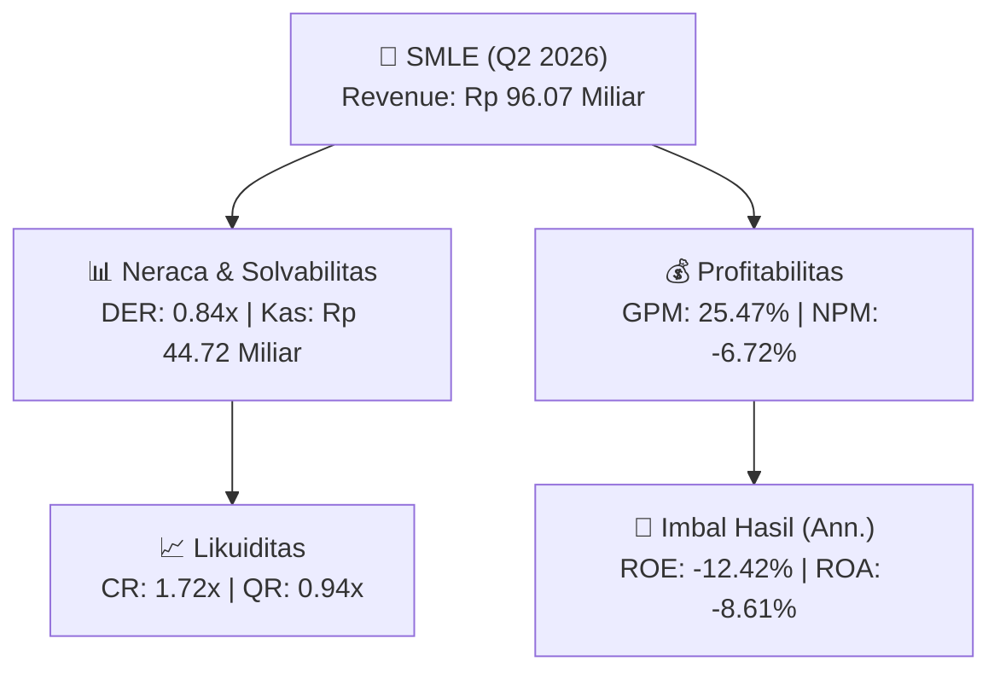
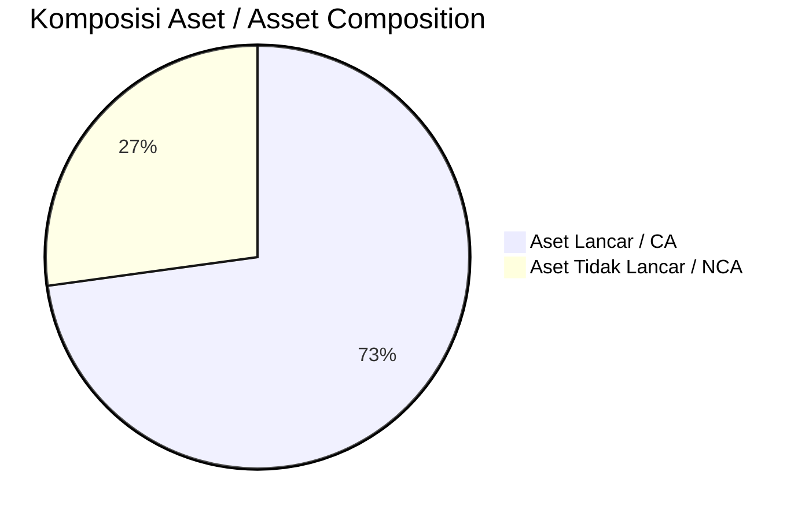
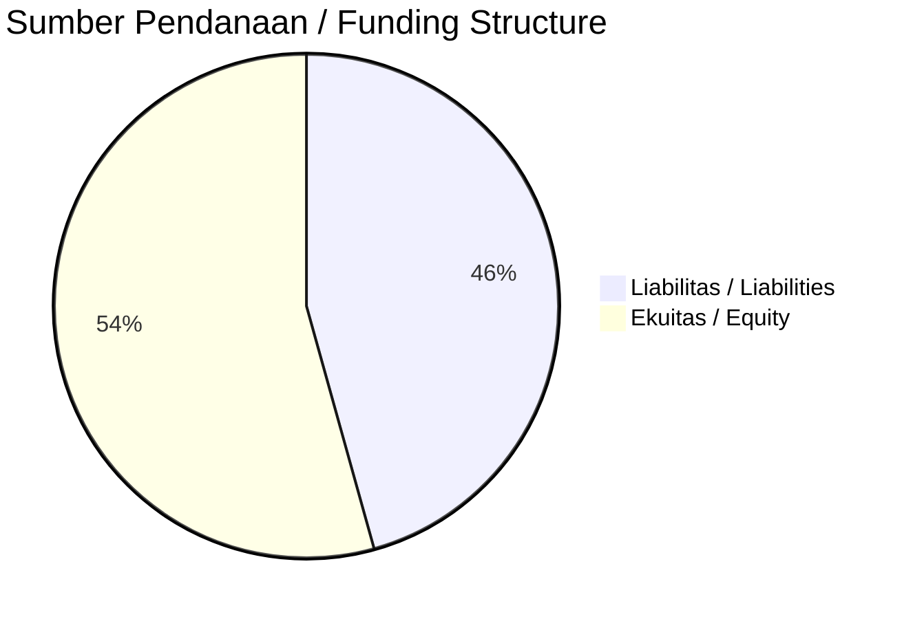

# 📈 Laporan Analisis Keuangan Mendalam: [[SMLE]] — Q2 2026

⬅️ [[knowledge-base/daily-digests/Daily_Digest_20261001|Kembali ke Daily Digest]] | 📅 **2026-10-01** | 🎛️ [[Dashboard|Ke Dashboard Utama]]

> [!IMPORTANT]
> Dokumen ini disusun oleh **Financial Summarizer Agent** untuk menganalisis kinerja keuangan, kesehatan neraca, profitabilitas, dan katalis sektor (General) **PT Sinergi Multi Lestarindo Tbk ([[SMLE]])** berdasarkan LK Q2 2026.

---

## 📌 1. Ikhtisar Kinerja Utama / Executive Performance Highlight
- **Emiten**: `[[SMLE]]` (PT Sinergi Multi Lestarindo Tbk)
- **Sektor Usaha / Industry Sector**: `General`
- **Periode Laporan / Reporting Period**: `Q2 2026`
- **Pendapatan Neto / Net Revenue**: `Rp 96.07 Miliar` (**-11.61% 🔴 YoY** dari Rp 108.69 Miliar)
- **Laba Bruto / Gross Profit**: `Rp 24.47 Miliar` (**-8.30% 🔴 YoY**)
- **Laba (Rugi) Bersih / Net Income**: `Rp -6.46 Miliar` (**-1754.45% 🔴 YoY**)
- **Total Aset / Total Assets**: `Rp 145.60 Miliar` | **Total Ekuitas / Total Equity**: `Rp 100.69 Miliar`
- **EPS (Annualized)**: `-0.55` | **BVPS**: `4.32`

---

## 📊 2. Laba Rugi Komparatif / Comparative Income Statement

| Pos Laba Rugi / Income Statement Item | Q2 2026 | Prior Period | YoY (%) |
| :--- | ---: | ---: | :---: |
| **Pendapatan Neto / Net Revenue** | `96.07B` | `108.69B` | **-11.61% 🔴** |
| **Beban Pokok / COGS** | `(71.60B)` | `(82.00B)` | -12.68% 🔴 |
| **Laba Bruto / Gross Profit** | `24.47B` | `26.69B` | **-8.30% 🔴** |
| **Beban Usaha / Operating Expenses** | `(12.70B)` | `(11.42B)` | +11.17% 🟢 |
| **Laba Operasional / EBIT** | `-7.10B` | `687.22M` | -1133.06% 🔴 |
| **Laba (Rugi) Bersih / Net Income** | **-6.46B** | **390.24M** | **-1754.45% 🔴** |

---

## 🏦 3. Neraca & Struktur Permodalan / Balance Sheet & Capital Structure

| Pos Neraca / Balance Sheet Item | Q2 2026 | Prior Year End | Δ YoY/YtD (%) | Catatan / Notes |
| :--- | ---: | ---: | :---: | :--- |
| **Aset Lancar / Current Assets** | `145.60B` | `154.47B` | -5.74% 🔴 | Kas: Rp 44.72 Miliar |
| **Aset Tidak Lancar / Non-Current Assets** | `54.34B` | `51.23B` | +6.07% 🟢 | Aset Tetap & Operasional |
| **TOTAL ASET / TOTAL ASSETS** | **145.60B** | **154.47B** | **-5.74% 🔴** | |
| **Liabilitas Jk. Pendek / Current Liabilities** | `84.53B` | `82.48B` | +2.48% 🟢 | |
| **Liabilitas Jk. Panjang / Non-Current Liabilities** | `14.73B` | `15.93B` | -7.53% 🔴 | |
| **TOTAL LIABILITAS / TOTAL LIABILITIES** | **84.53B** | **82.48B** | **+2.48% 🟢** | |
| **TOTAL EKUITAS / TOTAL EQUITY** | **100.69B** | **107.29B** | **-6.16% 🔴** | |

---

## 💸 4. Laporan Arus Kas / Cash Flow Statement

| Komponen Arus Kas / Cash Flow Component | Q2 2026 | Prior Period | Δ YoY (%) |
| :--- | ---: | ---: | :---: |
| **Arus Kas Operasi / CFO** | `4.76B` | `6.58B` | -27.77% 🔴 |
| **Arus Kas Investasi / CFI** | `-3.38B` | `-3.13B` | -8.09% 🔴 |
| **Arus Kas Pendanaan / CFF** | `-2.23B` | `-2.47B` | +9.82% 🟢 |
| **Kenaikan (Penurunan) Kas Bersih** | `-860.50M` | `977.68M` | -188.01% 🔴 |
| Belanja Modal / Capex | `(1.46B)` | `(0.00)` | - |
| Pembayaran Dividen / Dividends Paid | `(-)` | `(-)` | - |
| **Free Cash Flow (CFO - Capex)** | **3.30B** | **6.58B** | **-49.95% 🔴** |

---

## 📈 Analisis Rasio Keuangan / Financial Ratio Analysis

| Kategori / Category | Metrik / Metric | Nilai / Value | Benchmark | Interpretasi / Interpretation |
| :--- | :--- | :---: | :---: | :--- |
| **🛡️ Likuiditas** | **Current Ratio** | `1.72x` | `> 1.0x` | Kemampuan bayar kewajiban jk. pendek |
| | **Quick Ratio** | `0.94x` | `> 0.8x` | Likuiditas tanpa persediaan |
| **📊 Profitabilitas** | **Gross Profit Margin (GPM)** | `25.47%` | - | Margin kotor operasional inti |
| | **Operating Profit Margin (OPM)** | `-7.39%` | - | Efisiensi operasional |
| | **Net Profit Margin (NPM)** | `-6.72%` | - | Konversi revenue ke laba bersih |
| **🎯 Imbal Hasil (Ann.)** | **Return on Equity (ROE)** | `-12.42%` | - | Imbal hasil terhadap ekuitas |
| | **Return on Assets (ROA)** | `-8.61%` | - | Produktivitas aset |
| **⚖️ Solvabilitas** | **Debt to Equity (DER)** | `0.84x` | `< 2.0x` | Leverage utang vs modal |
| | **Debt to Asset (DAR)** | `0.58x` | `< 0.7x` | Porsi aset didanai utang |

---

## 📐 Per Share Metrics

| Metrik / Metric | Nilai / Value | Keterangan / Notes |
| :--- | ---: | :--- |
| **EPS (Annualized)** | `Rp -0.55` | Laba per saham (dianualisasi) |
| **BVPS** | `Rp 4.32` | Nilai buku per saham |

---

## 🚀 Analisis Strategis & Karakteristik Sektor / Strategic Analysis: General

Pada periode Q2 2026, **PT Sinergi Multi Lestarindo Tbk ([[SMLE]])** membukukan total pendapatan sebesar **Rp 96.07 Miliar** (-11.61% 🔴 YoY). Laba kotor tercatat **Rp 24.47 Miliar** dengan GPM **25.47%**. Laba bersih sebesar **Rp -6.46 Miliar** (-1754.45% 🔴 YoY). Total aset **Rp 145.60 Miliar**, ekuitas **Rp 100.69 Miliar**, DER **0.84x**.

### 🔍 Indikator Kunci Sektor / Sector Key Indicators (General)
- **Karakteristik Industri (General)**: Kinerja mencerminkan dinamika penyerapan pasar, utilisasi kapasitas produksi, dan efisiensi biaya pokok.
- **Faktor Penggerak**: Pertumbuhan organik, efisiensi operasional, dan ekspansi pasar.

> [!NOTE]
> _Data Public Expose / Investor Presentation belum tersedia untuk emiten ini._

---

## 📋 Catatan Kunci Laporan Keuangan / Key Notes to Financial Statements

### 🔍 Opini Auditor / Auditor Opinion
- **Jenis Opini / Opinion Type**: `Wajar Tanpa Modifikasian / Unqualified`
- **KAP / Audit Firm**: `KAP Jamaludin, Ardi, Sukimto dan Rekan`
- **Partner Audit**: `Deswal`
- **Tanggal Laporan / Report Date**: `2026-09-30`

---

## 💡 Catatan Strategis & Panduan Investor / Strategic Notes & Investor Guide

1. **Kesehatan Permodalan / Capital Health**: DER **0.84x**, CR **1.72x** — _sehat dan aman_.
2. **Katalis Pertumbuhan / Growth Catalysts**: Pantau realisasi pendapatan dan efisiensi operasional periode berikutnya.

---

## 🔗 Hubungan Note Terkait / Knowledge Graph Links
- [[knowledge-base/daily-digests/Daily_Digest_20261001|📄 Daily Digest 2026-10-01]]
- [[knowledge-base/trading-signals/Trading_Signals_20261001|🎯 Trading Signals]]
- [[Dashboard|🎛️ Kembali ke Dashboard Utama]]