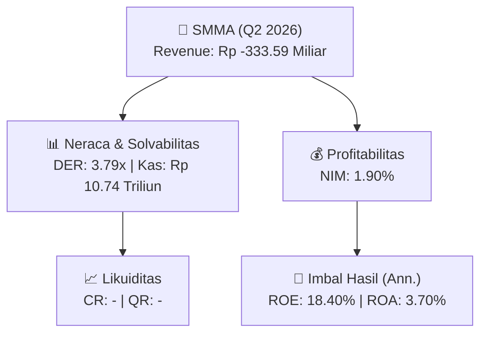
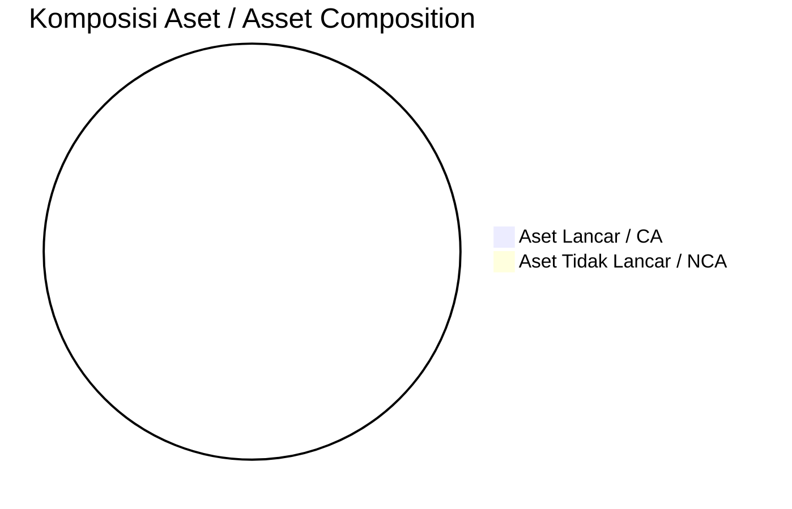
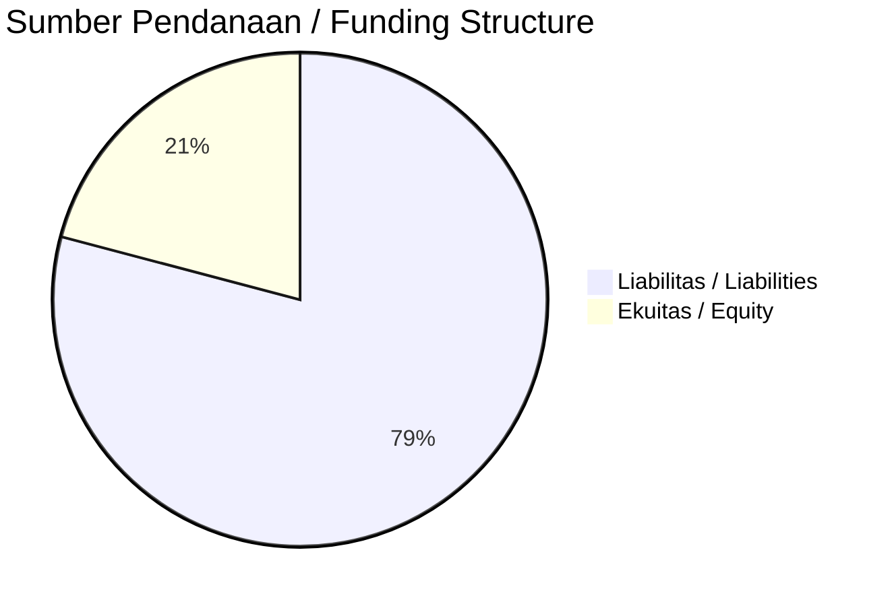

# 📈 Laporan Analisis Keuangan Mendalam: [[SMMA]] — Q2 2026

⬅️ [[knowledge-base/daily-digests/Daily_Digest_20260901|Kembali ke Daily Digest]] | 📅 **2026-09-01** | 🎛️ [[Dashboard|Ke Dashboard Utama]]

> [!IMPORTANT]
> Dokumen ini disusun oleh **Financial Summarizer Agent** untuk menganalisis kinerja keuangan, kesehatan neraca, profitabilitas, dan katalis sektor (Multifinance & Perbankan) **PT Sinar Mas Multiartha Tbk ([[SMMA]])** berdasarkan LK Q2 2026.

---

## 📌 1. Ikhtisar Kinerja Utama / Executive Performance Highlight
- **Emiten**: `[[SMMA]]` (PT Sinar Mas Multiartha Tbk)
- **Sektor Usaha / Industry Sector**: `Multifinance & Perbankan`
- **Periode Laporan / Reporting Period**: `Q2 2026`
- **Pendapatan Usaha / Total Revenue**: `Rp -333.59 Miliar` (**-132.57% 🔴 YoY** dari Rp 1.02 Triliun)
- **Pendapatan Bunga / Interest Income**: `Rp 2.15 Triliun`
- **Laba (Rugi) Bersih / Net Income**: `Rp 2.31 Triliun` (**+75.80% 🟢 YoY**)
- **Total Aset / Total Assets**: `Rp 129.72 Triliun` | **Total Ekuitas / Total Equity**: `Rp 26.72 Triliun`
- **EPS (Annualized)**: `3.46` | **BVPS**: `20.02`

---

## 📊 2. Laba Rugi Komparatif / Comparative Income Statement (Financial Sector)

| Pos Laba Rugi / Income Statement Item | Q2 2026 | Prior Period | YoY (%) |
| :--- | ---: | ---: | :---: |
| **Pendapatan Bunga / Interest Income** | `2.15T` | `2.29T` | -6.06% 🔴 |
| **Beban Bunga / Interest Expense** | `(911.28B)` | `(995.93B)` | -8.50% 🔴 |
| **Beban Klaim / Claims Expense** | `(11.27T)` | `(15.50T)` | -27.33% 🔴 |
| **Jumlah Pendapatan Usaha / Total Revenue** | `-333.59B` | `1.02T` | -132.57% 🔴 |
| **Pencadangan / Provision (PPAP)** | `(15.28B)` | `(129.97B)` | -88.24% 🔴 |
| **Beban Operasional / Operating Expenses** | `(1.18T)` | `(841.76B)` | +39.99% 🟢 |
| **Laba Sebelum Pajak / Profit Before Tax** | `2.33T` | `1.37T` | +70.85% 🟢 |
| **Laba (Rugi) Bersih / Net Income** | **2.31T** | **1.31T** | **+75.80% 🟢** |

---

## 🏦 3. Neraca & Struktur Permodalan / Balance Sheet & Capital Structure

| Pos Neraca / Balance Sheet Item | Q2 2026 | Prior Year End | Δ YoY/YtD (%) | Catatan / Notes |
| :--- | ---: | ---: | :---: | :--- |
| **Aset Lancar / Current Assets** | `-` | `-` | - | Kas: Rp 10.74 Triliun |
| **Aset Tidak Lancar / Non-Current Assets** | `-` | `-` | - | Aset Tetap & Operasional |
| **TOTAL ASET / TOTAL ASSETS** | **129.72T** | **120.39T** | **+7.75% 🟢** | |
| **Liabilitas Jk. Pendek / Current Liabilities** | `-` | `-` | - | |
| **Liabilitas Jk. Panjang / Non-Current Liabilities** | `-` | `-` | - | |
| **TOTAL LIABILITAS / TOTAL LIABILITIES** | **101.25T** | **94.48T** | **+7.16% 🟢** | |
| **TOTAL EKUITAS / TOTAL EQUITY** | **26.72T** | **23.53T** | **+13.56% 🟢** | |

---

## 💸 4. Laporan Arus Kas / Cash Flow Statement

| Komponen Arus Kas / Cash Flow Component | Q2 2026 | Prior Period | Δ YoY (%) |
| :--- | ---: | ---: | :---: |
| **Arus Kas Operasi / CFO** | `-6.14T` | `-4.51T` | -36.29% 🔴 |
| **Arus Kas Investasi / CFI** | `2.51T` | `-213.41B` | +1275.39% 🟢 |
| **Arus Kas Pendanaan / CFF** | `-1.47T` | `-29.67B` | -4870.97% 🔴 |
| **Kenaikan (Penurunan) Kas Bersih** | `-5.11T` | `-4.75T` | -7.55% 🔴 |
| Belanja Modal / Capex | `(145.49B)` | `(203.18B)` | -28.39% 🔴 |
| Pembayaran Dividen / Dividends Paid | `(-)` | `(-)` | - |
| **Free Cash Flow (CFO - Capex)** | **-6.29T** | **-4.71T** | **-33.50% 🔴** |

---

## 📈 Analisis Rasio Keuangan / Financial Ratio Analysis

| Kategori / Category | Metrik / Metric | Nilai / Value | Benchmark | Interpretasi / Interpretation |
| :--- | :--- | :---: | :---: | :--- |
| **🛡️ Likuiditas** | **Current Ratio** | `-` | `> 1.0x` | Kemampuan bayar kewajiban jk. pendek |
| | **Quick Ratio** | `-` | `> 0.8x` | Likuiditas tanpa persediaan |
| **📊 Profitabilitas** | **Net Interest Margin (NIM)** | `1.90%` | `> 3.0%` | Spread pendapatan bunga bersih |
| | **BOPO / Cost-to-Income Ratio** | `353.25%` | `< 80%` | Efisiensi biaya operasional |
| **🎯 Imbal Hasil (Ann.)** | **Return on Equity (ROE)** | `18.40%` | - | Imbal hasil terhadap ekuitas |
| | **Return on Assets (ROA)** | `3.70%` | - | Produktivitas aset |
| **⚖️ Solvabilitas** | **Debt to Equity (DER)** | `3.79x` | `< 2.0x` | Leverage utang vs modal |
| | **Debt to Asset (DAR)** | `0.78x` | `< 0.7x` | Porsi aset didanai utang |

---

## 📐 Per Share Metrics

| Metrik / Metric | Nilai / Value | Keterangan / Notes |
| :--- | ---: | :--- |
| **EPS (Annualized)** | `Rp 3.46` | Laba per saham (dianualisasi) |
| **BVPS** | `Rp 20.02` | Nilai buku per saham |

---

## 🚀 Analisis Strategis & Karakteristik Sektor / Strategic Analysis: Multifinance & Perbankan

Pada periode Q2 2026, **PT Sinar Mas Multiartha Tbk ([[SMMA]])** membukukan total pendapatan sebesar **Rp -333.59 Miliar** (-132.57% 🔴 YoY). Laba bersih sebesar **Rp 2.31 Triliun** (+75.80% 🟢 YoY). Total aset **Rp 129.72 Triliun**, ekuitas **Rp 26.72 Triliun**, DER **3.79x**.

### 🔍 Indikator Kunci Sektor / Sector Key Indicators (Multifinance & Perbankan)
- **Karakteristik Industri Finansial / Financial Industry**: Kinerja ditopang oleh spread pendapatan bunga (NIM), hasil investasi, dan pengelolaan Cost of Funds.
- **Kualitas Aset / Asset Quality**: Pengawasan rasio NPL/NPF dan kecukupan pencadangan (PPAP) untuk menjaga stabilitas margin usaha.
- **Solvabilitas / Solvency**: Rasio kecukupan modal (CAR/RBC) ketat sesuai regulasi OJK.

> [!NOTE]
> _Data Public Expose / Investor Presentation belum tersedia untuk emiten ini._

---

## 📋 Catatan Kunci Laporan Keuangan / Key Notes to Financial Statements

### 🔍 Opini Auditor / Auditor Opinion
- _Informasi opini auditor tidak tersedia._

---

## 💡 Catatan Strategis & Panduan Investor / Strategic Notes & Investor Guide

1. **Kesehatan Permodalan / Capital Health**: DER **3.79x**, CR **-** — _perlu dipantau secara disiplin_.
2. **Katalis Pertumbuhan / Growth Catalysts**: Pantau realisasi pendapatan dan efisiensi operasional periode berikutnya.
3. **Kualitas Aset Finansial**: Pantau tren NIM (**1.90%**) dan kualitas portofolio kredit/pembiayaan.

---

## 🔗 Hubungan Note Terkait / Knowledge Graph Links
- [[knowledge-base/daily-digests/Daily_Digest_20260901|📄 Daily Digest 2026-09-01]]
- [[knowledge-base/trading-signals/Trading_Signals_20260901|🎯 Trading Signals]]
- [[Dashboard|🎛️ Kembali ke Dashboard Utama]]