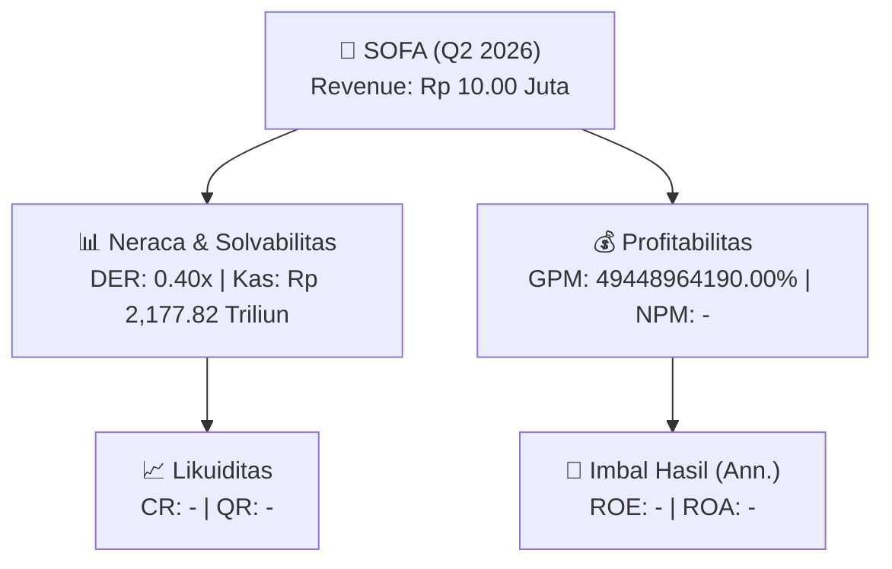
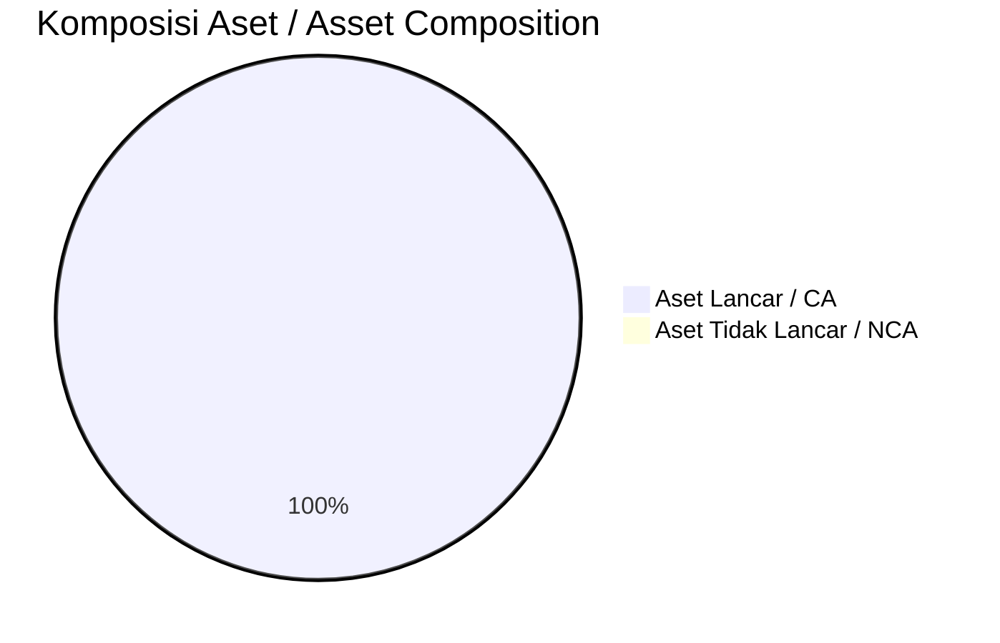
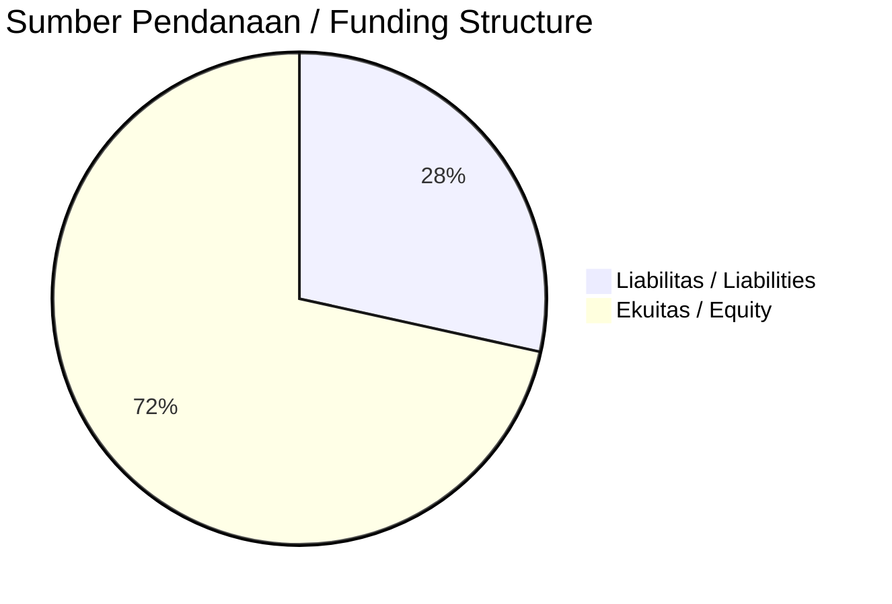

# 📈 Laporan Analisis Keuangan Mendalam: [[SOFA]] — Q2 2026

⬅️ [[knowledge-base/daily-digests/Daily_Digest_20260925|Kembali ke Daily Digest]] | 📅 **2026-09-25** | 🎛️ [[Dashboard|Ke Dashboard Utama]]

> [!IMPORTANT]
> Dokumen ini disusun oleh **Financial Summarizer Agent** untuk menganalisis kinerja keuangan, kesehatan neraca, profitabilitas, dan katalis sektor (General) **PT Solusi Environment Asia Tbk yang tidak memerlukan tanda tangan karena dihasilkan secara
elektronik. PT Solusi Environment Asia Tbk ([[SOFA]])** berdasarkan LK Q2 2026.

---

## 📌 1. Ikhtisar Kinerja Utama / Executive Performance Highlight
- **Emiten**: `[[SOFA]]` (PT Solusi Environment Asia Tbk yang tidak memerlukan tanda tangan karena dihasilkan secara
elektronik. PT Solusi Environment Asia Tbk)
- **Sektor Usaha / Industry Sector**: `General`
- **Periode Laporan / Reporting Period**: `Q2 2026`
- **Pendapatan Neto / Net Revenue**: `Rp 10.00 Juta` (**- YoY** dari -)
- **Laba Bruto / Gross Profit**: `Rp 4,944.90 Triliun` (**-54.72% 🔴 YoY**)
- **Laba (Rugi) Bersih / Net Income**: `-` (**- YoY**)
- **Total Aset / Total Assets**: `Rp 21,067.56 Triliun` | **Total Ekuitas / Total Equity**: `Rp 33,353.65 Triliun`
- **EPS (Annualized)**: `-` | **BVPS**: `-`

---

## 📊 2. Laba Rugi Komparatif / Comparative Income Statement

| Pos Laba Rugi / Income Statement Item | Q2 2026 | Prior Period | YoY (%) |
| :--- | ---: | ---: | :---: |
| **Pendapatan Neto / Net Revenue** | `10.00M` | `-` | **-** |
| **Beban Pokok / COGS** | `(16,439.89T)` | `(12,137.05T)` | +35.45% 🟢 |
| **Laba Bruto / Gross Profit** | `4,944.90T` | `10,920.88T` | **-54.72% 🔴** |
| **Beban Usaha / Operating Expenses** | `(-)` | `(-)` | - |
| **Laba Operasional / EBIT** | `-` | `-` | - |
| **Laba (Rugi) Bersih / Net Income** | **-** | **-** | **-** |

---

## 🏦 3. Neraca & Struktur Permodalan / Balance Sheet & Capital Structure

| Pos Neraca / Balance Sheet Item | Q2 2026 | Prior Year End | Δ YoY/YtD (%) | Catatan / Notes |
| :--- | ---: | ---: | :---: | :--- |
| **Aset Lancar / Current Assets** | `21,067.56T` | `25,161.53T` | -16.27% 🔴 | Kas: Rp 2,177.82 Triliun |
| **Aset Tidak Lancar / Non-Current Assets** | `-` | `-` | - | Aset Tetap & Operasional |
| **TOTAL ASET / TOTAL ASSETS** | **21,067.56T** | **25,161.53T** | **-16.27% 🔴** | |
| **Liabilitas Jk. Pendek / Current Liabilities** | `-` | `-` | - | |
| **Liabilitas Jk. Panjang / Non-Current Liabilities** | `-` | `-` | - | |
| **TOTAL LIABILITAS / TOTAL LIABILITIES** | **13,268.55T** | **12,963.13T** | **+2.36% 🟢** | |
| **TOTAL EKUITAS / TOTAL EQUITY** | **33,353.65T** | **39,036.06T** | **-14.56% 🔴** | |

---

## 💸 4. Laporan Arus Kas / Cash Flow Statement

| Komponen Arus Kas / Cash Flow Component | Q2 2026 | Prior Period | Δ YoY (%) |
| :--- | ---: | ---: | :---: |
| **Arus Kas Operasi / CFO** | `-` | `-` | - |
| **Arus Kas Investasi / CFI** | `-` | `-` | - |
| **Arus Kas Pendanaan / CFF** | `-` | `-` | - |
| **Kenaikan (Penurunan) Kas Bersih** | `-` | `-` | - |
| Belanja Modal / Capex | `(-)` | `(-)` | - |
| Pembayaran Dividen / Dividends Paid | `(-)` | `(-)` | - |
| **Free Cash Flow (CFO - Capex)** | **-** | **-** | **-** |

---

## 📈 Analisis Rasio Keuangan / Financial Ratio Analysis

| Kategori / Category | Metrik / Metric | Nilai / Value | Benchmark | Interpretasi / Interpretation |
| :--- | :--- | :---: | :---: | :--- |
| **🛡️ Likuiditas** | **Current Ratio** | `-` | `> 1.0x` | Kemampuan bayar kewajiban jk. pendek |
| | **Quick Ratio** | `-` | `> 0.8x` | Likuiditas tanpa persediaan |
| **📊 Profitabilitas** | **Gross Profit Margin (GPM)** | `49448964190.00%` | - | Margin kotor operasional inti |
| | **Operating Profit Margin (OPM)** | `-` | - | Efisiensi operasional |
| | **Net Profit Margin (NPM)** | `-` | - | Konversi revenue ke laba bersih |
| **🎯 Imbal Hasil (Ann.)** | **Return on Equity (ROE)** | `-` | - | Imbal hasil terhadap ekuitas |
| | **Return on Assets (ROA)** | `-` | - | Produktivitas aset |
| **⚖️ Solvabilitas** | **Debt to Equity (DER)** | `0.40x` | `< 2.0x` | Leverage utang vs modal |
| | **Debt to Asset (DAR)** | `0.63x` | `< 0.7x` | Porsi aset didanai utang |

---

## 📐 Per Share Metrics

| Metrik / Metric | Nilai / Value | Keterangan / Notes |
| :--- | ---: | :--- |
| **EPS (Annualized)** | `-` | Laba per saham (dianualisasi) |
| **BVPS** | `-` | Nilai buku per saham |

---

## 🚀 Analisis Strategis & Karakteristik Sektor / Strategic Analysis: General

Pada periode Q2 2026, **PT Solusi Environment Asia Tbk yang tidak memerlukan tanda tangan karena dihasilkan secara
elektronik. PT Solusi Environment Asia Tbk ([[SOFA]])** membukukan total pendapatan sebesar **Rp 10.00 Juta** (- YoY). Laba kotor tercatat **Rp 4,944.90 Triliun** dengan GPM **49448964190.00%**. Laba bersih sebesar **-** (- YoY). Total aset **Rp 21,067.56 Triliun**, ekuitas **Rp 33,353.65 Triliun**, DER **0.40x**.

### 🔍 Indikator Kunci Sektor / Sector Key Indicators (General)
- **Karakteristik Industri (General)**: Kinerja mencerminkan dinamika penyerapan pasar, utilisasi kapasitas produksi, dan efisiensi biaya pokok.
- **Faktor Penggerak**: Pertumbuhan organik, efisiensi operasional, dan ekspansi pasar.

> [!NOTE]
> _Data Public Expose / Investor Presentation belum tersedia untuk emiten ini._

---

## 📋 Catatan Kunci Laporan Keuangan / Key Notes to Financial Statements

### 🔍 Opini Auditor / Auditor Opinion
- _Informasi opini auditor tidak tersedia._

---

## 💡 Catatan Strategis & Panduan Investor / Strategic Notes & Investor Guide

1. **Kesehatan Permodalan / Capital Health**: DER **0.40x**, CR **-** — _perlu dipantau secara disiplin_.
2. **Katalis Pertumbuhan / Growth Catalysts**: Pantau realisasi pendapatan dan efisiensi operasional periode berikutnya.

---

## 🔗 Hubungan Note Terkait / Knowledge Graph Links
- [[knowledge-base/daily-digests/Daily_Digest_20260925|📄 Daily Digest 2026-09-25]]
- [[knowledge-base/trading-signals/Trading_Signals_20260925|🎯 Trading Signals]]
- [[Dashboard|🎛️ Kembali ke Dashboard Utama]]

---
> [!WARNING] **Data Sumber: PDF (LLM-Extracted)**
> Laporan ini dibuat dari ekstraksi PDF via LLM karena tidak tersedia XBRL workbook (.xlsx) dari IDX.
> Angka-angka yang ditampilkan mungkin kurang presisi dibanding laporan berbasis XBRL.
> Verifikasi manual disarankan sebelum digunakan sebagai dasar keputusan investasi.
