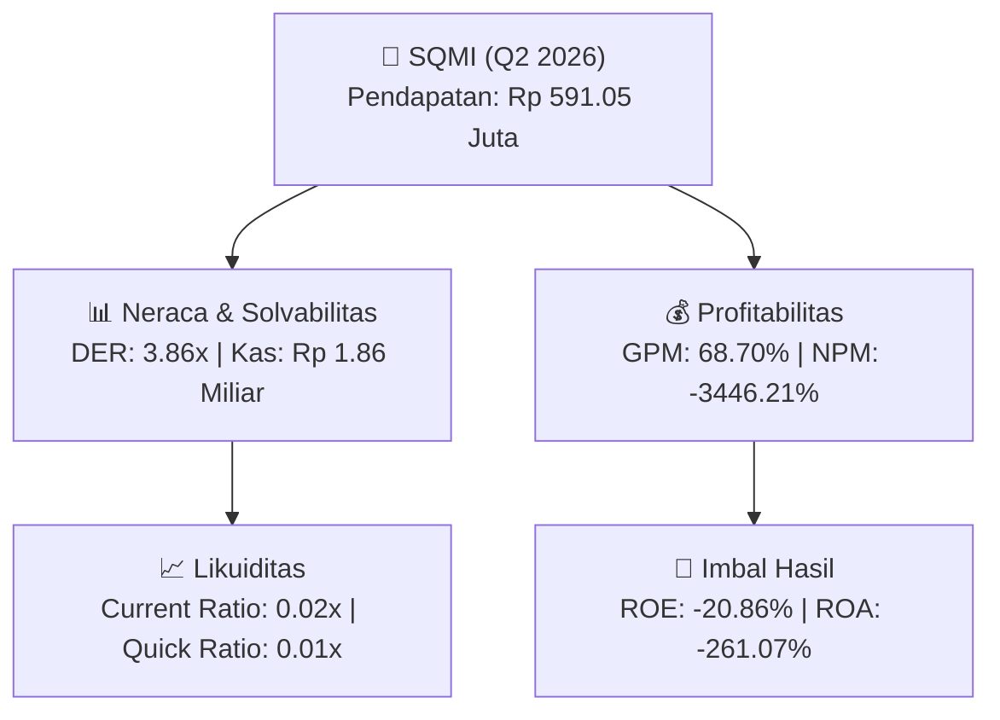

# 📈 Laporan Analisis Keuangan Mendalam: [[SQMI]] - Q2 2026

⬅️ [[knowledge-base/daily-digests/Daily_Digest_20260831|Kembali ke Daily Digest]] | 📅 **2026-08-31** | 🎛️ [[Dashboard|Ke Dashboard Utama]]

> [!IMPORTANT]
> Dokumen ini disusun secara khusus oleh **Financial Summarizer Agent** untuk menganalisis kinerja keuangan, **kesehatan neraca**, profitabilitas, dan **katalis sektor (Pertambangan)** **Wilton Makmur Indonesia Tbk ([[SQMI]])** berdasarkan Laporan Keuangan Q2 2026.

---

## 📌 1. Ikhtisar Kinerja Utama (Executive Performance Highlight)
- **Emiten**: `[[SQMI]]` (Wilton Makmur Indonesia Tbk)
- **Sektor Usaha**: `Pertambangan`
- **Periode Laporan**: `Q2 2026`
- **Pendapatan Neto (Revenue)**: `Rp 591.05 Juta` (**-36.14% 🔴 YoY** dari Rp 925.58 Juta)
- **Laba Bruto (Gross Profit)**: `Rp 406.05 Juta` (**-7.57% 🔴 YoY**)
- **Laba (Rugi) Bersih**: `Rp -20.37 Miliar` (**+50.90% 🟢 YoY**)
- **Total Aset**: `Rp 7.80 Miliar` | **Total Ekuitas**: `Rp 97.67 Miliar`

---

## 📊 2. Matriks Laba Rugi Komparatif (Income Statement)

| Pos Laba Rugi Utama (Dalam Miliar Rp) | Periode Berjalan (Q2 2026) | Periode Komparatif Lalu | Pertumbuhan YoY (%) |
| :--- | :---: | :---: | :---: |
| **Pendapatan / Penjualan Neto** | `591.05` | `925.58` | **-36.14% 🔴** |
| **Beban Pokok Pendapatan (COGS)** | `(185.00)` | `(486.30)` | -61.96% 🔴 |
| **Laba Bruto (Gross Profit)** | `406.05` | `439.28` | **-7.57% 🔴** |
| **Beban Usaha / Operasional** | `(13.52)` | `(33.21)` | -59.29% 🔴 |
| **Laba Operasional (EBIT)** | `-17.09` | `-38.70` | +55.85% 🟢 |
| **Laba (Rugi) Bersih Periode Berjalan** | **-20.37** | **-41.49** | **+50.90% 🟢** |

---

## 🏦 3. Matriks Neraca & Struktur Permodalan (Balance Sheet)

| Pos Neraca Utama (Dalam Miliar Rp) | Q2 2026 | Posisi Akhir Tahun Lalu | Perubahan YoY / YtD (%) | Catatan Analis |
| :--- | :---: | :---: | :---: | :--- |
| **Aset Lancar** | `7.80` | `7.88` | -0.95% 🔴 | Kas: Rp 1.86 Miliar |
| **Aset Tidak Lancar** | `504.53` | `505.27` | -0.15% 🔴 | Aset Tetap & Operasional |
| **TOTAL ASET** | **7.80** | **7.88** | **-0.95% 🔴** | Basis Skala Usaha |
| **Liabilitas Jangka Pendek** | `376.76` | `360.58` | +4.49% 🟢 | Utang Usaha & Kewajiban Pendek |
| **Liabilitas Jangka Panjang** | `45.54` | `41.87` | +8.78% 🟢 | Kewajiban Jangka Panjang |
| **TOTAL LIABILITAS** | **376.76** | **360.58** | **+4.49% 🟢** | Struktur Utang Terkendali |
| **TOTAL EKUITAS** | **97.67** | **118.03** | **-17.26% 🔴** | Modal Bersih Pemegang Saham |

---

## 📈 4. Analisis Rasio Keuangan Utama (Financial Ratios)

| Kategori Rasio | Metrik Rasio | Nilai Rasio | Benchmark & Status | Interpretasi Analis |
| :--- | :--- | :---: | :---: | :--- |
| **🛡️ Likuiditas** | **Current Ratio** | `0.02x` | `> 1.0x` | Kemampuan melunasi kewajiban jangka pendek |
| | **Quick Ratio** | `0.01x` | `> 0.8x` | Likuiditas kas & piutang tanpa persediaan |
| **📊 Profitabilitas** | **Gross Profit Margin (GPM)** | `68.70%` | - | Margin kotor dari operasional inti |
| | **Net Profit Margin (NPM)** | `-3446.21%` | - | Efisiensi konversi omset ke laba bersih |
| | **Return on Equity (ROE)** | `-20.86%` | - | Tingkat imbal hasil terhadap ekuitas |
| | **Return on Assets (ROA)** | `-261.07%` | - | Produktivitas aset menghasilkan laba |
| **⚖️ Solvabilitas** | **Debt to Equity Ratio (DER)** | `3.86x` | `< 2.0x` | Struktur leverage utang terhadap modal |
| | **Debt to Asset Ratio (DAR)** | `48.29x` | `< 0.7x` | Porsi pendanaan aset dari kewajiban |

---

## 🚀 5. Analisis Strategis & Karakteristik Sektor: Pertambangan

Pada periode Q2 2026, **Wilton Makmur Indonesia Tbk ([[SQMI]])** membukukan total pendapatan/penjualan sebesar **Rp 591.05 Juta** (-36.14% 🔴 YoY). Laba kotor tercatat sebesar **Rp 406.05 Juta** dengan Gross Profit Margin (GPM) sebesar **68.70%** dan laba bersih tahun berjalan sebesar **Rp -20.37 Miliar** (+50.90% 🟢 YoY).

Dari sisi neraca, perseroan memiliki total aset sebesar **Rp 7.80 Miliar** dengan ekuitas bersih **Rp 97.67 Miliar**. Rasio solvabilitas DER berada di level **3.86x**, menunjukkan struktur permodalan yang terkelola dengan rasio likuiditas Current Ratio sebesar **0.02x**.

### 🔍 Indikator Kunci Sektor (Pertambangan):
- **Karakteristik Industri Komoditas & Tambang**: Kinerja dipengaruhi oleh pergerakan Average Selling Price (ASP) komoditas global, volume produksi/pengapalan, dan efisiensi Cash Cost per ton.
- **Kekuatan Kas**: Profil arus kas operasional yang solid menopang pembagian dividen berkala dan ekspansi hilirisasi / transisi energi bersih.

---

## 💡 6. Catatan Strategis & Panduan Investor
1. **Kesehatan Permodalan**: Rasio DER tercatat **3.86x** dengan likuiditas Current Ratio **0.02x** (perlu dipantau secara disiplin).
2. **Katalis Pertumbuhan**: Pantau realisasi pendapatan semester berikutnya serta efisiensi beban usaha operasional.

---

## 🔗 Hubungan Note Terkait (Knowledge Graph)
- [[knowledge-base/daily-digests/Daily_Digest_20260831|📄 Daily Digest 2026-08-31]]
- [[knowledge-base/trading-signals/Trading_Signals_20260831|🎯 Trading Signals]]
- [[Dashboard|🎛️ Kembali ke Dashboard Utama]]
