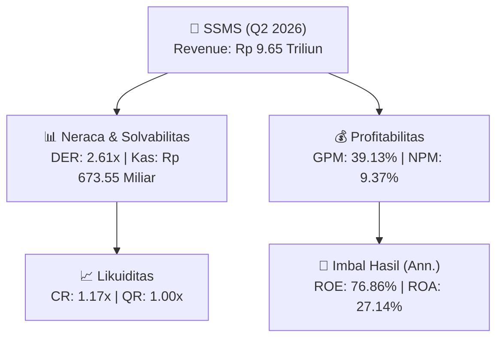
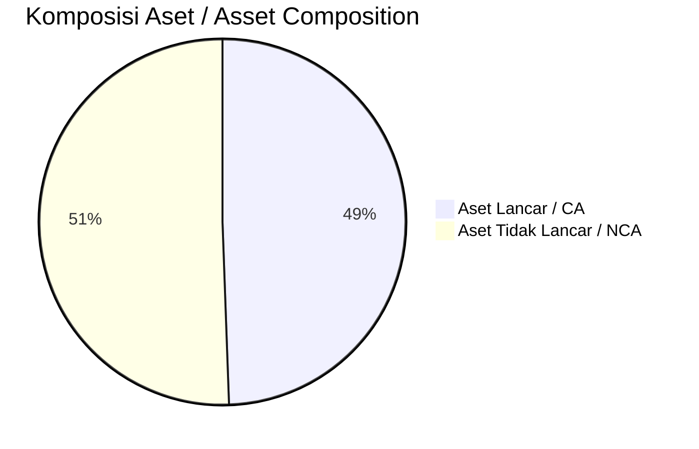
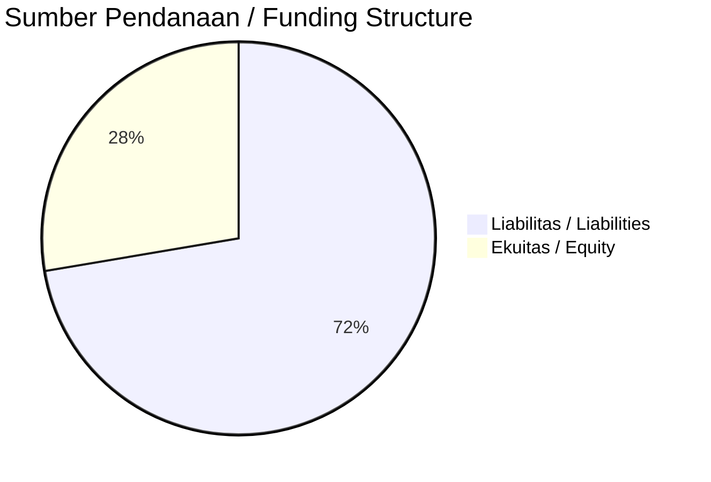

# 📈 Laporan Analisis Keuangan Mendalam: [[SSMS]] — Q2 2026

⬅️ [[knowledge-base/daily-digests/Daily_Digest_20260901|Kembali ke Daily Digest]] | 📅 **2026-09-01** | 🎛️ [[Dashboard|Ke Dashboard Utama]]

> [!IMPORTANT]
> Dokumen ini disusun oleh **Financial Summarizer Agent** untuk menganalisis kinerja keuangan, kesehatan neraca, profitabilitas, dan katalis sektor (Agrikultur) **PT Sawit Sumbermas Sarana Tbk. ([[SSMS]])** berdasarkan LK Q2 2026.

---

## 📌 1. Ikhtisar Kinerja Utama / Executive Performance Highlight
- **Emiten**: `[[SSMS]]` (PT Sawit Sumbermas Sarana Tbk.)
- **Sektor Usaha / Industry Sector**: `Agrikultur`
- **Periode Laporan / Reporting Period**: `Q2 2026`
- **Pendapatan Neto / Net Revenue**: `Rp 9.65 Triliun` (**+36.50% 🟢 YoY** dari Rp 7.07 Triliun)
- **Laba Bruto / Gross Profit**: `Rp 3.78 Triliun` (**+48.94% 🟢 YoY**)
- **Laba (Rugi) Bersih / Net Income**: `Rp 904.42 Miliar` (**+30.80% 🟢 YoY**)
- **Total Aset / Total Assets**: `Rp 7.43 Triliun` | **Total Ekuitas / Total Equity**: `Rp 2.43 Triliun`
- **EPS (Annualized)**: `1.90` | **BVPS**: `2.55`

---

## 📊 2. Laba Rugi Komparatif / Comparative Income Statement

| Pos Laba Rugi / Income Statement Item | Q2 2026 | Prior Period | YoY (%) |
| :--- | ---: | ---: | :---: |
| **Pendapatan Neto / Net Revenue** | `9.65T` | `7.07T` | **+36.50% 🟢** |
| **Beban Pokok / COGS** | `(5.88T)` | `(4.54T)` | +29.55% 🟢 |
| **Laba Bruto / Gross Profit** | `3.78T` | `2.54T` | **+48.94% 🟢** |
| **Beban Usaha / Operating Expenses** | `(574.10B)` | `(465.63B)` | +23.30% 🟢 |
| **Laba Operasional / EBIT** | `1.36T` | `998.63B` | +35.97% 🟢 |
| **Laba (Rugi) Bersih / Net Income** | **904.42B** | **691.45B** | **+30.80% 🟢** |

---

## 🏦 3. Neraca & Struktur Permodalan / Balance Sheet & Capital Structure

| Pos Neraca / Balance Sheet Item | Q2 2026 | Prior Year End | Δ YoY/YtD (%) | Catatan / Notes |
| :--- | ---: | ---: | :---: | :--- |
| **Aset Lancar / Current Assets** | `7.43T` | `5.90T` | +25.86% 🟢 | Kas: Rp 673.55 Miliar |
| **Aset Tidak Lancar / Non-Current Assets** | `7.60T` | `7.68T` | -1.06% 🔴 | Aset Tetap & Operasional |
| **TOTAL ASET / TOTAL ASSETS** | **7.43T** | **5.90T** | **+25.86% 🟢** | |
| **Liabilitas Jk. Pendek / Current Liabilities** | `6.35T` | `4.61T` | +37.65% 🟢 | |
| **Liabilitas Jk. Panjang / Non-Current Liabilities** | `5.78T` | `6.03T` | -4.12% 🔴 | |
| **TOTAL LIABILITAS / TOTAL LIABILITIES** | **6.35T** | **4.61T** | **+37.65% 🟢** | |
| **TOTAL EKUITAS / TOTAL EQUITY** | **2.43T** | **2.28T** | **+6.64% 🟢** | |

---

## 💸 4. Laporan Arus Kas / Cash Flow Statement

| Komponen Arus Kas / Cash Flow Component | Q2 2026 | Prior Period | Δ YoY (%) |
| :--- | ---: | ---: | :---: |
| **Arus Kas Operasi / CFO** | `-548.62B` | `612.32B` | -189.60% 🔴 |
| **Arus Kas Investasi / CFI** | `342.41B` | `-110.95B` | +408.61% 🟢 |
| **Arus Kas Pendanaan / CFF** | `465.60M` | `-1.09T` | +100.04% 🟢 |
| **Kenaikan (Penurunan) Kas Bersih** | `-205.74B` | `-589.88B` | +65.12% 🟢 |
| Belanja Modal / Capex | `(161.76B)` | `(41.62B)` | +288.66% 🟢 |
| Pembayaran Dividen / Dividends Paid | `(1.10T)` | `(452.16B)` | +142.91% 🟢 |
| **Free Cash Flow (CFO - Capex)** | **-710.38B** | **570.70B** | **-224.48% 🔴** |

---

## 📈 Analisis Rasio Keuangan / Financial Ratio Analysis

| Kategori / Category | Metrik / Metric | Nilai / Value | Benchmark | Interpretasi / Interpretation |
| :--- | :--- | :---: | :---: | :--- |
| **🛡️ Likuiditas** | **Current Ratio** | `1.17x` | `> 1.0x` | Kemampuan bayar kewajiban jk. pendek |
| | **Quick Ratio** | `1.00x` | `> 0.8x` | Likuiditas tanpa persediaan |
| **📊 Profitabilitas** | **Gross Profit Margin (GPM)** | `39.13%` | - | Margin kotor operasional inti |
| | **Operating Profit Margin (OPM)** | `14.07%` | - | Efisiensi operasional |
| | **Net Profit Margin (NPM)** | `9.37%` | - | Konversi revenue ke laba bersih |
| **🎯 Imbal Hasil (Ann.)** | **Return on Equity (ROE)** | `76.86%` | - | Imbal hasil terhadap ekuitas |
| | **Return on Assets (ROA)** | `27.14%` | - | Produktivitas aset |
| **⚖️ Solvabilitas** | **Debt to Equity (DER)** | `2.61x` | `< 2.0x` | Leverage utang vs modal |
| | **Debt to Asset (DAR)** | `0.85x` | `< 0.7x` | Porsi aset didanai utang |

---

## 📐 Per Share Metrics

| Metrik / Metric | Nilai / Value | Keterangan / Notes |
| :--- | ---: | :--- |
| **EPS (Annualized)** | `Rp 1.90` | Laba per saham (dianualisasi) |
| **BVPS** | `Rp 2.55` | Nilai buku per saham |

---

## 🚀 Analisis Strategis & Karakteristik Sektor / Strategic Analysis: Agrikultur

Pada periode Q2 2026, **PT Sawit Sumbermas Sarana Tbk. ([[SSMS]])** membukukan total pendapatan sebesar **Rp 9.65 Triliun** (+36.50% 🟢 YoY). Laba kotor tercatat **Rp 3.78 Triliun** dengan GPM **39.13%**. Laba bersih sebesar **Rp 904.42 Miliar** (+30.80% 🟢 YoY). Total aset **Rp 7.43 Triliun**, ekuitas **Rp 2.43 Triliun**, DER **2.61x**.

### 🔍 Indikator Kunci Sektor / Sector Key Indicators (Agrikultur)
- **Karakteristik Perkebunan & Agribisnis**: Dipengaruhi harga CPO/komoditas global, Oil Extraction Rate (OER), dan umur tanaman.
- **Efisiensi Produksi**: Pengendalian biaya pupuk, logistik, dan pemeliharaan PKS.
- **Siklus Musiman**: Produksi TBS mengikuti pola musiman curah hujan.

> [!NOTE]
> _Data Public Expose / Investor Presentation belum tersedia untuk emiten ini._

---

## 📋 Catatan Kunci Laporan Keuangan / Key Notes to Financial Statements

### 🔍 Opini Auditor / Auditor Opinion
- **Jenis Opini / Opinion Type**: `Reviu Terbatas / Limited Review`
- **KAP / Audit Firm**: `KAP Purwanto Susanti dan Surja`
- **Partner Audit**: `Daniel`
- **Tanggal Laporan / Report Date**: `2026-08-26`

---

## 💡 Catatan Strategis & Panduan Investor / Strategic Notes & Investor Guide

1. **Kesehatan Permodalan / Capital Health**: DER **2.61x**, CR **1.17x** — _perlu dipantau secara disiplin_.
2. **Katalis Pertumbuhan / Growth Catalysts**: Pantau realisasi pendapatan dan efisiensi operasional periode berikutnya.

---

## 🔗 Hubungan Note Terkait / Knowledge Graph Links
- [[knowledge-base/daily-digests/Daily_Digest_20260901|📄 Daily Digest 2026-09-01]]
- [[knowledge-base/trading-signals/Trading_Signals_20260901|🎯 Trading Signals]]
- [[Dashboard|🎛️ Kembali ke Dashboard Utama]]