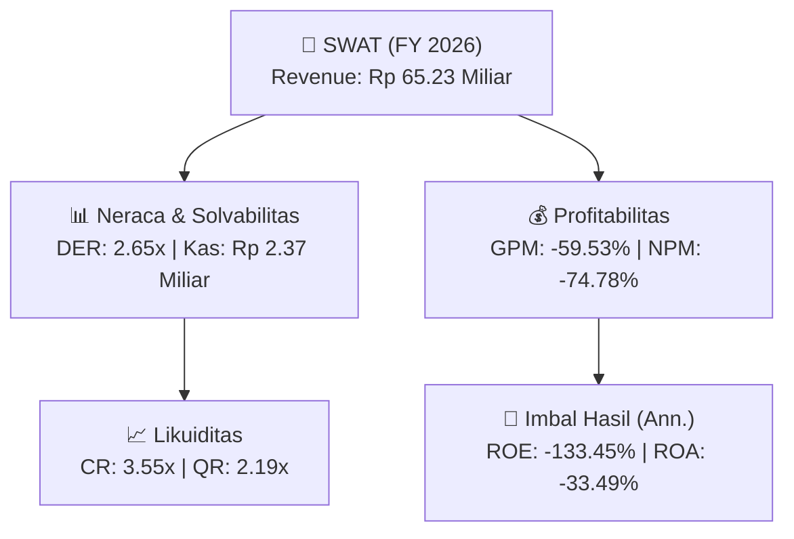
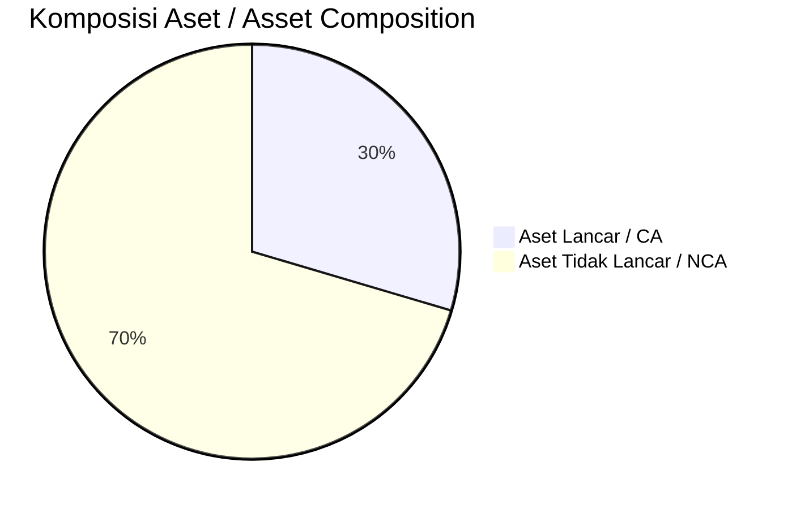
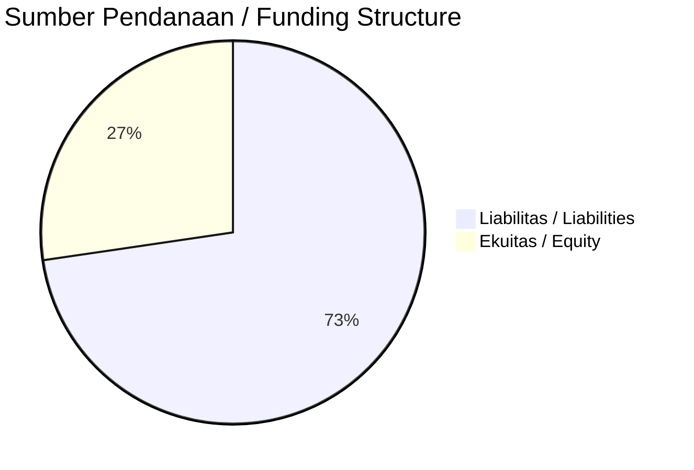

# 📈 Laporan Analisis Keuangan Tahunan Komprehensif: [[SWAT]] — FY 2026

⬅️ [[knowledge-base/daily-digests/Daily_Digest_20261007|Kembali ke Daily Digest]] | 📅 **2026-10-07** | 🎛️ [[Dashboard|Ke Dashboard Utama]]

> [!IMPORTANT]
> Dokumen ini disusun oleh **Financial Summarizer Agent** untuk menganalisis kinerja keuangan, kesehatan neraca, profitabilitas, dan katalis sektor (General) **PT Sriwahana Adityakarta Tbk. ([[SWAT]])** berdasarkan LK FY 2026.

---

## 📌 1. Ikhtisar Kinerja Utama / Executive Performance Highlight
- **Emiten**: `[[SWAT]]` (PT Sriwahana Adityakarta Tbk.)
- **Sektor Usaha / Industry Sector**: `General`
- **Periode Laporan / Reporting Period**: `FY 2026`
- **Pendapatan Neto / Net Revenue**: `Rp 65.23 Miliar` (**-63.04% 🔴 YoY** dari Rp 176.49 Miliar)
- **Laba Bruto / Gross Profit**: `Rp -38.83 Miliar` (**+30.51% 🟢 YoY**)
- **Laba (Rugi) Bersih / Net Income**: `Rp -48.78 Miliar` (**+65.80% 🟢 YoY**)
- **Total Aset / Total Assets**: `Rp 116.77 Miliar` | **Total Ekuitas / Total Equity**: `Rp 12.38 Miliar`
- **EPS (Annualized)**: `-0.16` | **BVPS**: `0.04`

---

## 📊 2. Laba Rugi Komparatif / Comparative Income Statement

| Pos Laba Rugi / Income Statement Item | FY 2026 | Prior Period | YoY (%) |
| :--- | ---: | ---: | :---: |
| **Pendapatan Neto / Net Revenue** | `65.23B` | `176.49B` | **-63.04% 🔴** |
| **Beban Pokok / COGS** | `(104.06B)` | `(232.37B)` | -55.22% 🔴 |
| **Laba Bruto / Gross Profit** | `-38.83B` | `-55.88B` | **+30.51% 🟢** |
| **Beban Usaha / Operating Expenses** | `(9.16B)` | `(19.98B)` | -54.14% 🔴 |
| **Laba Operasional / EBIT** | `-48.94B` | `-129.09B` | +62.09% 🟢 |
| **Laba (Rugi) Bersih / Net Income** | **-48.78B** | **-142.61B** | **+65.80% 🟢** |

---

## 🏦 3. Neraca & Struktur Permodalan / Balance Sheet & Capital Structure

| Pos Neraca / Balance Sheet Item | FY 2026 | Prior Year End | Δ YoY/YtD (%) | Catatan / Notes |
| :--- | ---: | ---: | :---: | :--- |
| **Aset Lancar / Current Assets** | `116.77B` | `174.51B` | -33.08% 🔴 | Kas: Rp 2.37 Miliar |
| **Aset Tidak Lancar / Non-Current Assets** | `277.87B` | `306.99B` | -9.49% 🔴 | Aset Tetap & Operasional |
| **TOTAL ASET / TOTAL ASSETS** | **116.77B** | **174.51B** | **-33.08% 🔴** | |
| **Liabilitas Jk. Pendek / Current Liabilities** | `32.87B` | `41.32B` | -20.43% 🔴 | |
| **Liabilitas Jk. Panjang / Non-Current Liabilities** | `349.31B` | `379.33B` | -7.92% 🔴 | |
| **TOTAL LIABILITAS / TOTAL LIABILITIES** | **32.87B** | **41.32B** | **-20.43% 🔴** | |
| **TOTAL EKUITAS / TOTAL EQUITY** | **12.38B** | **60.72B** | **-79.61% 🔴** | |

---

## 💸 4. Laporan Arus Kas / Cash Flow Statement

| Komponen Arus Kas / Cash Flow Component | FY 2026 | Prior Period | Δ YoY (%) |
| :--- | ---: | ---: | :---: |
| **Arus Kas Operasi / CFO** | `7.64B` | `-8.53B` | +189.61% 🟢 |
| **Arus Kas Investasi / CFI** | `1.99B` | `-450.58M` | +542.13% 🟢 |
| **Arus Kas Pendanaan / CFF** | `-15.71B` | `-4.59B` | -242.38% 🔴 |
| **Kenaikan (Penurunan) Kas Bersih** | `-6.08B` | `-13.57B` | +55.21% 🟢 |
| Belanja Modal / Capex | `(-1.99B)` | `(450.58M)` | -542.13% 🔴 |
| Pembayaran Dividen / Dividends Paid | `(-)` | `(-)` | - |
| **Free Cash Flow (CFO - Capex)** | **5.65B** | **-8.98B** | **+162.92% 🟢** |

---

## 📈 Analisis Rasio Keuangan / Financial Ratio Analysis

| Kategori / Category | Metrik / Metric | Nilai / Value | Benchmark | Interpretasi / Interpretation |
| :--- | :--- | :---: | :---: | :--- |
| **🛡️ Likuiditas** | **Current Ratio** | `3.55x` | `> 1.0x` | Kemampuan bayar kewajiban jk. pendek |
| | **Quick Ratio** | `2.19x` | `> 0.8x` | Likuiditas tanpa persediaan |
| **📊 Profitabilitas** | **Gross Profit Margin (GPM)** | `-59.53%` | - | Margin kotor operasional inti |
| | **Operating Profit Margin (OPM)** | `-75.03%` | - | Efisiensi operasional |
| | **Net Profit Margin (NPM)** | `-74.78%` | - | Konversi revenue ke laba bersih |
| **🎯 Imbal Hasil (Ann.)** | **Return on Equity (ROE)** | `-133.45%` | - | Imbal hasil terhadap ekuitas |
| | **Return on Assets (ROA)** | `-33.49%` | - | Produktivitas aset |
| **⚖️ Solvabilitas** | **Debt to Equity (DER)** | `2.65x` | `< 2.0x` | Leverage utang vs modal |
| | **Debt to Asset (DAR)** | `0.28x` | `< 0.7x` | Porsi aset didanai utang |

---

## 📐 Per Share Metrics

| Metrik / Metric | Nilai / Value | Keterangan / Notes |
| :--- | ---: | :--- |
| **EPS (Annualized)** | `Rp -0.16` | Laba per saham (dianualisasi) |
| **BVPS** | `Rp 0.04` | Nilai buku per saham |

---

## 🚀 Analisis Strategis & Karakteristik Sektor / Strategic Analysis: General

Pada periode FY 2026, **PT Sriwahana Adityakarta Tbk. ([[SWAT]])** membukukan total pendapatan sebesar **Rp 65.23 Miliar** (-63.04% 🔴 YoY). Laba kotor tercatat **Rp -38.83 Miliar** dengan GPM **-59.53%**. Laba bersih sebesar **Rp -48.78 Miliar** (+65.80% 🟢 YoY). Total aset **Rp 116.77 Miliar**, ekuitas **Rp 12.38 Miliar**, DER **2.65x**.

### 🔍 Indikator Kunci Sektor / Sector Key Indicators (General)
- **Karakteristik Industri (General)**: Kinerja mencerminkan dinamika penyerapan pasar, utilisasi kapasitas produksi, dan efisiensi biaya pokok.
- **Faktor Penggerak**: Pertumbuhan organik, efisiensi operasional, dan ekspansi pasar.

### 📋 Data Operasional dari Public Expose / Operational Data from Public Expose
> Sumber: `SWAT_Public_Expose_20260913.md`

- ****Tanggal Public Expose****: `11 September 2026`
- ****Tempat****: `Hotel Aston Solo, Surakarta`
- ****Jumlah Peserta****: `10 orang (tidak termasuk manajemen)`
- ****Kehadiran Direksi****: `Direktur Utama berhalangan hadir`
- ****Kehadiran Komisaris****: `Komisaris Utama hadir (Sri Hetti Turinani)`
- ****Materi Paparan****: `Profil perusahaan dan kinerja keuangan 2025`
- ****Sesi Tanya Jawab****: `Tidak ada pertanyaan dari peserta`

---

## 📋 Catatan Kunci Laporan Keuangan / Key Notes to Financial Statements

### 🔍 Opini Auditor / Auditor Opinion
- **Jenis Opini / Opinion Type**: `Wajar Dengan Pengecualian / Qualified`
- **KAP / Audit Firm**: `KAP Herman, Dody, Tanumihardja  Rekan`
- **Partner Audit**: `Dody Hapsoro`
- **Tanggal Laporan / Report Date**: `2026-09-04`

### 📝 Perjanjian & Kontrak Signifikan / Key Contracts & Agreements
- Perusahaan memiliki fasilitas kredit dari PT Bank Negara Indonesia (Persero) Tbk (BNI) dengan pembatasan (negative covenants) antara lain: mengubah bentuk atau status hukum Perusahaan, mengubah anggaran dasar (kecuali menambah modal Perusahaan), mengalihkan saham timbal balik atau saham Perusahaan baik antar pemegang saham maupun kepada pihak lain yang mengakibatkan perubahan pemegang saham dominan; menggunakan dana Perusahaan untuk tujuan di luar usaha yang dibiayai fasilitas kredit BNI; membuat perjanjian ... (teks terpotong).
- Grup menjual batubara dengan syarat Free on Board (FOB) dan Cost, Insurance and Freight (CIF). Untuk penjualan CIF, berdasarkan perjanjian penjualan, kepemilikan dan risiko kerugian atas batubara tetap berada pada Grup sampai batubara melewati pelabuhan bongkar.

---

## 💡 Catatan Strategis & Panduan Investor / Strategic Notes & Investor Guide

1. **Kesehatan Permodalan / Capital Health**: DER **2.65x**, CR **3.55x** — _perlu dipantau secara disiplin_.
2. **Katalis Pertumbuhan / Growth Catalysts**: Pantau realisasi pendapatan dan efisiensi operasional periode berikutnya.

---

## 📊 Trend Multi-Tahun / Multi-Year Trend

> [!NOTE]
> _Tabel trend multi-tahun (3 tahun) akan tersedia setelah data historis FY sebelumnya diproses._

---
## 🔗 Hubungan Note Terkait / Knowledge Graph Links
- [[knowledge-base/daily-digests/Daily_Digest_20261007|📄 Daily Digest 2026-10-07]]
- [[knowledge-base/trading-signals/Trading_Signals_20261007|🎯 Trading Signals]]
- [[Dashboard|🎛️ Kembali ke Dashboard Utama]]