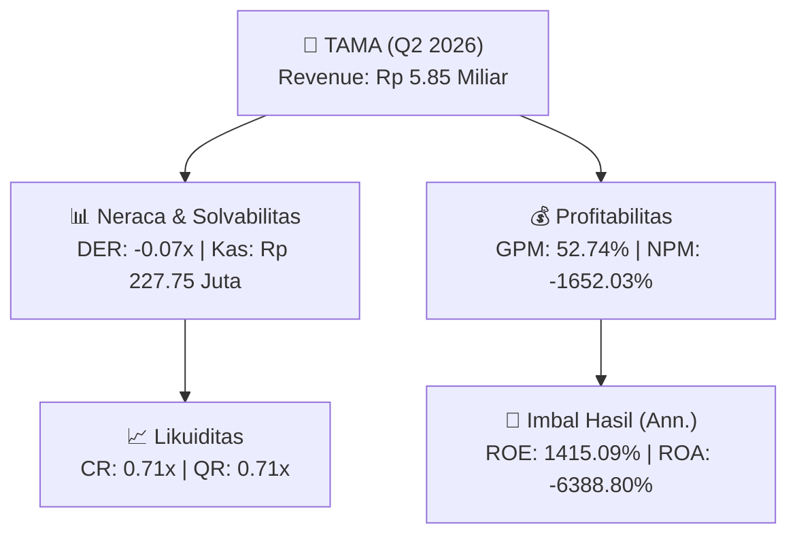
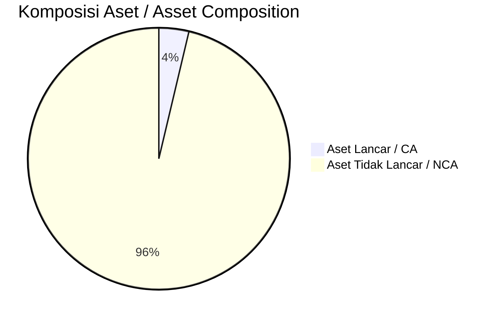
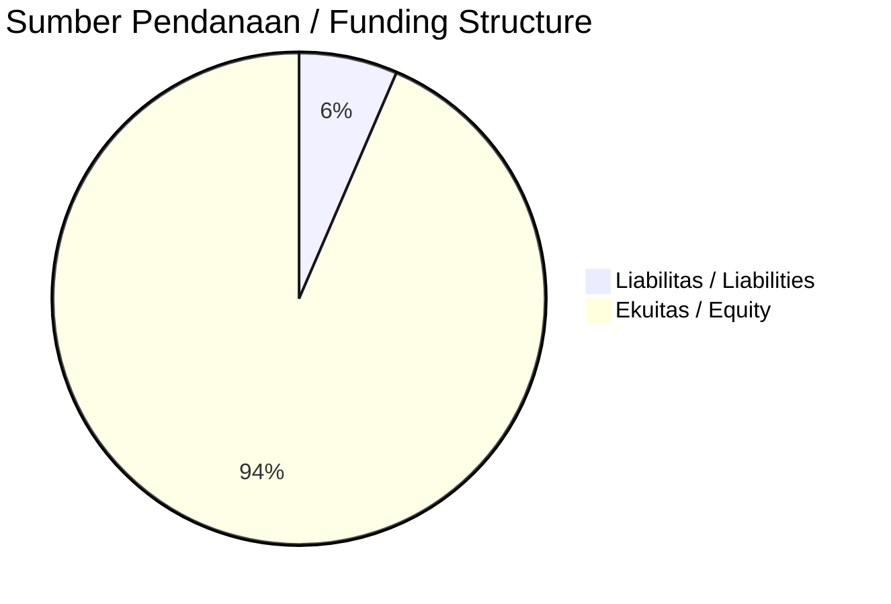

# 📈 Laporan Analisis Keuangan Mendalam: [[TAMA]] — Q2 2026

⬅️ [[knowledge-base/daily-digests/Daily_Digest_20260902|Kembali ke Daily Digest]] | 📅 **2026-09-02** | 🎛️ [[Dashboard|Ke Dashboard Utama]]

> [!IMPORTANT]
> Dokumen ini disusun oleh **Financial Summarizer Agent** untuk menganalisis kinerja keuangan, kesehatan neraca, profitabilitas, dan katalis sektor (Infrastruktur & Transportasi) **PT Lancartama Sejati Tbk. ([[TAMA]])** berdasarkan LK Q2 2026.

---

## 📌 1. Ikhtisar Kinerja Utama / Executive Performance Highlight
- **Emiten**: `[[TAMA]]` (PT Lancartama Sejati Tbk.)
- **Sektor Usaha / Industry Sector**: `Infrastruktur & Transportasi`
- **Periode Laporan / Reporting Period**: `Q2 2026`
- **Pendapatan Neto / Net Revenue**: `Rp 5.85 Miliar` (**-58.37% 🔴 YoY** dari Rp 14.05 Miliar)
- **Laba Bruto / Gross Profit**: `Rp 3.09 Miliar` (**-46.19% 🔴 YoY**)
- **Laba (Rugi) Bersih / Net Income**: `Rp -96.64 Miliar` (**-2118.51% 🔴 YoY**)
- **Total Aset / Total Assets**: `Rp 3.06 Miliar` | **Total Ekuitas / Total Equity**: `Rp -61.98 Miliar`
- **EPS (Annualized)**: `-6.44` | **BVPS**: `-2.07`

---

## 📊 2. Laba Rugi Komparatif / Comparative Income Statement

| Pos Laba Rugi / Income Statement Item | Q2 2026 | Prior Period | YoY (%) |
| :--- | ---: | ---: | :---: |
| **Pendapatan Neto / Net Revenue** | `5.85B` | `14.05B` | **-58.37% 🔴** |
| **Beban Pokok / COGS** | `(2.76B)` | `(8.32B)` | -66.76% 🔴 |
| **Laba Bruto / Gross Profit** | `3.09B` | `5.73B` | **-46.19% 🔴** |
| **Beban Usaha / Operating Expenses** | `(2.65B)` | `(2.84B)` | -6.87% 🔴 |
| **Laba Operasional / EBIT** | `-96.48B` | `-3.99B` | -2319.65% 🔴 |
| **Laba (Rugi) Bersih / Net Income** | **-96.64B** | **-4.36B** | **-2118.51% 🔴** |

---

## 🏦 3. Neraca & Struktur Permodalan / Balance Sheet & Capital Structure

| Pos Neraca / Balance Sheet Item | Q2 2026 | Prior Year End | Δ YoY/YtD (%) | Catatan / Notes |
| :--- | ---: | ---: | :---: | :--- |
| **Aset Lancar / Current Assets** | `3.06B` | `2.99B` | +2.57% 🟢 | Kas: Rp 227.75 Juta |
| **Aset Tidak Lancar / Non-Current Assets** | `79.69B` | `171.87B` | -53.63% 🔴 | Aset Tetap & Operasional |
| **TOTAL ASET / TOTAL ASSETS** | **3.06B** | **2.99B** | **+2.57% 🟢** | |
| **Liabilitas Jk. Pendek / Current Liabilities** | `4.29B` | `53.09B` | -91.93% 🔴 | |
| **Liabilitas Jk. Panjang / Non-Current Liabilities** | `140.44B` | `87.10B` | +61.24% 🟢 | |
| **TOTAL LIABILITAS / TOTAL LIABILITIES** | **4.29B** | **53.09B** | **-91.93% 🔴** | |
| **TOTAL EKUITAS / TOTAL EQUITY** | **-61.98B** | **34.66B** | **-278.81% 🔴** | |

---

## 💸 4. Laporan Arus Kas / Cash Flow Statement

| Komponen Arus Kas / Cash Flow Component | Q2 2026 | Prior Period | Δ YoY (%) |
| :--- | ---: | ---: | :---: |
| **Arus Kas Operasi / CFO** | `-2.82B` | `3.47B` | -181.33% 🔴 |
| **Arus Kas Investasi / CFI** | `-` | `-` | - |
| **Arus Kas Pendanaan / CFF** | `2.85B` | `-3.81B` | +174.85% 🟢 |
| **Kenaikan (Penurunan) Kas Bersih** | `30.71M` | `-341.37M` | +109.00% 🟢 |
| Belanja Modal / Capex | `(-)` | `(-)` | - |
| Pembayaran Dividen / Dividends Paid | `(-)` | `(-)` | - |
| **Free Cash Flow (CFO - Capex)** | **-** | **-** | **-** |

---

## 📈 Analisis Rasio Keuangan / Financial Ratio Analysis

| Kategori / Category | Metrik / Metric | Nilai / Value | Benchmark | Interpretasi / Interpretation |
| :--- | :--- | :---: | :---: | :--- |
| **🛡️ Likuiditas** | **Current Ratio** | `0.71x` | `> 1.0x` | Kemampuan bayar kewajiban jk. pendek |
| | **Quick Ratio** | `0.71x` | `> 0.8x` | Likuiditas tanpa persediaan |
| **📊 Profitabilitas** | **Gross Profit Margin (GPM)** | `52.74%` | - | Margin kotor operasional inti |
| | **Operating Profit Margin (OPM)** | `-1649.42%` | - | Efisiensi operasional |
| | **Net Profit Margin (NPM)** | `-1652.03%` | - | Konversi revenue ke laba bersih |
| **🎯 Imbal Hasil (Ann.)** | **Return on Equity (ROE)** | `1415.09%` | - | Imbal hasil terhadap ekuitas |
| | **Return on Assets (ROA)** | `-6388.80%` | - | Produktivitas aset |
| **⚖️ Solvabilitas** | **Debt to Equity (DER)** | `-0.07x` | `< 2.0x` | Leverage utang vs modal |
| | **Debt to Asset (DAR)** | `1.40x` | `< 0.7x` | Porsi aset didanai utang |

---

## 📐 Per Share Metrics

| Metrik / Metric | Nilai / Value | Keterangan / Notes |
| :--- | ---: | :--- |
| **EPS (Annualized)** | `Rp -6.44` | Laba per saham (dianualisasi) |
| **BVPS** | `Rp -2.07` | Nilai buku per saham |

---

## 🚀 Analisis Strategis & Karakteristik Sektor / Strategic Analysis: Infrastruktur & Transportasi

Pada periode Q2 2026, **PT Lancartama Sejati Tbk. ([[TAMA]])** membukukan total pendapatan sebesar **Rp 5.85 Miliar** (-58.37% 🔴 YoY). Laba kotor tercatat **Rp 3.09 Miliar** dengan GPM **52.74%**. Laba bersih sebesar **Rp -96.64 Miliar** (-2118.51% 🔴 YoY). Total aset **Rp 3.06 Miliar**, ekuitas **Rp -61.98 Miliar**, DER **-0.07x**.

### 🔍 Indikator Kunci Sektor / Sector Key Indicators (Infrastruktur & Transportasi)
- **Karakteristik Infrastruktur & Transportasi**: Kinerja didorong oleh pertumbuhan volume Lalu Lintas Harian Rata-rata (LHR) dan penyesuaian tarif berkala.
- **Struktur Leverage / Leverage Structure**: Pengelolaan liabilitas jangka panjang yang terukur seiring masa konsesi.
- **Recurring Revenue**: Pendapatan tol/sewa/transport bersifat recurring dan predictable.

> [!NOTE]
> _Data Public Expose / Investor Presentation belum tersedia untuk emiten ini._

---

## 📋 Catatan Kunci Laporan Keuangan / Key Notes to Financial Statements

### 🔍 Opini Auditor / Auditor Opinion
- **Jenis Opini / Opinion Type**: `Reviu Terbatas / Limited Review`
- **KAP / Audit Firm**: `KAP Kanaka Puradiredja, Suhartono`
- **Partner Audit**: `T. Siddharta`
- **Tanggal Laporan / Report Date**: `2026-08-31`

---

## 💡 Catatan Strategis & Panduan Investor / Strategic Notes & Investor Guide

1. **Kesehatan Permodalan / Capital Health**: DER **-0.07x**, CR **0.71x** — _perlu dipantau secara disiplin_.
2. **Katalis Pertumbuhan / Growth Catalysts**: Pantau realisasi pendapatan dan efisiensi operasional periode berikutnya.

---

## 🔗 Hubungan Note Terkait / Knowledge Graph Links
- [[knowledge-base/daily-digests/Daily_Digest_20260902|📄 Daily Digest 2026-09-02]]
- [[knowledge-base/trading-signals/Trading_Signals_20260902|🎯 Trading Signals]]
- [[Dashboard|🎛️ Kembali ke Dashboard Utama]]