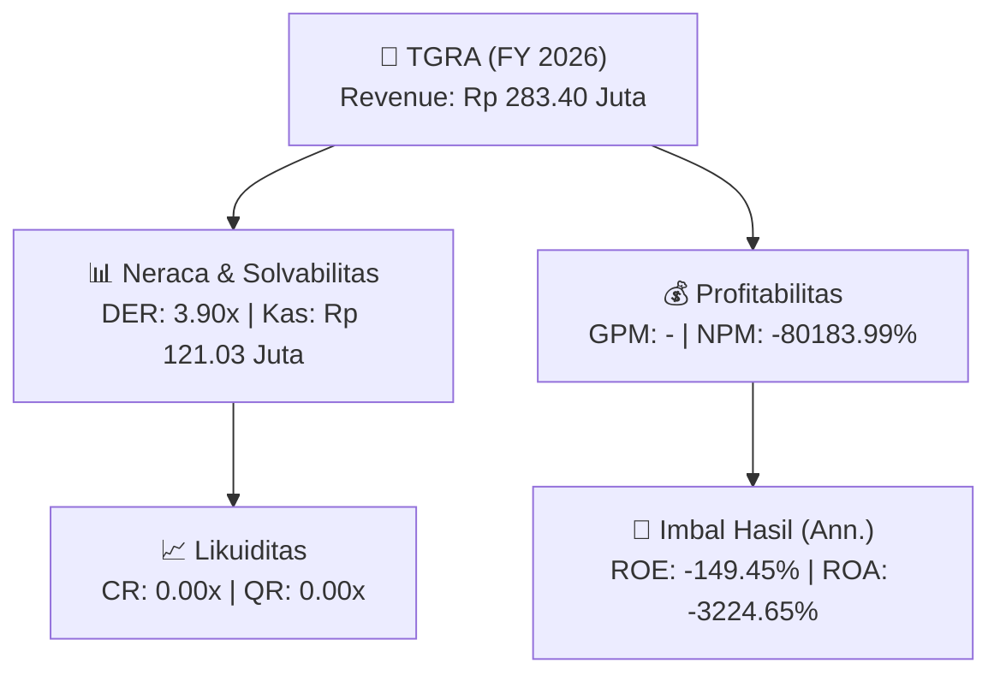
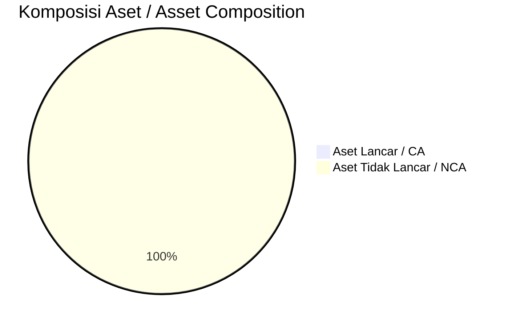
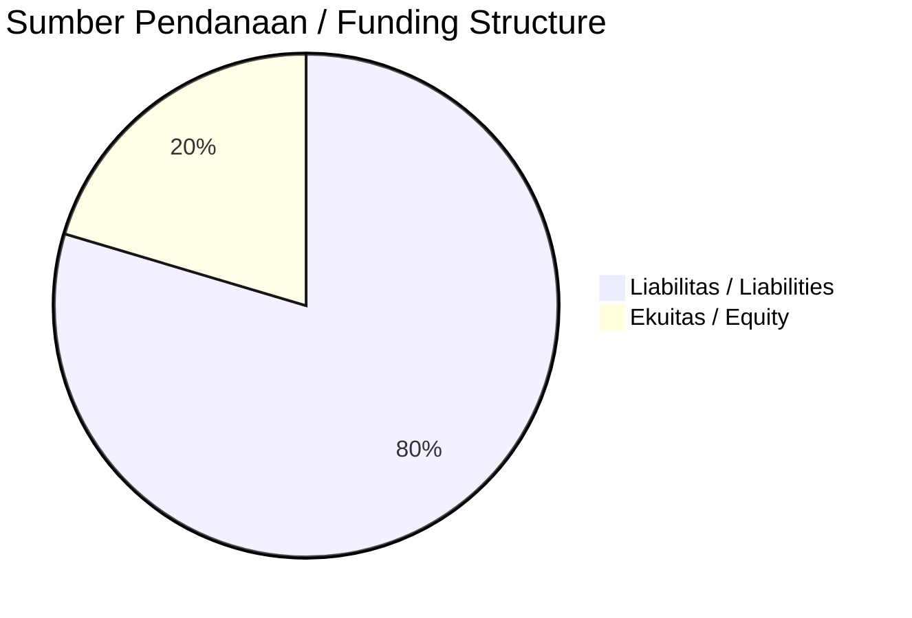

# 📈 Laporan Analisis Keuangan Tahunan Komprehensif: [[TGRA]] — FY 2026

⬅️ [[knowledge-base/daily-digests/Daily_Digest_20260929|Kembali ke Daily Digest]] | 📅 **2026-09-29** | 🎛️ [[Dashboard|Ke Dashboard Utama]]

> [!IMPORTANT]
> Dokumen ini disusun oleh **Financial Summarizer Agent** untuk menganalisis kinerja keuangan, kesehatan neraca, profitabilitas, dan katalis sektor (Infrastruktur & Transportasi) **PT Terregra Asia Energy ([[TGRA]])** berdasarkan LK FY 2026.

---

## 📌 1. Ikhtisar Kinerja Utama / Executive Performance Highlight
- **Emiten**: `[[TGRA]]` (PT Terregra Asia Energy)
- **Sektor Usaha / Industry Sector**: `Infrastruktur & Transportasi`
- **Periode Laporan / Reporting Period**: `FY 2026`
- **Pendapatan Neto / Net Revenue**: `Rp 283.40 Juta` (**+508.16% 🟢 YoY** dari Rp 46.60 Juta)

- **Laba (Rugi) Bersih / Net Income**: `Rp -227.25 Miliar` (**-883.81% 🔴 YoY**)
- **Total Aset / Total Assets**: `Rp 168.70 Juta` | **Total Ekuitas / Total Equity**: `Rp 38.54 Miliar`
- **EPS (Annualized)**: `-0.83` | **BVPS**: `0.14`

---

## 📊 2. Laba Rugi Komparatif / Comparative Income Statement

| Pos Laba Rugi / Income Statement Item | FY 2026 | Prior Period | YoY (%) |
| :--- | ---: | ---: | :---: |
| **Pendapatan Neto / Net Revenue** | `283.40M` | `46.60M` | **+508.16% 🟢** |
| **Beban Pokok / COGS** | `(-)` | `(-)` | - |
| **Laba Bruto / Gross Profit** | `-` | `-` | **-** |
| **Beban Usaha / Operating Expenses** | `(6.98B)` | `(13.80B)` | -49.40% 🔴 |
| **Laba Operasional / EBIT** | `-257.29B` | `-25.89B` | -893.79% 🔴 |
| **Laba (Rugi) Bersih / Net Income** | **-227.25B** | **-23.10B** | **-883.81% 🔴** |

---

## 🏦 3. Neraca & Struktur Permodalan / Balance Sheet & Capital Structure

| Pos Neraca / Balance Sheet Item | FY 2026 | Prior Year End | Δ YoY/YtD (%) | Catatan / Notes |
| :--- | ---: | ---: | :---: | :--- |
| **Aset Lancar / Current Assets** | `168.70M` | `13.93B` | -98.79% 🔴 | Kas: Rp 121.03 Juta |
| **Aset Tidak Lancar / Non-Current Assets** | `206.29B` | `444.66B` | -53.61% 🔴 | Aset Tetap & Operasional |
| **TOTAL ASET / TOTAL ASSETS** | **168.70M** | **13.93B** | **-98.79% 🔴** | |
| **Liabilitas Jk. Pendek / Current Liabilities** | `150.40B` | `143.93B` | +4.50% 🟢 | |
| **Liabilitas Jk. Panjang / Non-Current Liabilities** | `4.63B` | `3.94B` | +17.55% 🟢 | |
| **TOTAL LIABILITAS / TOTAL LIABILITIES** | **150.40B** | **143.93B** | **+4.50% 🟢** | |
| **TOTAL EKUITAS / TOTAL EQUITY** | **38.54B** | **265.57B** | **-85.49% 🔴** | |

---

## 💸 4. Laporan Arus Kas / Cash Flow Statement

| Komponen Arus Kas / Cash Flow Component | FY 2026 | Prior Period | Δ YoY (%) |
| :--- | ---: | ---: | :---: |
| **Arus Kas Operasi / CFO** | `-7.59B` | `-4.57B` | -65.94% 🔴 |
| **Arus Kas Investasi / CFI** | `388.72M` | `-2.49B` | +115.64% 🟢 |
| **Arus Kas Pendanaan / CFF** | `7.06B` | `6.49B` | +8.83% 🟢 |
| **Kenaikan (Penurunan) Kas Bersih** | `-133.83M` | `-566.81M` | +76.39% 🟢 |
| Belanja Modal / Capex | `(-)` | `(2.30B)` | - |
| Pembayaran Dividen / Dividends Paid | `(-)` | `(-)` | - |
| **Free Cash Flow (CFO - Capex)** | **-** | **-6.87B** | **-** |

---

## 📈 Analisis Rasio Keuangan / Financial Ratio Analysis

| Kategori / Category | Metrik / Metric | Nilai / Value | Benchmark | Interpretasi / Interpretation |
| :--- | :--- | :---: | :---: | :--- |
| **🛡️ Likuiditas** | **Current Ratio** | `0.00x` | `> 1.0x` | Kemampuan bayar kewajiban jk. pendek |
| | **Quick Ratio** | `0.00x` | `> 0.8x` | Likuiditas tanpa persediaan |
| **📊 Profitabilitas** | **Gross Profit Margin (GPM)** | `-` | - | Margin kotor operasional inti |
| | **Operating Profit Margin (OPM)** | `-90784.51%` | - | Efisiensi operasional |
| | **Net Profit Margin (NPM)** | `-80183.99%` | - | Konversi revenue ke laba bersih |
| **🎯 Imbal Hasil (Ann.)** | **Return on Equity (ROE)** | `-149.45%` | - | Imbal hasil terhadap ekuitas |
| | **Return on Assets (ROA)** | `-3224.65%` | - | Produktivitas aset |
| **⚖️ Solvabilitas** | **Debt to Equity (DER)** | `3.90x` | `< 2.0x` | Leverage utang vs modal |
| | **Debt to Asset (DAR)** | `891.55x` | `< 0.7x` | Porsi aset didanai utang |

---

## 📐 Per Share Metrics

| Metrik / Metric | Nilai / Value | Keterangan / Notes |
| :--- | ---: | :--- |
| **EPS (Annualized)** | `Rp -0.83` | Laba per saham (dianualisasi) |
| **BVPS** | `Rp 0.14` | Nilai buku per saham |

---

## 🚀 Analisis Strategis & Karakteristik Sektor / Strategic Analysis: Infrastruktur & Transportasi

Pada periode FY 2026, **PT Terregra Asia Energy ([[TGRA]])** membukukan total pendapatan sebesar **Rp 283.40 Juta** (+508.16% 🟢 YoY). Laba kotor tercatat **-** dengan GPM **-**. Laba bersih sebesar **Rp -227.25 Miliar** (-883.81% 🔴 YoY). Total aset **Rp 168.70 Juta**, ekuitas **Rp 38.54 Miliar**, DER **3.90x**.

### 🔍 Indikator Kunci Sektor / Sector Key Indicators (Infrastruktur & Transportasi)
- **Karakteristik Infrastruktur & Transportasi**: Kinerja didorong oleh pertumbuhan volume Lalu Lintas Harian Rata-rata (LHR) dan penyesuaian tarif berkala.
- **Struktur Leverage / Leverage Structure**: Pengelolaan liabilitas jangka panjang yang terukur seiring masa konsesi.
- **Recurring Revenue**: Pendapatan tol/sewa/transport bersifat recurring dan predictable.

> [!NOTE]
> _Data Public Expose / Investor Presentation belum tersedia untuk emiten ini._

---

## 📋 Catatan Kunci Laporan Keuangan / Key Notes to Financial Statements

### 🔍 Opini Auditor / Auditor Opinion
- **Jenis Opini / Opinion Type**: `Wajar Tanpa Modifikasian / Unqualified`
- **KAP / Audit Firm**: `KAP Irwanto dan Rekan`
- **Partner Audit**: `Nino Berlianto`
- **Tanggal Laporan / Report Date**: `2026-09-01`

---

## 💡 Catatan Strategis & Panduan Investor / Strategic Notes & Investor Guide

1. **Kesehatan Permodalan / Capital Health**: DER **3.90x**, CR **0.00x** — _perlu dipantau secara disiplin_.
2. **Katalis Pertumbuhan / Growth Catalysts**: Pantau realisasi pendapatan dan efisiensi operasional periode berikutnya.

---

## 📊 Trend Multi-Tahun / Multi-Year Trend

> [!NOTE]
> _Tabel trend multi-tahun (3 tahun) akan tersedia setelah data historis FY sebelumnya diproses._

---
## 🔗 Hubungan Note Terkait / Knowledge Graph Links
- [[knowledge-base/daily-digests/Daily_Digest_20260929|📄 Daily Digest 2026-09-29]]
- [[knowledge-base/trading-signals/Trading_Signals_20260929|🎯 Trading Signals]]
- [[Dashboard|🎛️ Kembali ke Dashboard Utama]]