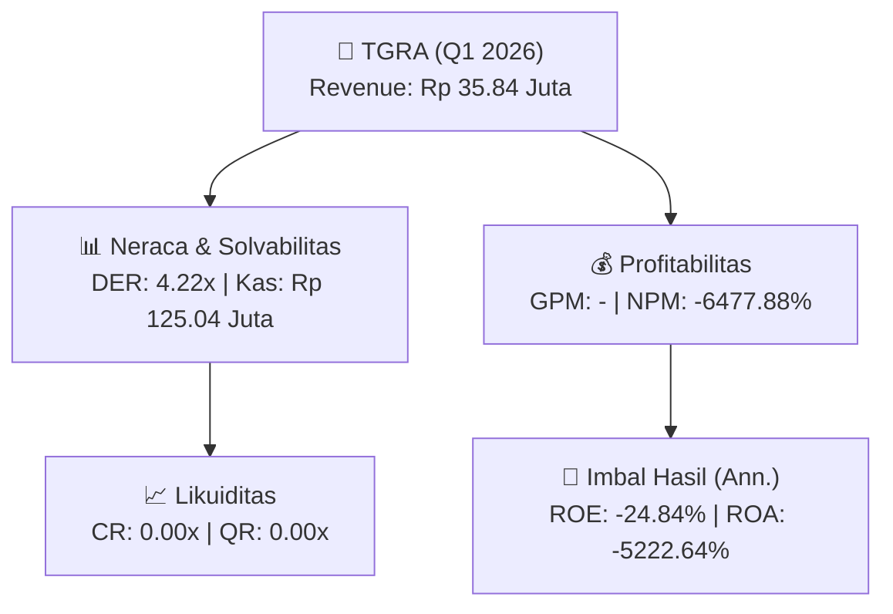

# 📈 Laporan Keuangan Interim: [[TGRA]] — Q1 2026

📅 **2026-09-30** | 🎛️ [[Dashboard|Ke Dashboard Utama]]

> [!NOTE]
> Laporan interim ringkas **PT Terregra Asia Energy ([[TGRA]])** — Sektor: Infrastruktur & Transportasi.

---

## 📌 1. Ikhtisar Kinerja Utama / Executive Performance Highlight
- **Emiten**: `[[TGRA]]` (PT Terregra Asia Energy)
- **Sektor Usaha / Industry Sector**: `Infrastruktur & Transportasi`
- **Periode Laporan / Reporting Period**: `Q1 2026`
- **Pendapatan Neto / Net Revenue**: `Rp 35.84 Juta` (**-50.66% 🔴 YoY** dari Rp 72.64 Juta)

- **Laba (Rugi) Bersih / Net Income**: `Rp -2.32 Miliar` (**+11.75% 🟢 YoY**)
- **Total Aset / Total Assets**: `Rp 186.94 Juta` | **Total Ekuitas / Total Equity**: `Rp 36.22 Miliar`
- **EPS (Annualized)**: `-0.03` | **BVPS**: `0.13`

---

## 📊 2. Laba Rugi Komparatif / Comparative Income Statement

| Pos Laba Rugi / Income Statement Item | Q1 2026 | Prior Period | YoY (%) |
| :--- | ---: | ---: | :---: |
| **Pendapatan Neto / Net Revenue** | `35.84M` | `72.64M` | **-50.66% 🔴** |
| **Beban Pokok / COGS** | `(-)` | `(-)` | - |
| **Laba Bruto / Gross Profit** | `-` | `-` | **-** |
| **Beban Usaha / Operating Expenses** | `(1.28B)` | `(1.36B)` | -6.01% 🔴 |
| **Laba Operasional / EBIT** | `-2.41B` | `-2.76B` | +12.48% 🟢 |
| **Laba (Rugi) Bersih / Net Income** | **-2.32B** | **-2.63B** | **+11.75% 🟢** |

---

## 🏦 3. Neraca & Struktur Permodalan / Balance Sheet & Capital Structure

| Pos Neraca / Balance Sheet Item | Q1 2026 | Prior Year End | Δ YoY/YtD (%) | Catatan / Notes |
| :--- | ---: | ---: | :---: | :--- |
| **Aset Lancar / Current Assets** | `186.94M` | `168.70M` | +10.81% 🟢 | Kas: Rp 125.04 Juta |
| **Aset Tidak Lancar / Non-Current Assets** | `206.29B` | `206.29B` | 0.00% ⚪ | Aset Tetap & Operasional |
| **TOTAL ASET / TOTAL ASSETS** | **186.94M** | **168.70M** | **+10.81% 🟢** | |
| **Liabilitas Jk. Pendek / Current Liabilities** | `152.83B` | `150.40B` | +1.62% 🟢 | |
| **Liabilitas Jk. Panjang / Non-Current Liabilities** | `4.63B` | `4.63B` | 0.00% ⚪ | |
| **TOTAL LIABILITAS / TOTAL LIABILITIES** | **152.83B** | **150.40B** | **+1.62% 🟢** | |
| **TOTAL EKUITAS / TOTAL EQUITY** | **36.22B** | **38.54B** | **-6.02% 🔴** | |

---

## 📈 Analisis Rasio Keuangan / Financial Ratio Analysis

| Kategori / Category | Metrik / Metric | Nilai / Value | Benchmark | Interpretasi / Interpretation |
| :--- | :--- | :---: | :---: | :--- |
| **🛡️ Likuiditas** | **Current Ratio** | `0.00x` | `> 1.0x` | Kemampuan bayar kewajiban jk. pendek |
| | **Quick Ratio** | `0.00x` | `> 0.8x` | Likuiditas tanpa persediaan |
| **📊 Profitabilitas** | **Gross Profit Margin (GPM)** | `-` | - | Margin kotor operasional inti |
| | **Operating Profit Margin (OPM)** | `-6729.98%` | - | Efisiensi operasional |
| | **Net Profit Margin (NPM)** | `-6477.88%` | - | Konversi revenue ke laba bersih |
| **🎯 Imbal Hasil (Ann.)** | **Return on Equity (ROE)** | `-24.84%` | - | Imbal hasil terhadap ekuitas |
| | **Return on Assets (ROA)** | `-5222.64%` | - | Produktivitas aset |
| **⚖️ Solvabilitas** | **Debt to Equity (DER)** | `4.22x` | `< 2.0x` | Leverage utang vs modal |
| | **Debt to Asset (DAR)** | `817.55x` | `< 0.7x` | Porsi aset didanai utang |

---

## 🔗 Hubungan Note Terkait / Knowledge Graph Links
- [[knowledge-base/daily-digests/Daily_Digest_20260930|📄 Daily Digest 2026-09-30]]
- [[knowledge-base/trading-signals/Trading_Signals_20260930|🎯 Trading Signals]]
- [[Dashboard|🎛️ Kembali ke Dashboard Utama]]