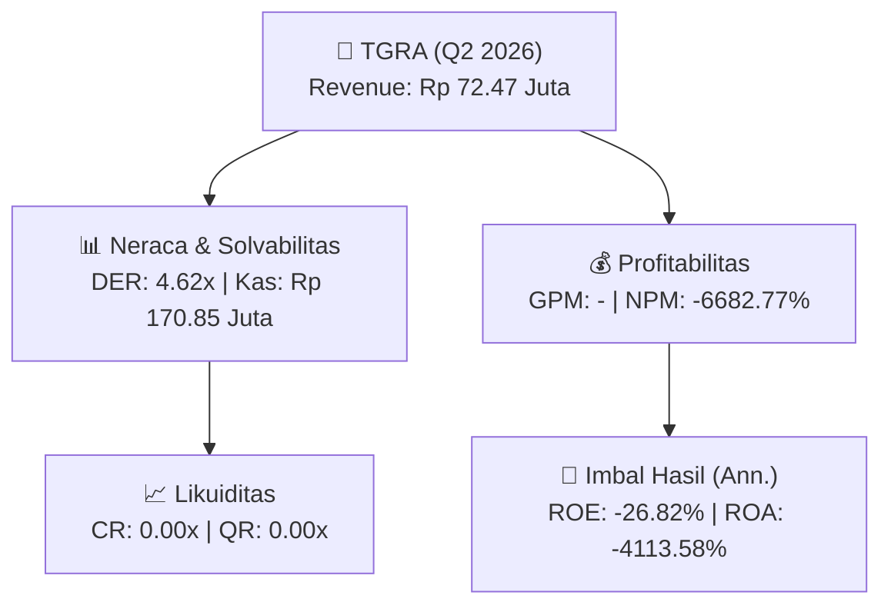
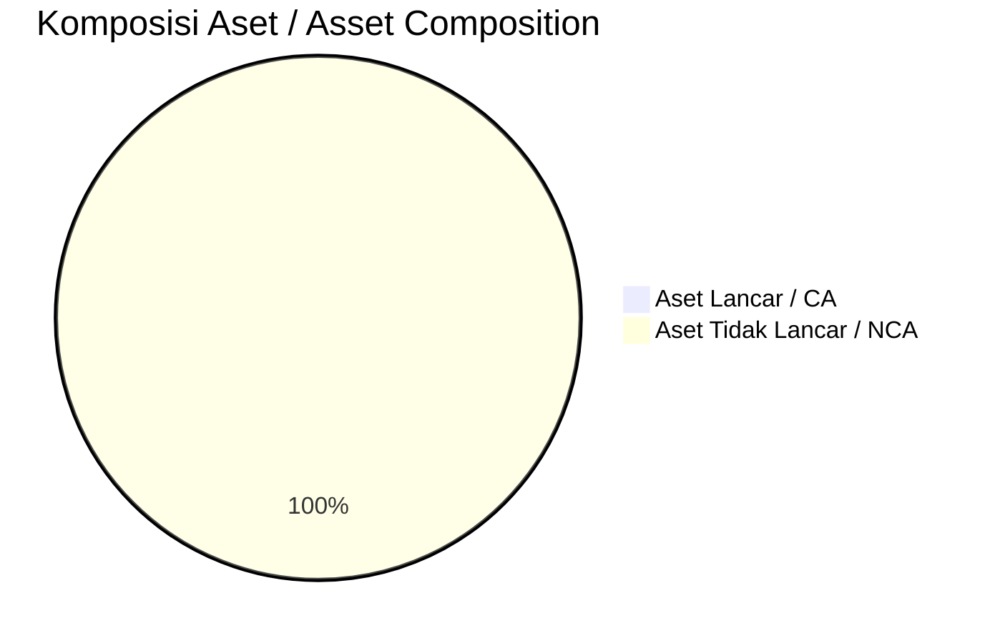
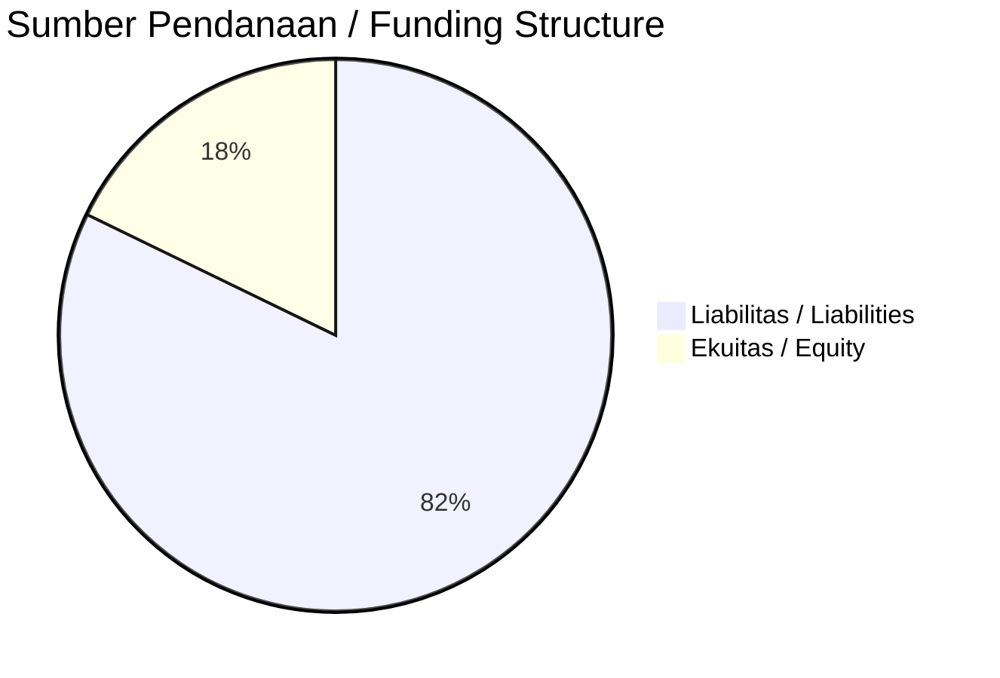

# 📈 Laporan Analisis Keuangan Mendalam: [[TGRA]] — Q2 2026

⬅️ [[knowledge-base/daily-digests/Daily_Digest_20260930|Kembali ke Daily Digest]] | 📅 **2026-09-30** | 🎛️ [[Dashboard|Ke Dashboard Utama]]

> [!IMPORTANT]
> Dokumen ini disusun oleh **Financial Summarizer Agent** untuk menganalisis kinerja keuangan, kesehatan neraca, profitabilitas, dan katalis sektor (Infrastruktur & Transportasi) **PT Terregra Asia Energy ([[TGRA]])** berdasarkan LK Q2 2026.

---

## 📌 1. Ikhtisar Kinerja Utama / Executive Performance Highlight
- **Emiten**: `[[TGRA]]` (PT Terregra Asia Energy)
- **Sektor Usaha / Industry Sector**: `Infrastruktur & Transportasi`
- **Periode Laporan / Reporting Period**: `Q2 2026`
- **Pendapatan Neto / Net Revenue**: `Rp 72.47 Juta` (**-40.54% 🔴 YoY** dari Rp 121.87 Juta)

- **Laba (Rugi) Bersih / Net Income**: `Rp -4.84 Miliar` (**+56.88% 🟢 YoY**)
- **Total Aset / Total Assets**: `Rp 302.23 Juta` | **Total Ekuitas / Total Equity**: `Rp 33.70 Miliar`
- **EPS (Annualized)**: `-0.04` | **BVPS**: `0.12`

---

## 📊 2. Laba Rugi Komparatif / Comparative Income Statement

| Pos Laba Rugi / Income Statement Item | Q2 2026 | Prior Period | YoY (%) |
| :--- | ---: | ---: | :---: |
| **Pendapatan Neto / Net Revenue** | `72.47M` | `121.87M` | **-40.54% 🔴** |
| **Beban Pokok / COGS** | `(-)` | `(-)` | - |
| **Laba Bruto / Gross Profit** | `-` | `-` | **-** |
| **Beban Usaha / Operating Expenses** | `(2.34B)` | `(2.37B)` | -1.40% 🔴 |
| **Laba Operasional / EBIT** | `-5.11B` | `-12.91B` | +60.40% 🟢 |
| **Laba (Rugi) Bersih / Net Income** | **-4.84B** | **-11.23B** | **+56.88% 🟢** |

---

## 🏦 3. Neraca & Struktur Permodalan / Balance Sheet & Capital Structure

| Pos Neraca / Balance Sheet Item | Q2 2026 | Prior Year End | Δ YoY/YtD (%) | Catatan / Notes |
| :--- | ---: | ---: | :---: | :--- |
| **Aset Lancar / Current Assets** | `302.23M` | `168.70M` | +79.15% 🟢 | Kas: Rp 170.85 Juta |
| **Aset Tidak Lancar / Non-Current Assets** | `206.29B` | `206.29B` | 0.00% ⚪ | Aset Tetap & Operasional |
| **TOTAL ASET / TOTAL ASSETS** | **302.23M** | **168.70M** | **+79.15% 🟢** | |
| **Liabilitas Jk. Pendek / Current Liabilities** | `155.65B` | `150.40B` | +3.49% 🟢 | |
| **Liabilitas Jk. Panjang / Non-Current Liabilities** | `4.63B` | `4.63B` | 0.00% ⚪ | |
| **TOTAL LIABILITAS / TOTAL LIABILITIES** | **155.65B** | **150.40B** | **+3.49% 🟢** | |
| **TOTAL EKUITAS / TOTAL EQUITY** | **33.70B** | **38.54B** | **-12.57% 🔴** | |

---

## 💸 4. Laporan Arus Kas / Cash Flow Statement

| Komponen Arus Kas / Cash Flow Component | Q2 2026 | Prior Period | Δ YoY (%) |
| :--- | ---: | ---: | :---: |
| **Arus Kas Operasi / CFO** | `-1.89B` | `-1.56B` | -20.99% 🔴 |
| **Arus Kas Investasi / CFI** | `72.47M` | `291.87M` | -75.17% 🔴 |
| **Arus Kas Pendanaan / CFF** | `1.86B` | `1.13B` | +64.51% 🟢 |
| **Kenaikan (Penurunan) Kas Bersih** | `49.83M` | `-134.48M` | +137.05% 🟢 |
| Belanja Modal / Capex | `(-)` | `(24.00M)` | - |
| Pembayaran Dividen / Dividends Paid | `(-)` | `(-)` | - |
| **Free Cash Flow (CFO - Capex)** | **-** | **-1.58B** | **-** |

---

## 📈 Analisis Rasio Keuangan / Financial Ratio Analysis

| Kategori / Category | Metrik / Metric | Nilai / Value | Benchmark | Interpretasi / Interpretation |
| :--- | :--- | :---: | :---: | :--- |
| **🛡️ Likuiditas** | **Current Ratio** | `0.00x` | `> 1.0x` | Kemampuan bayar kewajiban jk. pendek |
| | **Quick Ratio** | `0.00x` | `> 0.8x` | Likuiditas tanpa persediaan |
| **📊 Profitabilitas** | **Gross Profit Margin (GPM)** | `-` | - | Margin kotor operasional inti |
| | **Operating Profit Margin (OPM)** | `-7056.15%` | - | Efisiensi operasional |
| | **Net Profit Margin (NPM)** | `-6682.77%` | - | Konversi revenue ke laba bersih |
| **🎯 Imbal Hasil (Ann.)** | **Return on Equity (ROE)** | `-26.82%` | - | Imbal hasil terhadap ekuitas |
| | **Return on Assets (ROA)** | `-4113.58%` | - | Produktivitas aset |
| **⚖️ Solvabilitas** | **Debt to Equity (DER)** | `4.62x` | `< 2.0x` | Leverage utang vs modal |
| | **Debt to Asset (DAR)** | `515.01x` | `< 0.7x` | Porsi aset didanai utang |

---

## 📐 Per Share Metrics

| Metrik / Metric | Nilai / Value | Keterangan / Notes |
| :--- | ---: | :--- |
| **EPS (Annualized)** | `Rp -0.04` | Laba per saham (dianualisasi) |
| **BVPS** | `Rp 0.12` | Nilai buku per saham |

---

## 🚀 Analisis Strategis & Karakteristik Sektor / Strategic Analysis: Infrastruktur & Transportasi

Pada periode Q2 2026, **PT Terregra Asia Energy ([[TGRA]])** membukukan total pendapatan sebesar **Rp 72.47 Juta** (-40.54% 🔴 YoY). Laba kotor tercatat **-** dengan GPM **-**. Laba bersih sebesar **Rp -4.84 Miliar** (+56.88% 🟢 YoY). Total aset **Rp 302.23 Juta**, ekuitas **Rp 33.70 Miliar**, DER **4.62x**.

### 🔍 Indikator Kunci Sektor / Sector Key Indicators (Infrastruktur & Transportasi)
- **Karakteristik Infrastruktur & Transportasi**: Kinerja didorong oleh pertumbuhan volume Lalu Lintas Harian Rata-rata (LHR) dan penyesuaian tarif berkala.
- **Struktur Leverage / Leverage Structure**: Pengelolaan liabilitas jangka panjang yang terukur seiring masa konsesi.
- **Recurring Revenue**: Pendapatan tol/sewa/transport bersifat recurring dan predictable.

> [!NOTE]
> _Data Public Expose / Investor Presentation belum tersedia untuk emiten ini._

---

## 📋 Catatan Kunci Laporan Keuangan / Key Notes to Financial Statements

### 🔍 Opini Auditor / Auditor Opinion
- _Informasi opini auditor tidak tersedia._

---

## 💡 Catatan Strategis & Panduan Investor / Strategic Notes & Investor Guide

1. **Kesehatan Permodalan / Capital Health**: DER **4.62x**, CR **0.00x** — _perlu dipantau secara disiplin_.
2. **Katalis Pertumbuhan / Growth Catalysts**: Pantau realisasi pendapatan dan efisiensi operasional periode berikutnya.

---

## 🔗 Hubungan Note Terkait / Knowledge Graph Links
- [[knowledge-base/daily-digests/Daily_Digest_20260930|📄 Daily Digest 2026-09-30]]
- [[knowledge-base/trading-signals/Trading_Signals_20260930|🎯 Trading Signals]]
- [[Dashboard|🎛️ Kembali ke Dashboard Utama]]