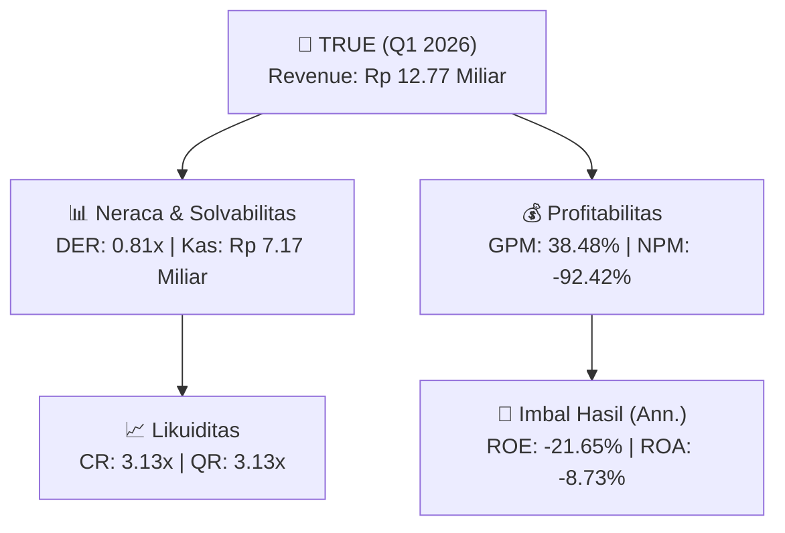

# 📈 Laporan Keuangan Interim: [[TRUE]] — Q1 2026

📅 **2026-09-22** | 🎛️ [[Dashboard|Ke Dashboard Utama]]

> [!NOTE]
> Laporan interim ringkas **PT Triniti Dinamik Tbk ([[TRUE]])** — Sektor: Properti & Konstruksi.

---

## 📌 1. Ikhtisar Kinerja Utama / Executive Performance Highlight
- **Emiten**: `[[TRUE]]` (PT Triniti Dinamik Tbk)
- **Sektor Usaha / Industry Sector**: `Properti & Konstruksi`
- **Periode Laporan / Reporting Period**: `Q1 2026`
- **Pendapatan Neto / Net Revenue**: `Rp 12.77 Miliar` (**+18.94% 🟢 YoY** dari Rp 10.74 Miliar)
- **Laba Bruto / Gross Profit**: `Rp 4.91 Miliar` (**+29.83% 🟢 YoY**)
- **Laba (Rugi) Bersih / Net Income**: `Rp -11.80 Miliar` (**-98.58% 🔴 YoY**)
- **Total Aset / Total Assets**: `Rp 539.93 Miliar` | **Total Ekuitas / Total Equity**: `Rp 212.19 Miliar`
- **EPS (Annualized)**: `-0.25` | **BVPS**: `1.12`

---

## 📊 2. Laba Rugi Komparatif / Comparative Income Statement

| Pos Laba Rugi / Income Statement Item | Q1 2026 | Prior Period | YoY (%) |
| :--- | ---: | ---: | :---: |
| **Pendapatan Neto / Net Revenue** | `12.77B` | `10.74B` | **+18.94% 🟢** |
| **Beban Pokok / COGS** | `(7.86B)` | `(6.95B)` | +13.02% 🟢 |
| **Laba Bruto / Gross Profit** | `4.91B` | `3.79B` | **+29.83% 🟢** |
| **Beban Usaha / Operating Expenses** | `(12.81B)` | `(7.39B)` | +73.33% 🟢 |
| **Laba Operasional / EBIT** | `-11.80B` | `-5.95B` | -98.38% 🔴 |
| **Laba (Rugi) Bersih / Net Income** | **-11.80B** | **-5.94B** | **-98.58% 🔴** |

---

## 🏦 3. Neraca & Struktur Permodalan / Balance Sheet & Capital Structure

| Pos Neraca / Balance Sheet Item | Q1 2026 | Prior Year End | Δ YoY/YtD (%) | Catatan / Notes |
| :--- | ---: | ---: | :---: | :--- |
| **Aset Lancar / Current Assets** | `539.93B` | `542.23B` | -0.42% 🔴 | Kas: Rp 7.17 Miliar |
| **Aset Tidak Lancar / Non-Current Assets** | `139.58B` | `139.62B` | -0.03% 🔴 | Aset Tetap & Operasional |
| **TOTAL ASET / TOTAL ASSETS** | **539.93B** | **542.23B** | **-0.42% 🔴** | |
| **Liabilitas Jk. Pendek / Current Liabilities** | `172.29B` | `179.81B` | -4.18% 🔴 | |
| **Liabilitas Jk. Panjang / Non-Current Liabilities** | `294.21B` | `277.24B` | +6.12% 🟢 | |
| **TOTAL LIABILITAS / TOTAL LIABILITIES** | **172.29B** | **179.81B** | **-4.18% 🔴** | |
| **TOTAL EKUITAS / TOTAL EQUITY** | **212.19B** | **223.99B** | **-5.27% 🔴** | |

---

## 📈 Analisis Rasio Keuangan / Financial Ratio Analysis

| Kategori / Category | Metrik / Metric | Nilai / Value | Benchmark | Interpretasi / Interpretation |
| :--- | :--- | :---: | :---: | :--- |
| **🛡️ Likuiditas** | **Current Ratio** | `3.13x` | `> 1.0x` | Kemampuan bayar kewajiban jk. pendek |
| | **Quick Ratio** | `3.13x` | `> 0.8x` | Likuiditas tanpa persediaan |
| **📊 Profitabilitas** | **Gross Profit Margin (GPM)** | `38.48%` | - | Margin kotor operasional inti |
| | **Operating Profit Margin (OPM)** | `-92.36%` | - | Efisiensi operasional |
| | **Net Profit Margin (NPM)** | `-92.42%` | - | Konversi revenue ke laba bersih |
| **🎯 Imbal Hasil (Ann.)** | **Return on Equity (ROE)** | `-21.65%` | - | Imbal hasil terhadap ekuitas |
| | **Return on Assets (ROA)** | `-8.73%` | - | Produktivitas aset |
| **⚖️ Solvabilitas** | **Debt to Equity (DER)** | `0.81x` | `< 2.0x` | Leverage utang vs modal |
| | **Debt to Asset (DAR)** | `0.32x` | `< 0.7x` | Porsi aset didanai utang |

---

## 🔗 Hubungan Note Terkait / Knowledge Graph Links
- [[knowledge-base/daily-digests/Daily_Digest_20260922|📄 Daily Digest 2026-09-22]]
- [[knowledge-base/trading-signals/Trading_Signals_20260922|🎯 Trading Signals]]
- [[Dashboard|🎛️ Kembali ke Dashboard Utama]]