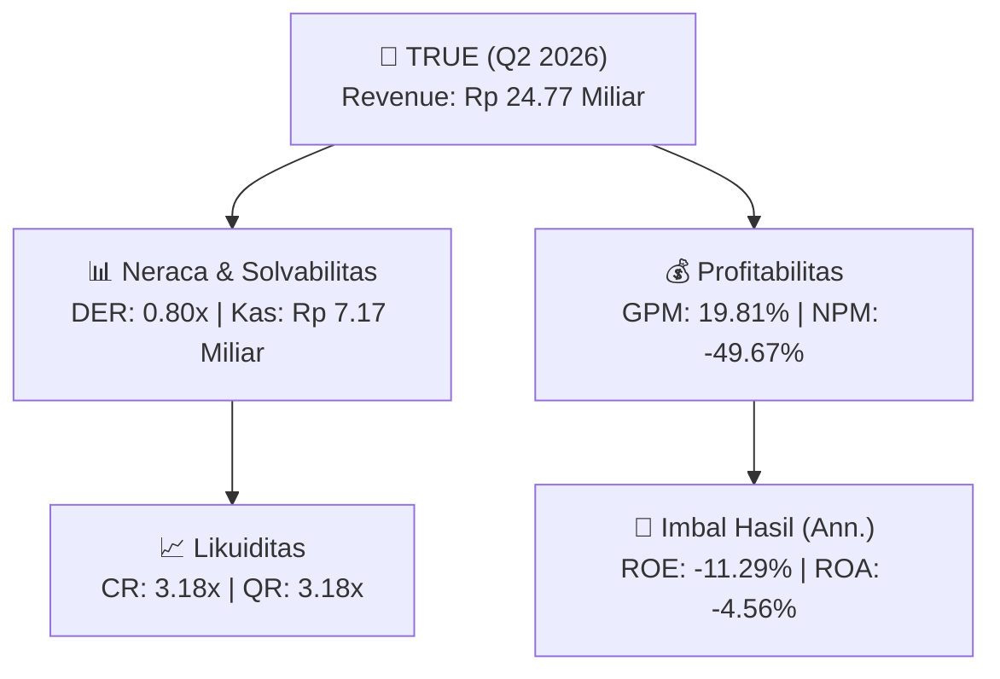
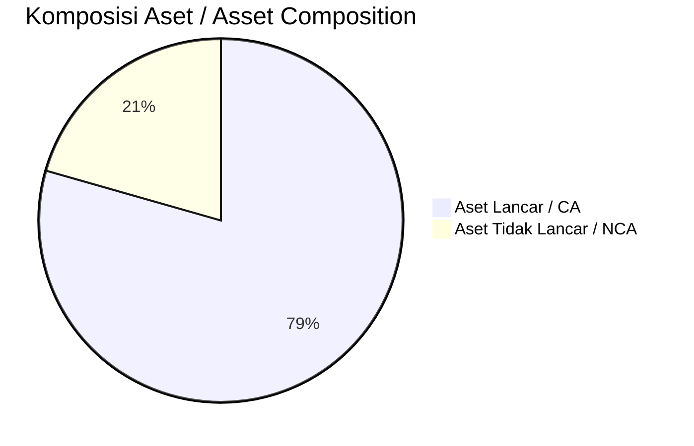
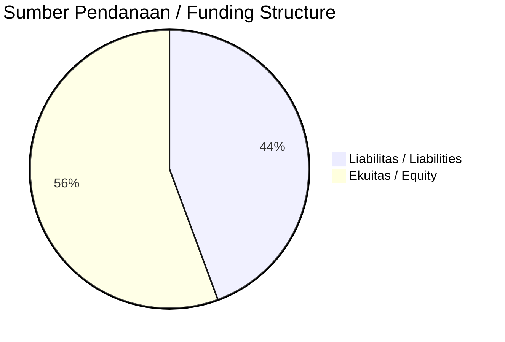

# 📈 Laporan Analisis Keuangan Mendalam: [[TRUE]] — Q2 2026

⬅️ [[knowledge-base/daily-digests/Daily_Digest_20260922|Kembali ke Daily Digest]] | 📅 **2026-09-22** | 🎛️ [[Dashboard|Ke Dashboard Utama]]

> [!IMPORTANT]
> Dokumen ini disusun oleh **Financial Summarizer Agent** untuk menganalisis kinerja keuangan, kesehatan neraca, profitabilitas, dan katalis sektor (Properti & Konstruksi) **PT Triniti Dinamik Tbk ([[TRUE]])** berdasarkan LK Q2 2026.

---

## 📌 1. Ikhtisar Kinerja Utama / Executive Performance Highlight
- **Emiten**: `[[TRUE]]` (PT Triniti Dinamik Tbk)
- **Sektor Usaha / Industry Sector**: `Properti & Konstruksi`
- **Periode Laporan / Reporting Period**: `Q2 2026`
- **Pendapatan Neto / Net Revenue**: `Rp 24.77 Miliar` (**+3.72% 🟢 YoY** dari Rp 23.88 Miliar)
- **Laba Bruto / Gross Profit**: `Rp 4.91 Miliar` (**-25.04% 🔴 YoY**)
- **Laba (Rugi) Bersih / Net Income**: `Rp -12.30 Miliar` (**-23.32% 🔴 YoY**)
- **Total Aset / Total Assets**: `Rp 536.43 Miliar` | **Total Ekuitas / Total Equity**: `Rp 211.69 Miliar`
- **EPS (Annualized)**: `-0.13` | **BVPS**: `1.12`

---

## 📊 2. Laba Rugi Komparatif / Comparative Income Statement

| Pos Laba Rugi / Income Statement Item | Q2 2026 | Prior Period | YoY (%) |
| :--- | ---: | ---: | :---: |
| **Pendapatan Neto / Net Revenue** | `24.77B` | `23.88B` | **+3.72% 🟢** |
| **Beban Pokok / COGS** | `(19.86B)` | `(17.34B)` | +14.58% 🟢 |
| **Laba Bruto / Gross Profit** | `4.91B` | `6.55B` | **-25.04% 🔴** |
| **Beban Usaha / Operating Expenses** | `(13.31B)` | `(13.15B)` | +1.25% 🟢 |
| **Laba Operasional / EBIT** | `-12.30B` | `-9.97B` | -23.38% 🔴 |
| **Laba (Rugi) Bersih / Net Income** | **-12.30B** | **-9.98B** | **-23.32% 🔴** |

---

## 🏦 3. Neraca & Struktur Permodalan / Balance Sheet & Capital Structure

| Pos Neraca / Balance Sheet Item | Q2 2026 | Prior Year End | Δ YoY/YtD (%) | Catatan / Notes |
| :--- | ---: | ---: | :---: | :--- |
| **Aset Lancar / Current Assets** | `536.43B` | `542.23B` | -1.07% 🔴 | Kas: Rp 7.17 Miliar |
| **Aset Tidak Lancar / Non-Current Assets** | `139.17B` | `139.62B` | -0.33% 🔴 | Aset Tetap & Operasional |
| **TOTAL ASET / TOTAL ASSETS** | **536.43B** | **542.23B** | **-1.07% 🔴** | |
| **Liabilitas Jk. Pendek / Current Liabilities** | `168.87B` | `179.81B` | -6.08% 🔴 | |
| **Liabilitas Jk. Panjang / Non-Current Liabilities** | `294.21B` | `277.24B` | +6.12% 🟢 | |
| **TOTAL LIABILITAS / TOTAL LIABILITIES** | **168.87B** | **179.81B** | **-6.08% 🔴** | |
| **TOTAL EKUITAS / TOTAL EQUITY** | **211.69B** | **223.99B** | **-5.49% 🔴** | |

---

## 💸 4. Laporan Arus Kas / Cash Flow Statement

| Komponen Arus Kas / Cash Flow Component | Q2 2026 | Prior Period | Δ YoY (%) |
| :--- | ---: | ---: | :---: |
| **Arus Kas Operasi / CFO** | `-16.37B` | `11.27B` | -245.29% 🔴 |
| **Arus Kas Investasi / CFI** | `-75.52M` | `-6.31B` | +98.80% 🟢 |
| **Arus Kas Pendanaan / CFF** | `15.78B` | `-5.16B` | +405.84% 🟢 |
| **Kenaikan (Penurunan) Kas Bersih** | `-666.21M` | `-207.63M` | -220.86% 🔴 |
| Belanja Modal / Capex | `(74.71M)` | `(189.20M)` | -60.51% 🔴 |
| Pembayaran Dividen / Dividends Paid | `(-)` | `(-)` | - |
| **Free Cash Flow (CFO - Capex)** | **-16.44B** | **11.08B** | **-248.44% 🔴** |

---

## 📈 Analisis Rasio Keuangan / Financial Ratio Analysis

| Kategori / Category | Metrik / Metric | Nilai / Value | Benchmark | Interpretasi / Interpretation |
| :--- | :--- | :---: | :---: | :--- |
| **🛡️ Likuiditas** | **Current Ratio** | `3.18x` | `> 1.0x` | Kemampuan bayar kewajiban jk. pendek |
| | **Quick Ratio** | `3.18x` | `> 0.8x` | Likuiditas tanpa persediaan |
| **📊 Profitabilitas** | **Gross Profit Margin (GPM)** | `19.81%` | - | Margin kotor operasional inti |
| | **Operating Profit Margin (OPM)** | `-49.67%` | - | Efisiensi operasional |
| | **Net Profit Margin (NPM)** | `-49.67%` | - | Konversi revenue ke laba bersih |
| **🎯 Imbal Hasil (Ann.)** | **Return on Equity (ROE)** | `-11.29%` | - | Imbal hasil terhadap ekuitas |
| | **Return on Assets (ROA)** | `-4.56%` | - | Produktivitas aset |
| **⚖️ Solvabilitas** | **Debt to Equity (DER)** | `0.80x` | `< 2.0x` | Leverage utang vs modal |
| | **Debt to Asset (DAR)** | `0.31x` | `< 0.7x` | Porsi aset didanai utang |

---

## 📐 Per Share Metrics

| Metrik / Metric | Nilai / Value | Keterangan / Notes |
| :--- | ---: | :--- |
| **EPS (Annualized)** | `Rp -0.13` | Laba per saham (dianualisasi) |
| **BVPS** | `Rp 1.12` | Nilai buku per saham |

---

## 🚀 Analisis Strategis & Karakteristik Sektor / Strategic Analysis: Properti & Konstruksi

Pada periode Q2 2026, **PT Triniti Dinamik Tbk ([[TRUE]])** membukukan total pendapatan sebesar **Rp 24.77 Miliar** (+3.72% 🟢 YoY). Laba kotor tercatat **Rp 4.91 Miliar** dengan GPM **19.81%**. Laba bersih sebesar **Rp -12.30 Miliar** (-23.32% 🔴 YoY). Total aset **Rp 536.43 Miliar**, ekuitas **Rp 211.69 Miliar**, DER **0.80x**.

### 🔍 Indikator Kunci Sektor / Sector Key Indicators (Properti & Konstruksi)
- **Karakteristik Konstruksi & Properti**: Pertumbuhan bertumpu pada perolehan kontrak baru (Order Book) dan percepatan progres fisik proyek.
- **Modal Kerja**: Restrukturisasi liabilitas dan pengelolaan arus kas proyek.
- **Katalis**: Presales/marketing sales, groundbreaking proyek baru, dan penyerahan unit.

> [!NOTE]
> _Data Public Expose / Investor Presentation belum tersedia untuk emiten ini._

---

## 📋 Catatan Kunci Laporan Keuangan / Key Notes to Financial Statements

### 🔍 Opini Auditor / Auditor Opinion
- _Informasi opini auditor tidak tersedia._

### 📝 Perjanjian & Kontrak Signifikan / Key Contracts & Agreements
- Liabilitas pembiayaan konsumen atas pembelian 1 unit kendaraan Toyota Innova Zenix 2.0 Q HV Modelista TSS dari PT BCA, Nomor Kontrak 1302706922-001, bunga 6,02% efektif, jangka waktu 29 November 2024 sampai dengan 29 Oktober 2027.
- Restrukturisasi utang bank: PT Bank Pan Indonesia Tbk menyetujui perubahan pembayaran angsuran fasilitas PJP sampai dengan tanggal 21 Juni 2029 berdasarkan Surat Restrukturisasi No. 562/DSA/EXT/24.
- Perjanjian penting: pengaturan bersama dilaksanakan melalui kendaraan terpisah, di mana Perusahaan dan PIM tetap memiliki hak atas aset dan kewajiban terkait.

---

## 💡 Catatan Strategis & Panduan Investor / Strategic Notes & Investor Guide

1. **Kesehatan Permodalan / Capital Health**: DER **0.80x**, CR **3.18x** — _sehat dan aman_.
2. **Katalis Pertumbuhan / Growth Catalysts**: Pantau realisasi pendapatan dan efisiensi operasional periode berikutnya.

---

## 🔗 Hubungan Note Terkait / Knowledge Graph Links
- [[knowledge-base/daily-digests/Daily_Digest_20260922|📄 Daily Digest 2026-09-22]]
- [[knowledge-base/trading-signals/Trading_Signals_20260922|🎯 Trading Signals]]
- [[Dashboard|🎛️ Kembali ke Dashboard Utama]]