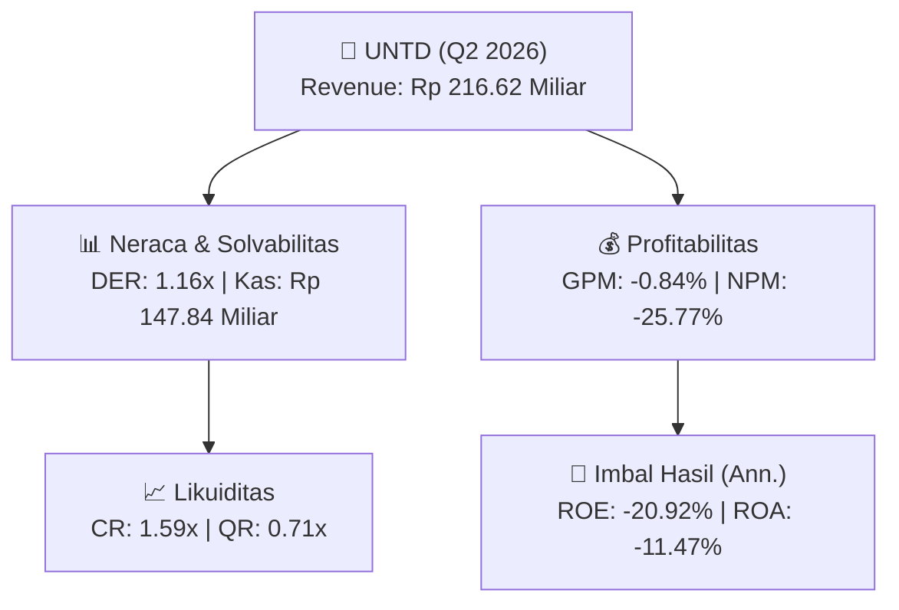
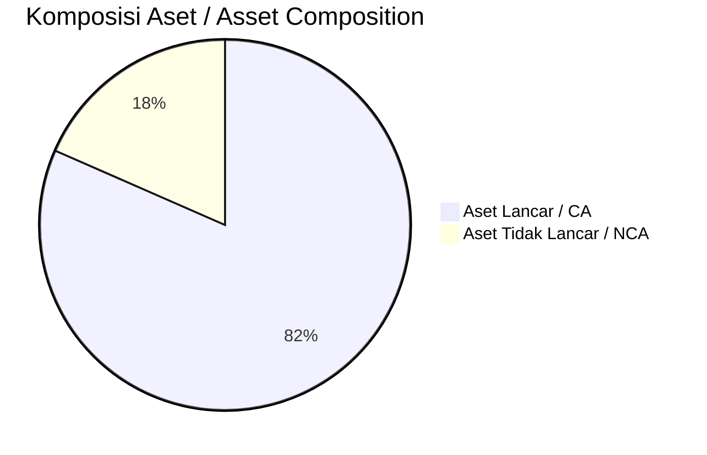
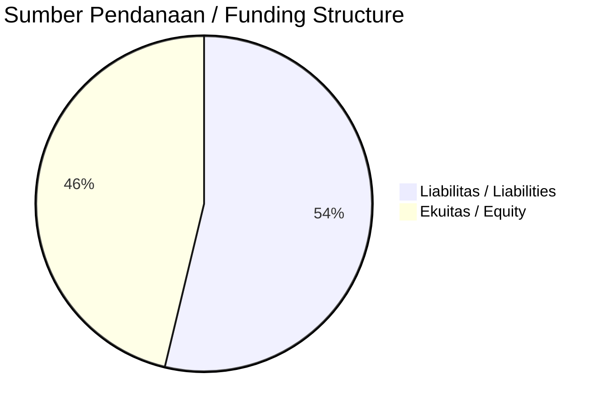

# 📈 Laporan Analisis Keuangan Mendalam: [[UNTD]] — Q2 2026

⬅️ [[knowledge-base/daily-digests/Daily_Digest_20260901|Kembali ke Daily Digest]] | 📅 **2026-09-01** | 🎛️ [[Dashboard|Ke Dashboard Utama]]

> [!IMPORTANT]
> Dokumen ini disusun oleh **Financial Summarizer Agent** untuk menganalisis kinerja keuangan, kesehatan neraca, profitabilitas, dan katalis sektor (Manufaktur) **PT Terang Dunia Internusa Tbk. ([[UNTD]])** berdasarkan LK Q2 2026.

---

## 📌 1. Ikhtisar Kinerja Utama / Executive Performance Highlight
- **Emiten**: `[[UNTD]]` (PT Terang Dunia Internusa Tbk.)
- **Sektor Usaha / Industry Sector**: `Manufaktur`
- **Periode Laporan / Reporting Period**: `Q2 2026`
- **Pendapatan Neto / Net Revenue**: `Rp 216.62 Miliar` (**+20.94% 🟢 YoY** dari Rp 179.10 Miliar)
- **Laba Bruto / Gross Profit**: `Rp -1.83 Miliar` (**-103.67% 🔴 YoY**)
- **Laba (Rugi) Bersih / Net Income**: `Rp -55.82 Miliar` (**-7156.82% 🔴 YoY**)
- **Total Aset / Total Assets**: `Rp 932.75 Miliar` | **Total Ekuitas / Total Equity**: `Rp 505.89 Miliar`
- **EPS (Annualized)**: `-0.67` | **BVPS**: `3.04`

---

## 📊 2. Laba Rugi Komparatif / Comparative Income Statement

| Pos Laba Rugi / Income Statement Item | Q2 2026 | Prior Period | YoY (%) |
| :--- | ---: | ---: | :---: |
| **Pendapatan Neto / Net Revenue** | `216.62B` | `179.10B` | **+20.94% 🟢** |
| **Beban Pokok / COGS** | `(218.44B)` | `(129.39B)` | +68.82% 🟢 |
| **Laba Bruto / Gross Profit** | `-1.83B` | `49.71B` | **-103.67% 🔴** |
| **Beban Usaha / Operating Expenses** | `(23.12B)` | `(17.56B)` | +31.69% 🟢 |
| **Laba Operasional / EBIT** | `-56.94B` | `1.15B` | -5043.62% 🔴 |
| **Laba (Rugi) Bersih / Net Income** | **-55.82B** | **790.97M** | **-7156.82% 🔴** |

---

## 🏦 3. Neraca & Struktur Permodalan / Balance Sheet & Capital Structure

| Pos Neraca / Balance Sheet Item | Q2 2026 | Prior Year End | Δ YoY/YtD (%) | Catatan / Notes |
| :--- | ---: | ---: | :---: | :--- |
| **Aset Lancar / Current Assets** | `932.75B` | `1.01T` | -7.98% 🔴 | Kas: Rp 147.84 Miliar |
| **Aset Tidak Lancar / Non-Current Assets** | `211.00B` | `208.86B` | +1.03% 🟢 | Aset Tetap & Operasional |
| **TOTAL ASET / TOTAL ASSETS** | **932.75B** | **1.01T** | **-7.98% 🔴** | |
| **Liabilitas Jk. Pendek / Current Liabilities** | `587.84B` | `588.04B` | -0.03% 🔴 | |
| **Liabilitas Jk. Panjang / Non-Current Liabilities** | `50.02B` | `72.87B` | -31.36% 🔴 | |
| **TOTAL LIABILITAS / TOTAL LIABILITIES** | **587.84B** | **588.04B** | **-0.03% 🔴** | |
| **TOTAL EKUITAS / TOTAL EQUITY** | **505.89B** | **561.55B** | **-9.91% 🔴** | |

---

## 💸 4. Laporan Arus Kas / Cash Flow Statement

| Komponen Arus Kas / Cash Flow Component | Q2 2026 | Prior Period | Δ YoY (%) |
| :--- | ---: | ---: | :---: |
| **Arus Kas Operasi / CFO** | `17.03B` | `-48.15B` | +135.36% 🟢 |
| **Arus Kas Investasi / CFI** | `-6.69B` | `-13.80B` | +51.51% 🟢 |
| **Arus Kas Pendanaan / CFF** | `-29.56B` | `60.93B` | -148.51% 🔴 |
| **Kenaikan (Penurunan) Kas Bersih** | `-19.22B` | `-1.02B` | -1789.58% 🔴 |
| Belanja Modal / Capex | `(6.69B)` | `(13.80B)` | -51.51% 🔴 |
| Pembayaran Dividen / Dividends Paid | `(-)` | `(8.33B)` | - |
| **Free Cash Flow (CFO - Capex)** | **10.34B** | **-61.95B** | **+116.69% 🟢** |

---

## 📈 Analisis Rasio Keuangan / Financial Ratio Analysis

| Kategori / Category | Metrik / Metric | Nilai / Value | Benchmark | Interpretasi / Interpretation |
| :--- | :--- | :---: | :---: | :--- |
| **🛡️ Likuiditas** | **Current Ratio** | `1.59x` | `> 1.0x` | Kemampuan bayar kewajiban jk. pendek |
| | **Quick Ratio** | `0.71x` | `> 0.8x` | Likuiditas tanpa persediaan |
| **📊 Profitabilitas** | **Gross Profit Margin (GPM)** | `-0.84%` | - | Margin kotor operasional inti |
| | **Operating Profit Margin (OPM)** | `-26.29%` | - | Efisiensi operasional |
| | **Net Profit Margin (NPM)** | `-25.77%` | - | Konversi revenue ke laba bersih |
| **🎯 Imbal Hasil (Ann.)** | **Return on Equity (ROE)** | `-20.92%` | - | Imbal hasil terhadap ekuitas |
| | **Return on Assets (ROA)** | `-11.47%` | - | Produktivitas aset |
| **⚖️ Solvabilitas** | **Debt to Equity (DER)** | `1.16x` | `< 2.0x` | Leverage utang vs modal |
| | **Debt to Asset (DAR)** | `0.63x` | `< 0.7x` | Porsi aset didanai utang |

---

## 📐 Per Share Metrics

| Metrik / Metric | Nilai / Value | Keterangan / Notes |
| :--- | ---: | :--- |
| **EPS (Annualized)** | `Rp -0.67` | Laba per saham (dianualisasi) |
| **BVPS** | `Rp 3.04` | Nilai buku per saham |

---

## 🚀 Analisis Strategis & Karakteristik Sektor / Strategic Analysis: Manufaktur

Pada periode Q2 2026, **PT Terang Dunia Internusa Tbk. ([[UNTD]])** membukukan total pendapatan sebesar **Rp 216.62 Miliar** (+20.94% 🟢 YoY). Laba kotor tercatat **Rp -1.83 Miliar** dengan GPM **-0.84%**. Laba bersih sebesar **Rp -55.82 Miliar** (-7156.82% 🔴 YoY). Total aset **Rp 932.75 Miliar**, ekuitas **Rp 505.89 Miliar**, DER **1.16x**.

### 🔍 Indikator Kunci Sektor / Sector Key Indicators (Manufaktur)
- **Karakteristik Industri (Manufaktur)**: Kinerja mencerminkan dinamika penyerapan pasar, utilisasi kapasitas produksi, dan efisiensi biaya pokok.
- **Faktor Penggerak**: Pertumbuhan organik, efisiensi operasional, dan ekspansi pasar.

> [!NOTE]
> _Data Public Expose / Investor Presentation belum tersedia untuk emiten ini._

---

## 📋 Catatan Kunci Laporan Keuangan / Key Notes to Financial Statements

### 🔍 Opini Auditor / Auditor Opinion
- **Jenis Opini / Opinion Type**: `Reviu Terbatas / Limited Review`
- **KAP / Audit Firm**: `KAP Tjahjadi  Tamara`
- **Partner Audit**: `Henry Gunawan Tjahjadi`
- **Tanggal Laporan / Report Date**: `2026-08-28`

---

## 💡 Catatan Strategis & Panduan Investor / Strategic Notes & Investor Guide

1. **Kesehatan Permodalan / Capital Health**: DER **1.16x**, CR **1.59x** — _sehat dan aman_.
2. **Katalis Pertumbuhan / Growth Catalysts**: Pantau realisasi pendapatan dan efisiensi operasional periode berikutnya.

---

## 🔗 Hubungan Note Terkait / Knowledge Graph Links
- [[knowledge-base/daily-digests/Daily_Digest_20260901|📄 Daily Digest 2026-09-01]]
- [[knowledge-base/trading-signals/Trading_Signals_20260901|🎯 Trading Signals]]
- [[Dashboard|🎛️ Kembali ke Dashboard Utama]]