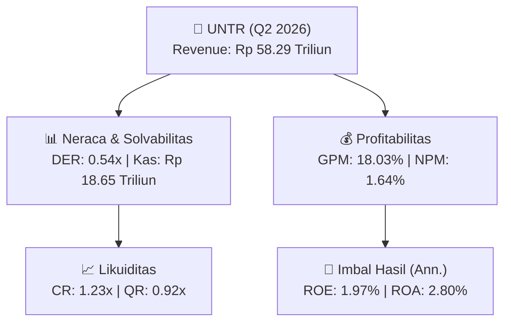
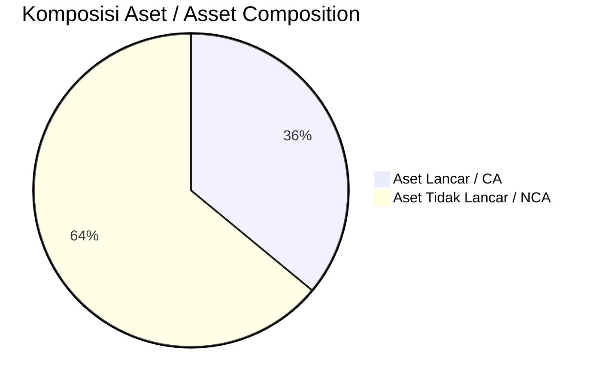
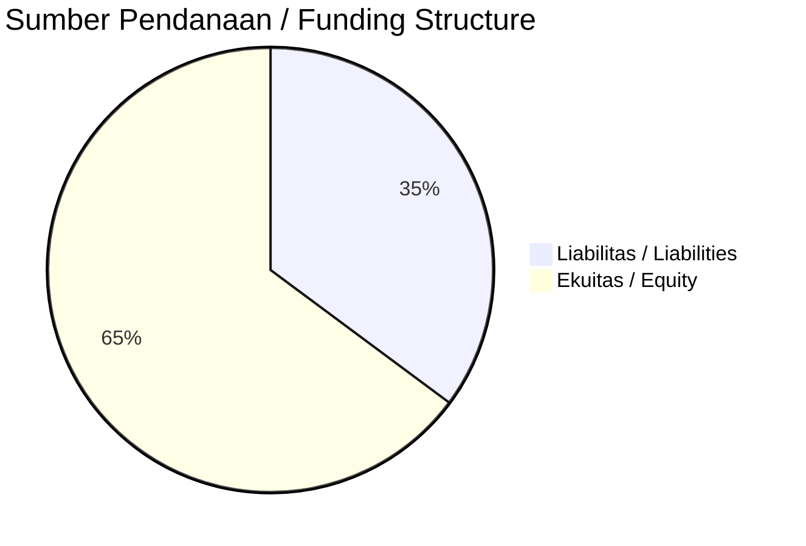

# 📈 Laporan Analisis Keuangan Mendalam: [[UNTR]] — Q2 2026

⬅️ [[knowledge-base/daily-digests/Daily_Digest_20260901|Kembali ke Daily Digest]] | 📅 **2026-09-01** | 🎛️ [[Dashboard|Ke Dashboard Utama]]

> [!IMPORTANT]
> Dokumen ini disusun oleh **Financial Summarizer Agent** untuk menganalisis kinerja keuangan, kesehatan neraca, profitabilitas, dan katalis sektor (Konsumer & Ritel) **United Tractors Tbk ([[UNTR]])** berdasarkan LK Q2 2026.

---

## 📌 1. Ikhtisar Kinerja Utama / Executive Performance Highlight
- **Emiten**: `[[UNTR]]` (United Tractors Tbk)
- **Sektor Usaha / Industry Sector**: `Konsumer & Ritel`
- **Periode Laporan / Reporting Period**: `Q2 2026`
- **Pendapatan Neto / Net Revenue**: `Rp 58.29 Triliun` (**-14.94% 🔴 YoY** dari Rp 68.53 Triliun)
- **Laba Bruto / Gross Profit**: `Rp 10.51 Triliun` (**-29.98% 🔴 YoY**)
- **Laba (Rugi) Bersih / Net Income**: `Rp 956.28 Miliar` (**-88.24% 🔴 YoY**)
- **Total Aset / Total Assets**: `Rp 64.48 Triliun` | **Total Ekuitas / Total Equity**: `Rp 96.57 Triliun`
- **EPS (Annualized)**: `2.05` | **BVPS**: `103.56`

---

## 📊 2. Laba Rugi Komparatif / Comparative Income Statement

| Pos Laba Rugi / Income Statement Item | Q2 2026 | Prior Period | YoY (%) |
| :--- | ---: | ---: | :---: |
| **Pendapatan Neto / Net Revenue** | `58.29T` | `68.53T` | **-14.94% 🔴** |
| **Beban Pokok / COGS** | `(47.78T)` | `(53.52T)` | -10.72% 🔴 |
| **Laba Bruto / Gross Profit** | `10.51T` | `15.01T` | **-29.98% 🔴** |
| **Beban Usaha / Operating Expenses** | `(3.92T)` | `(2.85T)` | +37.44% 🟢 |
| **Laba Operasional / EBIT** | `2.00T` | `11.01T` | -81.81% 🔴 |
| **Laba (Rugi) Bersih / Net Income** | **956.28B** | **8.13T** | **-88.24% 🔴** |

---

## 🏦 3. Neraca & Struktur Permodalan / Balance Sheet & Capital Structure

| Pos Neraca / Balance Sheet Item | Q2 2026 | Prior Year End | Δ YoY/YtD (%) | Catatan / Notes |
| :--- | ---: | ---: | :---: | :--- |
| **Aset Lancar / Current Assets** | `64.48T` | `72.14T` | -10.62% 🔴 | Kas: Rp 18.65 Triliun |
| **Aset Tidak Lancar / Non-Current Assets** | `114.58T` | `105.50T` | +8.61% 🟢 | Aset Tetap & Operasional |
| **TOTAL ASET / TOTAL ASSETS** | **64.48T** | **72.14T** | **-10.62% 🔴** | |
| **Liabilitas Jk. Pendek / Current Liabilities** | `52.45T` | `53.21T` | -1.44% 🔴 | |
| **Liabilitas Jk. Panjang / Non-Current Liabilities** | `24.86T` | `21.29T` | +16.79% 🟢 | |
| **TOTAL LIABILITAS / TOTAL LIABILITIES** | **52.45T** | **53.21T** | **-1.44% 🔴** | |
| **TOTAL EKUITAS / TOTAL EQUITY** | **96.57T** | **97.77T** | **-1.23% 🔴** | |

---

## 💸 4. Laporan Arus Kas / Cash Flow Statement

| Komponen Arus Kas / Cash Flow Component | Q2 2026 | Prior Period | Δ YoY (%) |
| :--- | ---: | ---: | :---: |
| **Arus Kas Operasi / CFO** | `2.38T` | `11.36T` | -79.06% 🔴 |
| **Arus Kas Investasi / CFI** | `-12.02T` | `-5.40T` | -122.56% 🔴 |
| **Arus Kas Pendanaan / CFF** | `1.49T` | `-5.74T` | +125.92% 🟢 |
| **Kenaikan (Penurunan) Kas Bersih** | `-8.15T` | `226.72B` | -3695.83% 🔴 |
| Belanja Modal / Capex | `(3.18T)` | `(6.38T)` | -50.22% 🔴 |
| Pembayaran Dividen / Dividends Paid | `(4.16T)` | `(5.82T)` | -28.60% 🔴 |
| **Free Cash Flow (CFO - Capex)** | **-797.36B** | **4.98T** | **-116.01% 🔴** |

---

## 📈 Analisis Rasio Keuangan / Financial Ratio Analysis

| Kategori / Category | Metrik / Metric | Nilai / Value | Benchmark | Interpretasi / Interpretation |
| :--- | :--- | :---: | :---: | :--- |
| **🛡️ Likuiditas** | **Current Ratio** | `1.23x` | `> 1.0x` | Kemampuan bayar kewajiban jk. pendek |
| | **Quick Ratio** | `0.92x` | `> 0.8x` | Likuiditas tanpa persediaan |
| **📊 Profitabilitas** | **Gross Profit Margin (GPM)** | `18.03%` | - | Margin kotor operasional inti |
| | **Operating Profit Margin (OPM)** | `3.43%` | - | Efisiensi operasional |
| | **Net Profit Margin (NPM)** | `1.64%` | - | Konversi revenue ke laba bersih |
| **🎯 Imbal Hasil (Ann.)** | **Return on Equity (ROE)** | `1.97%` | - | Imbal hasil terhadap ekuitas |
| | **Return on Assets (ROA)** | `2.80%` | - | Produktivitas aset |
| **⚖️ Solvabilitas** | **Debt to Equity (DER)** | `0.54x` | `< 2.0x` | Leverage utang vs modal |
| | **Debt to Asset (DAR)** | `0.81x` | `< 0.7x` | Porsi aset didanai utang |

---

## 📐 Per Share Metrics

| Metrik / Metric | Nilai / Value | Keterangan / Notes |
| :--- | ---: | :--- |
| **EPS (Annualized)** | `Rp 2.05` | Laba per saham (dianualisasi) |
| **BVPS** | `Rp 103.56` | Nilai buku per saham |

---

## 🚀 Analisis Strategis & Karakteristik Sektor / Strategic Analysis: Konsumer & Ritel

Pada periode Q2 2026, **United Tractors Tbk ([[UNTR]])** membukukan total pendapatan sebesar **Rp 58.29 Triliun** (-14.94% 🔴 YoY). Laba kotor tercatat **Rp 10.51 Triliun** dengan GPM **18.03%**. Laba bersih sebesar **Rp 956.28 Miliar** (-88.24% 🔴 YoY). Total aset **Rp 64.48 Triliun**, ekuitas **Rp 96.57 Triliun**, DER **0.54x**.

### 🔍 Indikator Kunci Sektor / Sector Key Indicators (Konsumer & Ritel)
- **Karakteristik Industri (Konsumer & Ritel)**: Kinerja mencerminkan dinamika penyerapan pasar, utilisasi kapasitas produksi, dan efisiensi biaya pokok.
- **Faktor Penggerak**: Pertumbuhan organik, efisiensi operasional, dan ekspansi pasar.

> [!NOTE]
> _Data Public Expose / Investor Presentation belum tersedia untuk emiten ini._

---

## 📋 Catatan Kunci Laporan Keuangan / Key Notes to Financial Statements

### 🔍 Opini Auditor / Auditor Opinion
- _Informasi opini auditor tidak tersedia._

---

## 💡 Catatan Strategis & Panduan Investor / Strategic Notes & Investor Guide

1. **Kesehatan Permodalan / Capital Health**: DER **0.54x**, CR **1.23x** — _sehat dan aman_.
2. **Katalis Pertumbuhan / Growth Catalysts**: Pantau realisasi pendapatan dan efisiensi operasional periode berikutnya.

---

## 🔗 Hubungan Note Terkait / Knowledge Graph Links
- [[knowledge-base/daily-digests/Daily_Digest_20260901|📄 Daily Digest 2026-09-01]]
- [[knowledge-base/trading-signals/Trading_Signals_20260901|🎯 Trading Signals]]
- [[Dashboard|🎛️ Kembali ke Dashboard Utama]]