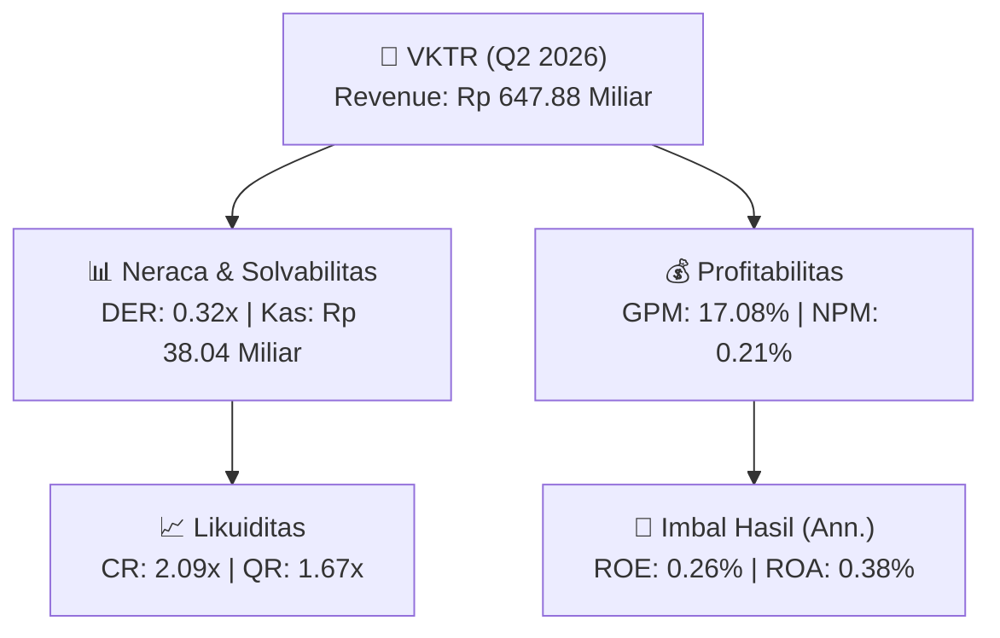
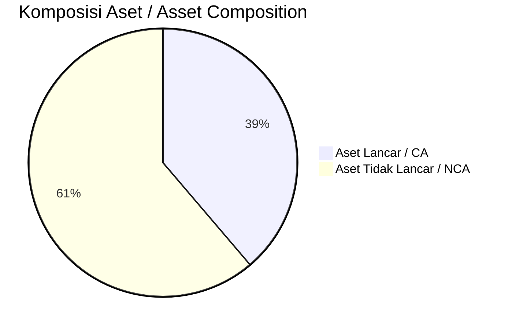
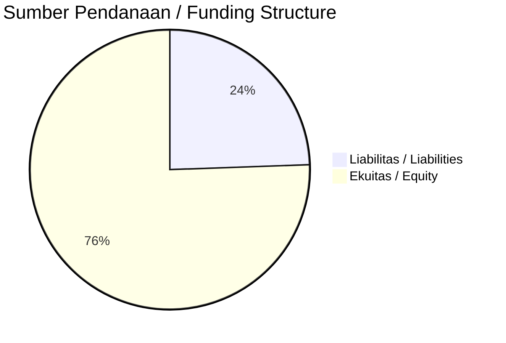

# 📈 Laporan Analisis Keuangan Mendalam: [[VKTR]] — Q2 2026

⬅️ [[knowledge-base/daily-digests/Daily_Digest_20261001|Kembali ke Daily Digest]] | 📅 **2026-10-01** | 🎛️ [[Dashboard|Ke Dashboard Utama]]

> [!IMPORTANT]
> Dokumen ini disusun oleh **Financial Summarizer Agent** untuk menganalisis kinerja keuangan, kesehatan neraca, profitabilitas, dan katalis sektor (Konsumer & Ritel) **PT VKTR Teknologi Mobilitas Tbk ([[VKTR]])** berdasarkan LK Q2 2026.

---

## 📌 1. Ikhtisar Kinerja Utama / Executive Performance Highlight
- **Emiten**: `[[VKTR]]` (PT VKTR Teknologi Mobilitas Tbk)
- **Sektor Usaha / Industry Sector**: `Konsumer & Ritel`
- **Periode Laporan / Reporting Period**: `Q2 2026`
- **Pendapatan Neto / Net Revenue**: `Rp 647.88 Miliar` (**+56.48% 🟢 YoY** dari Rp 414.04 Miliar)
- **Laba Bruto / Gross Profit**: `Rp 110.64 Miliar` (**+39.82% 🟢 YoY**)
- **Laba (Rugi) Bersih / Net Income**: `Rp 1.37 Miliar` (**-71.03% 🔴 YoY**)
- **Total Aset / Total Assets**: `Rp 704.44 Miliar` | **Total Ekuitas / Total Equity**: `Rp 1.04 Triliun`
- **EPS (Annualized)**: `0.01` | **BVPS**: `2.39`

---

## 📊 2. Laba Rugi Komparatif / Comparative Income Statement

| Pos Laba Rugi / Income Statement Item | Q2 2026 | Prior Period | YoY (%) |
| :--- | ---: | ---: | :---: |
| **Pendapatan Neto / Net Revenue** | `647.88B` | `414.04B` | **+56.48% 🟢** |
| **Beban Pokok / COGS** | `(537.24B)` | `(334.91B)` | +60.41% 🟢 |
| **Laba Bruto / Gross Profit** | `110.64B` | `79.13B` | **+39.82% 🟢** |
| **Beban Usaha / Operating Expenses** | `(89.66B)` | `(74.12B)` | +20.97% 🟢 |
| **Laba Operasional / EBIT** | `11.19B` | `4.33B` | +158.54% 🟢 |
| **Laba (Rugi) Bersih / Net Income** | **1.37B** | **4.73B** | **-71.03% 🔴** |

---

## 🏦 3. Neraca & Struktur Permodalan / Balance Sheet & Capital Structure

| Pos Neraca / Balance Sheet Item | Q2 2026 | Prior Year End | Δ YoY/YtD (%) | Catatan / Notes |
| :--- | ---: | ---: | :---: | :--- |
| **Aset Lancar / Current Assets** | `704.44B` | `727.54B` | -3.18% 🔴 | Kas: Rp 38.04 Miliar |
| **Aset Tidak Lancar / Non-Current Assets** | `1.11T` | `1.07T` | +3.91% 🟢 | Aset Tetap & Operasional |
| **TOTAL ASET / TOTAL ASSETS** | **704.44B** | **727.54B** | **-3.18% 🔴** | |
| **Liabilitas Jk. Pendek / Current Liabilities** | `337.41B` | `314.05B` | +7.44% 🟢 | |
| **Liabilitas Jk. Panjang / Non-Current Liabilities** | `223.21B` | `238.98B` | -6.60% 🔴 | |
| **TOTAL LIABILITAS / TOTAL LIABILITIES** | **337.41B** | **314.05B** | **+7.44% 🟢** | |
| **TOTAL EKUITAS / TOTAL EQUITY** | **1.04T** | **1.04T** | **+0.72% 🟢** | |

---

## 💸 4. Laporan Arus Kas / Cash Flow Statement

| Komponen Arus Kas / Cash Flow Component | Q2 2026 | Prior Period | Δ YoY (%) |
| :--- | ---: | ---: | :---: |
| **Arus Kas Operasi / CFO** | `138.16B` | `-16.38B` | +943.49% 🟢 |
| **Arus Kas Investasi / CFI** | `-101.50B` | `-80.28B` | -26.43% 🔴 |
| **Arus Kas Pendanaan / CFF** | `-50.44B` | `47.79B` | -205.55% 🔴 |
| **Kenaikan (Penurunan) Kas Bersih** | `-13.79B` | `-48.88B` | +71.80% 🟢 |
| Belanja Modal / Capex | `(49.65B)` | `(75.90B)` | -34.58% 🔴 |
| Pembayaran Dividen / Dividends Paid | `(-)` | `(-)` | - |
| **Free Cash Flow (CFO - Capex)** | **88.50B** | **-92.28B** | **+195.91% 🟢** |

---

## 📈 Analisis Rasio Keuangan / Financial Ratio Analysis

| Kategori / Category | Metrik / Metric | Nilai / Value | Benchmark | Interpretasi / Interpretation |
| :--- | :--- | :---: | :---: | :--- |
| **🛡️ Likuiditas** | **Current Ratio** | `2.09x` | `> 1.0x` | Kemampuan bayar kewajiban jk. pendek |
| | **Quick Ratio** | `1.67x` | `> 0.8x` | Likuiditas tanpa persediaan |
| **📊 Profitabilitas** | **Gross Profit Margin (GPM)** | `17.08%` | - | Margin kotor operasional inti |
| | **Operating Profit Margin (OPM)** | `1.73%` | - | Efisiensi operasional |
| | **Net Profit Margin (NPM)** | `0.21%` | - | Konversi revenue ke laba bersih |
| **🎯 Imbal Hasil (Ann.)** | **Return on Equity (ROE)** | `0.26%` | - | Imbal hasil terhadap ekuitas |
| | **Return on Assets (ROA)** | `0.38%` | - | Produktivitas aset |
| **⚖️ Solvabilitas** | **Debt to Equity (DER)** | `0.32x` | `< 2.0x` | Leverage utang vs modal |
| | **Debt to Asset (DAR)** | `0.48x` | `< 0.7x` | Porsi aset didanai utang |

---

## 📐 Per Share Metrics

| Metrik / Metric | Nilai / Value | Keterangan / Notes |
| :--- | ---: | :--- |
| **EPS (Annualized)** | `Rp 0.01` | Laba per saham (dianualisasi) |
| **BVPS** | `Rp 2.39` | Nilai buku per saham |

---

## 🚀 Analisis Strategis & Karakteristik Sektor / Strategic Analysis: Konsumer & Ritel

Pada periode Q2 2026, **PT VKTR Teknologi Mobilitas Tbk ([[VKTR]])** membukukan total pendapatan sebesar **Rp 647.88 Miliar** (+56.48% 🟢 YoY). Laba kotor tercatat **Rp 110.64 Miliar** dengan GPM **17.08%**. Laba bersih sebesar **Rp 1.37 Miliar** (-71.03% 🔴 YoY). Total aset **Rp 704.44 Miliar**, ekuitas **Rp 1.04 Triliun**, DER **0.32x**.

### 🔍 Indikator Kunci Sektor / Sector Key Indicators (Konsumer & Ritel)
- **Karakteristik Industri (Konsumer & Ritel)**: Kinerja mencerminkan dinamika penyerapan pasar, utilisasi kapasitas produksi, dan efisiensi biaya pokok.
- **Faktor Penggerak**: Pertumbuhan organik, efisiensi operasional, dan ekspansi pasar.

> [!NOTE]
> _Data Public Expose / Investor Presentation belum tersedia untuk emiten ini._

---

## 📋 Catatan Kunci Laporan Keuangan / Key Notes to Financial Statements

### 🔍 Opini Auditor / Auditor Opinion
- **Jenis Opini / Opinion Type**: `Wajar Tanpa Modifikasian / Unqualified`
- **KAP / Audit Firm**: `KAP Y. Santosa dan Rekan`
- **Partner Audit**: `Tjiendrajaja Yamin`
- **Tanggal Laporan / Report Date**: `2026-09-30`

### 📝 Perjanjian & Kontrak Signifikan / Key Contracts & Agreements
- Pada 28 Maret 2024, PT VKTR Sakti Industries (VSI), Entitas Anak, selaku Pembeli menandatangani Kontrak Penjualan dengan CHTC Kinwin (Nanjing) Automobile Co., Ltd (CHTC) sebagai Penjual untuk lima belas (15) unit prototype Electric Vehicles (EV).
- Pada 5 Agustus 2024, VSI dan BYD Auto Industry Co., Ltd mengadakan Perjanjian Lisensi Teknis Perakitan KD. VSI sebagai Penerima Lisensi dan BYD sebagai Pemberi Lisensi yang mengatur pemberian Hak Produksi dengan jangka waktu lima (5) tahun.

### 🤝 Transaksi Pihak Berelasi / Related Party Transactions
- Utang pihak berelasi per 30 Juni 2026 dan 31 Desember 2025: PT Bakrie Metal Industries sebesar 23.980 (4,28% dan 4,34%); PT Bakrie & Brothers Tbk sebesar 3.020 dan 5.020 (0,54% dan 0,91%); Total sebesar 27.000 dan 29.000 (4,82% dan 5,25%).

### ⚠️ Komitmen & Kontinjensi / Commitments & Contingencies
- Perjanjian dan ikatan signifikan: Kontrak Penjualan antara VSI dan CHTC Kinwin (Nanjing) Automobile Co., Ltd untuk lima belas (15) unit prototype Electric Vehicles (EV).
- Perjanjian dan ikatan signifikan: Perjanjian Lisensi Teknis Perakitan KD antara VSI dan BYD Auto Industry Co., Ltd dengan jangka waktu lima (5) tahun.

---

## 💡 Catatan Strategis & Panduan Investor / Strategic Notes & Investor Guide

1. **Kesehatan Permodalan / Capital Health**: DER **0.32x**, CR **2.09x** — _sehat dan aman_.
2. **Katalis Pertumbuhan / Growth Catalysts**: Pantau realisasi pendapatan dan efisiensi operasional periode berikutnya.

---

## 🔗 Hubungan Note Terkait / Knowledge Graph Links
- [[knowledge-base/daily-digests/Daily_Digest_20261001|📄 Daily Digest 2026-10-01]]
- [[knowledge-base/trading-signals/Trading_Signals_20261001|🎯 Trading Signals]]
- [[Dashboard|🎛️ Kembali ke Dashboard Utama]]