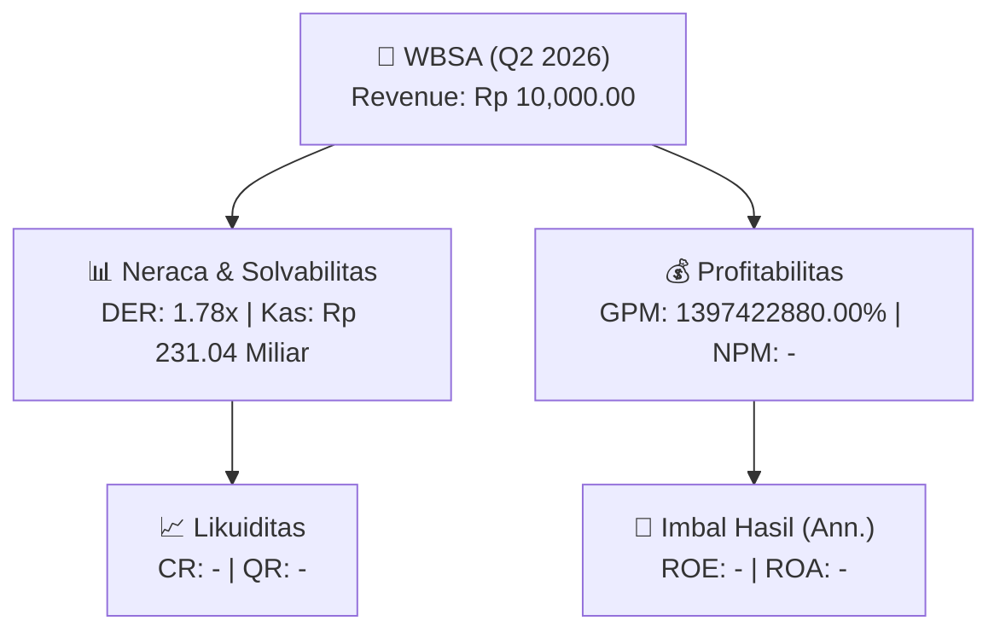
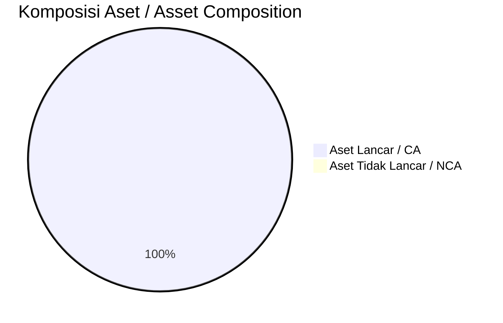
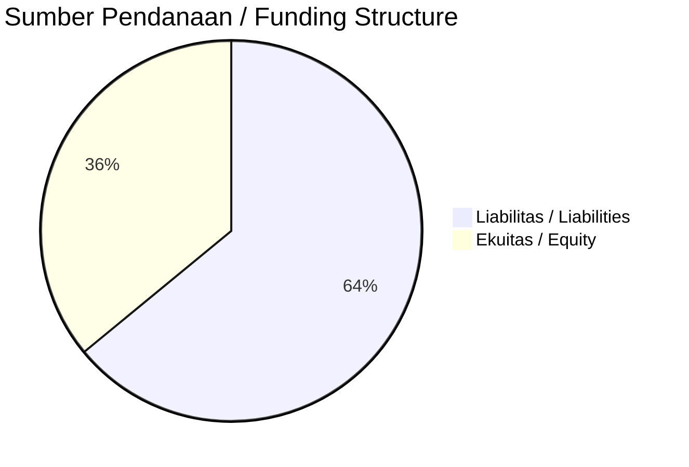

# 📈 Laporan Analisis Keuangan Mendalam: [[WBSA]] — Q2 2026

⬅️ [[knowledge-base/daily-digests/Daily_Digest_20260925|Kembali ke Daily Digest]] | 📅 **2026-09-25** | 🎛️ [[Dashboard|Ke Dashboard Utama]]

> [!IMPORTANT]
> Dokumen ini disusun oleh **Financial Summarizer Agent** untuk menganalisis kinerja keuangan, kesehatan neraca, profitabilitas, dan katalis sektor (General) **PT BSA Logistics Indonesia Tbk yang tidak memerlukan tanda tangan karena dihasilkan secara
elektronik. PT BSA Logistics Indonesia Tbk ([[WBSA]])** berdasarkan LK Q2 2026.

---

## 📌 1. Ikhtisar Kinerja Utama / Executive Performance Highlight
- **Emiten**: `[[WBSA]]` (PT BSA Logistics Indonesia Tbk yang tidak memerlukan tanda tangan karena dihasilkan secara
elektronik. PT BSA Logistics Indonesia Tbk)
- **Sektor Usaha / Industry Sector**: `General`
- **Periode Laporan / Reporting Period**: `Q2 2026`
- **Pendapatan Neto / Net Revenue**: `Rp 10,000.00` (**- YoY** dari -)
- **Laba Bruto / Gross Profit**: `Rp 139.74 Miliar` (**-20.75% 🔴 YoY**)
- **Laba (Rugi) Bersih / Net Income**: `-` (**- YoY**)
- **Total Aset / Total Assets**: `Rp 954.35 Miliar` | **Total Ekuitas / Total Equity**: `Rp 617.85 Miliar`
- **EPS (Annualized)**: `-` | **BVPS**: `-`

---

## 📊 2. Laba Rugi Komparatif / Comparative Income Statement

| Pos Laba Rugi / Income Statement Item | Q2 2026 | Prior Period | YoY (%) |
| :--- | ---: | ---: | :---: |
| **Pendapatan Neto / Net Revenue** | `10.00K` | `-` | **-** |
| **Beban Pokok / COGS** | `(1.81T)` | `(1.19T)` | +52.03% 🟢 |
| **Laba Bruto / Gross Profit** | `139.74B` | `176.32B` | **-20.75% 🔴** |
| **Beban Usaha / Operating Expenses** | `(-)` | `(-)` | - |
| **Laba Operasional / EBIT** | `-` | `-` | - |
| **Laba (Rugi) Bersih / Net Income** | **-** | **-** | **-** |

---

## 🏦 3. Neraca & Struktur Permodalan / Balance Sheet & Capital Structure

| Pos Neraca / Balance Sheet Item | Q2 2026 | Prior Year End | Δ YoY/YtD (%) | Catatan / Notes |
| :--- | ---: | ---: | :---: | :--- |
| **Aset Lancar / Current Assets** | `954.35B` | `775.68B` | +23.03% 🟢 | Kas: Rp 231.04 Miliar |
| **Aset Tidak Lancar / Non-Current Assets** | `-` | `-` | - | Aset Tetap & Operasional |
| **TOTAL ASET / TOTAL ASSETS** | **954.35B** | **775.68B** | **+23.03% 🟢** | |
| **Liabilitas Jk. Pendek / Current Liabilities** | `-` | `-` | - | |
| **Liabilitas Jk. Panjang / Non-Current Liabilities** | `-` | `-` | - | |
| **TOTAL LIABILITAS / TOTAL LIABILITIES** | **1.10T** | **1.06T** | **+3.43% 🟢** | |
| **TOTAL EKUITAS / TOTAL EQUITY** | **617.85B** | **538.68B** | **+14.70% 🟢** | |

---

## 💸 4. Laporan Arus Kas / Cash Flow Statement

| Komponen Arus Kas / Cash Flow Component | Q2 2026 | Prior Period | Δ YoY (%) |
| :--- | ---: | ---: | :---: |
| **Arus Kas Operasi / CFO** | `-` | `-` | - |
| **Arus Kas Investasi / CFI** | `-` | `-` | - |
| **Arus Kas Pendanaan / CFF** | `-` | `-` | - |
| **Kenaikan (Penurunan) Kas Bersih** | `-` | `-` | - |
| Belanja Modal / Capex | `(-)` | `(-)` | - |
| Pembayaran Dividen / Dividends Paid | `(-)` | `(-)` | - |
| **Free Cash Flow (CFO - Capex)** | **-** | **-** | **-** |

---

## 📈 Analisis Rasio Keuangan / Financial Ratio Analysis

| Kategori / Category | Metrik / Metric | Nilai / Value | Benchmark | Interpretasi / Interpretation |
| :--- | :--- | :---: | :---: | :--- |
| **🛡️ Likuiditas** | **Current Ratio** | `-` | `> 1.0x` | Kemampuan bayar kewajiban jk. pendek |
| | **Quick Ratio** | `-` | `> 0.8x` | Likuiditas tanpa persediaan |
| **📊 Profitabilitas** | **Gross Profit Margin (GPM)** | `1397422880.00%` | - | Margin kotor operasional inti |
| | **Operating Profit Margin (OPM)** | `-` | - | Efisiensi operasional |
| | **Net Profit Margin (NPM)** | `-` | - | Konversi revenue ke laba bersih |
| **🎯 Imbal Hasil (Ann.)** | **Return on Equity (ROE)** | `-` | - | Imbal hasil terhadap ekuitas |
| | **Return on Assets (ROA)** | `-` | - | Produktivitas aset |
| **⚖️ Solvabilitas** | **Debt to Equity (DER)** | `1.78x` | `< 2.0x` | Leverage utang vs modal |
| | **Debt to Asset (DAR)** | `1.15x` | `< 0.7x` | Porsi aset didanai utang |

---

## 📐 Per Share Metrics

| Metrik / Metric | Nilai / Value | Keterangan / Notes |
| :--- | ---: | :--- |
| **EPS (Annualized)** | `-` | Laba per saham (dianualisasi) |
| **BVPS** | `-` | Nilai buku per saham |

---

## 🚀 Analisis Strategis & Karakteristik Sektor / Strategic Analysis: General

Pada periode Q2 2026, **PT BSA Logistics Indonesia Tbk yang tidak memerlukan tanda tangan karena dihasilkan secara
elektronik. PT BSA Logistics Indonesia Tbk ([[WBSA]])** membukukan total pendapatan sebesar **Rp 10,000.00** (- YoY). Laba kotor tercatat **Rp 139.74 Miliar** dengan GPM **1397422880.00%**. Laba bersih sebesar **-** (- YoY). Total aset **Rp 954.35 Miliar**, ekuitas **Rp 617.85 Miliar**, DER **1.78x**.

### 🔍 Indikator Kunci Sektor / Sector Key Indicators (General)
- **Karakteristik Industri (General)**: Kinerja mencerminkan dinamika penyerapan pasar, utilisasi kapasitas produksi, dan efisiensi biaya pokok.
- **Faktor Penggerak**: Pertumbuhan organik, efisiensi operasional, dan ekspansi pasar.

> [!NOTE]
> _Data Public Expose / Investor Presentation belum tersedia untuk emiten ini._

---

## 📋 Catatan Kunci Laporan Keuangan / Key Notes to Financial Statements

### 🔍 Opini Auditor / Auditor Opinion
- _Informasi opini auditor tidak tersedia._

### 📝 Perjanjian & Kontrak Signifikan / Key Contracts & Agreements
- Pada tanggal 9 Oktober 2024, Perusahaan menandatangani Perjanjian Induk Leasing iB berdasarkan Prinsip Ijarah Muntahiyah Bi Tamlik (IMBT) dan Sale and Lease Back dengan Bank Maybank. Berdasarkan perjanjian ini, Bank Maybank setuju memberikan fasilitas pinjaman Pembiayaan Berjangka (PB)-IMBT untuk pembelian 25 unit truk Quester dan trailernya untuk proyek road train pengangkutan barang dari mills ke gudang.

### 🤝 Transaksi Pihak Berelasi / Related Party Transactions
- Dalam kegiatan usaha normal, Grup melakukan transaksi usaha dan keuangan dengan pihak-pihak berelasi tertentu. Transaksi dilakukan berdasarkan persyaratan dan ketentuan yang disepakati bersama dengan pihak berelasi yang sama dengan pihak ketiga. Saldo akun signifikan dengan pihak berelasi diungkapkan pada Catatan 22.

---

## 💡 Catatan Strategis & Panduan Investor / Strategic Notes & Investor Guide

1. **Kesehatan Permodalan / Capital Health**: DER **1.78x**, CR **-** — _perlu dipantau secara disiplin_.
2. **Katalis Pertumbuhan / Growth Catalysts**: Pantau realisasi pendapatan dan efisiensi operasional periode berikutnya.

---

## 🔗 Hubungan Note Terkait / Knowledge Graph Links
- [[knowledge-base/daily-digests/Daily_Digest_20260925|📄 Daily Digest 2026-09-25]]
- [[knowledge-base/trading-signals/Trading_Signals_20260925|🎯 Trading Signals]]
- [[Dashboard|🎛️ Kembali ke Dashboard Utama]]

---
> [!WARNING] **Data Sumber: PDF (LLM-Extracted)**
> Laporan ini dibuat dari ekstraksi PDF via LLM karena tidak tersedia XBRL workbook (.xlsx) dari IDX.
> Angka-angka yang ditampilkan mungkin kurang presisi dibanding laporan berbasis XBRL.
> Verifikasi manual disarankan sebelum digunakan sebagai dasar keputusan investasi.
