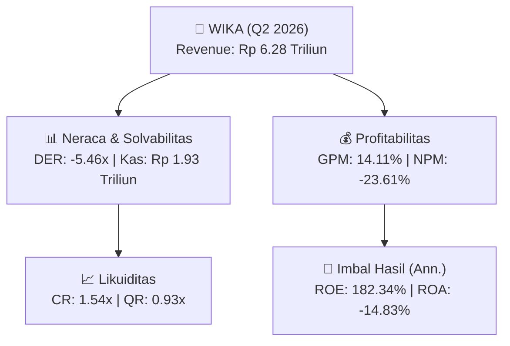
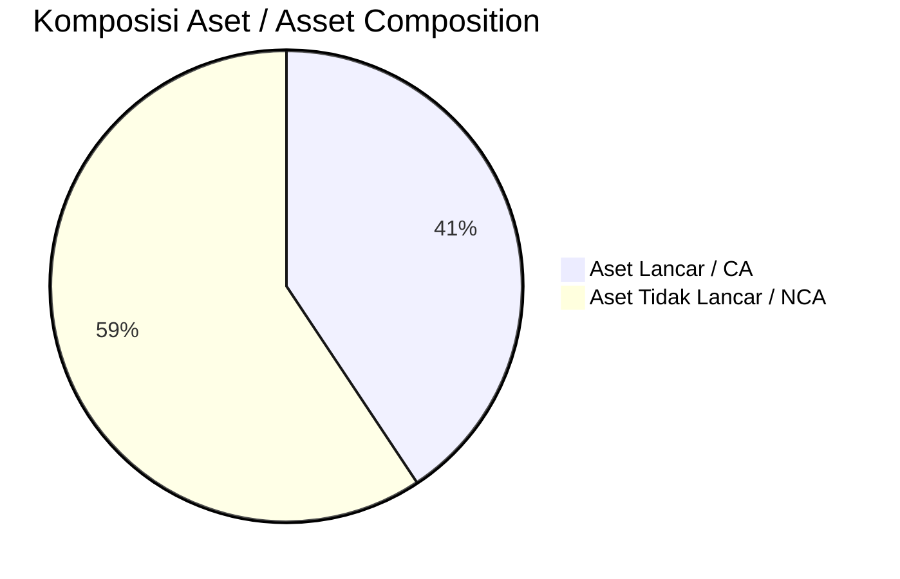
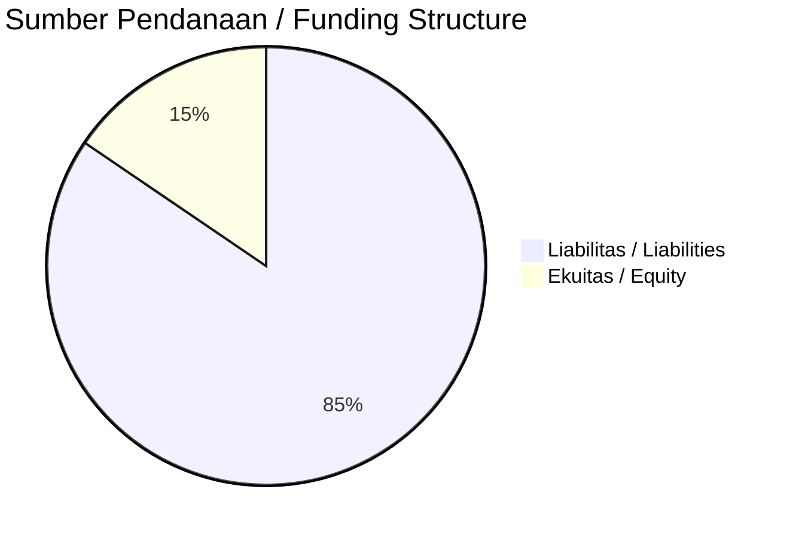

# 📈 Laporan Analisis Keuangan Mendalam: [[WIKA]] — Q2 2026

⬅️ [[knowledge-base/daily-digests/Daily_Digest_20260901|Kembali ke Daily Digest]] | 📅 **2026-09-01** | 🎛️ [[Dashboard|Ke Dashboard Utama]]

> [!IMPORTANT]
> Dokumen ini disusun oleh **Financial Summarizer Agent** untuk menganalisis kinerja keuangan, kesehatan neraca, profitabilitas, dan katalis sektor (Properti & Konstruksi) **PT Wijaya Karya (Persero) Tbk ([[WIKA]])** berdasarkan LK Q2 2026.

---

## 📌 1. Ikhtisar Kinerja Utama / Executive Performance Highlight
- **Emiten**: `[[WIKA]]` (PT Wijaya Karya (Persero) Tbk)
- **Sektor Usaha / Industry Sector**: `Properti & Konstruksi`
- **Periode Laporan / Reporting Period**: `Q2 2026`
- **Pendapatan Neto / Net Revenue**: `Rp 6.28 Triliun` (**+7.19% 🟢 YoY** dari Rp 5.86 Triliun)
- **Laba Bruto / Gross Profit**: `Rp 886.33 Miliar` (**+87.56% 🟢 YoY**)
- **Laba (Rugi) Bersih / Net Income**: `Rp -1.48 Triliun` (**+10.88% 🟢 YoY**)
- **Total Aset / Total Assets**: `Rp 19.90 Triliun` | **Total Ekuitas / Total Equity**: `Rp -2.37 Triliun`
- **EPS (Annualized)**: `-0.74` | **BVPS**: `-0.59`

---

## 📊 2. Laba Rugi Komparatif / Comparative Income Statement

| Pos Laba Rugi / Income Statement Item | Q2 2026 | Prior Period | YoY (%) |
| :--- | ---: | ---: | :---: |
| **Pendapatan Neto / Net Revenue** | `6.28T` | `5.86T` | **+7.19% 🟢** |
| **Beban Pokok / COGS** | `(5.39T)` | `(5.39T)` | +0.14% 🟢 |
| **Laba Bruto / Gross Profit** | `886.33B` | `472.56B` | **+87.56% 🟢** |
| **Beban Usaha / Operating Expenses** | `(573.48B)` | `(509.32B)` | +12.60% 🟢 |
| **Laba Operasional / EBIT** | `-1.55T` | `-1.69T` | +8.66% 🟢 |
| **Laba (Rugi) Bersih / Net Income** | **-1.48T** | **-1.66T** | **+10.88% 🟢** |

---

## 🏦 3. Neraca & Struktur Permodalan / Balance Sheet & Capital Structure

| Pos Neraca / Balance Sheet Item | Q2 2026 | Prior Year End | Δ YoY/YtD (%) | Catatan / Notes |
| :--- | ---: | ---: | :---: | :--- |
| **Aset Lancar / Current Assets** | `19.90T` | `20.07T` | -0.81% 🔴 | Kas: Rp 1.93 Triliun |
| **Aset Tidak Lancar / Non-Current Assets** | `29.04T` | `30.08T` | -3.45% 🔴 | Aset Tetap & Operasional |
| **TOTAL ASET / TOTAL ASSETS** | **19.90T** | **20.07T** | **-0.81% 🔴** | |
| **Liabilitas Jk. Pendek / Current Liabilities** | `12.92T` | `15.51T` | -16.73% 🔴 | |
| **Liabilitas Jk. Panjang / Non-Current Liabilities** | `35.90T` | `32.95T` | +8.95% 🟢 | |
| **TOTAL LIABILITAS / TOTAL LIABILITIES** | **12.92T** | **15.51T** | **-16.73% 🔴** | |
| **TOTAL EKUITAS / TOTAL EQUITY** | **-2.37T** | **-884.71B** | **-167.54% 🔴** | |

---

## 💸 4. Laporan Arus Kas / Cash Flow Statement

| Komponen Arus Kas / Cash Flow Component | Q2 2026 | Prior Period | Δ YoY (%) |
| :--- | ---: | ---: | :---: |
| **Arus Kas Operasi / CFO** | `-533.39B` | `-1.05T` | +49.41% 🟢 |
| **Arus Kas Investasi / CFI** | `862.76B` | `1.52T` | -43.24% 🔴 |
| **Arus Kas Pendanaan / CFF** | `-1.15T` | `-2.20T` | +47.57% 🟢 |
| **Kenaikan (Penurunan) Kas Bersih** | `-825.53B` | `-1.74T` | +52.47% 🟢 |
| Belanja Modal / Capex | `(3.83B)` | `(5.83B)` | -34.42% 🔴 |
| Pembayaran Dividen / Dividends Paid | `(-)` | `(-)` | - |
| **Free Cash Flow (CFO - Capex)** | **-537.21B** | **-1.06T** | **+49.33% 🟢** |

---

## 📈 Analisis Rasio Keuangan / Financial Ratio Analysis

| Kategori / Category | Metrik / Metric | Nilai / Value | Benchmark | Interpretasi / Interpretation |
| :--- | :--- | :---: | :---: | :--- |
| **🛡️ Likuiditas** | **Current Ratio** | `1.54x` | `> 1.0x` | Kemampuan bayar kewajiban jk. pendek |
| | **Quick Ratio** | `0.93x` | `> 0.8x` | Likuiditas tanpa persediaan |
| **📊 Profitabilitas** | **Gross Profit Margin (GPM)** | `14.11%` | - | Margin kotor operasional inti |
| | **Operating Profit Margin (OPM)** | `-24.64%` | - | Efisiensi operasional |
| | **Net Profit Margin (NPM)** | `-23.61%` | - | Konversi revenue ke laba bersih |
| **🎯 Imbal Hasil (Ann.)** | **Return on Equity (ROE)** | `182.34%` | - | Imbal hasil terhadap ekuitas |
| | **Return on Assets (ROA)** | `-14.83%` | - | Produktivitas aset |
| **⚖️ Solvabilitas** | **Debt to Equity (DER)** | `-5.46x` | `< 2.0x` | Leverage utang vs modal |
| | **Debt to Asset (DAR)** | `0.65x` | `< 0.7x` | Porsi aset didanai utang |

---

## 📐 Per Share Metrics

| Metrik / Metric | Nilai / Value | Keterangan / Notes |
| :--- | ---: | :--- |
| **EPS (Annualized)** | `Rp -0.74` | Laba per saham (dianualisasi) |
| **BVPS** | `Rp -0.59` | Nilai buku per saham |

---

## 🚀 Analisis Strategis & Karakteristik Sektor / Strategic Analysis: Properti & Konstruksi

Pada periode Q2 2026, **PT Wijaya Karya (Persero) Tbk ([[WIKA]])** membukukan total pendapatan sebesar **Rp 6.28 Triliun** (+7.19% 🟢 YoY). Laba kotor tercatat **Rp 886.33 Miliar** dengan GPM **14.11%**. Laba bersih sebesar **Rp -1.48 Triliun** (+10.88% 🟢 YoY). Total aset **Rp 19.90 Triliun**, ekuitas **Rp -2.37 Triliun**, DER **-5.46x**.

### 🔍 Indikator Kunci Sektor / Sector Key Indicators (Properti & Konstruksi)
- **Karakteristik Konstruksi & Properti**: Pertumbuhan bertumpu pada perolehan kontrak baru (Order Book) dan percepatan progres fisik proyek.
- **Modal Kerja**: Restrukturisasi liabilitas dan pengelolaan arus kas proyek.
- **Katalis**: Presales/marketing sales, groundbreaking proyek baru, dan penyerahan unit.

> [!NOTE]
> _Data Public Expose / Investor Presentation belum tersedia untuk emiten ini._

---

## 📋 Catatan Kunci Laporan Keuangan / Key Notes to Financial Statements

### 🔍 Opini Auditor / Auditor Opinion
- **Jenis Opini / Opinion Type**: `Wajar Tanpa Modifikasian / Unqualified`
- **KAP / Audit Firm**: `KAP Slamet Riyanto, Aryanto  Rekan`
- **Partner Audit**: `SLAMET RIYANTO`
- **Tanggal Laporan / Report Date**: `2026-08-27`
- **Kesimpulan**: _Wajar Tanpa Modifikasian_

---

## 💡 Catatan Strategis & Panduan Investor / Strategic Notes & Investor Guide

1. **Kesehatan Permodalan / Capital Health**: DER **-5.46x**, CR **1.54x** — _sehat dan aman_.
2. **Katalis Pertumbuhan / Growth Catalysts**: Pantau realisasi pendapatan dan efisiensi operasional periode berikutnya.

---

## 🔗 Hubungan Note Terkait / Knowledge Graph Links
- [[knowledge-base/daily-digests/Daily_Digest_20260901|📄 Daily Digest 2026-09-01]]
- [[knowledge-base/trading-signals/Trading_Signals_20260901|🎯 Trading Signals]]
- [[Dashboard|🎛️ Kembali ke Dashboard Utama]]