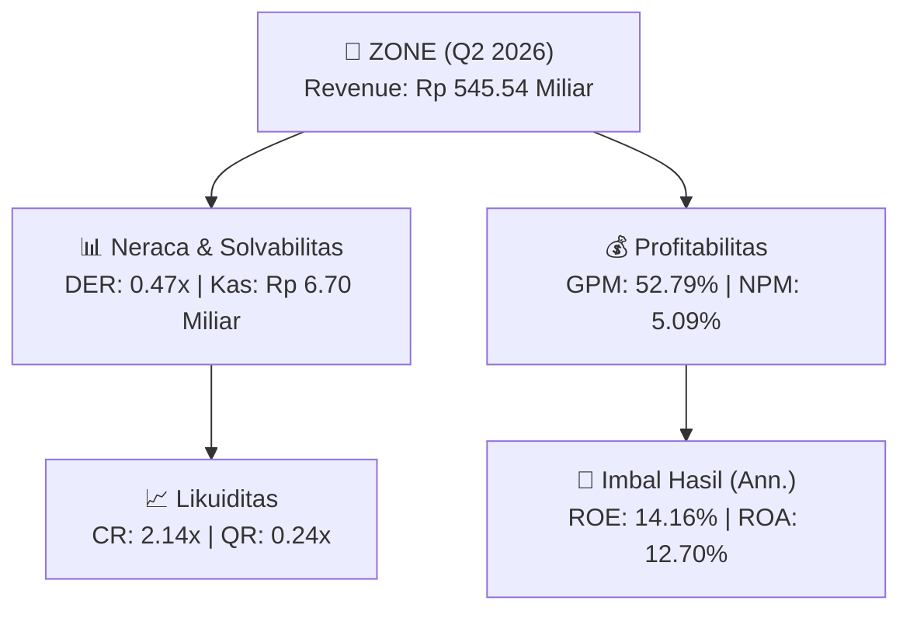
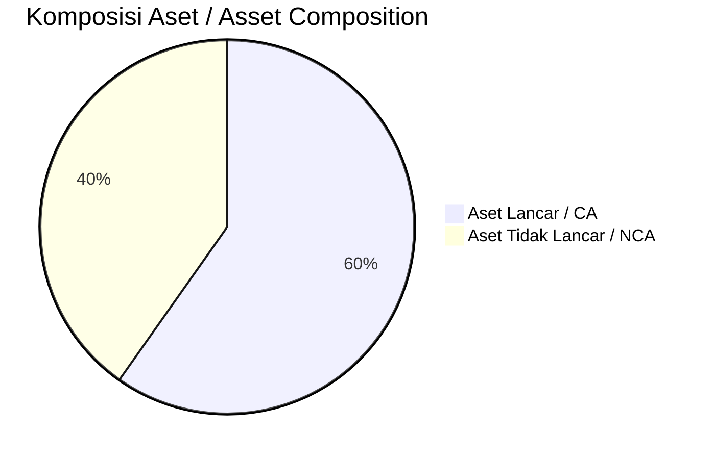
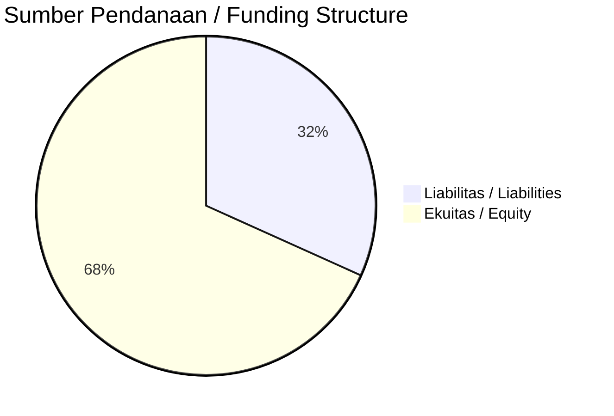

# 📈 Laporan Analisis Keuangan Mendalam: [[ZONE]] — Q2 2026

⬅️ [[knowledge-base/daily-digests/Daily_Digest_20260925|Kembali ke Daily Digest]] | 📅 **2026-09-25** | 🎛️ [[Dashboard|Ke Dashboard Utama]]

> [!IMPORTANT]
> Dokumen ini disusun oleh **Financial Summarizer Agent** untuk menganalisis kinerja keuangan, kesehatan neraca, profitabilitas, dan katalis sektor (Konsumer & Ritel) **PT Mega Perintis Tbk. ([[ZONE]])** berdasarkan LK Q2 2026.

---

## 📌 1. Ikhtisar Kinerja Utama / Executive Performance Highlight
- **Emiten**: `[[ZONE]]` (PT Mega Perintis Tbk.)
- **Sektor Usaha / Industry Sector**: `Konsumer & Ritel`
- **Periode Laporan / Reporting Period**: `Q2 2026`
- **Pendapatan Neto / Net Revenue**: `Rp 545.54 Miliar` (**+35.32% 🟢 YoY** dari Rp 403.14 Miliar)
- **Laba Bruto / Gross Profit**: `Rp 288.01 Miliar` (**+48.09% 🟢 YoY**)
- **Laba (Rugi) Bersih / Net Income**: `Rp 27.78 Miliar` (**+138.33% 🟢 YoY**)
- **Total Aset / Total Assets**: `Rp 400.42 Miliar` | **Total Ekuitas / Total Equity**: `Rp 401.04 Miliar`
- **EPS (Annualized)**: `0.64` | **BVPS**: `4.61`

---

## 📊 2. Laba Rugi Komparatif / Comparative Income Statement

| Pos Laba Rugi / Income Statement Item | Q2 2026 | Prior Period | YoY (%) |
| :--- | ---: | ---: | :---: |
| **Pendapatan Neto / Net Revenue** | `545.54B` | `403.14B` | **+35.32% 🟢** |
| **Beban Pokok / COGS** | `(257.52B)` | `(208.65B)` | +23.42% 🟢 |
| **Laba Bruto / Gross Profit** | `288.01B` | `194.49B` | **+48.09% 🟢** |
| **Beban Usaha / Operating Expenses** | `(19.13B)` | `(18.57B)` | +3.01% 🟢 |
| **Laba Operasional / EBIT** | `36.83B` | `15.28B` | +141.11% 🟢 |
| **Laba (Rugi) Bersih / Net Income** | **27.78B** | **11.66B** | **+138.33% 🟢** |

---

## 🏦 3. Neraca & Struktur Permodalan / Balance Sheet & Capital Structure

| Pos Neraca / Balance Sheet Item | Q2 2026 | Prior Year End | Δ YoY/YtD (%) | Catatan / Notes |
| :--- | ---: | ---: | :---: | :--- |
| **Aset Lancar / Current Assets** | `400.42B` | `474.61B` | -15.63% 🔴 | Kas: Rp 6.70 Miliar |
| **Aset Tidak Lancar / Non-Current Assets** | `269.67B` | `286.60B` | -5.91% 🔴 | Aset Tetap & Operasional |
| **TOTAL ASET / TOTAL ASSETS** | **400.42B** | **474.61B** | **-15.63% 🔴** | |
| **Liabilitas Jk. Pendek / Current Liabilities** | `186.76B` | `288.22B` | -35.20% 🔴 | |
| **Liabilitas Jk. Panjang / Non-Current Liabilities** | `81.51B` | `88.60B` | -8.00% 🔴 | |
| **TOTAL LIABILITAS / TOTAL LIABILITIES** | **186.76B** | **288.22B** | **-35.20% 🔴** | |
| **TOTAL EKUITAS / TOTAL EQUITY** | **401.04B** | **383.63B** | **+4.54% 🟢** | |

---

## 💸 4. Laporan Arus Kas / Cash Flow Statement

| Komponen Arus Kas / Cash Flow Component | Q2 2026 | Prior Period | Δ YoY (%) |
| :--- | ---: | ---: | :---: |
| **Arus Kas Operasi / CFO** | `114.38B` | `53.63B` | +113.28% 🟢 |
| **Arus Kas Investasi / CFI** | `-6.41B` | `-3.41B` | -87.84% 🔴 |
| **Arus Kas Pendanaan / CFF** | `-106.02B` | `-54.23B` | -95.52% 🔴 |
| **Kenaikan (Penurunan) Kas Bersih** | `1.95B` | `-4.01B` | +148.58% 🟢 |
| Belanja Modal / Capex | `(6.41B)` | `(3.41B)` | +87.84% 🟢 |
| Pembayaran Dividen / Dividends Paid | `(10.44B)` | `(-)` | - |
| **Free Cash Flow (CFO - Capex)** | **107.97B** | **50.22B** | **+115.00% 🟢** |

---

## 📈 Analisis Rasio Keuangan / Financial Ratio Analysis

| Kategori / Category | Metrik / Metric | Nilai / Value | Benchmark | Interpretasi / Interpretation |
| :--- | :--- | :---: | :---: | :--- |
| **🛡️ Likuiditas** | **Current Ratio** | `2.14x` | `> 1.0x` | Kemampuan bayar kewajiban jk. pendek |
| | **Quick Ratio** | `0.24x` | `> 0.8x` | Likuiditas tanpa persediaan |
| **📊 Profitabilitas** | **Gross Profit Margin (GPM)** | `52.79%` | - | Margin kotor operasional inti |
| | **Operating Profit Margin (OPM)** | `6.75%` | - | Efisiensi operasional |
| | **Net Profit Margin (NPM)** | `5.09%` | - | Konversi revenue ke laba bersih |
| **🎯 Imbal Hasil (Ann.)** | **Return on Equity (ROE)** | `14.16%` | - | Imbal hasil terhadap ekuitas |
| | **Return on Assets (ROA)** | `12.70%` | - | Produktivitas aset |
| **⚖️ Solvabilitas** | **Debt to Equity (DER)** | `0.47x` | `< 2.0x` | Leverage utang vs modal |
| | **Debt to Asset (DAR)** | `0.47x` | `< 0.7x` | Porsi aset didanai utang |

---

## 📐 Per Share Metrics

| Metrik / Metric | Nilai / Value | Keterangan / Notes |
| :--- | ---: | :--- |
| **EPS (Annualized)** | `Rp 0.64` | Laba per saham (dianualisasi) |
| **BVPS** | `Rp 4.61` | Nilai buku per saham |

---

## 🚀 Analisis Strategis & Karakteristik Sektor / Strategic Analysis: Konsumer & Ritel

Pada periode Q2 2026, **PT Mega Perintis Tbk. ([[ZONE]])** membukukan total pendapatan sebesar **Rp 545.54 Miliar** (+35.32% 🟢 YoY). Laba kotor tercatat **Rp 288.01 Miliar** dengan GPM **52.79%**. Laba bersih sebesar **Rp 27.78 Miliar** (+138.33% 🟢 YoY). Total aset **Rp 400.42 Miliar**, ekuitas **Rp 401.04 Miliar**, DER **0.47x**.

### 🔍 Indikator Kunci Sektor / Sector Key Indicators (Konsumer & Ritel)
- **Karakteristik Industri (Konsumer & Ritel)**: Kinerja mencerminkan dinamika penyerapan pasar, utilisasi kapasitas produksi, dan efisiensi biaya pokok.
- **Faktor Penggerak**: Pertumbuhan organik, efisiensi operasional, dan ekspansi pasar.

> [!NOTE]
> _Data Public Expose / Investor Presentation belum tersedia untuk emiten ini._

---

## 📋 Catatan Kunci Laporan Keuangan / Key Notes to Financial Statements

### 🔍 Opini Auditor / Auditor Opinion
- _Informasi opini auditor tidak tersedia._

---

## 💡 Catatan Strategis & Panduan Investor / Strategic Notes & Investor Guide

1. **Kesehatan Permodalan / Capital Health**: DER **0.47x**, CR **2.14x** — _sehat dan aman_.
2. **Katalis Pertumbuhan / Growth Catalysts**: Pantau realisasi pendapatan dan efisiensi operasional periode berikutnya.

---

## 🔗 Hubungan Note Terkait / Knowledge Graph Links
- [[knowledge-base/daily-digests/Daily_Digest_20260925|📄 Daily Digest 2026-09-25]]
- [[knowledge-base/trading-signals/Trading_Signals_20260925|🎯 Trading Signals]]
- [[Dashboard|🎛️ Kembali ke Dashboard Utama]]